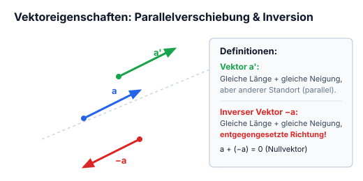
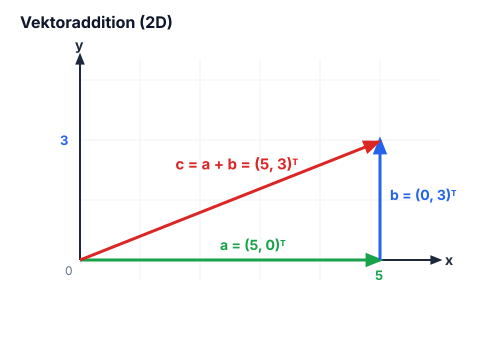
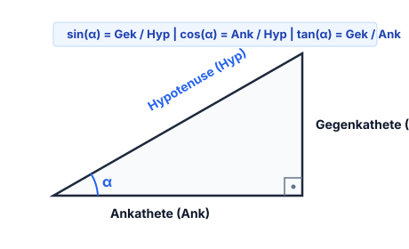
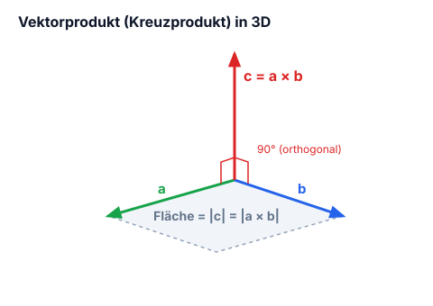
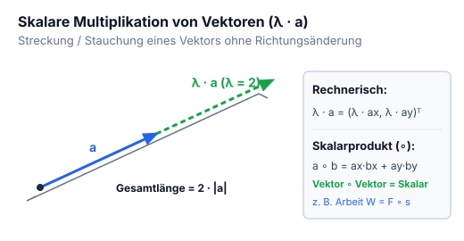

# Kapitel 1: Mathematische Grundlagen & Vektorrechnung

!!! abstract "Überblick"
    Vektoralgebra, Betrag, Skalarprodukt, Kreuzprodukt und trigonometrische Grundlagen.

## 1.1 Vektoren, Ortsvektoren & Betrag

- **Vektor** = Richtung + Betrag, z. B. Geschwindigkeit
- **Skalar** = Betrag, z. B. Masse

---

### Eigenschaften und Varianten von Vektoren

*Abbildung: 2D-Koordinatensystem mit Achsen $x$ und $y$, Vektor $\vec{a}$ startet im Ursprung $(0,0)$.*

- $\vec{a}'$ = gleich lang + gleiche Neigung, aber anderer Standort als $\vec{a}$
- $-\vec{a}$ = gleich lang + gleiche Neigung, aber die entgegengesetzte Richtung

*Abbildung: Drei Vektoren auf einer Referenzlinie: $\vec{a}$ nach rechts oben, $-\vec{a}$ parallel nach links unten, $\vec{a}'$ parallel verschoben nach rechts oben.*

---

### Vektoraddition, Subtraktion

Vektoren: $\vec{a}$ *(grün)*, $\vec{b}$ *(blau)*, $\vec{c}$ *(rot)*

$$\begin{pmatrix} 5 \\ 0 \end{pmatrix} + \begin{pmatrix} 0 \\ 3 \end{pmatrix} = \begin{pmatrix} 5 \\ 3 \end{pmatrix}$$

$$\begin{pmatrix} \vec{a}_x \\ \vec{a}_y \end{pmatrix} + \begin{pmatrix} \vec{b}_x \\ \vec{b}_y \end{pmatrix}$$

*Abbildung: 2D-Koordinatensystem mit $x$-Achse bis 5 und $y$-Achse bis 3:*
- *$\vec{a}$: grüner Vektor entlang der $x$-Achse von $(0,0)$ bis $(5,0)$*
- *$\vec{b}$: blauer Vektor vertikal von $(5,0)$ bis $(5,3)$*
- *$\vec{c} = \vec{a} + \vec{b}$: roter Summenvektor von $(0,0)$ bis $(5,3)$*

---

### Betrag eines Vektors

**Betrag** $= |\vec{a}|$ wird aus $\vec{a}_x$ und $\vec{a}_y$ berechnet:

$$\sqrt{\vec{a}_x^2 + \vec{a}_y^2} = |\vec{a}|$$

**z. B.:** 
$$\vec{a} = \begin{pmatrix} 5 \\ 3 \end{pmatrix} \implies \sqrt{5^2 + 3^2} = \sqrt{34} \approx 5{,}83$$

---

### Einheitsvektor

- $\vec{e} = \text{Einheitsvektor (hat immer Länge 1)}$
- $\vec{e}_a = \text{Vektorrichtung}$

$$\boxed{\vec{e}_a = \frac{\vec{a}}{|\vec{a}|}}$$

$\frac{\vec{a}}{|\vec{a}|} =$ Länge des Einheitsvektors mit der Richtung

**z. B.:**
$$\vec{a} = \begin{pmatrix} 3 \\ 5 \end{pmatrix}, \quad |\vec{a}| = \sqrt{3^2 + 5^2} = 5{,}83$$

$$3 : 5{,}83 = \vec{e}_x \approx 0{,}52 \quad \Bigg\} = \text{aufgeteilte Länge}$$
$$5 : 5{,}83 = \vec{e}_y \approx 0{,}86$$

---

### Trigonometrie am rechtwinkligen Dreieck

*Abbildung: eines rechtwinkligen Dreiecks mit Hypotenuse, Gegenkathete, Ankathete und Winkel $\alpha$ unten rechts:*

$$\frac{\text{Gek}}{\text{Hyp}} = \sin(\alpha) \quad (\text{Sinus})$$

$$\frac{\text{Ank}}{\text{Hyp}} = \cos(\alpha) \quad (\text{Cosinus})$$

$$\frac{\text{Gek}}{\text{Ank}} = \tan(\alpha) \quad (\text{tangenz})$$

---

---

## 1.2 Vektorprodukt (Kreuzprodukt)

*Abbildung: 3D-Darstellung der Vektoren $\vec{a}$, $\vec{b}$ und $\vec{c}$:*
- *$\vec{a}$ und $\vec{b}$ spannen in einer Ebene ein Parallelogramm auf (Flächeninhalt $= |\vec{c}|$*

- *$\vec{c}$ steht senkrecht auf der durch $\vec{a}$ und $\vec{b}$ aufgespannten Ebene)*

> **Beschriftungen:**
> - *„3D dargestellt!“*
> - *„Ortogonal = Rechtwinklig“*

---

### Berechnungsvorschrift

$$\vec{a} \times \vec{b} = \begin{pmatrix} a_x \\ a_y \\ a_z \end{pmatrix} \times \begin{pmatrix} b_x \\ b_y \\ b_z \end{pmatrix} = \begin{pmatrix} a_y \cdot b_z \overset{1}{-} a_z \cdot b_y \\ a_z \cdot b_x \overset{2}{-} a_x \cdot b_z \\ a_x \cdot b_y \overset{3}{-} a_y \cdot b_x \end{pmatrix} = \begin{pmatrix} c_x \\ c_y \\ c_z \end{pmatrix}$$

#### Hilfsschema (Sarrus-ähnliches Schema zur Multiplikation):
*Zur Vereinfachung der Rechnung hängt man die zwei obersten Angaben der jeweiligen Vektoren unten an, z. B. $a_x, a_y$ und $b_x, b_y$:*

$$\begin{array}{ccc}
a_x & & b_x \\
a_y & \searrow_1 \nwarrow^1 & b_y \\
a_z & \searrow_2 \nwarrow^2 & b_z \\
\hline
a_x & \searrow_3 \nwarrow^3 & b_x \\
a_y & & b_y
\end{array}$$

- **Zeile 1 ($c_x$):** $1 \implies a_y \cdot b_z - a_z \cdot b_y$
- **Zeile 2 ($c_y$):** $2 \implies a_z \cdot b_x - a_x \cdot b_z$
- **Zeile 3 ($c_z$):** $3 \implies a_x \cdot b_y - a_y \cdot b_x$

---

---

## 1.3 Skalare Größen

Ein Beispiel für ein Skalar ist Masse. Das beste Beispiel für die Skalare Multiplikation oder Division wäre:

$$\vec{F} = m \cdot \vec{a}$$

$$\text{Skalar} \cdot \text{Vektor} = \text{Vektor}$$

$$\lambda \vec{a} = \text{Skalar} \times \text{Vektor}$$

---

### Optische Darstellung:

*Abbildung: Ein blauer Vektor $\vec{a}$ wird geradlinig um dieselbe Länge verlängert. Über der Verlängerung ist $\lambda$ notiert. Eine geschweifte Klammer fasst die gesamte verlängerte Strecke zusammen: $\lambda \vec{a} \text{ mit } \lambda = 2$.*

---

### Rechnerische Darstellung

$$\lambda \vec{a} = \lambda \begin{pmatrix} \vec{a}_x \\ \vec{a}_y \end{pmatrix} = \begin{pmatrix} \lambda \vec{a}_x \\ \lambda \vec{a}_y \end{pmatrix}$$

---

---

## 1.4 Skalarprodukt (Punktprodukt)

Es wird Skalarprodukt genannt weil das Endprodukt ein Skalar ist. Bei einer Rechnung wird dann eigentlich dieses Zeichen eingesetzt: $\circ$ *(Pfeil weist auf einen kleinen Kreis / Kringel als Produktzeichen)*.

$$\begin{pmatrix} \vec{a}_x \\ \vec{a}_y \end{pmatrix} \circ \begin{pmatrix} \vec{b}_x \\ \vec{b}_y \end{pmatrix} = \vec{a}_x \cdot \vec{b}_x + \vec{a}_y \cdot \vec{b}_y$$

$$\text{Vektor} \circ \text{Vektor} = \text{Skalar}$$

---

---
