# Kapitel 2: Elektrostatik, Ladungen & Elektrische Felder

!!! abstract "Überblick"
    Ladungsquantelung, Coulombsches Gesetz, E-Feld, Gaußscher Satz, Potenzial und Spannung.

## 2.1 Atommodell, Ladungen & Elementarladung

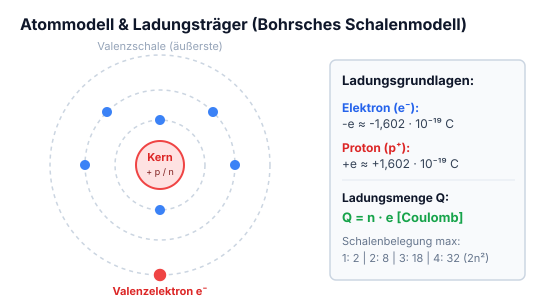

*Abbildung: Schematisches Atommodell für „Wasserstoff“:*
- *In der Mitte ein Kern mit Protonen ($p$, grün beschriftet) und Neutronen ($n$, blau beschriftet).*
- *Eine äußere Kreisbahn mit einem umlaufenden Elektron ($e$, rot beschriftet).*

- **Wasserstoff**
- **Elektron** *(rot)* = negative Ladung
- **Proton** *(grün)* = positive Ladung
- **Neutron** *(blau)* = neutrale Ladung

Die ungleichnamige Ladungen ziehen sich an und die gleichnamigen stossen sich ab. Nur durch die Zentrifugalkraft stürzt der Elektron nicht zum Proton.

Ein Atom kann aus mehreren Bahnen bestehen.

---

Ein Atom besteht aus einem **Kern** und aus einen oder mehreren **Schalen**, auf diesen können nur eine begrenzte Anzahl von Elektronen sein.

Reihenfolge:
1) 2
2) 8
3) 18
4) 32

> **Merksatz (rot umrandeter Kasten):**  
> Die Elektronen auf der äussersten Schale des jeweiligen Atoms heissen **Valenzelektronen**.

---

### Elementarladung

Bei einem Atom hat es immer gleichviele Protonen wie Elektronen, die Ladung der Elementarteilchen ist fest gequantelt, diese nennt man:

$$\text{Elementarladung} = -e \approx -1{,}602 \times 10^{-19} \, \text{C}$$

Bei den Protonen ist es fast das selbe:

$$\text{Elementarladung} = +e \approx +1{,}602 \times 10^{-19} \, \text{C}$$

---

das c steht für coulomb.

ion = Der Atom während elektronen entzogen oder Beigefügt ~~oder entzogen~~ werden.

---

### Ladungsmenge

- $Q =$ Ladung (Elektrizitätsmenge)
- $n =$ Anzahl der Elementarladung
- $e =$ Elementarladung

$$Q = n \times \pm e$$

**Bsp.:**  
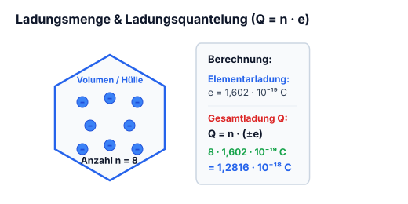

*Abbildung: Eine sechseckige Umrandung mit 8 blauen Punkten im Inneren:*
- *$\bullet \rightarrow \pm \text{Elementarladung} = \pm 1{,}602 \times 10^{-19}$*
- *$n = \text{menge}$ (Pfeil auf die Gesamtheit der Ladungen*

- *$Q = \text{Ladung}$ (Pfeil nach außen aus der Umrandung))*

$$8 \times 1{,}602 \times 10^{-19} = 1{,}2816 \times 10^{-18}$$

---

---

## 2.2 Coulombsches Gesetz

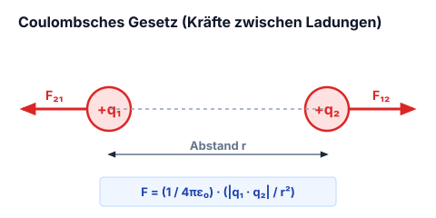 *(im Original: „Coulombsches Gesetz“)*

*Abbildung: Zwei punktförmige Ladungen:*
- *Quelladung $q$ (schwarz*

- *Testladung $e$ (blau)*
- *Gestrichelte Pfeillinie als Abstandsvektor $\vec{r}$ von $q$ nach $e$.)*

$$F \approx \frac{1}{4\pi\varepsilon_0} \cdot \frac{q \cdot e}{|r|^2} \qquad F = \text{Kraft } [\text{N}]$$

$$\vec{F} \approx \frac{1}{4\pi\varepsilon_0} \cdot \frac{q \cdot e}{|r|^2} \, \vec{e}_r \qquad \varepsilon_0 = 8{,}854 \cdot 10^{-12} \, \text{C/Vm}$$

Dieses Gesetz ist nur bei Punktladungen möglich.

$$F = e E$$

---
!!! warning "Coulombsches Gesetz & Dielektrizitätskonstante"
    - Das Coulombsche Gesetz gilt in dieser Form streng für **ruhende Punktladungen**.
    - Befinden sich die Ladungen in einem dielektrischen Medium (z. B. Isolieröl, Kunststoff), verringert sich die wirksame Kraft um die relative Permittivität $\varepsilon_r$:
      $$\vec{F} = \frac{1}{4\pi \varepsilon_0 \varepsilon_r} \cdot \frac{q_1 \cdot q_2}{|\vec{r}|^2} \, \vec{e}_r$$
    - Im Vakuum / Luft gilt $\varepsilon_r \approx 1$.

---

## 2.3 Superpositionsprinzip & Feldstärkeberechnung

*Abbildung: Zentrale Punktladung $q$, von der 8 radiale Feldlinien (blaue Pfeile) in alle Richtungen nach außen verlaufen. Im ersten Quadranten liegt ein Messpunkt $P$ mit gestricheltem Abstandsdreieck $r$ zum Zentrum $q$.*

Hier gilt:

$$\vec{E} = \frac{1}{4\pi\varepsilon_0} \cdot \frac{q}{|r|^2} \, \vec{e}_r$$

Wir wollen die Feldstärke vom Punkt $P$ wissen.

Vereinfachte Rechnung von mehreren Quelladungen:

$$\vec{E}(\vec{r}_P) = \frac{1}{4\pi\varepsilon_0} \cdot \sum_{i=1}^n \frac{q_i}{|r_i|^2} \, \vec{e}_r$$

Quellladung haben gegenseitig keinen Einfluss.  
Die Dichte der Feldlinien definieren die Stärke vom Elektrischem Feld.

---

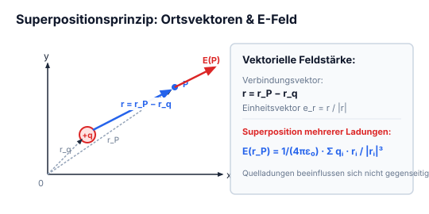

*Abbildung: oben: 2D-Koordinatensystem mit Achsen:*
- *Quelladung $q$ mit Ortsvektor $\vec{r}_q$ und nach allen Richtungen ausgehenden Feldlinien.*
- *Messpunkt $P$ mit Ortsvektor $\vec{r}_P$.*
- *Verbindungsvektor $\vec{r}$ von $q$ nach $P$ mit Einheitsvektor $\vec{e}_r$.*

$$\vec{r} = \vec{r}_P - \vec{r}_q$$

$$\vec{e}_r = \frac{\vec{r}}{|r|}$$

$$\vec{E} = \frac{1}{4\pi\varepsilon_0} \cdot \frac{q}{|r|^2} \, \vec{e}_r \implies \vec{E} = \frac{1}{4\pi\varepsilon_0} \cdot \frac{q \vec{r}}{|r|^3}$$

$$\vec{E} = \frac{1}{4\pi\varepsilon_0} \cdot \sum_{i=1}^n q_i \frac{\vec{r}_i}{|r_i|^3} \quad \text{mit } \vec{r}_i = \vec{r}_P - \vec{r}_{qi}$$

---

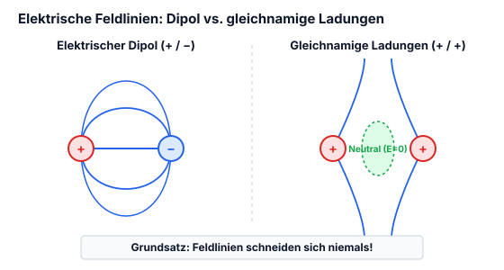

*(Zwei Feldlinien-Skizzen:*
1. *Elektrischer Dipol: Oben Pluspol $(+)$, unten Minuspol $(-)$. Feldlinien treten aus $(+)$ aus und verlaufen in symmetrischen Bögen zu $(-)$.*
2. *Zwei gleichnamige Ladungen: Oben Pluspol $(+)$, unten Pluspol $(+)$. Die Feldlinien weichen einander aus und biegen nach links und rechts ab. Der feldfreie Zwischenraum in der Mitte ist grün markiert und mit „Neutral“ beschriftet.)*

**Feldlinien schneiden sich nie.**

---

---

## 2.4 Kontinuierliche Ladungsverteilungen

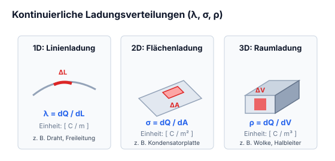

1. **Längenbezogene Ladungsdichte:**  

*Abbildung: Eine geschwungene Linie/Draht mit einem roten Linienelement $\Delta L$ und gestrichelter Verbindungslinie zu einem Punkt oben.*
  
$$\Delta L = \text{Delta } l$$  
$$\lambda = \lim_{\Delta L \to 0} \frac{\Delta Q}{\Delta L} \quad \left[\frac{\text{C}}{\text{m}}\right]$$

2. **Flächenbezogene Ladungsdichte:**  

*Abbildung: Eine rautenförmige Ebene mit Ladungspunkten und einem rot hervorgehobenen Flächenelement $\Delta A$, von dem eine gestrichelte Linie zu einem Punkt führt.*
  
$$\Delta A$$  
$$\sigma = \lim_{\Delta A \to 0} \frac{\Delta Q}{\Delta A} \quad \left[\frac{\text{C}}{\text{m}^2}\right]$$

3. **Raumbezogene Ladungsdichte (Volumenladungsdichte):**  

*Abbildung: Ein unregelmäßiger 3D-Körper mit Ladungspunkten im Inneren und einem rot umrandeten Volumenelement $\Delta V$, verbunden mit einem Punkt oben.*
  
$$\Delta V$$  
$$\rho = \lim_{\Delta V \to 0} \frac{\Delta Q}{\Delta V} \quad \left[\frac{\text{C}}{\text{m}^3}\right]$$

$$\vec{E}(\vec{r}_P) = \frac{\lambda \Delta L}{4\pi\varepsilon_0} \sum_{i=1}^n \frac{1}{|\vec{r}_i|^2}$$

*(Roter handschriftlicher Kommentar unten:)*  
> *„Kann man nicht Rechnen!“*

---

---

## 2.5 Elektrischer Fluss

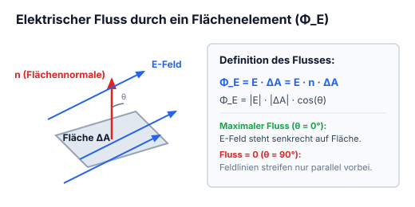

*Abbildung: Eine ebene rechteckige Fläche $\Delta A$ mit Flächennormale $\vec{n}$ senkrecht dazu. Parallele elektrische Feldlinien $\vec{E}$ (blaue Pfeile) durchstoßen die Fläche schräg.*

$$\Phi_E = \vec{E} \cdot \Delta \vec{A}$$

*(mit $\Delta \vec{A} = \vec{n} \cdot \Delta A$)*

- $\Delta A = \text{Fläche}$
- $\vec{n} = \text{Flächennormale}$
- $\vec{E} = \text{Elektrische Feldlinien}$
- $\Phi_E = \text{Elektrischer Fluss}$

$$\Phi_E = \sum_{i=1}^n \vec{E}_i \cdot \Delta \vec{A}_i = \text{Fluss in homogenen und nicht gerader Fläche.}$$

---

---

## 2.6 Gaußsches Gesetz (Symmetrien: Kugel, Zylinder, Ebene)

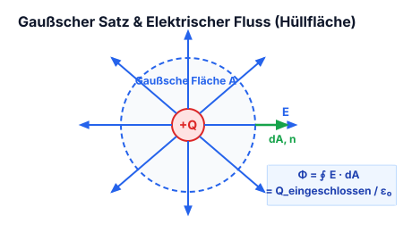

### Sphärische Symmetrie

$$\sum_{i=1}^n \vec{E}_i \cdot \Delta \vec{A}_i = \frac{Q}{\varepsilon_0}$$

Für geschlossene Flächen (Allgemein)

Für Kugeln:

$$\vec{E} \cdot 4\pi r^2 = \frac{Q}{\varepsilon_0}$$

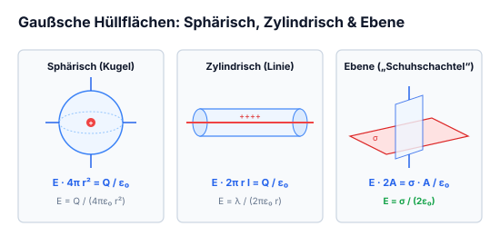

*Abbildung: Eine Kugel mit Äquator- und Längenkreisen. Im Mittelpunkt eine Ladung $e$ bzw. $q$ (blau), von der rote Pfeile radial nach außen zu den Polen und Rändern verlaufen.*

---

### Zylindersymmetrie

$$E = \frac{\rho \cdot r^2}{2 r \varepsilon_0} \implies E \cdot 2\pi r l = \frac{Q}{\varepsilon_0}$$

*Abbildung: Ein Zylinder in horizontaler Ausrichtung, auf dessen Mittelachse mehrere Ladungspunkte aufgereiht sind.*

Mit dieser Formel berechnet man die elektrische Feldstärke an einem Punkt außerhalb des Zylinders.

---

### Ebene Symmetrie

Gauss'sche Oberfläche  
„Gaußsche Schuhschachtel“ (Quaderförmige Hüllfläche)

Formel dafür ist:

$$E \cdot A = \frac{\sigma}{\varepsilon_0} \rightarrow E = \frac{\sigma}{2\varepsilon_0}$$

*Abbildung: Eine flächige geladene Ebene mit Punktladungen, durch die senkrecht ein quaderförmiges Volumen („Schuhschachtel“, blau) hindurchstößt.*

---

---

## 2.7 Elektrisches Potenzial & Arbeit im E-Feld

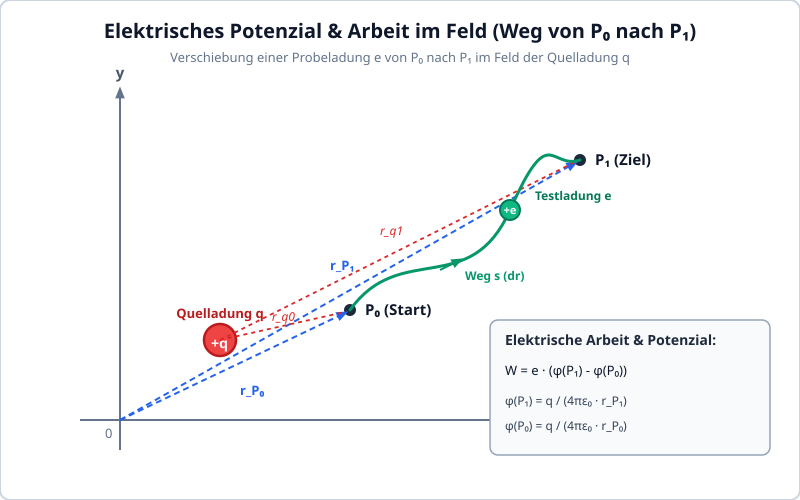

*Abbildung: 2D-Koordinatensystem mit Achsen $y$ und $x$:*
- *Quelladung $q$ (rot) im Koordinatensystem.*
- *Anfangspunkt $P_0$ mit Ortsvektor $\vec{r}_{P_0}$ vom Ursprung.*
- *Endpunkt $P_1$ mit Ortsvektor $\vec{r}_{P_1}$ vom Ursprung.*
- *Ein geschwungener Pfad zwischen $P_0$ und $P_1$ mit einer Testladung $e$ (grün).*
- *Gestrichelte Verbindungslinien von der Quelladung $q$ nach $P_0$ und $P_1$.*

- $P_1 = P_1, \quad P_0 = P_0$
- Der Punkt $q$ kann man selber wählen: $q = \text{Nullpunkt}$

Hier gilt:

$$W = e \left( \underbrace{\frac{q}{4\pi\varepsilon_0 r_{P_1}}}_{P_{P_1}} - \underbrace{\frac{q}{4\pi\varepsilon_0 r_{P_0}}}_{P_{P_0}} \right) =$$

$$W = e (P_{P_1} - P_{P_0})$$

Wie man sieht kann man die Arbeit von der Bewegung einer Ladung mit dem elektrischem Potential berechnen.

---

---

## 2.8 Elektrische Spannung & Potenzialdifferenz

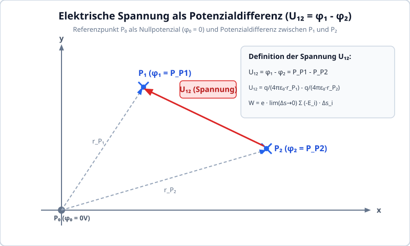

*Abbildung: 2D-Koordinatensystem mit den Achsen $y$ und $x$:*
- *Punkt $P_1$ mit Kreuz im oberen Bereich.*
- *Punkt $P_2$ mit Kreuz weiter unten rechts.*
- *Ursprung als Referenzpunkt $P_0$.*

$$P_0 = p_0 = 0$$

$$W = e \cdot \lim_{\Delta s \to 0} \sum (-\vec{E}_i) \cdot \Delta \vec{s}_i$$

$$U_{12} = \lim_{\Delta s \to 0} \sum (-\vec{E}_i) \cdot \Delta \vec{s}_i$$

---

$$\left( \frac{q}{4\pi\varepsilon_0 r_{P_1}} - \underbrace{\frac{q}{4\pi\varepsilon_0 r_{P_0}}}_{0} \right) - \left( \frac{q}{4\pi\varepsilon_0 r_{P_2}} - \underbrace{\frac{q}{4\pi\varepsilon_0 r_{P_0}}}_{0} \right)$$

$$\downarrow$$

$$P_{P_1} - P_{P_2} = \frac{q}{4\pi\varepsilon_0 r_{P_1}} - \frac{q}{4\pi\varepsilon_0 r_{P_2}} = U_{12}$$

Mit dieser Formel können wir ~~das~~ die Potentialdifferenz berechnen.  
Wird als elektrische Spannung $U$ [V] angegeben.

---

---

## 2.9 Äquipotenzialflächen

Da es auf beiden Seiten der Punkte auf der Äquipotentialfläche die gleiche Feldstärke hat, ergibt die Potentialdifferenz 0, daher gibt auch die Feldstärke dieser beiden Punkte 0.

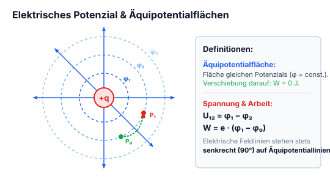

*Abbildung: Zentrales radialsymmetrisches Feld:*
- *Punktladung $q$ im Zentrum.*
- *Acht radiale Feldlinien (blaue Pfeile) nach außen.*
- *Vier konzentrische Kreislinien um das Zentrum, beschriftet per Pfeil mit „Äquipotentialflächen“.*
- *Auf einem der inneren Kreise liegen zwei Punkte $P_1$ und $P_2$.*

---

---

## 2.10 Elektrische Felder in Materie

Ein **Isolator** z. B. Keramik oder Gummi ist ein Material in dem alle Elektronen an die Atome gebunden sind.

**Elektrische Leiter** (z. B. Kupfer, Aluminium) sind Materialien mit frei beweglichen Leitungselektronen im Leitungsband.

---

---

## 2.11 Dünne leitende Platten im homogenen Feld

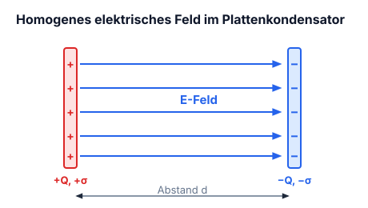

### Flächenladungsdichte

$$\pm \sigma = \pm Q : A$$

*Abbildung: Plattenkondensator mit zwei vertikalen Platten:*
- *Linke Platte positiv geladen ($+$).*
- *Rechte Platte negativ geladen ($-$).*
- *Dazwischen homogene elektrische Feldlinien (blaue Pfeile) horizontal von links nach rechts verlaufend.*
- *Hinweispfeil auf das Einbringen von Platten zwischen die Kondensatorplatten.*

Werden zwei dünne, ungeladene leitende Platten in das Feld eingebracht:

$\downarrow$

tritt Ladungstrennung durch elektrische Influenz auf. Die induzierten Oberflächenladungen kompensieren das äußere Feld im Inneren des Leiters vollständig.

---

---

## 2.12 Leitender Körper & Faraday-Käfig (Hohlraum)

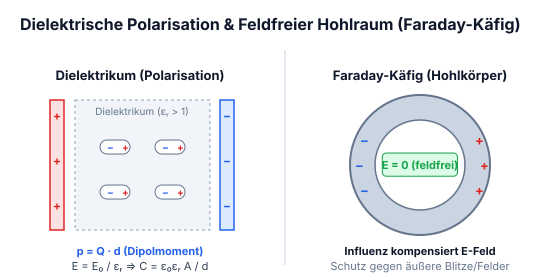

Wenn wir uns ungeladener Kupfer in Form von einer geschlossenen Kugel vorstellen, wirkt es wie auf dem beispiel auf der letzten Seite.

*Abbildung: Zwei konzentrische Kreise stellen einen leitenden Hohlkörper (z. B. eine geschlossene metallische Kugelschale) in einem äußeren elektrischen Feld dar. An der linken Außenoberfläche befinden sich influenzierte negative Ladungen ($-$), an der rechten Außenoberfläche positive Ladungen ($+$). Im inneren, vom Leiter umschlossenen Hohlraum ist das Feld kompensiert, ein Pfeil weist auf diesen zentralen Hohlraum mit der Beschriftung „Feldfrei“.*

---

---

## 2.13 Dielektrische Polarisation & Materieeinfluss

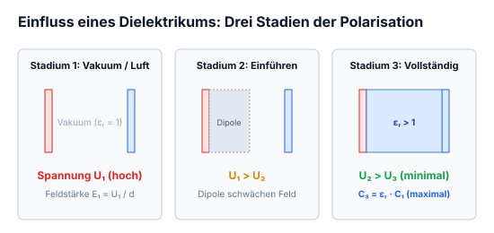

*Abbildung: Drei Stadien eines Plattenkondensators mit Plattenabstand $d$:*
*1. Vakuum/Luft zwischen den Platten: linke Platte positiv geladen ($+$), rechte Platte negativ geladen ($-$). Elektrische Feldlinien verlaufen homogen von links nach rechts. Spannung $U_1$.*
*Dazwischen: $U_1 > U_2$.*
*2. Kondensator mit einsetzender dielektrischer Polarisation: mikroskopische elektrische Dipole richten sich gegen das externe Feld aus und schwächen das innere Feld; Spannung $U_2$.*
*Dazwischen: $U_2 > U_3$.*
*3. Kondensator mit vollständig ausgefülltem Dielektrikum (blau hervorgehoben); die Feldstärke und damit die Spannung sinken weiter auf $U_3$.*

$$U = E \cdot d$$

*Abbildung: Modell eines polarisierbaren Atoms/Moleküls in einem äußeren elektrischen Feld, dargestellt als Kreis mit horizontalen Feldlinien (blaue Pfeile nach rechts). An der Hülle sammeln sich Ladungsschwerpunkte: negative Ladungsträger ($-$) links, positive Ladungsträger ($+$) rechts. Ein kleiner Kreis stellt den verschobenen Kern bzw. die Ladungsträger dar, mit einem Abstandsvektor $\vec{d}$ zwischen den Schwerpunkten.*

Hier gilt:
$$\vec{p} = Q \vec{d}$$

Dieser Vorgang nennt man Dipolmoment.

---

Mit mehreren dipole in einem Volumen wird die Formel so gerechnet:

$$\vec{P} = \frac{1}{V} \sum_{n=1}^{N} \vec{p}_n$$

---

---
