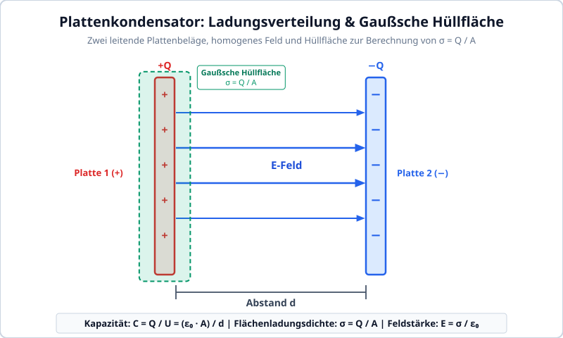
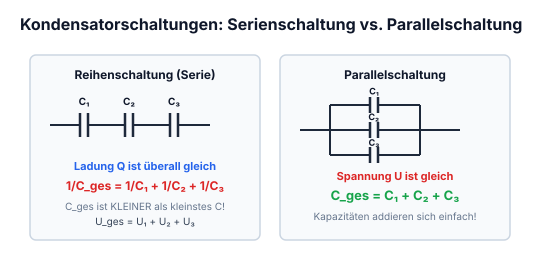
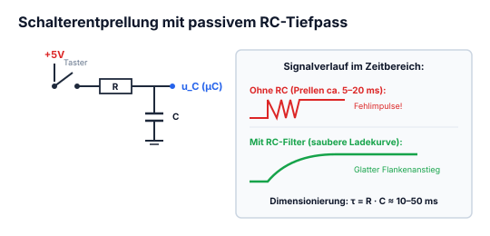
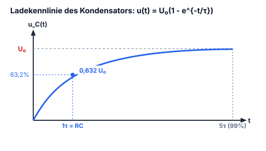

# Kapitel 3: Kondensatoren & Kapazität

!!! abstract "Überblick"
    Plattenkondensator, Kapazitätsberechnung, Bauformen, Energie und Lade-/Entladevorgänge.

## 3.1 Die Kapazität & Plattenkondensator

$$Q = C \cdot U \qquad C = \text{Kapazität}$$

- $C$ ist ein Mass für die Fähigkeit eines Körpers, Ladung zu speichern.
- $C$ wird in $\text{C}/\text{V}$ oder $\text{F} = \text{Farad}$ angegeben.
- Ein Bauelement mit der Eigenschaft der Kapazität wird Kondensator genannt.

### Bildliche vorstellung

*Abbildung: Zwei parallele leitende Plattenbeläge mit vertikalem Abstand; der obere Belag trägt positive Ladungen ($+$), der untere Belag gleich große negative Ladungen ($-$). Zwischen den Belägen zeigen vertikale elektrische Feldlinien nach unten. Beschriftung: „2 leitende Beläge mit gleichgrossen Ladungen“.*

*Abbildung: Zwei gegenüberstehende vertikale Kondensatorplatten:*
*- Linke Platte: positiv geladen ($+$), umgeben von einer gestrichelten Kontur, beschriftet als „Hüllfläche“. Pfeil mit Notiz: „Zur berechnung der Flächenladungsdichte: $\sigma = Q : A$“.*
*- Rechte Platte: negativ geladen ($-$), blau umrandet, beschriftet mit: „Wird Homogen dargestellt“.*

### Berechnung der Kapazität von Plattenkondensatoren

$$C = \frac{Q}{U} = \frac{\varepsilon_0 A}{d}$$

---
!!! warning "Gespeicherte Energie im elektrischen Feld des Kondensators"
    Die im Kondensator gespeicherte elektrostatische Energie berechnet sich aus dem Integral über den Ladevorgang:
    $$W_e = \frac{1}{2} C U^2 = \frac{1}{2} \frac{Q^2}{C} = \frac{1}{2} Q U \quad [\text{Joule}]$$

---

## 3.2 Kondensator-Grundlagen & Feldwirkung

### Reihenschaltung von Kondensatoren

*Abbildung: Reihenschaltung dreier Kondensatoren $C_1, C_2, C_3$ an einer Spannungsquelle. Ein Gesamtstrom bzw. eine Gesamtladung $Q_{\text{ges}}$ wird eingespeist.*

$$C_{\text{ges}} = \frac{1}{\frac{1}{C_1} + \frac{1}{C_2} + \frac{1}{C_3}}$$

Bei der Reihenschaltung ist die Ladungsmenge der Kondensatoren gleich.

$Q = \text{Ladungsmenge}$
$$C = \frac{Q}{U} \quad \text{mit } Q = n \cdot e = I \cdot t$$

$$Q = n \cdot e \quad \text{mit } e = 0{,}1602 \cdot 10^{-18}\,\text{C} = \text{Elementarladung}$$
*(Hinweis: entspricht $1{,}602 \cdot 10^{-19}\,\text{C}$)*
in Coulomb $[\text{C}]$ oder $[\text{As}]$

### Parallelschaltung

*Abbildung: Parallelschaltung dreier Kondensatoren $C_1, C_2, C_3$ an einer Spannungsquelle. Die Teilladungen bzw. Teilströme $Q_1, Q_2, Q_3$ fließen in die einzelnen Zweige.*

$$C_{\text{ges}} = C_1 + C_2 + C_3$$

Bei der Parallelschaltung liegt an jedem Kondensator die Gleiche Spannung an aber die Ladungsmenge ist überall anders.

$$Q_{\text{ges}} = Q_1 + Q_2 + Q_3$$

---

---

## 3.3 Typische Anwendungen von Kondensatoren

### RC-Glied (Tiefpassfilter)

*Abbildung: Grundschaltung eines RC-Tiefpassfilters. In der oberen Zuleitung liegt ein Widerstand $R$. Dahinter ist parallel zwischen der oberen und der unteren Masseleitung ein Kondensator $C$ geschaltet. Eingang links, Ausgang rechts.*

Mit dieser Schaltung kann man nicht nur ein Frequenz-abhängigen Spannungsteiler, oder ein Tiefpass-Filter machen, sondern auch Schalter entprellen.

*Abbildung: Schaltung zur Schalterentprellung. In der oberen Signalleitung liegt ein erster Widerstand $R_1$. Dahinter ist ein Schalter/Taster ($E--\backslash$) gegen Masse geschaltet. In Reihe folgt ein zweiter Widerstand $R_2$, zu dem eine Diode parallelgeschaltet ist (Anode links, Kathode rechts). Dahinter ist ein Kondensator parallel gegen Masse geschaltet.*

Um Verzögerungen zu vermeiden sollten $R_1$ & $R_2$ gleich gross gewählt werden.  
Wichtig: Um die Bauteile auszuwählen ist die Zeitkonstante $\tau$. Man sagt $\tau \approx 5$ [bzw. $5\tau$], dann ist der Kondensator geladen.

---

---

## 3.4 Auf- und Entladen des Kondensators (RC-Zeitkonstante τ)

*Abbildung: Lade-/Entladediagramm mit der Kondensatorspannung $U_c$ über der Zeitachse $t$.*
*Das Diagramm ist in zwei Abschnitte der Zeitdauer $t_g$ gegliedert:*
*1. Phase „aufladen“: Kurve steigt von 0 exponentiell an.*
*2. Phase „entladen“: Kurve fällt vom Maximalwert wieder exponentiell gegen 0 ab.*

$$t_g \approx 5\,\tau \quad [\mathrm{s}]$$

$$\tau = R \cdot C \quad [\mathrm{s}]$$

### Aufladen

$U_c = \text{Spannung am Kondensator}$

$$U_c = U \cdot \left(1 - e^{-\frac{t}{\tau}}\right)$$

### Entladen

$$U_c = U \cdot e^{-\frac{t}{\tau}}$$

!!! example "Praxisbeispiel: RC-Zeitglied (Einschaltverzögerung)"
    Ein RC-Lied aus $R = 10\,\text{k}\Omega$ und $C = 100\,\mu\text{F}$ wird über einen Schalter an $U = 10\,\text{V}$ gelegt:
    1. **Zeitkonstante $\tau$:**
       $$\tau = R \cdot C = 10\,000\,\Omega \cdot 100 \cdot 10^{-6}\,\text{F} = 1{,}0\,\text{s}$$
    2. **Kondensatorspannung $U_C$ im Zeitverlauf:**
       - nach $t = 1\,\text{s}$ ($1\tau$): $U_C = 10\,\text{V} \cdot (1 - e^{-1}) \approx 6{,}32\,\text{V}$
       - nach $t = 3\,\text{s}$ ($3\tau$): $U_C = 10\,\text{V} \cdot (1 - e^{-3}) \approx 9{,}50\,\text{V}$
       - nach $t = 5\,\text{s}$ ($5\tau$): $U_C = 10\,\text{V} \cdot (1 - e^{-5}) \approx 9{,}93\,\text{V}$
       Nach $5\,\text{Sekunden}$ ist der Kondensator zu über $99\,\%$ aufgeladen.

---
!!! tip "Kenngrößen der RC-Ladekurve (Faustregeln für die Praxis)"
    - **$t = 1\tau$**: Die Spannung erreicht **$63{,}2\%$** der Endspannung ($U_C = 0{,}632 \, U$).
    - **$t = 3\tau$**: Die Spannung erreicht **$95{,}0\%$** der Endspannung.
    - **$t = 5\tau$**: Die Spannung erreicht **$99{,}3\%$** der Endspannung (in der Praxis gilt der Kondensator nach $5\tau$ als vollständig geladen / entladen).
    - **Ladestrom zum Einschaltzeitpunkt ($t = 0$):** Der ungeladene Kondensator wirkt wie ein Kurzschluss; der Spitzenstrom beträgt $I_{\max} = \frac{U}{R}$.

---

## 3.5 Kondensatoren: Bauarten & Kenndaten

### Elektrolytkondensator

- **Polarisiert?** Ja
- **Vorteil:** grosse Kapazität, relativ hohe Spannungsfestigkeit
- **Nachteil:** unter Umständen sehr hoher ESR (equivalent serial resistenc [verlustwiederstand]), nicht geeignet für hohe Frequenzen, verliert schnell seinen Kapazitätswert, sie mögen keine hohe Temperatur.
- **Info:** Sie besitzen ein Überdruckventil, welches bei falsch-polung oder zu hoher spannung platzt und daraus kommt ein sehr heisses und giftiges Gas.

---

### Folienkondensator

- **Polarisiert?** Nein
- **Vorteil:** grosse Kapazität, gut für NF (Niederfrequenz) oder für Filter im Audiobereich, im Vergleich zu Elektrolytkondensator besser für höhere Frequenzen, Sie sind sehr stabil d.h. sie verlieren ihren Kapazitätswert, gibt es mit hohen Werten (jedoch grosse Dimension)
- **Nachteil:** nicht für sehr hohe Frequenzen geeignet
- **Info:** Wird meist als Stützkondensatoren bei IC's verwendet, typischerweise 100nF (so nahe wie möglich beim IC)

---

## 3.6 Keramikkondensatoren & SMD-Bauformen

- **Polarisiert?** Nein
- **Vorteil:** sehr gut für sehr hohe Frequenzen
- **Nachteil:** brüchig, ungenaue Kapazitätswerte (hohe Toleranz), altert stark, es gibt nur kleine Werte.

---

---

## 3.7 Regeln & Zusammenfassung zu Kondensatorschaltungen

Nebst der Kapazität muss noch die Spannungsfestigkeit berücksichtigt werden.

Spannungsfestigkeit für Kondensatoren mindestens $2 \cdot \text{Spitzenspannung}$, wenns nach dem Gleichrichter kommt. Für nach dem Spannungsregler wird empfohlen mindestens $2 \cdot \text{die Gleichspannung}$, weil es vorkommen kann, das durch's umlegen eines Schalters eine höhere Spannung entstehen kann, besser wäre ein Kondensator mit $3 \cdot \text{die Gleichspannung}$.

**Wichtig!** Im ersten Moment ist ein Kondensator ein Kurzschluss.

---
