# Kapitel 4: Gleichstromtechnik, Netzwerkanalyse & Grundgesetze

!!! abstract "Überblick"
    Strom, Ohmsches Gesetz, Joulesche Wärme, Zählpfeile, Kirchhoffsche Regeln und Quellen.

## 4.1 Elektrischer Strom & Stromdichte

*Abbildung: Zwei räumliche Leiterkörper mit Ladungen $Q+$ und $Q-$, zwischen denen elektrische Feldlinien bzw. ein Stromfaden verlaufen. Eine schematische Augen-Skizze betrachtet den Leitungsquerschnitt, durch den sich ein Elektron $e^-$ mit Driftgeschwindigkeit $\vec{v}_e$ bewegt.*

$$\frac{n \times e}{\Delta t} = \frac{\Delta Q}{\Delta t} = I \; [\text{A}]$$

$$\lambda = \frac{\Delta Q}{\Delta l} \rightarrow I = \frac{\lambda \times \Delta l}{\Delta t} = \lambda \times \vec{v}$$

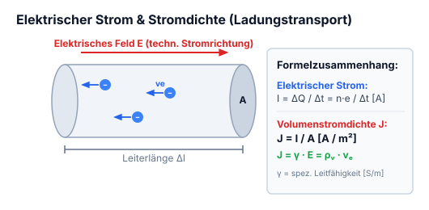

*Abbildung: Ein zylindrischer Leiter entlang einer Koordinatenachse $x$ mit Querschnittsfläche $\Delta A$ und sich bewegenden positiven Ladungen $+$, betrachtet durch ein Auge.*

$$\frac{\frac{n \times e}{\Delta t}}{\Delta A} = \frac{I}{\Delta A} = J \; \left[\frac{\text{A}}{\text{m}^2}\right]$$

### Volumenstromdichte

$J =$ Volumenstromdichte

$$J = \rho \times \vec{v} = \frac{\rho \times \Delta V}{\Delta t \times \Delta A}$$

- $\vec{v}_e =$ Driftgeschwindigkeit
- $\vec{v} =$ Geschwindigkeit
- $\vec{v}_e = -\mu \vec{E} \qquad \mu = \text{Beweglichkeit}$

$$J = n(-e) \times \vec{v}_e = n(-e) \times (-\mu e \vec{E}) = \underbrace{n e \, \mu}_{\gamma} \vec{E} \rightarrow J = \gamma \vec{E}$$

---

---

## 4.2 Ladungsbewegung im metallischen Leiter

$$J = \text{Volumenstromdichte} = [\text{A}/\text{m}^2]$$

$$\vec{J} = \frac{\Delta I}{\Delta A} :$$
heisst welcher Stromanteil durch eine bestimmte Fläche fliesst.

Je grösser die Volumenstromdichte ist desto wärmer wird der Leiter, je wärmer er wird desto grösser ist der Widerstand, bei gewissen Halbleiter ist es genau anders rum.

$$Q = \rho \cdot \Delta V$$

$$\rho = \frac{Q}{\Delta V}$$

$$\vec{J} = \rho \cdot \vec{v}$$

**Größen:**
- $\Delta V = \text{Volumen} = \Delta A \cdot \Delta l$
- $\rho = \text{Raumladungsdichte}$
- $\vec{v} = \text{Geschwindigkeit}$

---

---

## 4.3 Ohmsches Gesetz & Spezifischer Widerstand

$$R = \frac{U}{I} = \frac{l}{\gamma \cdot A} = \frac{\rho \cdot l}{A} \quad \text{mit } \rho = \frac{1}{\gamma}$$

- $\gamma =$ Spezifische Leitfähigkeit
- $\rho =$ Spezifische Widerstandfähigkeit

### Widerstand bei einer bestimmten Temperatur ($T$)

$$R(T) = R_{20^\circ} \cdot (1 + \alpha \cdot \Delta T)$$

*(Beschriftung der Formelbestandteile):*
- ① $R(T)$: Widerstand in der Gewissen Temperatur
- ② $R_{20^\circ}$: Spezifischer Widerstand bei $20^\circ\text{C}$
- ③ $\alpha$: Temperaturbeiwerte
- ④ $\Delta T$: Gewollte Temperatur (differenz zu $20^\circ\text{C}$)

**Einheiten:**
- $R = [\Omega] \text{ ohm}$
- $R_{20^\circ} = \rho = [\Omega \cdot \text{mm}^2/\text{m}]$
- $\gamma = [\text{m}/(\Omega \cdot \text{mm}^2)]$

---

---

## 4.4 Joulesches Gesetz, elektrische Leistung & Arbeit

- $P =$ Leistung
- $W =$ Arbeit
- $t =$ Zeit

$$P = \frac{W}{t} = U \cdot I \quad \text{mit } W = F \cdot s \quad [\text{Nm}]$$

Zum berechnen der Verlustleistung z.B eines Widerstandes:

$$P = U \cdot I = I^2 \cdot R = \frac{U^2}{R}$$

**Einheiten:**
- $P = [\text{W}] \text{ Watt}$
- $W = [\text{J}] \text{ Joule}$
- $t = [\text{s}] \text{ Sek (time)}$

---

---

## 4.5 Zählpfeilsysteme (Erzeuger- vs. Verbraucherpfeilsystem)

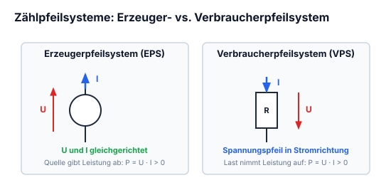

*Abbildung: Ein einfacher Stromkreis aus Quelle links und Verbraucherwiderstand rechts. Bei der Quelle zeigt der Zählpfeil $u \uparrow$ parallel zur Quellspannung („Generatorpfeilsystem“). Beim Verbraucher zeigt der Spannungsabfallpfeil $u \downarrow$ in Richtung des durchfließenden Stroms („Verbraucherpfeilsystem“).*

### Spannungsquellen-Schaltsymbole:
- Kreis mit durchgehendem Strich: **Spannungsquelle Allgemein**
- Kreis mit Querstrich/Minus: **Gleichspannung**
- Kreis mit Sinuswelle $\sim$: **Wechselspannung**
- Kreis mit Pfeil nach unten $\downarrow$: **Zeitlich veränderbare spannung**

---

---

## 4.6 1. Kirchhoffsches Gesetz (Knotenregel)

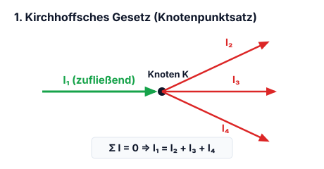

Die Summe der vom Knoten wegfliessenden Ladungsträger ergibt die Anzahl der in den Knoten reinfliessenden Ladungsträger.

*Abbildung: Ein Verzweigungsknoten. Ein Strom $I_1$ fließt horizontal in den Knoten hinein, zwei Teilströme $I_2$ (schräg nach oben) und $I_3$ (nach unten) fließen aus dem Knoten heraus.*

$$I_1 = I_2 + I_3$$

$$\sum_{k=1}^n I_k = 0 = I_1 - I_2 - I_3$$

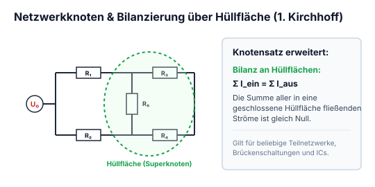

*Abbildung: Netzwerk / Brückenschaltung mit Gleichspannungsquelle links und fünf Widerständen $R_1, R_2, R_3, R_4, R_5$. Über eine gestrichelte grüne Hüllfläche um die Teilknoten rechts wird der Summenstrom bilanziert:*

$$I_{R1} + I_{R4} = I_{R3} + I_{R4} + I_{R5}$$

---

---

## 4.7 2. Kirchhoffsches Gesetz (Maschenregel)

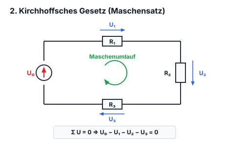

Wenn eine Ladung von $P_1$ ein Weg zu $P_1$ zurücklegt ist die Arbeit Null somit ist auch die Spannung Null.

*Abbildung: Dreieckige Leiterschleife mit den Punkten $P_1, P_2, P_3$. Zwischen $P_1$ und $P_2$ liegt Widerstand $R_1$ mit Zählpfeil $U_{R1} \rightarrow$. Zwischen $P_2$ und $P_3$ liegt Widerstand $R_3$ mit Zählpfeil $U_{R3} \downarrow$. Zwischen $P_3$ und $P_1$ liegt Widerstand $R_4$ mit Pfeil $U_{R4} \nwarrow$. Ein zentraler Kreispfeil gibt den Umlaufsinn im Uhrzeigersinn vor.*

$$P_1 - P_1 = U_{R1} + U_{R3} - U_{R4} = 0$$

$$\sum_{k=1}^n U_k = 0$$

---

---

## 4.8 Reihen- und Parallelschaltung von Widerständen

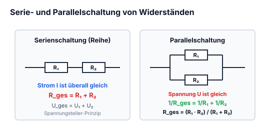

### Serie

*Abbildung: Stromkreis mit einer Quelle $I \uparrow$ in Reihe mit drei Widerständen $R_1$ (horizontal, Spannung $U_1 \rightarrow$), $R_2$ (vertikal, Spannung $U_2 \downarrow$) und $R_3$ (vertikal, Spannung $U_3 \downarrow$).*

$$R_{\text{ges}} = R_1 + R_2 + R_3$$

$$U_{\text{ges}} = R_{\text{ges}} \cdot I = U_1 + U_2 + U_3$$

$$I = \frac{U_{\text{ges}}}{R_{\text{ges}}}$$

> Der Strom bleibt überall gleich aber die Spannung ändert sich

### Parallel

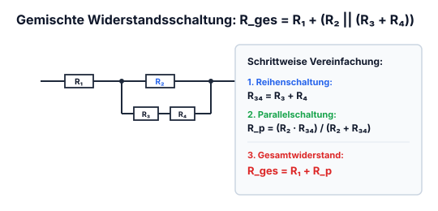

*Abbildung: Umformung einer Schaltung. Links schematische Parallelschaltung mit Quelle. Rechts Schaltung mit Speisung $I \uparrow, U_q \downarrow$, Vorwiderstand $R_1$ und zwei Parallelzweigen: Zweig 1 mit $R_2$ (Strom $I_1 \downarrow$, Spannung $U_1 \downarrow$), Zweig 2 mit Reihenschaltung aus $R_3$ und $R_4$ (Strom $I_2 \downarrow$, Gesamtspannung $U_1 \downarrow$).*

$$R_{34} \,||\, R_2$$

$$R_1 + (R_{34} \,||\, R_2) = \text{Ersatzwiederstand} : R_{\text{ges}} = \frac{1}{\sum_{k=1}^n \frac{1}{R_k}}$$

$$I = I_1 + I_2$$

$$U_q = U_1$$

$$I_1 = \frac{U_1}{R_2}$$

> Der Strom teilt sich je nach wiederstand auf, die Spannung bleibt aber überall gleich

---

---

## 4.9 Spannungsteiler (unbelastet & belastet) & Stromteiler

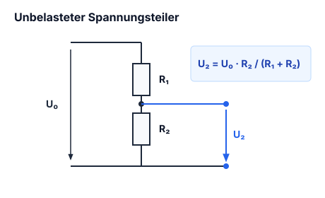

### Spannungsteiler

*Abbildung: Reihenschaltung an einer Spannungsquelle $U \downarrow$, bestehend aus zwei in Reihe geschalteten Widerständen $R_1$ mit Teilspannung $U_1 \downarrow$ und $R_2$ mit Teilspannung $U_2 \downarrow$. Pfeilbeschriftung: „$\subset$ Serieschaltung“.*

$$U_1 = R_1 \cdot I, \quad U_2 = R_2 \cdot I \quad \& \quad U = U_1 + U_2 = I(R_1 + R_2)$$

$$\downarrow$$

$$\frac{U_1}{U_2} = \frac{R_1}{R_2} \quad \& \quad \frac{U_2}{U} = \frac{R_2}{R_1 + R_2}$$

### Stromteiler

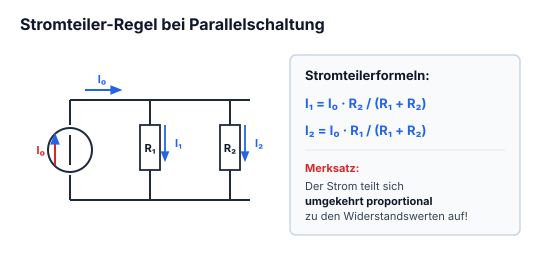

*Abbildung: Parallelschaltung an einer Stromquelle (Pfeil $\uparrow$) mit zwei parallelen Zweigen: Widerstand $R_1$ mit Strom $I_1 \downarrow$ und Widerstand $R_2$ mit Strom $I_2 \downarrow$. An beiden liegt die Gesamtspannung $U \downarrow$.*

$$I_1 = U / R_1 \quad \& \quad I_2 = U / R_2$$

$$I = I_1 + I_2 = U \left(\frac{1}{R_1} + \frac{1}{R_2}\right) = U \frac{R_1 + R_2}{R_1 \cdot R_2}$$

$$\downarrow$$

$$\frac{I_1}{I_2} = \frac{R_2}{R_1} = \frac{G_1}{G_2} \quad \& \quad \frac{I_2}{I} = \frac{R_1}{R_1 + R_2}$$

!!! example "Praxisbeispiel: Belasteter vs. unbelasteter Spannungsteiler"
    Ein Spannungsteiler aus $R_1 = 10\,\text{k}\Omega$ und $R_2 = 10\,\text{k}\Omega$ an $U_{\text{in}} = 10\,\text{V}$ liefert im Leerlauf exakt $U_{\text{out}} = 5{,}0\,\text{V}$.
    
    Schließt man nun einen Lastwiderstand $R_L = 10\,\text{k}\Omega$ an:
    1. **Ersatzwiderstand des Querzweigs:**
       $$R_{2\parallel L} = \frac{R_2 \cdot R_L}{R_2 + R_L} = \frac{10\,\text{k}\Omega \cdot 10\,\text{k}\Omega}{20\,\text{k}\Omega} = 5{,}0\,\text{k}\Omega$$
    2. **Eingebrochene Ausgangsspannung:**
       $$U_{\text{out,belastet}} = U_{\text{in}} \cdot \frac{R_{2\parallel L}}{R_1 + R_{2\parallel L}} = 10\,\text{V} \cdot \frac{5\,\text{k}\Omega}{10\,\text{k}\Omega + 5\,\text{k}\Omega} = 3{,}33\,\text{V} \quad (\ll 5\,\text{V}!)$$
    
    **Schaltungsregel:** Ein resistiver Spannungsteiler bricht unter Last ein. Er muss entweder niederohmig dimensioniert werden ($R_L \gg R_2$) oder durch einen [[#10.5 Der Impedanzwandler (Spannungsfolger / Buffer)|Operationsverstärker-Buffer]] entkoppelt werden.

---

---

## 4.10 Reale Spannungs- und Stromquellen (Innenwiderstand)

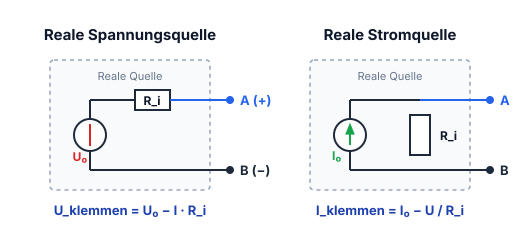

### Reale Spannungsquelle

*Abbildung: Ersatzschaltbild einer realen Spannungsquelle mit idealer Quellenspannung $U_0 \downarrow$ in Reihe zum Innenwiderstand $R_i$ mit Spannungsabfall $U_{Ri} \rightarrow$, abgeschlossen mit Ausgangsklemmen und Klemmenspannung $U \downarrow$. Beschriftung: „Spannungsquelle mit Innenwiederstand“.*

- $\text{Leerlaufspannung: } U = U_L = U_0$
- $U_L \, (=\text{Quellspannung}) = \text{Leerlaufspannung}$
- $\text{Kurzschlussstrom: } I_k = \frac{U_0}{R_i}$ *(in der Handschrift als „Kurzschlussspannung“ tituliert)*

### Reale Stromquelle

*Abbildung: Reale Stromquelle bestehend aus idealer Stromquelle $I_0 \uparrow$ parallel zu einem Innenwiderstand, mit Ausgangsspannung $U \downarrow$.*

- $\text{Kurzschlussbetrieb: } I = I_k = I_0$
- $I_k \, (=\text{Quellstrom})$
- $\text{Leerlaufspannung: } U_L = I_0 \cdot R_i$

### Berechnung von $R_i$
*(Im roten Kasten notiert):*
- $U_0 \rightarrow (\text{Leerlaufspannung})$
- $I_k \rightarrow (\text{Kurzschlussstrom})$

$$R_i = \frac{U_0}{I_k}$$

---

## 4.11 Wirkungsgrad & Leistungsanpassung

$$\eta = \frac{P_L}{P_{\text{ges}}} \cdot 100\%$$

- $P_L =$ Nutzleistung (am Lastwiederstand verbrauchte Leistung)
- $P_{\text{ges}} =$ Gesamtleistung

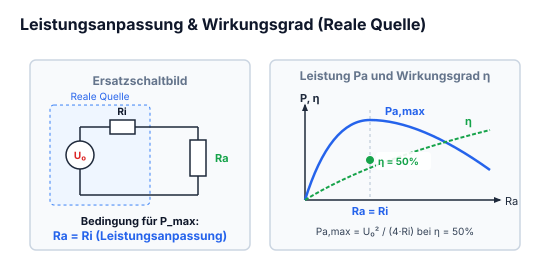

*Abbildung: Vollständiger Stromkreis. Eine reale Spannungsquelle (grün umrahmt: ideale Spannungsquelle mit Innenwiderstand $R_i$ und Spannungsabfall $U_{Ri}$) treibt den Strom $I \downarrow$ durch einen externen Lastwiderstand $R_L$, über dem die Klemmenspannung $U \downarrow$ abfällt.*

---
!!! warning "Leistungsanpassung vs. Spannungsanpassung"
    - **Leistungsanpassung ($R_L = R_i$):**
      - Am Lastwiderstand wird die maximal mögliche Leistung umgesetzt: $P_{L,\max} = \frac{U_0^2}{4 R_i}$.
      - Der Wirkungsgrad beträgt dabei genau **$\eta = 50\%$** (die andere Hälfte wird im Innenwiderstand $R_i$ in Wärme umgewandelt).
    - **Spannungsanpassung ($R_L \gg R_i$):**
      - Minimale thermische Verluste in der Quelle, Klemmenspannung $U \approx U_0$.
      - Wirkungsgrad **$\eta \to 100\%$** (Standard im Stromnetz und der Signalübertragung).
    - **Stromanpassung ($R_L \ll R_i$):**
      - Laststrom entspricht nahezu dem Kurzschlussstrom $I_L \approx I_K$.

---

## 4.12 Leistungs- & Impedanzanpassung in der Praxis

Wird ein elektrischer Verbraucher mit dem Lastwiderstand $R_L$ an eine reale Spannungsquelle mit der Quellenspannung $U_0$ und dem Innenwiderstand $R_i$ angeschlossen, unterscheidet man je nach Schaltungsziel drei fundamentale Betriebsarten:

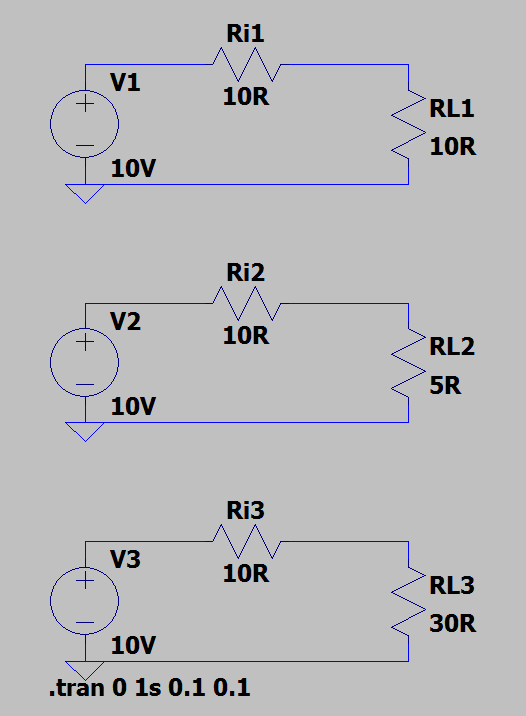

1. **Leistungsanpassung ($R_L = R_i$):**
   - Ziel: Die an den Verbraucher übertragene Wirkleistung $P_L$ soll ein Maximum erreichen.
   - Herleitung:
     $$I = \frac{U_0}{R_i + R_L} \implies P_L = I^2 \cdot R_L = \frac{U_0^2 \cdot R_L}{(R_i + R_L)^2}$$
     Durch Ableitung $\frac{dP_L}{dR_L} = 0$ ergibt sich das Maximum exakt bei:
     $$R_L = R_i \implies P_{L,max} = \frac{U_0^2}{4 \cdot R_i}$$
   - **Wirkungsgrad bei Leistungsanpassung:**
     $$\eta = \frac{P_L}{P_{ges}} = \frac{I^2 \cdot R_L}{I^2 \cdot (R_i + R_L)} = \frac{R_L}{R_i + R_L} = \frac{R_i}{2R_i} = \mathbf{50\,\%}$$
     Genau die Hälfte der erzeugten Leistung wird im Innenwiderstand $R_i$ der Quelle in Wärme umgesetzt. Anwendung: HF-Technik, Antennentechnik ($50\,\Omega / 75\,\Omega$), Audio-Endstufen.

2. **Spannungsanpassung ($R_L \gg R_i$, z. B. $R_L \ge 10 \cdot R_i$):**
   - Ziel: Die Klemmenspannung $U_L$ soll möglichst lastunabhängig und nahe an der Quellenspannung $U_0$ liegen.
   - Wirkungsgrad $\eta \to 100\,\%$.
   - Anwendung: Netzspannung ($230\,\text{V}$-Steckdosennetz), Operationsverstärker-Ausgänge, Audio-Line-Pegel.

3. **Stromanpassung ($R_L \ll R_i$):**
   - Ziel: Ein möglichst konstanter, lastunabhängiger Stromfluss.
   - Anwendung: Stromschleifen ($4\dots 20\,\text{mA}$ in der Prozessautomatisierung), LED-Treiber.

## 4.13 Einschaltstrombegrenzung (Inrush Current) & Sanftanlauf

Beim Einschalten elektronischer Geräte treten häufig extrem hohe Stromspitzen (das Vielfache des Nennbetriebsstroms) auf, die Gerätesicherungen auslösen oder Schalterkontakte verschweißen können:

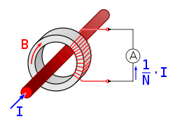

### Ursachen des Einschaltstroms
1. **Laden von Puffer- und Siebkondensatoren:**
   Im ungeladenen Zustand ($t=0$) ist die Spannung am Kondensator $u_C(0) = 0\,\text{V}$. Der Kondensator wirkt im ersten Schaltmoment wie ein Kurzschluss; der Spitzenstrom wird ausschließlich durch den Netzinnenwiderstand, die Leitungsinduktivität und den Ersatzserienwiderstand (ESR) begrenzt:
   $$i_{peak} = \frac{U_{peak}}{R_{Netz} + ESR}$$
2. **Magnetische Einschaltstromspitzen bei Transformatoren:**
   Wird ein Ringkerntrafo im Spannungsnulldurchgang eingeschaltet, treibt die Flussakkumulation den Kern tief in die magnetische Sättigung. Die Induktivität bricht zusammen, und es fließen kurzzeitig Ströme bis zum 20- bis 50-fachen des Nennstroms.

### Schaltungstechnische Schutzmaßnahmen
- **NTC-Einschaltstrombegrenzer (Heißleiter):**
  Ein NTC-Widerstand besitzt im kalten Zustand einen hohen Widerstand (z. B. $5\dots 10\,\Omega$), der den Einschaltstrom sicher deckelt. Durch den fließenden Betriebsstrom erwärmt er sich und sinkt auf einen minimalen Restwiderstand ($<0{,}5\,\Omega$) ab.
- **Relais-Überbrückungsschaltung (Sanftanlauf):**
  Ein fester Leistungswiderstand ($10\dots 47\,\Omega$, z. B. $25\,\text{W}$) liegt in der Ladeleitung. Sobald der Zwischenkreis auf ca. $80\dots 90\,\%$ aufgeladen ist, überbrückt ein Relaiskontakt den Vorwiderstand verlustfrei für den Dauerbetrieb.

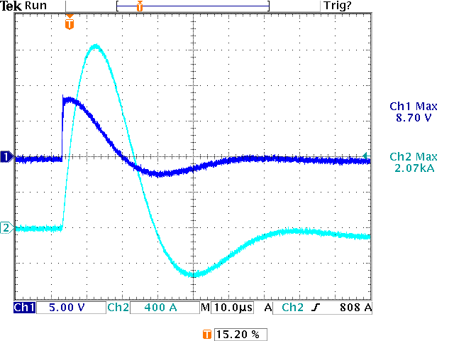

## 4.14 Rückstromschutz (Reverse DC Current Protection)

Wird ein Netzteil oder DC/DC-Wandler an eine Batterie oder an eine busgespeiste Schaltung angeschlossen, kann Strom rückwärts in den Ausgang des Netzteils fließen, wenn die Ausgangsspannung unter die externe Spannung sinkt.

### Lösungsansätze im Vergleich
1. **Standard-Siliziumdiode:**
   - Hoher Vorwärtsspannungsabfall $U_F \approx 0{,}7\dots 1{,}0\,\text{V}$.
   - Hohe thermische Verlustleistung $P_V = U_F \cdot I_L$ (bei $5\,\text{A}$ bereits ca. $4\,\text{W}$ Kühlbedarf!).
2. **Schottky-Diode:**
   - Geringere Schleusenspannung $U_F \approx 0{,}3\dots 0{,}5\,\text{V}$.
   - Gut geeignet für kleinere bis mittlere Ströme, aber höherer Sperr-Leckstrom $I_R$.

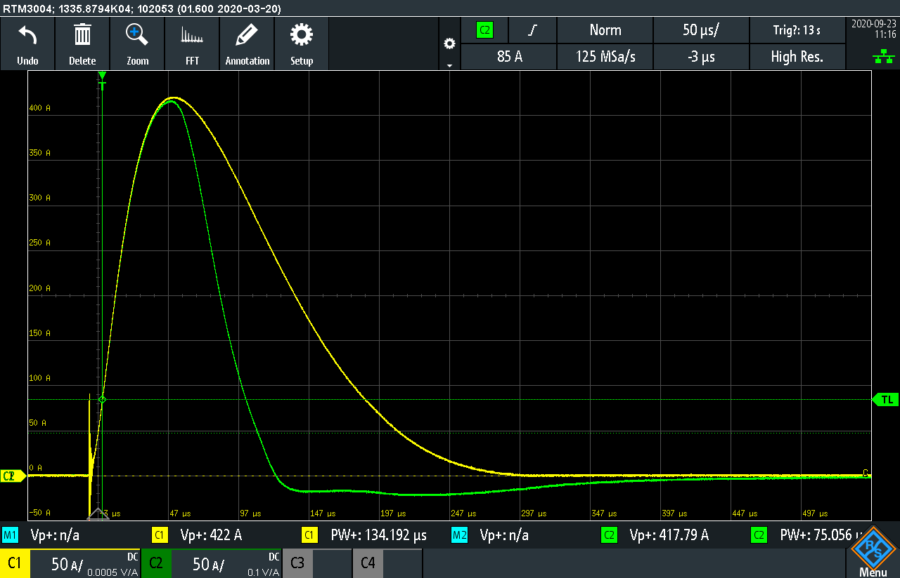
3. **Ideale Diode (MOSFET-basierter Rückstromschutz):**
   - Ein P-Kanal- oder N-Kanal-Power-MOSFET wird invers in die Versorgungsleitung geschaltet.
   - Ein Controller misst die Spannungsdifferenz über Source und Drain. Bei normalem Stromfluss schaltet er das Gate voll durch.
   - Der Spannungsabfall beträgt lediglich $U_{drop} = I_L \cdot R_{DS(on)}$ (z. B. $5\,\text{A} \cdot 5\,\text{m}\Omega = 25\,\text{mV}$).
   - Die Verlustleistung sinkt drastisch auf $P_V = I_L^2 \cdot R_{DS(on)} = (5\,\text{A})^2 \cdot 5\,\text{m}\Omega = \mathbf{0{,}125\,\text{W}}$!

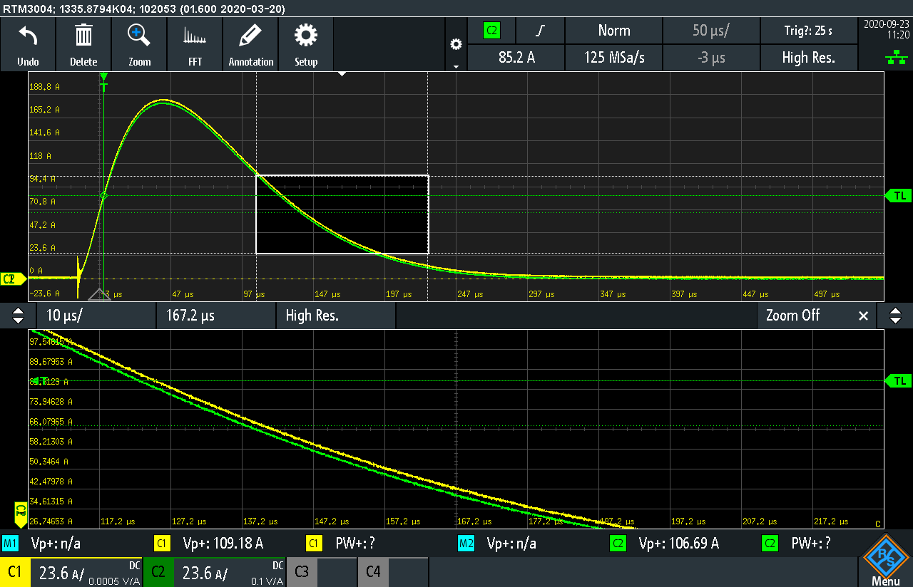

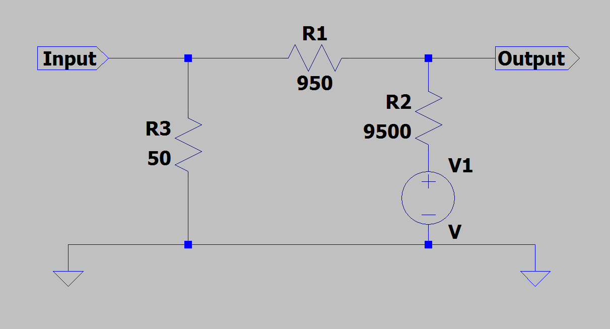
