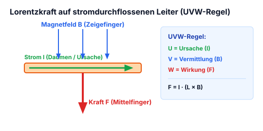
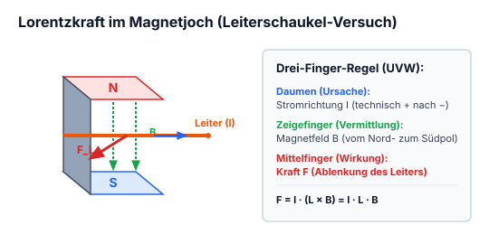
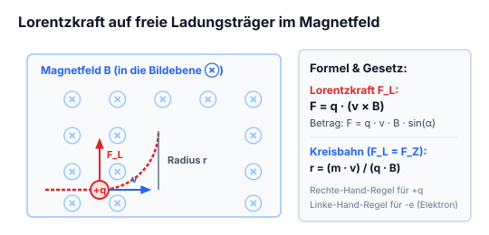
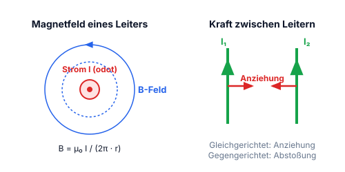
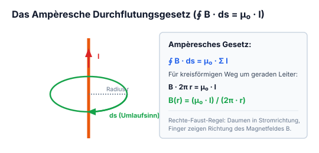
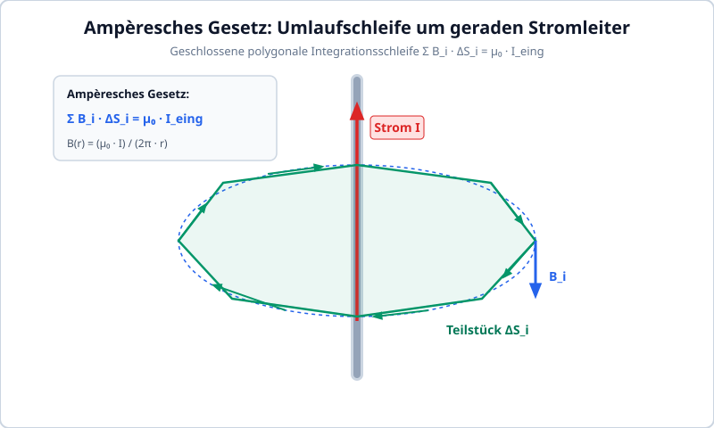
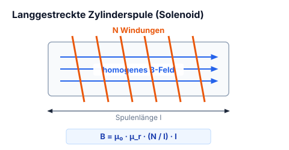
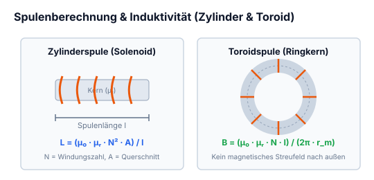
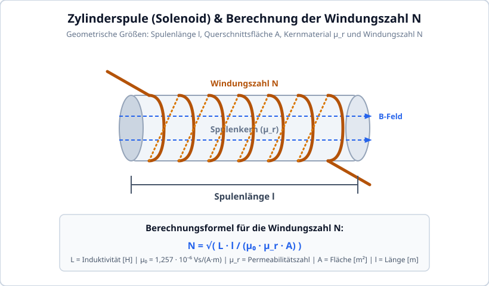
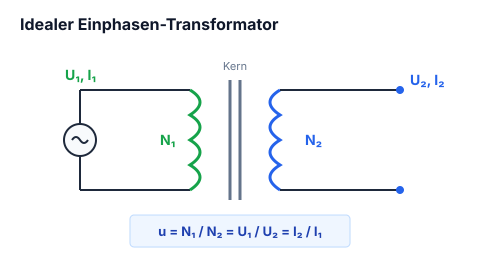

# Kapitel 5: Magnetismus, Induktion, Spulen & Transformatoren

!!! abstract "Überblick"
    Lorentzkraft, Ampèresches Gesetz, Solenoid, Spulenberechnung und Transformatoren.

## 5.1 Kraftwirkung des Magnetfeldes auf Ströme




*Abbildung: Zwei Darstellungen zur Kraftwirkung zwischen Leitern und Magneten:*
*Links: Zwei parallel verlaufende Leiterdrähte an einer Gleichstromquelle $[+ \mid -]$. Die Ströme fließen gegenläufig (linker Ast nach oben, rechter Ast nach unten). Die Drähte biegen sich nach außen voneinander weg. Beschriftung: "Abstossung". Darunter zwei Stabmagnete mit gleichnamigen Polen gegenübergestellt: $[\,S \mid N\,] \rightarrow \leftarrow [\,N \mid S\,]$.*
*Rechts: Zwei parallele Drähte an einer Gleichstromquelle $[+ \mid -]$, Ströme fließen gleichgerichtet. Die Drähte ziehen sich gegenseitig an und biegen sich zueinander. Beschriftung: "Anziehung". Darunter zwei Stabmagnete mit ungleichnamigen Polen: $[\,S \mid N\,] \rightarrow \leftarrow [\,S \mid N\,]$.*


Ein von Strom durchflossenen Leiter hat auch ein Magnetisches Feld, es übt auch eine Magnetische Kraft aus.

Um die Stärke eines Magnetfeldes auszurechnen benutzt man eine von strom durchflossenen Leiter. Mit $\vec{F}$ hat man die richtung der Kraft.




*Abbildung: C-förmiges Gestell / Magnetjoch in einem 3D-Koordinatensystem $(x, y, z)$. Am oberen Schenkel ist die Tiefe $L$ entlang der $y$-Achse markiert sowie elektrische Anschlüsse $+$ und $-$. An zwei Zuleitungsdrähten ist ein zylindrischer Leiter der Länge $L$ aufgehängt. Durch den Leiter fließt ein Strom $I$ (blauer Pfeil in $y$-Richtung). Das Magnetfeld bewirkt eine Auslenkung um den Winkel $\alpha$ gegenüber der Senkrechten; eingetragen sind die Kraftkomponenten bzw. Gegenkraft $-\vec{F}$.*


$$\vec{F} = L \cdot \vec{I} \times \vec{B}$$

$$F = B \cdot I \cdot L \cdot \sin(\alpha)$$

---

---

## 5.2 Lorentzkraft auf bewegte Ladungen (UVW-Regel)

Kraft auf bewegende Ladungsmenge:
- $\vec{v} =$ Geschwindigkeit der Ladungsmenge
- $\vec{B} =$ Die Kraft die auf die Ladungsmenge $Q$ wirkt
- $Q =$ Ladungsmenge

so gilt:
$$\vec{F} = Q \, \vec{v} \times \vec{B}$$

Wenn ausser dem Magnetfeld $\vec{B}$ noch gleichzeitig ein elektrisches Feld $\vec{E}$ wirkt, dann:
$$\vec{F} = Q(\vec{E} + \vec{v} \times \vec{B})$$



---

---

## 5.3 Magnetfeld eines geraden stromdurchflossenen Leiters



Mit:
- $\mu_0 = \text{magnetische Feldkonstante} = 0{,}4 \cdot \pi \cdot 10^{-6}\,\frac{\text{Vs}}{\text{Am}}$
- $I_1 = \text{Stromstärke}$
- $d = \text{Abstand}$

$$B_1 = \frac{\mu_0}{2\pi} \cdot \frac{I_1}{d}$$

---

## 5.4 Magnetische Kraft zwischen parallelen Leitern

$$\frac{\vec{F}}{L} = -\vec{e}_d \cdot \frac{\mu_0}{2\pi} \cdot \frac{I_1 \cdot I_2}{d}$$




*Abbildung: Neben der Formel eine geschlossene polygonale Umlauflinie mit Richtungspfeilen. Darunter ein 2D-Koordinatensystem mit Achsen $x$ und $y$. Im Ursprung befindet sich Leiter 1 ($I_1$, Symbol $\odot$ für Strom aus der Ebene heraus). Im Abstand $d$ auf der $x$-Achse befindet sich Leiter 2 ($I_2$, Symbol $\odot$). Zwischen beiden Leitern ist der Abstand $d$ als Doppelpfeil markiert. Am Ort des Leiters 2 zeigt der Magnetfeldvektor $\vec{B}$ senkrecht nach oben in $+y$-Richtung.*


---
!!! warning "Kraftwirkung paralleler Leiter (Merkregel)"
    - **Gleichgerichtete Ströme ($I_1 \uparrow \uparrow I_2$):** Die Leiter **ziehen sich an** (Magnetfelder zwischen den Leitern schwächen sich ab).
    - **Entgegengesetzte Ströme ($I_1 \uparrow \downarrow I_2$):** Die Leiter **stoßen sich ab** (Magnetfelder zwischen den Leitern verstärken sich).

---

## 5.5 Ampèresches Durchflutungsgesetz (Umlaufintegral)



Berechnen des Magnetfeldes für einfache und symetrischen Draht, von einem geschlossenen Weg.


*Abbildung: Ein gerader, vertikal verlaufender Leiter mit nach oben gerichtetem Strompfeil $I$. Um den Leiter ist eine geschlossene polygonale Wegschleife gelegt, die in Teilstücke $\Delta S_i$ unterteilt ist, mit Pfeilen für den geschlossenen Umlauf im Gegenuhrzeigersinn.*


$$\sum_{i=1}^n \vec{B}_i \cdot \Delta S_i = \mu_0 \cdot I_{\text{eing}}$$

---

---

## 5.6 Lang gestreckte Zylinderspule (Solenoid)




*Abbildung: Zylindrische Spule mit Windungen entlang der horizontalen $x$-Achse. Am linken Ende tritt der Strom $I$ ein. Im Inneren der Spule verläuft das homogene Magnetfeld $B_x$ entlang der Achse über die Spulenlänge $l$.*


$$B \cdot l = \mu_0 \cdot N \cdot I_{\text{eing}}$$

---

## 5.7 Toroidspule (Ringspule)




*Abbildung: Ringspule / Toroid mit kreisförmig angeordneten Drahtwindungen um einen ringförmigen Kern mit Radius $r$. Auf der linken Seite sind die beiden Anschlussdrähte für den Strom $I$ mit Vorzeichen $+$ und $-$ herausgeführt.*


$$B \cdot 2\pi r = \mu_0 \cdot N \cdot I_{\text{eing}}$$

---

---

## 5.8 Berechnung der Windungszahl & Spuleninduktivität




*Abbildung: Zylinderspule (Solenoid) mit Windungszahl $N$, Länge $l$ und Querschnittsfläche $A$.*


Wieviele Windungen man machen muss, um die gewünschte Induktivität zu erhalten, hängt ab von:

$$N = \sqrt{L \cdot \frac{l}{\mu_0 \cdot \mu_r \cdot A}}$$

- $N =$ Anzahl der Windungen
- $L =$ Induktivität $[\text{H}]$
- $\mu_0 =$ magnetische Feldkonstante $= 1{,}257 \cdot 10^{-6} \, \frac{\text{Vs}}{\text{Am}}$
- $\mu_r =$ Permeabilitätszahl

---
!!! note "Selbstinduktionsgesetz & Magnetische Energie der Spule"
    - **Induktionsspannung:** Eine Stromänderung $\frac{di}{dt}$ induziert eine gegengerichtete Selbstinduktionsspannung:
      $$u_L(t) = L \cdot \frac{di}{dt}$$
      *(Folge: Der Strom durch eine Induktivität kann nicht springen! Beim plötzlichen Trennen entstehen hohe Abschaltspannungsspitzen).*
    - **Gespeicherte magnetische Energie:**
      $$W_m = \frac{1}{2} L I^2 \quad [\text{Joule}]$$

---

## 5.9 Der ideale Einphasen-Transformator



### Idealer Einphasen Transformator


*Abbildung: Ersatzschaltbild eines Einphasentransformators:*
- *Primärseite: Wechselstromgenerator $G\sim$ mit Primärspannung $U_1$, Primärstrom $I_1$ und Primärwindungszahl $N_1$.*
- *Transformatorkern (vertikale Trennlinien für galvanische Trennung).*
- *Sekundärseite: Sekundärspule mit Windungszahl $N_2$, Sekundärspannung $U_2$ und Sekundärstrom $I_2$.*


$$u = \text{Übersetzungsverhältnis}$$

$$u = \frac{N_1}{N_2} = \frac{U_1}{U_2} = \frac{I_2}{I_1}$$

Dienen als Energiezufuhr mit einer galvanischen Trennung, sind Strom- oder Spannungsverstärker (bzw. Wandler).

---
!!! tip "Impedanztransformation des Transformators"
    Ein Transformator transformiert nicht nur Spannungen und Ströme, sondern auch Lastwiderstände quadratisch mit dem Übersetzungsverhältnis $u$:
    $$Z_1 = u^2 \cdot Z_2 = \left(\frac{N_1}{N_2}\right)^2 \cdot Z_2$$

---


## 5.10 Magnetismus, Ferromagnetismus & Magnetwerkstoffe

Magnetische Erscheinungen beruhen auf der Bewegung elektrischer Ladungen (Mikroströme durch Elektronenspin und Orbitalbewegung der Elektronen um den Atomkern).


### Elementarmagnete & Weißsche Bezirke
In ferromagnetischen Werkstoffen (Eisen $\text{Fe}$, Kobalt $\text{Co}$, Nickel $\text{Ni}$) sind die magnetischen Momente benachbarter Atome durch quantenmechanische Austauschwechselwirkung parallel ausgerichtet. Diese mikroskopischen Bereiche spontaner Magnetisierung heißen **Weißsche Bezirke** (Domänen), getrennt durch **Bloch-Wände**.
- Im unmagnetisierten Zustand sind die Domänen statistisch regellos verteilt $\implies B_{aussen} = 0$.
- Unter Einwirkung eines äußeren Feldes $H$ verschieben sich zunächst die Bloch-Wände (reversibel), gefolgt von irreversiblen Barkhausen-Sprüngen und vollständiger Drehung der Domänen in Feldrichtung.

### Magnetische Hysteresekurve ($B$-$H$-Diagramm)
- **Neukurve:** Verlauf der Magnetisierung vom feldfreien Ursprung bis zur Sättigung.
- **Sättigungsflussdichte $B_{sat}$:** Maximal möglicher magnetischer Fluss im Material (alle Elementarmagnete parallel ausgerichtet).
- **Remanenz $B_R$:** Verbleibende magnetische Flussdichte nach Abschalten des äußeren Feldes ($H=0$).
- **Koerzitivfeldstärke $H_C$:** Erforderliche magnetische Gegenfeldstärke, um den Werkstoff vollständig zu entmagnetisieren ($B=0$).
- **Hystereseverlust:** Die vom Hystereseast umschlossene Fläche $\oint H \, dB$ entspricht der pro Ummagnetisierungszyklus in Wärme umgesetzten Energie.


## 5.11 Sättigungsverhalten von Spulen & Induktivitäten

Wird der Strom durch eine Spule mit Eisen- oder Ferritkern über den linearen Bereich hinaus gesteigert, gerät der Kern in die **magnetische Sättigung**:

```
          B [Tesla]
             ^          Sättigungsflussdichte B_sat
             |       .-------------------------- (mu_r -> 1)
             |     / 
             |   /   Linearer Bereich (hohe Induktivität L)
             | /
  -----------+------------------> H [A/m]
```

### Konsequenzen in der Leistungselektronik
Die Induktivität einer Spule ist proportional zur differentiellen Permeabilität $\mu_r = \frac{1}{\mu_0} \frac{dB}{dH}$:
$$L(i) = \frac{N^2 \cdot A_e \cdot \mu_0 \cdot \mu_r(i)}{l_e}$$

- Sobald $B \ge B_{sat}$ erreicht wird, bricht $\mu_r$ schlagartig von Werten wie $2\,000\dots 5\,000$ auf $\mu_r \approx 1$ ein.
- **Dramatische Stromsteilheit:** Da $u_L = L \cdot \frac{di}{dt}$, sinkt $L$ auf den winzigen Wert einer Luftspule. Der Strom schießt explosionsartig in die Höhe $\implies$ MOSFETs, Dioden oder Sicherungen werden zerstört.

!!! warning "Konstruktive Abhilfe: Der Luftspalt"
    Speicherdrosseln für Schaltnetzteile (Buck/Boost) besitzen einen definierten **Luftspalt** im Kern. Der Luftspalt verringert die wirksame Gesamtremanenz, linearisiert die Scherung der Kennlinie und verschiebt den Sättigungsstrom $I_{sat}$ zu deutlich höheren Werten. Nahezu die gesamte magnetische Feldenergie $W = \frac{1}{2} L I^2$ wird im Volumen des Luftspalts gespeichert!


## 5.12 Luftspulen: Berechnung & Hochfrequenzverhalten

Für Hochfrequenzanwendungen (Filterstufen, Schwingkreise, Dämpfungsglieder) werden Spulen ohne ferromagnetischen Kern verwendet (Luftspulen). Sie kennen keine Sättigung und keine Hystereseverluste.

### Induktivitätsberechnung einer einlagigen Zylinderspule
Eine bewährte ingenieurmäßige Näherung ist die Formel von Wheeler (für Zylinderspulen mit Spulenradius $r$, Länge $l$ und Windungszahl $N$ in mm):

$$L \approx \frac{N^2 \cdot r^2}{228 \cdot r + 254 \cdot l} \quad [\mu\text{H}]$$

### Hochfrequenzeffekte an Luftspulen
1. **Skineffekt:** Mit steigender Frequenz verdrängen Wirbelströme den Stromfluss an die Leiteroberfläche. Die effektive Eindringtiefe beträgt:
   $$\delta = \frac{1}{\sqrt{\pi \cdot f \cdot \mu \cdot \kappa}}$$
   Bei $1\,\text{MHz}$ in Kupfer beträgt $\delta \approx 66\,\mu\text{m}$. Abhilfe: Versilberte Drähte oder Hochfrequenz-Litze (HF-Litze).
2. **Eigenresonanz:** Jede Windung bildet mit der Nachbarwindung eine parasitäre Koppelkapazität $C_p$. Oberhalb der Eigenresonanzfrequenz $f_{res} = \frac{1}{2\pi\sqrt{L \cdot C_p}}$ verhält sich eine Spule kapazitiv!


## 5.13 Elektrische Schwingkreise (LC-Resonanz)

Ein Schwingkreis besteht aus der Parallelschaltung (Parallelresonanzkreis) oder Reihenschaltung (Serienresonanzkreis) einer Spule $L$ und eines Kondensators $C$.


### Thomsonsche Schwingungsgleichung
Bei der Resonanzfrequenz $f_0$ kompensieren sich der induktive Blindwiderstand $X_L$ und der kapazitive Blindwiderstand $X_C$ exakt:

$$X_L = X_C \implies \omega_0 L = \frac{1}{\omega_0 C} \implies \mathbf{f_0 = \frac{1}{2\pi \sqrt{L \cdot C}}}$$

### Wichtige Kenngrößen
- **Wellenwiderstand (Kennwiderstand):**
  $$Z_0 = \sqrt{\frac{L}{C}}$$
- **Gütefaktor $Q$ (Qualitätsfaktor):**
  Beschreibt die Dämpfungsarmut des Schwingkreises (Verhältnis von gespeicherter Energie zu Verlustenergie pro Periode):
  $$Q = \frac{\omega_0 L}{R_s} = \frac{1}{\omega_0 C R_s} \quad \text{(beim Serienschwingkreis mit Verlustwiderstand } R_s\text{)}$$
  $$Q = \frac{R_p}{\omega_0 L} = \omega_0 C R_p \quad \text{(beim Parallelschwingkreis)}$$
- **Resonanzüberhöhung:**
  Beim Serienschwingkreis tritt an $L$ und $C$ eine Spannungsüberhöhung um den Faktor $Q$ auf ($U_L = U_C = Q \cdot U_{in}$)!
- **Bandbreite $B$:**
  $$B = \frac{f_0}{Q}$$
