# Kapitel 6: Messtechnik & Elektrische Sicherheit

!!! abstract "Überblick"
    Messverfahren, Shunts, Drehspulwerk, DMM, Kelvin-Messung, Wheatstone-Brücke, Oszilloskop und RCD.

## 6.1 Grundlagen der Messtechnik & Einführung

### Spannungsmessung

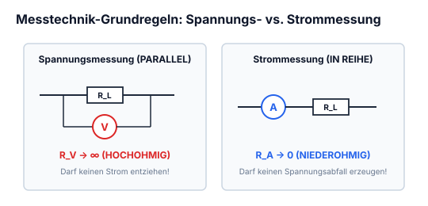


*Abbildung: Zwei Leitungen führen von links zu einem Lastwiderstand. Parallel dazu liegt ein Voltmeter $(V)$ zusammen mit seinem Innenwiderstand $R_V$.*


$R_V = \text{Hochohmig}$

### Strommessung

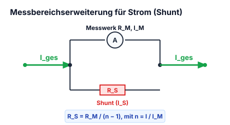


*Abbildung: In Reihe zu einem Lastwiderstand $R_L$ liegt im Leitungszweig ein Amperemeter $(A)$ mit seinem Innenwiderstand $R_A$.*


$R_A = \text{Niederohmig}$

### Messbereicherweiterung

$R_S = \text{Vorwiederstand}$ *(Shunt / Nebenwiderstand)*

$$R_{\text{ges}} = \frac{R_S \cdot R_A}{R_S + R_A} + R_L$$

$$\frac{I_A}{I_S} = \frac{R_S}{R_A}$$

$$I_{\text{max}} = I_S + I_A$$


*Abbildung: Schaltkreis mit Lastwiderstand $R_L$. Dahinter zweigt parallel ein Nebenwiderstand $R_S$ mit Teilstrom $I_S$ ab, während der Hauptmesszweig über das Amperemeter $(A)$ und dessen Innenwiderstand $R_A$ mit Teilstrom $I_A$ verläuft. Das eigentliche Messwerk ist durch eine Umrahmung hervorgehoben.*


---

---

## 6.2 Indirekte Widerstandsmessung (Strom- vs. Spannungsfehlerschaltung)

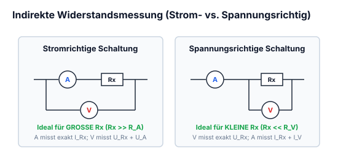

### Spannungsfehlerschaltung (genauer)


*Abbildung: Eine Gleichspannungsquelle speist die Schaltung. Das Voltmeter $(V)$ samt Innenwiderstand liegt direkt parallel zur Quelle an den Hauptleitungen. In der unteren Leitung liegt dahinter in Reihe der Innenwiderstand und das Strommessgerät $(A)$, gefolgt vom Lastwiderstand $R_L$. Das Amperemeter misst exakt den Strom durch $R_L$, während das Voltmeter zusätzlich den Spannungsabfall über dem Amperemeter erfasst.*


Es hat durch das Ampeere-messgerät eine Abweichung ist aber trotzdem relativ genau.

### Stromfehlerschatung (ungenau)


*Abbildung: Eine Gleichspannungsquelle mit nachgeschaltetem Amperemeter $(A)$ samt Innenwiderstand in der Zuleitung. Dahinter liegen der Lastwiderstand $R_L$ und das Voltmeter $(V)$ samt Innenwiderstand $R_V$ parallel. Das Voltmeter misst exakt die Spannung an $R_L$, das Amperemeter misst jedoch die Summe aus Laststrom und Voltmeterstrom.*


Ist sehr ungenau, wenn man Volt und Ampeere gleichzeitig misst.

---

---

## 6.3 Direkte Widerstandsmessung & Vierleiter-Kelvin-Messung

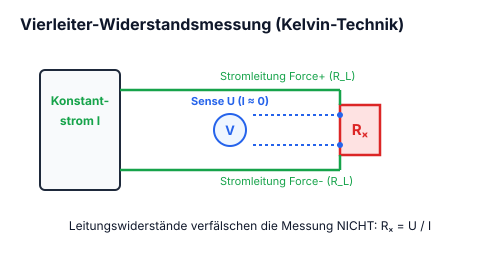

### 2-Drahttechnik


*Abbildung: n: Drei Stufen der direkten 2-Leiter-Widerstandsmessung:*
*1. Links: Ersatzschaltbild mit interner Stromquelle, parallel liegendem Spannungsmesser $(V)$ und Prüfling (Widerstand).*
*2. Mitte: Symbolische Darstellung eines Widerstandsmessgeräts $(\Omega)$ parallel zum Prüfwiderstand.*
*3. Rechts: Praktischer Anschluss über zwei Messleitungen an Anschlüssen $\circ$. Auf den Zuleitungsdrähten sind schräge Markierungen angebracht, die den Einfluss der Leitungswiderstände andeuten.*


Bei elektronischer Schaltung ist Vorsicht geboten

### 4-Drahttechnik


*Abbildung: Kelvin-Vierdrahtmessung. Eine Stromquelle links speist einen definierten Messstrom über zwei äußere Leitungen (mit eingezeichneten Leitungswiderständen) durch den Prüfwiderstand rechts. Die Spannung am Prüfwiderstand wird über zwei separate innere Leitungen mit Leitungswiderständen hochohmig durch ein Voltmeter $(V)$ abgegriffen.*


---

---

## 6.4 Strom- und Spannungsmessung mit Shunt-Widerstand

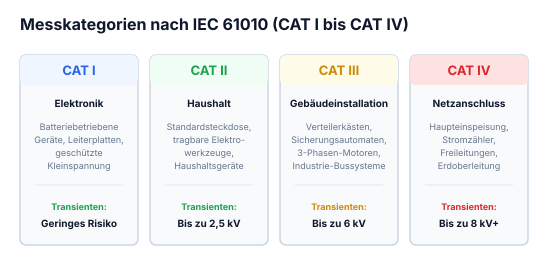

Messgeräte haben Kategorien:
cat I, cat II, cat III und cat IV

Je näher man der Energiequelle kommt desto grösser wird die Kategorie

Es können durch Blitzeinschläge oder anderen Ursachen in Schaltungen Transienten entstehen, Transienten sind hohe Spannungsüberschüse auf kurzer Zeit, dass kann währen dem Messen ein Lichtbogen verursach: das ist eine Explosion.
Bei guten Messgeräte ist man dagegen geschützt

---

---

## 6.5 Messgeräte-Innenwiderstände & Bürde

### 1. Fundamentalvoraussetzung
Die zu messende Grösse muss qualitativ eindeutig definiert sein und quantitativ bestimmbar sein.

### 2. Fundamentalvoraussetzung
Das Messnormal muss durch eine Konventation festgelegt sein (Si-Einheit)
*(Hinweis / Klammer darunter: kann man von t/s/m ableiten)*

### Messungen müssen:
- Objektiv sein
- reproduzierbar sein
- quantitativ (mit einer Zahl versehen)

---

---

## 6.6 Begriffsdefinitionen (Toleranz, Messfehler, Auflösung)

- **Messgrösse:** Die physikalische Grösse, die bestimmt werden soll
- **Messgerät:** Für die Messung geeignete Einrichtung
- **Messeinrichtung:** Alles um das Messgerät herum
- **Sensor:** Teil des Messgeräts der in direkter Verbindung mit der physikalischen Grösse steht.
- **Messwert:** Gemessener Wert
- **richtiger Wert:** gemessener Wert mit Fehlerberechnung
- **wahrer Wert:** unmessbar
- **Messabweichung:** differenz von wahrer Wert und gemessener Wert
- **Messergebnis:** Zahl und Einheit ist vorhanden
- **kalibrieren:** Ermittle die Messabweichung vom richtigen Wert (wird amtlich geeicht)
- **Messbereich:** Ein Spannungsbereich den man Messen kann.

---

---

## 6.7 Analoge Drehspulmesswerke vs. Digitalmultimeter (DMM)

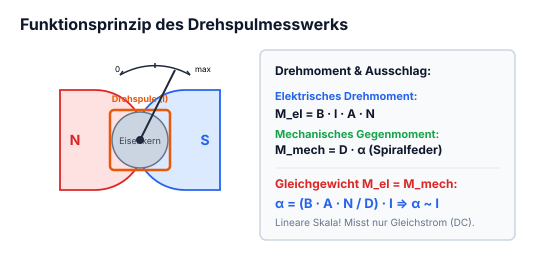

### Analog

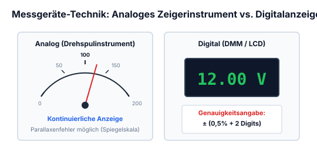


*Abbildung: Zeigerinstrument mit Skala von 0 bis 200: $0 \backslash | / 200$. Links unter der Skala: "Genauigkeitsklasse 0,5". Ein Pfeil verknüpft den Skalenendwert 200 mit dem Messbereich.*


Abweichung berechnet mit:
- Genauigkeit $= 0{,}5\%$
- Messbereich $= 200\,\text{V}$
- Messwert $= 12\,\text{V}$

$$0{,}5\% \text{ von } 200\,\text{V} = 1{,}0\,\text{V}$$
$$\text{Abweichung} = 12\,\text{V} \pm 1{,}0\,\text{V}$$

### Digital


*Abbildung: Digitalanzeige mit LCD-Feld "12 V". Darunter Spezifikation: $\pm 5\% + 3\,\text{digit}$.*


Abweichung berechnen mit
Anzeigeumfang:
$3\frac{1}{2}$ stellen $= \frac{1}{2}$ für 1 und 3 für 999
$\min 0000$ und $\max 1999$
Anzeigeumfang $= 2000$

$$\text{Auflösung} = \frac{\text{Messbereich}}{\text{Anzeigeumfang}}$$

Messbereich $= 10\,\text{V}$
$$\text{Auflösung} = \frac{10}{2000} = 0{,}005$$

$$\text{Abweichung} = 0{,}015 = 0{,}005 \cdot 3 \text{ für 3 digit} + \text{Absoluter Fehler } \pm 0{,}6\,\text{V}$$
*(Hinweis: $5\% \text{ von } 12\,\text{V} = 0{,}6\,\text{V}$)*

---

---

## 6.8 Oszilloskop: Funktionsprinzip & Schirmaufbau

### Betriebe:
- **yt-Betrieb** $\rightarrow$ Misst den zeitlichen Verlauf einer Spannung ($y = \text{Spannung} \,/\, x = t = \text{Zeit}$)
- **xy-Betrieb** $\rightarrow$ Misst man die Spanung von den Kanälen CH1 und CH2 gegeneinander. ($x = \text{CH}1, y = \text{CH}2$) zum Messen von Kennlinien der Bauteile

**Trigger = Auslöser:** Wenn man eine bestimmte Spannung erfassen möchte, dafür gibt's auch ein externer Eingang.

Auf dem Oszilloskop steht der Spitzenwert $V_{pk}$ was gemessen werden darf und den Innenwiederstand.
$\triangle$ immer das Handbuch lesen ($R_i$ ist meistens $1\,\text{M}\Omega$)

### Sonde:
Ist meist ein Hochohmiges Kabel mit einem Spannungsteiler. Sie ist mit einem BNC stecker mit dem Oszilloskop verbunden und gleichzeitig auch geerdet.

---

---

## 6.9 Oszilloskop: Einstellungen & Messpraxis (Trigger, Timebase)

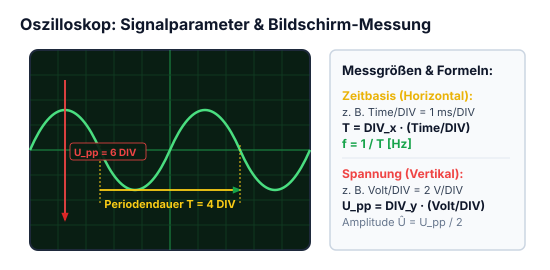

### einstellungen:
- **AC:** Die Gleichspannungssignale werden ausgeblendet
- **DC:** Direkte verbindung ohne Änderung

### Horizontal:
- **Wert $\frac{\text{sec}}{\text{div}}$ vergrössern/verkleinern** (bei yt Betrieb)
- **Position von der horizontale Grundlinie (Achse)**
- **Wert $\frac{\text{V}}{\text{div}}$ vergrössern/verkleinern** (bei xy Betrieb)

### Vertikal:
- **Vertikale Empfindlichkeit ($\frac{\text{V}}{\text{div}}$) einstellen:** Skaliert die Amplitude der Messkurve auf dem Schirm.
- **Position der Vertikalen Achse**

---

---

## 6.10 Wheatstonesche Messbrücke & Abgleichbedingung

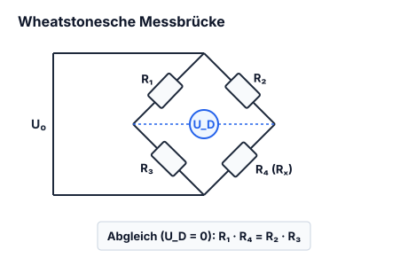


*Abbildung: Wheatstonesche Messbrücke in Rautenform. Vier Brückenzweige mit Widerständen: links oben $R_1$ mit Spannungsabfall $U_1$, rechts oben $R_2$ mit $U_2$, links unten Prüfling $R_L$ mit $U_L$, rechts unten Regelwiderstand $R_P$ mit $U_P$. In der Querdiagonale zwischen den seitlichen Abgriffen liegt ein Voltmeter $(V)$. Die Speisespannung wird an den oberen und unteren Knotenpunkten von links zugeführt. Rechts ist parallel zur Brücke eine Reihenschaltung aus Kondensator und Widerstand skizziert.*


Wenn $R_1$ und $R_2$ gleich ist und man $R_L$ herausfinden will, dreht man den $R_P$ bis der gesamter Spannungsabfall 0 ist

$$U_{12} = U_2 - U_1 = U_L - U_P = 0$$

$$\frac{U_1}{U_L} = \frac{U_2}{U_P}$$

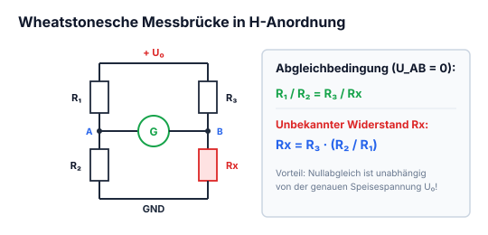


*Abbildung: Darunter befindet sich eine zweite Schaltskizze derselben Brücke in H-Anordnung mit zwei parallelen Brückenzweigen $[R_1 \text{ in Reihe mit } R_L]$ und $[R_2 \text{ in Reihe mit } R_P]$, verbunden über das zentrale Voltmeter $(V)$.*


---
!!! warning "Allgemeine Abgleichbedingung der Wheatstone-Brücke"
    Die Brückenspannung zwischen den Querabgriffen wird genau dann zu null ($U_{\text{Brücke}} = 0\,\text{V}$), wenn die Diagonalprodukte der Brückenwiderstände identisch sind:
    $$R_1 \cdot R_P = R_2 \cdot R_L \iff R_L = R_P \cdot \frac{R_1}{R_2}$$
    Dies gilt universell für beliebige Widerstandswerte.

---

## 6.11 Elektrische Sicherheit: Schmelzsicherungen & RCD (FI-Schutzschalter)

### Schaltsymbol:
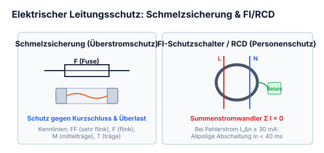


*Abbildung: Schaltsymbol einer Sicherung: Schmales Rechteck mit mittig hindurchgeführter Leitung, darüber bezeichnet mit „F“*


### Aufbau & Funktion:
Ein Schmelzsicherung ist nichts weiter als ein sehr dünner Draht (hochohmig weil $R = \frac{\rho \cdot l}{A}$), der, wenn zu viel Strom fliesst verglüht.

### Nennstrom:
Der Nennstrom ist die maximal zulässige Stromzufuhr welche die Sicherung (auch auf ewig) aushält.  
Je grösser die Differenz zwischen $I_{\text{real}} - I_{\text{Nennstrom}}$ ist desto schneller löst die Sicherung aus.

### Nennspannung:
Die Nennspannung ist die maximal zulässige Spannung, bei der die Sicherung den Strom sicher unterbrechen kann.

### Schnelligkeit der Sicherung:
Es gibt...

| Flink | Träge |
|:---|:---|
| Superflink (FF) | Träge (T) |
| flink (F) | Superträge (TT) |
| mittelträge (M) | |

---

Es gibt grössere Sicherungen für grösseren Strom z.B Leitungsschutz, findet man in einer Wohnung.  
oder es gibt Feinsicherungen die in Geräten verbaut sind. (Geräteschutz)

### Fehlerstromschutzschalter:
Wird auch RCD (Residual Current protective Device) genannt.

**Schaltungssymbol:**  

*Abbildung: 4-poliges Schaltsymbol eines RCD/FI-Schutzschalters:*
*Obere Anschlüsse: L1 (Klemme 1), L2 (Klemme 3), L3 (Klemme 5), N (Klemme 7N).*
*Untere Anschlüsse: Klemme 2, Klemme 4, Klemme 6, Klemme 8N.*
*Vier gekoppelte Schaltglieder mit Auslösekennzeichnung.*


Sie unterbrechen den Stromkreis an allen Polen, sobald ein definierter Fehlerstrom z.B durch das berühren eines Strom führenden Teils.

**Wichtig:**  
Sie unterbrechen nicht bei Überlast oder Kurzschluss.  
Sie ersetzen kein Leitungsschutzschalter.

---

---

## 6.12 Temperaturmessung mit Thermoelementen (Seebeck-Effekt)

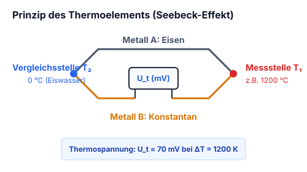


*Abbildung: Prinzipskizze eines Thermoelements (Seebeck-Effekt):*
- *Zwei Drähte aus unterschiedlichen Metallen:*
  - *Oberer Leiter: Eisen*
  - *Unterer Leiter: Konstantan*
- *Rechte Verbindungsstelle (Messstelle) auf Temperatur $T_1$, Thermospannung $U_1$.*
- *Linke Verbindungsstelle (Vergleichsstelle) auf Temperatur $T_2$, Thermospannung $U_2$.*
- *Vom aufgetrennten Konstantan-Leiter führen zwei Leitungen zu einem Messgerät / Messverstärker (Kasten).*


### Funktionsweise & Bedingungen
- Einer der beiden Temperaturen ($T_1 / T_2$) sollte konstant auf $0^\circ\text{C}$ gekühlt werden, um eine Vergleichstemperatur festzulegen.
- Um mit dem was anfangen zu können, braucht man einen Messverstärker.

### Beispiel

Wenn:
$$T_2 = 0^\circ\text{C}$$
und:
$$T_1 = 1200^\circ\text{C}$$

Thermospannung:
$$U_t = 70\,\text{mV}$$

---

---


## 6.13 Messkategorien CAT I bis CAT IV nach IEC/EN 61010

Bei Arbeiten an elektrischen Anlagen droht die größte Lebensgefahr nicht durch die reguläre Betriebsspannung ($230\,\text{V}/400\,\text{V}$), sondern durch energiereiche **Überspannungs-Transienten** (Blitzeinschläge, Schaltvorgänge im Mittelspannungsnetz). Schlägt ein Transient in einem Messgerät über, zündet ein Lichtbogen, der durch die nachfließende Kurzschlussleistung zur Explosion führen kann.

Die Sicherheitsnorm **DIN EN 61010-1** unterteilt Messumgebungen in vier Kategorien:

```
[Mittelspannungsnetz / Trafostation]
                 |
            [ CAT IV ]   Netzursprung, Zählerplatz, Freileitung, Hausanschlusskasten
                 |
            [ CAT III ]  Gebäudeinstallation, Unterverteiler, Sicherungskästen, CEE-Dosen
                 |
            [ CAT II ]   Steckdosenbetriebene Verbraucher (Haushaltsgeräte, Netzteile)
                 |
            [ CAT I ]    Galvanisch getrennte Elektronik, Labornetzteile, Batteriegeräte
```

### Stoßspannungsfestigkeit im Vergleich

| Nennspannung gegen Erde | CAT I Prüfstoß | CAT II Prüfstoß | CAT III Prüfstoß | CAT IV Prüfstoß |
| :---: | :---: | :---: | :---: | :---: |
| **$300\,\text{V}$** | $800\,\text{V}$ | $1\,500\,\text{V}$ | $2\,500\,\text{V}$ | $4\,000\,\text{V}$ |
| **$600\,\text{V}$** | $1\,500\,\text{V}$ | $2\,500\,\text{V}$ | $4\,000\,\text{V}$ | **$6\,000\,\text{V}$** |
| **$1\,000\,\text{V}$** | $2\,500\,\text{V}$ | $4\,000\,\text{V}$ | **$6\,000\,\text{V}$** | **$8\,000\,\text{V}$** |

!!! warning "Sicherheitsmerkmale von Qualitäts-Multimetern"
    Echte CAT-III/IV-Multimeter besitzen sandgefüllte Hochenergie-Schmelzsicherungen ($10\times 38\,\text{mm}$) mit einem Abschaltvermögen von mindestens $10\dots 50\,\text{kA}$ bei $1\,000\,\text{V}$, um interne Lichtbögen sicher zu löschen, sowie Messleitungen mit Fingerschutzkragen und reduzierten Spitzenlängen ($<4\,\text{mm}$).


## 6.14 Gefahren des elektrischen Stroms (AC vs. DC) & 5 Sicherheitsregeln

### Schutzkleinspannungsgrenzen
- **Wechselspannung (AC):** $U_{max} \le \mathbf{50\,\text{V AC}}$ (Effektivwert)
- **Gleichspannung (DC):** $U_{max} \le \mathbf{120\,\text{V DC}}$ (Restwelligkeit $<10\%$)
- Bei feuchter Umgebung oder Tieren: $\le 25\,\text{V AC}$ / $\le 60\,\text{V DC}$.

### Physiologische Wirkung auf den menschlichen Organismus
Der menschliche Körperinnenwiderstand beträgt von Hand zu Hand im Mittel ca. $R_K \approx 1\,000\,\Omega$:
- **$0{,}5\,\text{mA}$:** Wahrnehmungsschwelle (Kribbeln).
- **$10\,\text{mA}$:** Loslass-Schwelle (Verkrampfung der Beugemuskulatur, „Festkleben“ an der Leitung).
- **$30\,\text{mA}$:** Atembeklemmung, Gefahr des Erstickens bei längerer Einwirkzeit (Auslösegrenze von Personenschutz-FI/RCD!).
- **$>50\,\text{mA}$:** Akute Lebensgefahr durch **Herzkammerflimmern** bei $50/60\,\text{Hz}$ Wechselstrom.
- **$>1\,\text{A}$:** Schwerste innere Organverbrennungen und Herzstillstand.

### Gleichstrom vs. Wechselstrom
- **Wechselstrom ($50\,\text{Hz}$)** ist bei gleicher Spannung für das menschliche Herz gefährlicher, da $50\,\text{Hz}$ genau in die vulnerable Erregungsphase des Herzmuskels fällt.
- **Gleichstrom** führt primär zu thermischen Verbrennungen und gefährlicher Blut-Elektrolyse (Vergiftung). Ein Gleichstrom-Lichtbogen hat keinen natürlichen Nulldurchgang und erlischt extrem schwer!

### Die 5 Sicherheitsregeln (DIN VDE 0105-100)
1. **Freischalten** (allpolig abschalten).
2. **Gegen Wiedereinschalten sichern** (Schaltsperre, Vorhängeschloss, Warnschild).
3. **Spannungsfreiheit allpolig feststellen** (zweipoliger Prüfer, z. B. Duspol, vor und nach Messung testen!).
4. **Erden und kurzschließen** (zuerst Erde, dann Leiter kontaktieren).
5. **Benachbarte, unter Spannung stehende Teile abdecken oder abschranken**.


## 6.15 Transienten, Surge & Burst in der EMV-Prüfpraxis

Transiente Überspannungen sind impulsartige Spannungsstöße mit extrem schneller Anstiegszeit und hoher Amplitude.


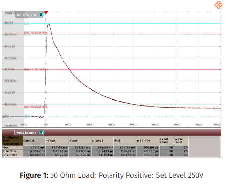

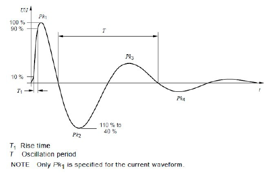

### Genormte Störimpulse (EMV-Prüfung)
1. **Surge (Blitz-Stoßspannung nach IEC 61000-4-5):**
   - Hochenergetischer Impuls mit Wellenform $1{,}2/50\,\mu\text{s}$ (Spannung) bzw. $8/20\,\mu\text{s}$ (Strom).
   - Prüfpegel: typisch $0{,}5\,\text{kV}$ bis $>4\,\text{kV}$.
2. **Burst (Schnelle transiente elektrische Störgrößen nach IEC 61000-4-4):**
   - Schauer von Tausenden extrem schnellen Nadelimpulsen ($5/50\,\text{ns}$) mit Wiederholfrequenzen von $5\,\text{kHz}\dots 100\,\text{kHz}$, hervorgerufen durch prellende Relais- und Schützkontakte.


## 6.16 Hochspannungs-Tastköpfe (HV-Probes): Frequenzabgleich

Um Hochspannungssignale bis zu mehreren Kilovolt unverfälscht auf dem Oszilloskop darzustellen, werden kompensierte $100:1$- oder $1\,000:1$-Tastköpfe verwendet.

### Abgleichbedingung des frequenzkompensierten Spannungsteilers
Damit das Teilerverhältnis über den gesamten Frequenzbereich von Gleichstrom bis in den Megahertz-Bereich konstant bleibt, muss die RC-Zeitkonstante des Tastkopfes exakt derjenigen des Oszilloskopeingangs entsprechen:

$$R_1 \cdot C_1 = R_2 \cdot C_2 \iff \frac{R_1}{R_2} = \frac{C_2}{C_1}$$

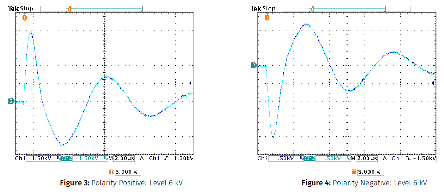

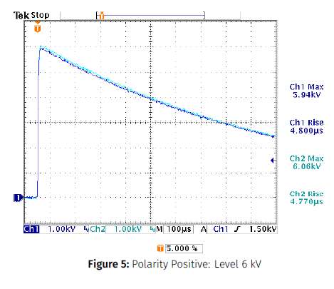

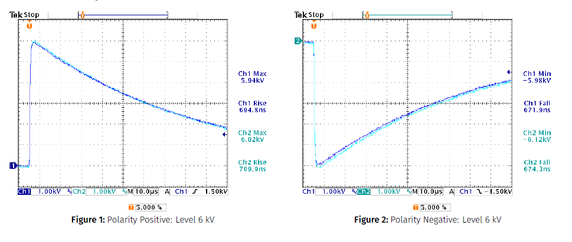

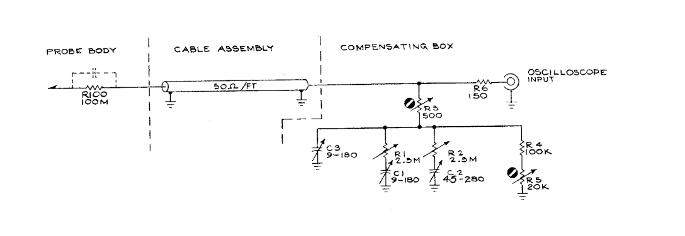

- **Abgleichpraxis:** Anlegen des internen $1\,\text{kHz}$-Rechteck-Kalibriersignals des Oszilloskops. Mit einem isolierten Abgleichschraubendreher wird die Trimmerkapazität $C_1$ justiert:
  - **Unterkompensation ($R_1 C_1 > R_2 C_2$):** Abgerundete Vorderflanke, Tiefpassverhalten.
  - **Überkompensation ($R_1 C_1 < R_2 C_2$):** Scharfe Überschwinger an den Ecken.
  - **Idealer Abgleich:** Perfekt horizontales Rechteckdach ohne Dachschräge.


## 6.17 Aufbau & Dokumentation professioneller Messprotokolle

Ein normgerechtes Prüf- und Messprotokoll (im Prüffeld sowie bei Qualifikationsprüfungen) muss folgende Pflichtelemente aufweisen:
1. **Kopfdaten:** Prüfdatum, Prüfer/Autor, Prüflingsbezeichnung, Seriennummer, Artikelnummer, Auftragsnummer.
2. **Umgebungsbedingungen:** Raumtemperatur (z. B. $22\,^\circ\text{C}$), relative Luftfeuchte (z. B. $45\,\%$) und Luftdruck.
3. **Eingesetzte Messmittel:** Exakte Modellbezeichnung, Seriennummer, Kalibrierdatum und gültige Prüfplakette.
4. **Messaufbau & Schaltskizze:** Blockschaltbild mit Kennzeichnung aller Messpunkte (TP = Test Points).
5. **Messwerttabelle:** Systematischer tabellarischer Soll-Ist-Vergleich mit Toleranzangaben ($\pm\,\%$) und klarer Statusbewertung (PASS / FAIL).
6. **Fehlerdiskussion & Fazit:** Zusammenfassung und rechtsverbindliche Freigabe-Unterschrift.
