# Kapitel 7: Passive Bauelemente & Fertigungstechnik

!!! abstract "Überblick"
    Widerstandsbauformen, Farbcode, E-Reihen, Potentiometer, R2R, Kabel, Mechanik und Lötverfahren.

## 7.1 Mechanische Fertigungstechnik

### Normen:
Die Normen sind von Organisationen festgelegte Anforderungen, sie sind eine Vereinheitlichung von Massen, rechnerische Regeln und vielen anderen Angaben.
Es gibt den Landesnorm z.B SNR, die europäische Normen EN und die weltweit geltenen Normen ISO. Die Normen gibt es für verschiedene Fachrichtungen.

### Toleranzen:
So genau wie nötig, nicht so genau wie möglich.
Eine Toleranz schreibt man so $\pm 0{,}1\,\text{mm}$.

---

---

## 7.2 Maß-, Form- und Lagetoleranzen

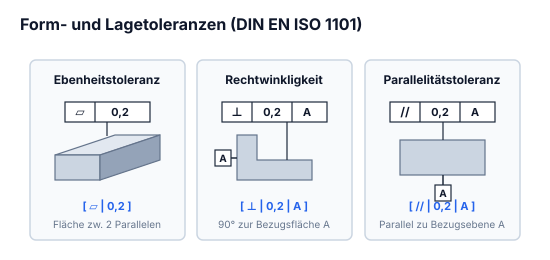

### Ebenheitstoleranz:
`[ ⏥ | 0,2 ]`

*Abbildung: Werkstückkörper mit planer Oberseite. Ein Toleranzhinweispfeil mit gefülltem Dreieck zeigt auf die Oberfläche und trägt das Toleranzfeld `[ ⏥ | 0,2 ]`.*

### Rechtwinkligkeitstoleranz:
`[ ⊥ | 0,2 | A ]`

*Abbildung: L-förmiger Werkstückquerschnitt. An der linken vertikalen Außenfläche befindet sich das Bezugselement `[A]` mit gefülltem Dreieck. Auf die Oberseite des unteren horizontalen Schenkels weist der Toleranzpfeil mit dem Rahmen `[ ⊥ | 0,2 | A ]`.*

### Paralellitätstoleranz:
`[ // | 0,2 | A ]`

*Abbildung: Ein Hohlblockprofil mit innenliegender Aussparung. An der unteren Grundfläche ist das Bezugsdreieck `[A]` platziert. Auf die gegenüberliegende obere Außenfläche zeigt die Toleranzangabe `[ // | 0,2 | A ]`.*

---

---

## 7.3 Technische Zeichnung & Projektionen

Bei einer technischen Zeichnung gibt es 2 Teile: einmal die Zeichnung und den Zeichnungskopf mit wichtigen Angaben. Bei einer technischer Zeichnung ist fast alles genormt.

### Perspektiven:
Es werden nur soviele Ansichten gezeichnet wie man braucht. Die Frontperspektive ist die Ansicht welche dir am meisten Informationen [gibt].

### Darstellungen:

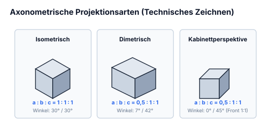

- **Isometrisch** $\longrightarrow$
  
*Abbildung: Quader/Würfel in isometrischer Axonometrie, aufsteigende Kanten jeweils im $30^\circ$-Winkel zur Horizontalen.*

  $$a : b : c = 1 : 1 : 1$$
  $$\alpha = 30^\circ \quad \beta = 30^\circ$$

- **Kabinett**
  
*Abbildung: Quader in Kavalier-/Kabinettperspektive; Frontfläche unverzerrt parallel zur Bildebene, $\alpha = 0^\circ$, Fluchtachse unter $\beta = 45^\circ$ verkürzt.*

  $$a : b : c = 0{,}5 : 1 : 1$$
  $$\alpha = 0^\circ \quad \beta = 45^\circ$$

- **Dimetrisch**
  
*Abbildung: Quader in dimetrischer Projektion; Winkel $\alpha = 7^\circ$ und $\beta = 42^\circ$ zur Horizontalen, Breitenachse verkürzt.*

  $$a : b : c = 0{,}5 : 1 : 1$$
  $$\alpha = 7^\circ \quad \beta = 42^\circ$$

---

---

## 7.4 Fertigungsverfahren der Mechanik

Die Form der Werkstücke wird nach dem Verfahren...

| geschaffen | geändert | beibehalten |
| :--- | :--- | :--- |
| Urformen (HG 1) | Umformen (HG 2) \| Trennen (HG 3) | Fügen (HG 4) \| Beschichten (HG 5) \| Änderung der Stoffeigenschaften (HG 6) |

Der Zusammenhalt des Werkstoffes wird durch das Verfahren...
- geschaffen (HG 1)
- beibehalten (HG 2)
- verkleinert (HG 3)
- vergrössert (HG 4)
- beibehalten / verkleinert / vergrössert (HG 5, HG 6)

### Hauptgruppen:
- **HG 1:** Giessen
- **HG 2:** Biegeumformen, Zugdruckumformen (Druckformen, Zugformen)
- **HG 3:** Fräsen
- **HG 4:** Form-, Kraft-, Stoff-schlüssiges Fügen, Vorgespannetes Formschlüssiges Fügen
- **HG 5:** Galvanisieren, Anodisieren
- **HG 6:** Glühen, Härten, Vergüten, Randschichthärten, Einsatzhärten.

---

---

## 7.5 Bohren & Zerspanung

$$v_c = \frac{d \cdot \pi \cdot n}{1000}$$

$$n = \frac{v_c \cdot 1000}{d \cdot \pi}$$

- $v_c =$ Schnittgeschwindigkeit
- $n =$ Drehzahl
- $d =$ Durchmesser

---

## 7.6 Prüfen & Messzeuge

### Formlehren
- Fasenlehre
- Radiuslehre
- Kreislehre

### Masslehren
- Fühlerlehre
- Lochlehre

### Messen
- Massstab
- Messschieber

*(Strukturdiagramm: Prüfen unterteilt sich in:*
*- **subjektives Prüfen** $\rightarrow$ Sinneswahrnehmung*
*- **Objektives Prüfen** $\rightarrow$ Lehren, Messen)*

---

---

## 7.7 Kabelaufbau, Adern, Litzen & Isolation

### Kabelarten:

- **Litze:** 
*Abbildung: Zylindrische Isolierhülse, aus der mehrere schräg verdrillte Leiterdrähte hervortreten*
  
  mit mehreren Drähten (unter $1\,\mathrm{mm}$) verdreht  
  *Seil:* mit mehreren Drähten ($1\text{--}4\,\mathrm{mm}$) verdreht

- **Draht:** 
*Abbildung: Isolierhülse mit einem einzelnen, massiven Innenleiter*
  
  mit 1 dickeren Draht

- **Flexible Litze:** 
*Abbildung: Isolierhülse, aus der viele sehr feine Drähte fächerförmig austreten*
  
  mit vielen sehr feinen Drähte

Der Draht kann sehr schnell brechen, die Litze ist schon eher beweglich aber am besten ist die Flexible Litze, wenn man eine bewegliche Verbindung braucht. Die Drähte werden nur noch als Verbindung zwischen 2 Platinen gebraucht, aber auch nur, wenn die Verbindung nicht bewegt wird.

---

### Netzkabel:
Wird auch Apparatekabel genannt.

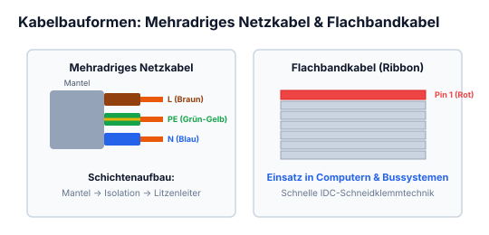

*Abbildung: Aufbau eines mehradrigen Netzkabels. Links die äußere Schicht „Mantel“, daraus hervortretend drei einzeln isolierte Adern („Isolation“), nummeriert mit ①, ②, ③, an deren Enden die metallische „Litze“ sichtbar ist.*

- ① Neutralleiter [N] (Blau)
- ② Polleiter (Braun oder Schwarz) [P]
- ③ Schutzerde [PE] (gelb-grün)

Erhältlich mit 2–5 Adern  
**Anwendung:** Netz-, Geräte- und Verlängerungskabel

### Steuerkabel:

*Abbildung: Kabelaufbau mit äußerem „Mantel“, mehreren Adern mit „Isolation“ und freigelegter „Litze“*
  
**Anwendung:** Verbindung von Bedienungs- zu Steuerungseinheit  
Erhältlich mit 2–50 Adern und mit oder ohne Abschirmung

### Flachkabel:

*Abbildung: Flachbandkabel mit mehreren parallel nebeneinander geführten Adern, beschriftet mit „Isolation“*
  
Farbig nach genormten Farbcode  
Erhältlich mit 10–96 Adern, mit und ohne Abschirmung  
**Anwendung:** Verbindung zwischen Leiterplatten

### AWG (American Wire Gauge):
Einheit für den Leiterquerschnitt.

**Beispiel:**

| AWG | Querschnitt [$\mathrm{mm}^2$] |
|:---:|:---:|
| 17 | $1{,}039\,\mathrm{mm}^2$ |
| 20 | $0{,}518\,\mathrm{mm}^2$ |

---

### Koaxialkabel:

*Abbildung: Konzentrischer Aufbau eines Koaxialkabels von außen nach innen:*
*- Mantel*
*- Kupfergeflecht $\rightarrow$ Schirm*
*- Isolierung*
*- Kupferdraht*

**Vorteil:**  
Stördämpfend

**Nachteil:**  
Brüchig (es wird ein biegeradius angegeben, den man nicht überschreiten darf)

**Anwendung:**  
Hochfrequenzübertragung  
Datenübertragung

### Lichtwellenleiter:

**Vorteil:**  
Grosse Datenübertragung  
Störabsicherung

**Nachteil:**  
Brüchig, teuer

**Anwendung:**

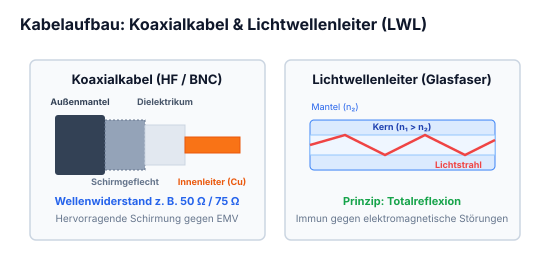

*Abbildung: Schichtweiser Aufbau eines Lichtwellenleiters:*
*- Umhüllung aus Kunststoff*
*- Mantel aus Kunststoff*
*- Kern aus Glas, Kunststoff*

---

### Buskabel:

| ASI (Flachkabel) | Profibus | Ethernet | KNX (EIB) |
|:---:|:---:|:---:|:---:|
| 
*Abbildung: Flaches Profil mit Mantel und 2 Adern*
   Mantel | 
*Abbildung: Runder Mantel, Abschirmung / Kupfergeflecht, 2 Adern*
   Mantel, Abschirrm | 
*Abbildung: Runder Mantel / Kunststoff, Kupfergeflecht-Schirm, 4 Adern*
   Mantel / Kunststoff | *(leer)* |

**ASI:**  
Flaches Kabel, nicht paarweise verdrillt und hat keine Schirmung

**Profibus:**  
Rundes Kabel, nicht paarweise verdrillt geschirmt gegen äussere Einflüsse

**Ethernet:**  
Rundes Kabel, paarweise verdrillt geschirmt gegen äussere Einflüsse

*(Post-it Notiz:)*
> Ethernet ist twisted-pair

---

---

## 7.8 Kabelquerschnitte & AWG-Norm

| ab | Querschnitt | Bis maximal | Einsatz |
|:---:|:---:|:---:|:---|
| $< 16\,\text{A}$ | $2{,}5\,\mathrm{mm}^2$ | | Hauptstromkreis 230/400 V |
| $< 10\,\text{A}$ | $1{,}5\,\mathrm{mm}^2$ | $\le 16\,\text{A}$ | Hauptstromkreis 230/400 Vac |
| $< 6\,\text{A}$ | $1\,\mathrm{mm}^2$ | $\le 10\,\text{A}$ | Hauptstromkreis 230/400 Vac |
| | $0{,}75\,\mathrm{mm}^2$ | $\le 6\,\text{A}$ | |
| | $0{,}5\,\mathrm{mm}^2$ | $\le 1{,}5\,\text{A}$ | Steuerspannung 24 V |

---

## 7.9 Kabelfarben nach DIN/VDE

### Generell
- Schutzerde [PE] = grün-gelb

### Steuerkreis (Steuerspannung)
**Wechselstrom:**
- 24 Vac (Phase) = dunkelblau
- Rückleiter AC = weiss-dunkelblau

**Gleichstrom:**
- +24 Vdc = rot
- Rückleiter DC = weiss-rot

### Hauptstromkreis
- Polleiter / Phase [P] 230/400 Vac = schwarz
- Nullleiter [N] = hellblau

---

---

## 7.10 Festwiderstände: Schicht- vs. Drahtwiderstände

### Funktion & Aufbau
Widerstände beeinflussen in einer Schaltung die Ströme & Spannungen. Der Wert der abgebaut wird, verlässt den Widerstand in Form von Wärme.  
Es gibt verschiede Widerstände:

### Drahtwiederstand
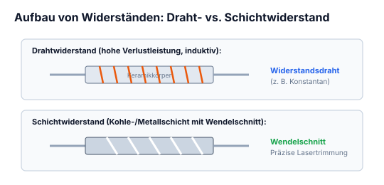

*Abbildung: Zylindrischer Keramikkörper mit gewickeltem Widerstandsdraht und zwei axialen Anschlussdrähten*
  
Der Keramikzylinder wird mit einem dünnem Draht umwickelt. Die Drahtwiederstände sind gut für hohe Leistungen geeignet, sie werden auch mit dem Aluminiumgehäuse gekühlt.

### Kohlenschicht-, Metallschichtwiederstände

*Abbildung: Schichtwiderstand mit wendelförmigen/mäanderförmigen Einschnitten:*
*- Pfeil oben: „Kohle-, Metallschicht“*
*- Pfeil rechts: „Einschleiffungen“*
*- Pfeil unten: „Keramikzylinder (ausgerollt)“*
  
Auf dem Keramikzylinder ist eine Dünne Metall- oder Kohlenschicht aufgetragen, um den Widerstand zu definieren wird die Schicht eingeschliffen.

---

---

## 7.11 Farbcode-Kennzeichnung von Widerständen

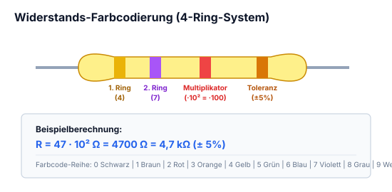

Die Widerstände werden mit einem Farbcode bedruckt, damit man den Widerstandswert anhand der Farben feststellen kann.

| Farbe | Wert | Multiplikator | Toleranz |
|:---|:---:|:---:|:---:|
| Schwarz | $0\,\Omega$ | $\times 1$ | — |
| Braun | $1\,\Omega$ | $\times 10$ | $1\%$ |
| Rot | $2\,\Omega$ | $\times 100$ | $2\%$ |
| Orange | $3\,\Omega$ | $\times 1\,\text{k}$ | — |
| Gelb | $4\,\Omega$ | $\times 10\,\text{k}$ | — |
| Grün | $5\,\Omega$ | $\times 100\,\text{k}$ | $0{,}5\%$ |
| Blau | $6\,\Omega$ | $\times 1\,\text{M}$ | $0{,}25\%$ |
| Violet | $7\,\Omega$ | $\times 10\,\text{M}$ | $0{,}1\%$ |
| Grau | $8\,\Omega$ | — | — |
| Weiss | $9\,\Omega$ | — | — |
| Silber | — | $\times 0{,}01$ | $10\%$ |
| Gold | — | $\times 0{,}1$ | $5\%$ |

### Schaltungssymbol:

*Abbildung: Genormtes Schaltsymbol eines Festwiderstands als Rechteck mit Anschlussleitungen, darüber bezeichnet mit „R“*

**Wichtig:**  
Nicht jeder Widerstand verträgt die selbe Leistung.

---

---

## 7.12 E-Normreihen (E6 bis E96) & Toleranzen

Das ist eine klar definierte Reihe an Widerstandswerte die man festgelegt hat. Je höher die Reihe (z.B E12 oder E96) desto genauer werden sie und desto mehr Werte sind von ihnen vorhanden.

**Beispiel an E6 und E12**

| E6 (hat 20% Toleranz) | E12 (hat 10% Toleranz) |
|:---:|:---:|
| 1,0 | 1,0 |
| 1,5 | 1,2 |
| 2,2 | 1,5 |
| 3,3 | 1,8 |
| 4,7 | 2,2 |
| 6,8 | 2,7 |
| | 3,3 |
| | 3,9 |
| | 4,7 |
| | 5,6 |
| | 6,8 |
| | 8,2 |

Diese Werte können multipliziert werden  
z.B $\times 1\,\Omega$, $10\,\Omega$, $100\,\Omega$, $1\,\text{k}\Omega$, $10\,\text{k}\Omega$, $100\,\text{k}\Omega$, $1\,\text{M}\Omega$ usw...

---

---

## 7.13 Veränderbare Widerstände (Potentiometer & Trimmer)

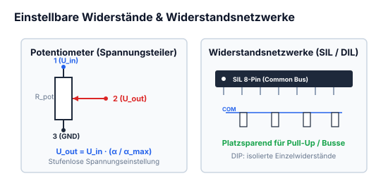

Das sind Widerstände bei dem man den Wert in Begrenzung beliebig einstellen kann.

### Schaltsymbole:

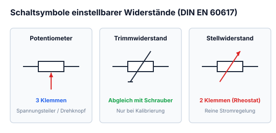

*Abbildung: n dreier Schaltsymbole für einstellbare Widerstände:*
*1. „Verstellbarer Widerstand“: Rechteckiger Widerstandskörper mit diagonal durchgehendem Pfeil nach rechts oben, links bezeichnet mit „R“.*
*2. „Einstellpotentiometer“: Rechteckiger Widerstandskörper mit diagonaler Linie, die oben links mit einem Querbalken abschließt (Trimmer-Symbol), links bezeichnet mit „R“.*
*3. „Widerstand mit beweglichem Abgriff“: Rechteckiger Widerstandskörper mit oberem und unterem Festanschluss sowie einem seitlich rechtwinklig herangeführten Pfeilabgriff, links bezeichnet mit „R“.*

Bei den veränderbaren Widerstände gibt es auch wieder verschiedene Aufbauten z.B

### Kohlenschichtpotentiometer:
Durch bewegung des Schleiffers wird der Wert verändert (Aufbau 1 Seite vorher)

### Cermetpotentiometer:
Ist eine Keramikzylinder wie beim Kohlenschichtwied. einfach mit einem Gemisch aus Keramik & Metall (genannt Cermet) aufgetragen.

### Drahtpotentiometer:
Die Position des Schleiffers gibt dann eine höheren oder tieferen Widerstandswert

---

---

## 7.14 Widerstandsnetzwerke (SIL/SIP & DIP/DIL)

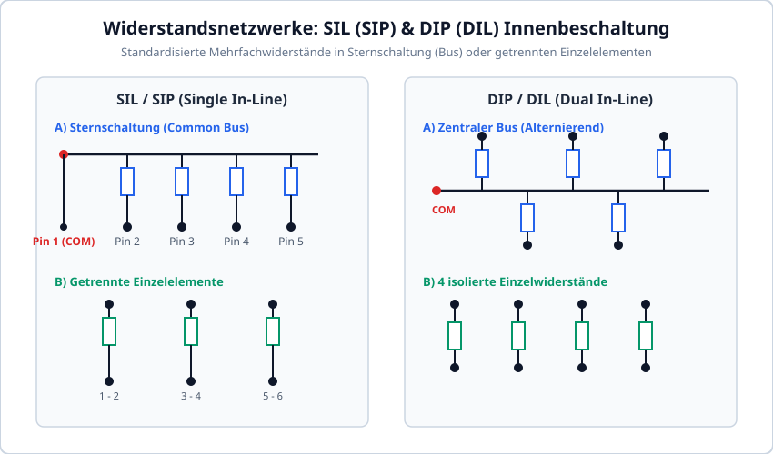

SIP (single inline package), DIP (dual inline package)

Das sind normale Widerstände in einem gefertigten Baustein, es gibt sie mit verschiedenen Werten, Anzahl und Pins (die sind im Datenblatt zum nachschlagen)

### Beispiel vom Aufbau von SIL (SIP)

*Abbildung: n zu SIL/SIP-Widerstandsnetzwerken:*
*- Links (Sternschaltung / Sammelschiene): Eine horizontale gemeinsame Busleitung oben mit einem gemeinsamen Pin ganz links. Daran hängen 5 parallele Widerstände, die jeweils nach unten zu separaten Anschluss-Pins führen.*
*- oder -*
*- Rechts (Einzelelemente): Drei voneinander isolierte Widerstände nebeneinander, jeweils mit separatem Pin oben und unten.*

### Beispiel vom Aufbau von DIP (DIL)

*Abbildung: n zu DIP/DIL-Widerstandsnetzwerken:*
*- Links (Zentraler Bus): Eine horizontale Mittelleitung mit Pin links, an die abwechselnd Widerstände nach oben (3 Stück) und nach unten (2 Stück) zu externen Pins führen.*
*- oder -*
*- Rechts (Isolierte Einzelwiderstände): Vier parallele, voneinander getrennte Widerstände mit je einem Anschluss oben und unten.*

---

---

## 7.15 Anwendungsbereiche von Widerständen

### Vorwiderstand

Zum begrenzen des Strom wird ein Vorwiderstand benötigt z.B bei einer LED. Ein LED darf maximal mit $20\,\mathrm{mA}$ & $2\,\mathrm{V}$ betrieben werden.

*Abbildung: *
*- Links: LED direkt zwischen zwei Klemmen an eine Spannungsquelle geschaltet.*
*- Pfeil $\rightarrow$ nach rechts:*
*- Rechts: Schaltung an $5\,\mathrm{V}$: Vorwiderstand $R_v$ in Reihe vor der LED zur Strombegrenzung geschaltet zwischen $+5\,\mathrm{V}$ und Masse.*

### Kleinere aber feinere Potentiometer Einstellmöglichkeit

Je nach Anordnung von Widerstand & Potentiometer kann man verschiedene Einstellmöglichkeiten erlangen.

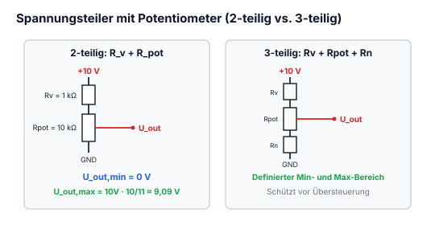

*Abbildung: & Rechnung 1: Spannungsteiler an $10\,\mathrm{V}$ bestehend aus einem oberen Vorwiderstand $R_v$ und einem unteren Potentiometer $R_{\mathrm{pot}}$.*

$$U_{Rv} = 0{,}9 \cdot 10\,\mathrm{V} = 9\,\mathrm{V}$$
$$U_{Rpot} = 0{,}1 \cdot 10\,\mathrm{V} = 1\,\mathrm{V}$$

*(Notiz daneben: $\rightarrow R = \frac{U_{Rpot}}{I_{\text{ges}}} = \frac{1\,\mathrm{V}}{\dots}$)*

Somit ist der Einstellbereich zwischen 90% & 100% also 10%

*Abbildung: & Rechnung 2: Dreiteiliger Spannungsteiler an $10\,\mathrm{V}$ bestehend aus einem oberen Vorwiderstand $R_v$, einem mittleren Potentiometer $R_{\mathrm{pot}}$ und einem unteren Widerstand $R_n$.*

$$U_{Rv} = 0{,}45 \cdot 10\,\mathrm{V} = 4{,}5\,\mathrm{V}$$
$$U_{Rpot} = 0{,}1 \cdot 10\,\mathrm{V} = 1\,\mathrm{V}$$
$$U_{Rn} = 0{,}45 \cdot 10\,\mathrm{V} = 4{,}5\,\mathrm{V}$$

Der Einstellbereich ist zwischen 45% & 55% also 10%

---

---

## 7.16 R-2R-Widerstandsleiter-Netzwerk (D/A-Wandlung)

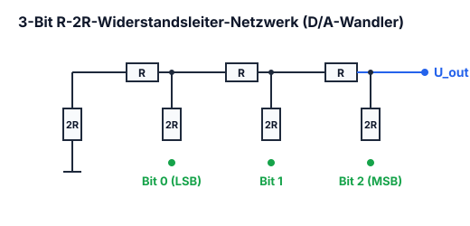

Das ist eine spezielle Schaltung von Widerständen, sie wandelt Digital-Werte zu Analoge-Spannung um. (Digital-Analog-Umsetzung).

*Abbildung: 3-Bit R-2R-Widerstandsleiter-Netzwerk:
Drei digitale Eingänge, jeweils über Widerstände mit dem Wert $2R$:
- „Höchster Bit“ (MSB) führt über $2R$ an den oberen Knotenpunkt (Ausgang)
- „Mittlerer Bit“ führt über $2R$ an den mittleren Knotenpunkt
- „kleinster Bit“ (LSB) führt über $2R$ an den unteren Knotenpunkt
Zwischen den Knotenpunkten liegt jeweils ein Längswiderstand $R$.
Vom untersten Knotenpunkt führt ein Widerstand $2R$ nach Masse (GND).
Rechts ist vermerkt: $2R = 2 \cdot R$.*

---

## 7.17 Widerstandstrimmung durch Parallelschaltung

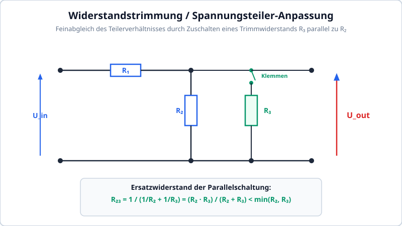

Der Widerstand kann man mit einem anderem Widerstand kontrollieren, durch Parallelschaltung.

*Abbildung: Schaltung zur Widerstandstrimmung / Spannungsteiler:
Eingangsklemmen links führen auf eine Reihenschaltung aus Längswiderstand $R_1$ und Parallelwiderstand $R_2$.
Parallel zu $R_2$ kann über zwei Klemmen ein dritter Widerstand $R_3$ zugeschaltet werden.
Über der Parallelschaltung von $R_2$ und $R_3$ wird die Ausgangsspannung $U$ abgegriffen.*

Der Ersatzwiderstand aus $R_2$ & $R_3$ wird verändert.

Je grösser $R_3$ ist umso „genauer“ wird der Ersatzwiderstand ($R_{23}$).

$$R_{23} = \frac{1}{\frac{1}{R_2} + \frac{1}{R_3}} \quad \text{ans} \rightarrow \frac{1}{\dots} = \frac{1}{\frac{1}{R_2} + \frac{1}{R_3}}$$

Der Ersatzwiderstand kann nicht grösser werden als der kleinste Widerstand in der Parallelschaltung.

---

## 7.18 Lötverfahren: Tauch- und Wellenlöten

### Lötzinn

Es gibt verschiedene Lötzinnlegierungen  
z.B. $\text{Sn}99\text{Cu}1$, $\text{Sn}95{,}5\text{Ag}3{,}8\,\text{Cu}0{,}7$, $\text{Sn}60\text{Pb}40$  
Das Silberhaltige Lötzinn ist sehr teuer aber es leitet am besten.

| Material | Leitfähigkeit bei $20\,^\circ\text{C}$ $[\text{m}/(\Omega \cdot \text{mm}^2)]$ |
| :--- | :--- |
| Silber | 62 |
| Kupfer | 56 |
| Gold | 43,5 |
| Aluminium | 36 |

In einem Lötzinn hat es ein Flussmittel enthalten, Das Flussmittel löst die Oxydschicht an der Lötstelle.

---

### Tauchlöten

Die Leiterplatte mit den THT bestückten Bauelementen wird exakt in das flüssige Lötzinn eingetaucht, sodass nur die Beinchen belötet werden.

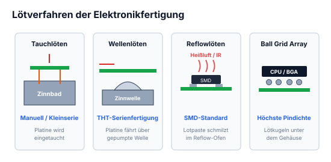

*Abbildung: Tauchlöten – Leiterplatte mit bedrahteten Bauelementen wird nach unten in ein Zinnbad abgesenkt, sodass lediglich die Anschlussbeinchen das flüssige Zinn berühren.*

---

### Wellenlöten

Es wird eine Welle im Lötbecken erzeugt die exakt an die untere Seite an der Platine reicht, so werden THT Bauteile nicht all zu heiss gelötet.

*Abbildung: Wellenlöten – Bestückte Platine bewegt sich horizontal über ein Lötbecken, in dem eine Zinnwelle an die Unterseite der Leiterplatte geführt wird.*

---

## 7.19 Reflowlöten mit Heißluft / Ofen

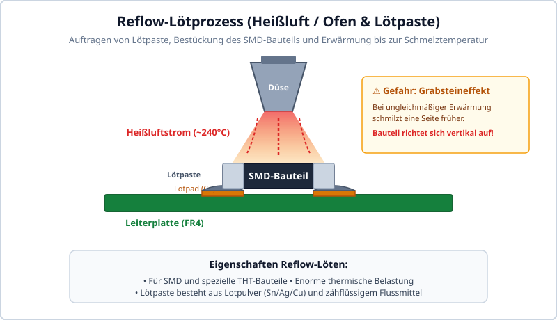

Zuerst wird eine Lötpaste auf die gewollte Stelle aufgetragen, danach wird es im Ofen oder mit einem Föhn verflüssigt. Bei diesem Verfahren wird das Bauteil enorm erhitzt.  
SMD's und THT können so angebracht werden, jedoch besteht die Gefahr auf den Grabsteineffekt.

*Abbildung: Reflow-Lötprozess – Ein SMD-Bauteil auf einer Leiterplatte wird mittels einer Heißluftdüse/Föhn erwärmt.*

---

---

## 7.20 Dampfphasenlöten (Vapor Phase Soldering)

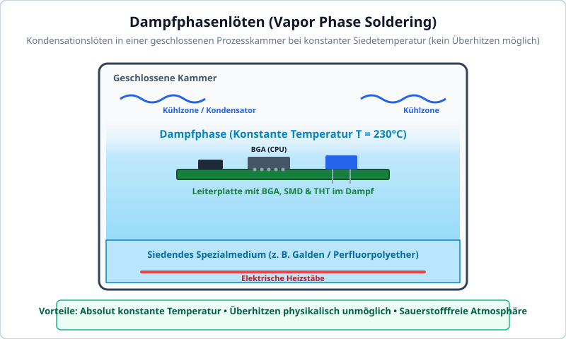

Die Leiterplatte wird in Dampf eingebracht, welcher nur eine konstante Temperatur aufweisen kann. Das überhitzen ist damit unmöglich. Dieser Vorgang ist gut zum Löten von THT, SMD und BGA (Kugelgitteranordnung) geeignet.

*Abbildung: Dampfphasenlöten – Leiterplatte mit Bauteilen in einer geschlossenen Kammer mit definierter Dampfatmosphäre.*

---

---

## 7.21 BGA (Ball Grid Array) Kugelgitteranordnung

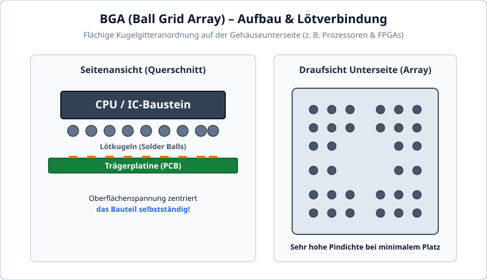

Das ist eine spezielle Anordnung von Lötverbindungen auf einer Platine, die ist z.B. bei einer CPU zu sehen.

*Abbildung: Ball Grid Array (BGA) – Bausteinbeschriftung „CPU“ mit einem darunterliegenden Feld aus Lötkugeln/Lötbällen auf einer Trägerplatine.*

---

## 7.22 Der Grabsteineffekt (Tombstoning)

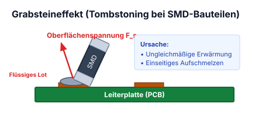

Das ist, wenn sich ein SMD Bauteil Vertikal aufrichtet, das passiert wenn die Hitzeverteilung durch grössere oder kleinere Leiterflächen auf der Platine ungleich ist.

*Abbildung: Grabsteineffekt (Tombstoning):  
Links: SMD-Bauteil flach auf zwei Lötpads montiert – linkes Lötpad ist schmal („klein“), rechtes Lötpad ist großflächig („Gross“, z.B. GND).  
Pfeil $\rightarrow$  
Rechts: Durch ungleichmäßige Wärmeabfuhr und unterschiedliche Schmelzzeiten der Lötpaste richtet sich das SMD-Bauteil einseitig senkrecht auf wie ein Grabstein.*

---

## 7.23 Metalloxid-Varistoren (MOV / VDR)

Ein Varistor (**Var**iable Res**istor** oder VDR = Voltage Dependent Resistor) ist ein spannungsabhängiger Halbleiterwiderstand mit stark nichtlinearer Strom-Spannungs-Kennlinie.

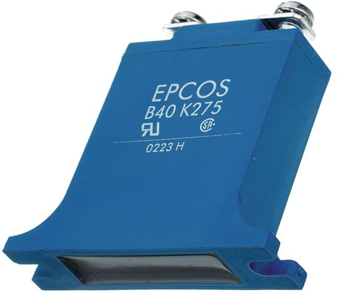

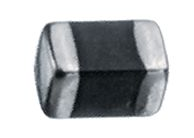

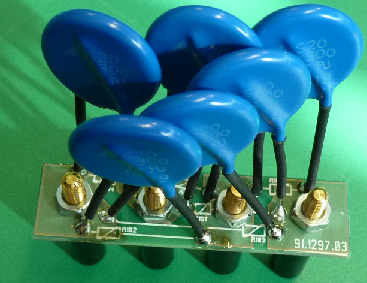

### Aufbau & Wirkungsweise
- **Zusammensetzung:** Gesinterte Keramikscheibe aus Zinkoxid-Körnern ($\text{ZnO}$) mit Beimischungen von Wismut-, Antimon- und Manganoxiden.
- **Mikrostruktur:** An den Berührungspunkten der leitfähigen ZnO-Kristallkörner entstehen mikroskopische Halbleiter-Sperrschichten (Reihen- und Parallelschaltung Tausender winziger Diodenbarrieren).
- **Kennlinie:**
  $$I = k \cdot U^\alpha \quad \text{mit Nichtlinearitätskoeffizient } \alpha \approx 30\dots 50$$
  - Bei Nennbetriebsspannung fließt nur ein winziger Sperr-Leckstrom ($<10\,\mu\text{A}$).
  - Steigt die anliegende Spannung über die Ansprechspannung (Schwellspannung $U_V$), bricht der Widerstand lawinenartig um viele Zehnerpotenzen zusammen und leitet hochenergetische Ströme (bis mehrere Kiloampere) gegen Erde ab.
- **Polung:** Varistoren sind symmetrisch bidirektional und eignen sich gleichermaßen für Wechsel- und Gleichspannung.

!!! warning "Alterung & Brandgefahr bei Varistoren"
    Jeder abgeleitete Surge-Impuls erzeugt punktuelle Mikro-Schmelzkanäle im Zinkoxid-Gefüge. Mit zunehmender Impulsanzahl sinkt die Schwellspannung $U_V$, und der dauerhafte Leckstrom steigt an. Dies führt zu thermischem Durchgehen (Thermal Runaway). Professionelle Überspannungsschutzmodule verfügen deshalb über integrierte thermische Trennschalter (Thermo-Fuse).

## 7.24 Selbstrückstellende Sicherungen (PolyFuse / PPTC)

Eine PolyFuse (auch PolySwitch oder PPTC = Polymeric Positive Temperature Coefficient) ist ein nichtlineares Schutzelement, das bei Überstrom hochohmig wird und sich nach Behebung des Fehlers **selbsttätig wieder zurückstellt**:

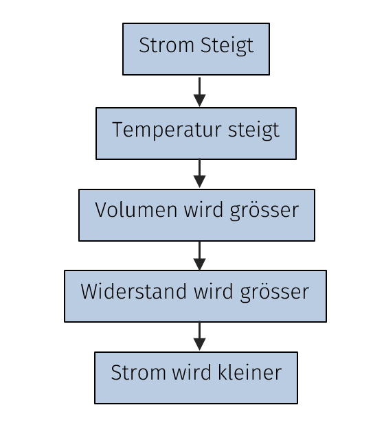

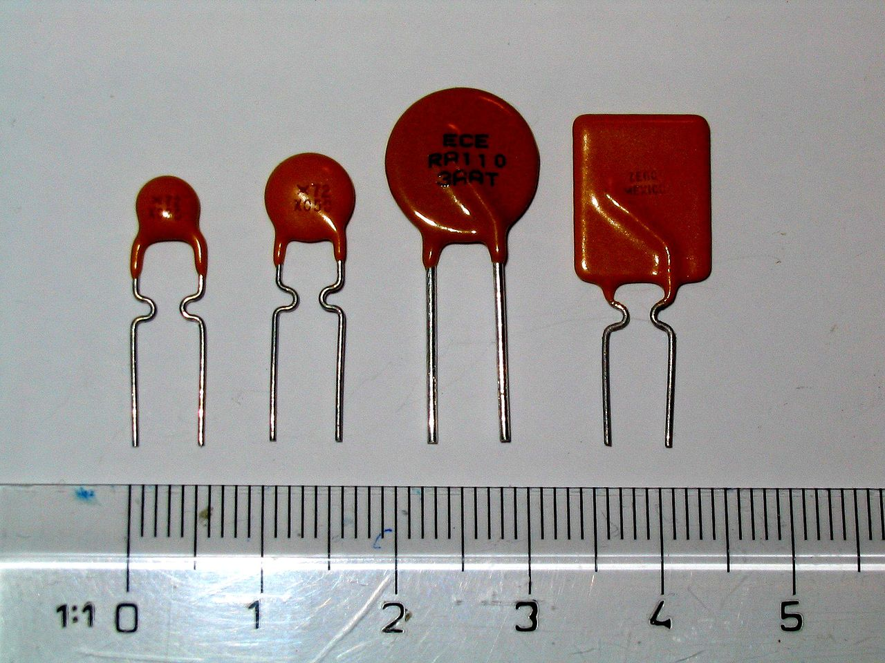

### Funktionsprinzip
- **Materialaufbau:** Matrix aus unpolarem Polymer (z. B. Polyethylen), gefüllt mit mikroskopischen Partikeln aus leitfähigem Ruß/Kohlenstoff (Carbon Black).
- **Ruhezustand:** Bei Nennstrom berühren sich die Rußpartikel $\implies$ geringer Kaltwiderstand ($R_{cold} \approx 20\,\text{m}\Omega \dots 1\,\Omega$).
- **Auslösevorgang:** Bei Überstrom erwärmt sich das Bauteil durch $P = I^2 \cdot R$. Beim Erreichen der Phasenumwandlungstemperatur dehnt sich das Polymer kristallin schlagartig aus. Die Rußketten reißen ab; der Widerstand springt sprunghaft um das $10\,000$-fache in die Höhe.
- **Rückstellung:** Nach Abschalten der Last und Abkühlung sintert das Polymer in den Ausgangszustand zurück.

### Wichtige Kennwerte
- **$I_{hold}$ (Haltestrom):** Maximaler Dauerstrom, bei dem die Sicherung garantiert nicht auslöst.
- **$I_{trip}$ (Auslösestrom):** Mindeststrom, bei dem die Sicherung sicher auslöst (typisch $I_{trip} \approx 2 \cdot I_{hold}$).
- **$V_{max}$:** Maximale Betriebsspannung im hochohmigen Zustand.

## 7.25 Bauteil-Codierung: Farbringe, SMD-Codes & EIA-96

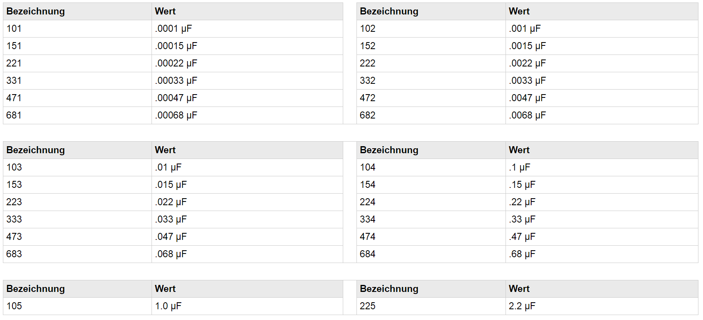

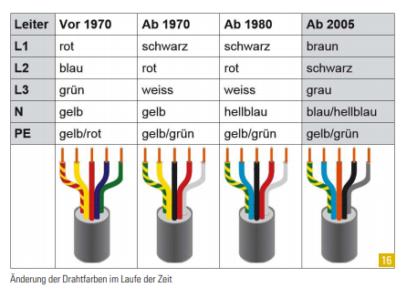

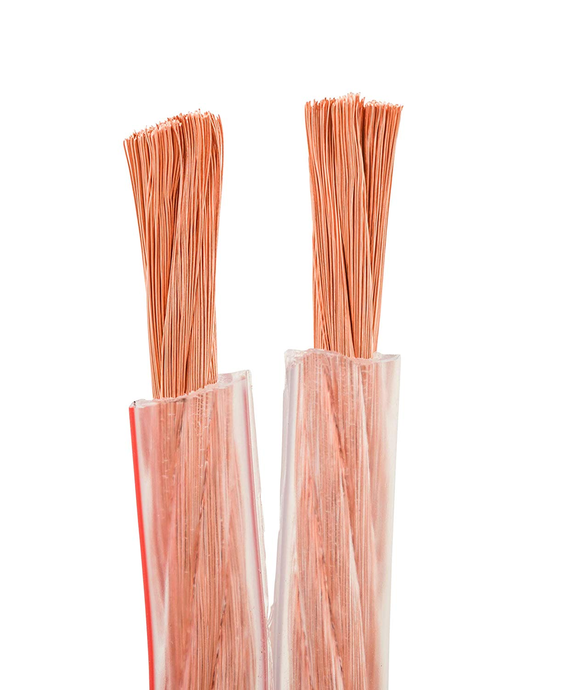

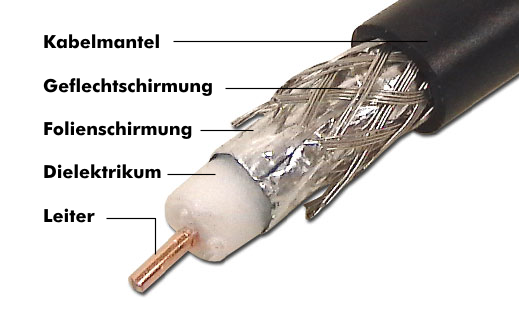

### 1. Farbcode-Kennzeichnung bedrahteter Widerstände
- **4-Ring-Widerstand (Standard):** Ring 1 & 2 = Ziffern, Ring 3 = Multiplikator ($10^x$), Ring 4 = Toleranz.
- **5-Ring-Widerstand (Metallschicht 1%):** Ring 1, 2 & 3 = Ziffern, Ring 4 = Multiplikator, Ring 5 = Toleranz (Braun = 1%, Rot = 2%).
- **6-Ring-Widerstand (Präzision):** Ring 6 gibt den Temperaturkoeffizienten an (z. B. Blau = $10\,\text{ppm}/\text{K}$, Gelb = $25\,\text{ppm}/\text{K}$, Rot = $50\,\text{ppm}/\text{K}$).

### 2. SMD-Widerstandscodes
- **3-stelliger Standardcode (5% Toleranz):**
  - `472` $= 47 \cdot 10^2\,\Omega = 4{,}7\,\text{k}\Omega$
  - `104` $= 10 \cdot 10^4\,\Omega = 100\,\text{k}\Omega$
  - `4R7` $= 4{,}7\,\Omega$ ($R$ dient als Dezimalpunkt)
  - `0R0` $= 0\,\Omega$ (Null-Ohm-Jumper)
- **4-stelliger Code (1% Toleranz):**
  - `1001` $= 100 \cdot 10^1\,\Omega = 1{,}00\,\text{k}\Omega$
  - `4702` $= 470 \cdot 10^2\,\Omega = 47{,}0\,\text{k}\Omega$
- **EIA-96 System (für Bauform 0603 mit 1% Toleranz):**
  Besteht aus zwei Ziffern (Wert aus E96-Tabelle) und einem Buchstaben (Multiplikator):
  - Multiplikatoren: $A=10^0$, $B=10^1$, $C=10^2$, $D=10^3$, $E=10^4$, $X=10^{-1}$, $Y=10^{-2}$.
  - Beispiel: `01C` $\to$ Code `01` entspricht $100 \implies 100 \cdot 10^2\,\Omega = \mathbf{10\,\text{k}\Omega}$.
