# Kapitel 8: Halbleiterphysik, Dioden & Leistungshalbleiter

!!! abstract "Überblick"
    Bändermodell, Dotierung, PN-Übergang, Diodentypen, Gleichrichter, LED, Thyristor und Triac.

## 8.1 Halbleiterphysik & Bändermodell

- Elementhalbleiter (ein chemisches Element aus der 4ten Hauptgruppe)
- Verbindungshalbleiter (Verbindung aus chemischen Elementen aus der 3ten, 5ten, 2ten oder 6ten Hauptgruppe)

### Bändermodell

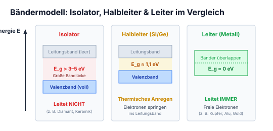

*Abbildung: Ein nach oben gerichteter Pfeil symbolisiert die Energieachse. Von oben nach unten sind drei Zustände in Kästchen dargestellt:*
*- Nichtleiter (leitet nicht*

*- Halbleiter (leitet nach bestimmter Energie)*
*- Leiter (leitet immer))*

- Entstehung Elektronen-Loch-Paar $\rightarrow$ Generation
- Hineinfallen eines Elektron in ein Loch $\rightarrow$ Rekombination

---

---

## 8.2 Dotierung (N- und P-Dotierung)

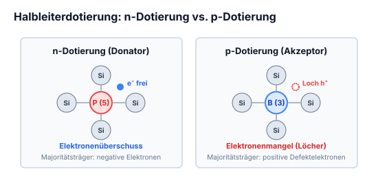

- p-dotierung
- n-dotierung
- Dotieren (verschmutzen mit anderen Elementen)

### n-dotierung

*Abbildung: Kristallgitter bei n-Dotierung.*
*In der Mitte befindet sich ein Phosphor-Atom (P) als Donator, umgeben von Silizium-Atomen (Si) oben, unten, links und rechts mit kovalenten Elektronenpaaren. Ein fünftes Elektron ist frei.*
*Beschriftungen:*
*- Pfeil auf P: „Donator (5 wertige Atom mit Majoritätsträger)“*
*- Pfeil auf das freie Elektron: „Elektronen sind Majoritätsträger“*

### p-dotierung

*Abbildung: Kristallgitter bei p-Dotierung.*
*In der Mitte befindet sich ein Bor-Atom (B) als Akzeptor, umgeben von Silizium-Atomen (Si) mit Elektronenpaaren. Eine Bindung bleibt unvollständig (Fehlstelle/Loch).*
*Beschriftungen:*
*- Pfeil auf B: „Akzeptor“*
*- Pfeil auf das Loch: „Fehlstellungen sind Majoritätsträger“*

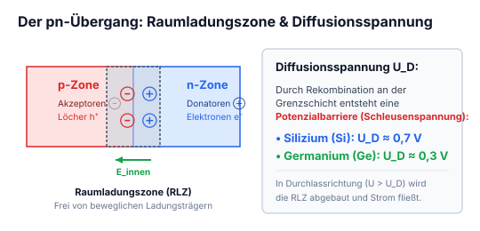

*Abbildung: pn-Übergang und Diffusionsspannung:*
*1. Block mit zwei Zonen: $[ \,n \mid p\, ]$. Pfeilbeschriftung: „Majoritätsträger finden zusammen“.*
*2. Darunter Darstellung der Raumladungszone der Breite $d$. Nach links gerichteter Pfeil für das elektrische Feld $\vec{E}$ von der n- zur p-Zone.*
*Formel darunter: $U = E \cdot d$*

---

---

## 8.3 Der PN-Übergang & Dioden-Schaltsymbol

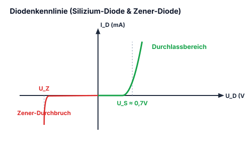

*Abbildung: Schematischer Aufbau einer Diode: Links Kathode mit Vorzeichen $+$, pn-Übergang $[n \mid p]$, rechts Anode mit Vorzeichen $-$.*
*Darunter links: "Durchlassrichtung" mit Diodensymbol nach links gerichtet, Pfeil nach links und Schichtenfolge $- [\,n \mid p\,] +$.*
*Darunter rechts: "Sperrrichtung" mit Diodensymbol, Pfeil nach rechts und Schichtenfolge $+ [\,n \mid p\,] -$.*

---

## 8.4 Dioden-Typen (Silizium, Schottky, Zener)

### Normale Dioden
Bsp Silicium Diode.
Sie hat eine Schleusenspannung in Durchlassrichtung die beträgt $0{,}7\,\text{V}$.

*(Schaltsymbol: Standard-Diodensymbol mit Leitungsanschlüssen, Anodendreieck und Kathodenquerstrich.)*
**Symbol:** Diode

### Schottky-Dioden (Shottky-Dioden)
Schottky-Dioden zeichnen sich durch eine sehr geringe Schwellenspannung ($U_F \approx 0{,}2 \dots 0{,}4\,\text{V}$) sowie extrem kurze Schalt- und Sperrverzögerungszeiten aus.

*(Schaltsymbol: Schottky-Diodensymbol mit S-förmig abgewinkeltem Kathodenbalken.)*
**Symbol:** Schottky-Diode

### Z-Dioden
Werden Zener-Dioden gennant, weil sie eine Sperrspannung hab, wenn diese erreicht wird fängt die Dioden in Sperrichtung an zu leiten. In durchlassrichtung ist sie wie eine normale Diode.
Die Werte der Sperrspannung kommen aus der Normreihe E12 & E24.

*(Schaltsymbol: Zener-Diodensymbol mit rechtwinklig umgebogenen Kathodenbalkenenden.)*
**Symbol:** Zener-Diode

---
!!! tip "Typische Schwellenspannungen (Schleusenspannungen) von Dioden"
    - **Germanium-Dioden:** $U_F \approx 0{,}2 \dots 0{,}3\,\text{V}$
    - **Schottky-Dioden:** $U_F \approx 0{,}2 \dots 0{,}4\,\text{V}$ (sehr schnelle Erholzeit)
    - **Silizium-Dioden:** $U_F \approx 0{,}6 \dots 0{,}7\,\text{V}$ (Standard)
    - **Zener-Dioden (Z-Dioden):** Werden in Sperrrichtung bei definierter Durchbruchspannung $U_Z$ betrieben.
    - **Leuchtdioden (LED):**
      - Infrarot: $\approx 1{,}2\,\text{V}$
      - Rot: $\approx 1{,}6 \dots 2{,}0\,\text{V}$
      - Gelb / Grün: $\approx 2{,}0 \dots 2{,}4\,\text{V}$
      - Blau / Weiß: $\approx 3{,}0 \dots 3{,}4\,\text{V}$

---

## 8.5 Brückengleichrichter (Graetz-Schaltung) & Glättung

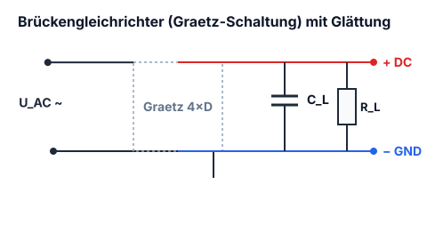

*Abbildung: Graetz-Gleichrichterbrücke aus vier Dioden in Rautenanordnung. An den Klemmen links wird die Wechselspannung eingespeist (oberer Ast an oberen Knoten, unterer Ast an unteren Knoten). An den horizontalen Querabgriffen ist der Lastwiderstand $R$ angeschlossen.*

*(Signaldiagramme:*
*Oben: Wechselspannung "Von" als vollständige Sinusschwingung über und unter der Zeitachse.*
*Pfeil nach unten mit Text: "$f$ wird 2. so schnell"*
*Mitte: Gleichgerichtete Spannung "Zu" als Folge aufeinanderfolgender positiver Sinushalbwellen.)*

Mit einem Kondensator parallel zum Widerstand wird die Welle geglätet

*(Signaldiagramm unten: Geglättete Gleichspannung mit kleiner Restwelligkeit.)*

---

---

## 8.6 Leuchtdioden (LED): Farben, Schwellenspannung & Vorwiderstand

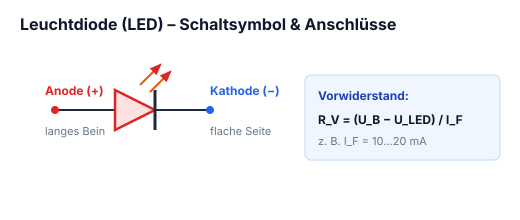

Das sind nichts weiter als Dioden die leuchten können.

Durch den P-N-Übergang wird aus Energie Licht ausgestrahlt die mit Linsen verdeutlicht werden, d.h. je mehr Energie in die Diode reinfliesst desto mehr Licht entsteht.

Die meisten LED's werden mit ca. $2\,\text{V}$ Gleichspannung und $20\,\text{mA}$ betrieben das kommt aber auch auf die Bauform an.

Die polarisierung ist bei manchen LED's mit einer Abgeflachten seite bezeichnet oder einem längeren Beinchen.

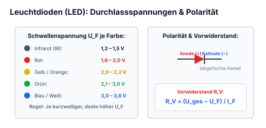

*Abbildung: n und Symbole zur LED:
1. Bedrahtetes LED-Gehäuse: Anode $A$ mit längerem Beinchen, Kathode $K$ mit kürzerem Beinchen und abgeflachtem Gehäuserand.
2. Gehäuseansicht von unten / Sockel: Runder Grundriss mit gerader Abflachung auf der Seite der Kathode $K$.
3. Innere Struktur: Kleinerer Anschlusssteg für Anode $A$, größerer Kelch/Amboss für Kathode $K$.
4. Schaltsymbol: Schaltzeichen einer Diode mit zwei Pfeilen nach schräg oben rechts zur Darstellung der Lichtemission.*

!!! example "Praxisbeispiel: Dimensionierung des LED-Vorwiderstands"
    Eine Standard-Leuchtdiode ($U_F = 1{,}8\,\text{V}$, Nennstrom $I_F = 20\,\text{mA} = 0{,}02\,\text{A}$) soll an einer Versorgungsspannung $U_B = 5\,\text{V}$ (z. B. Mikrocontroller-Board) betrieben werden:
    1. **Erforderlicher Vorwiderstand:**
       $$R_V = \frac{U_B - U_F}{I_F} = \frac{5\,\text{V} - 1{,}8\,\text{V}}{0{,}02\,\text{A}} = \frac{3{,}2\,\text{V}}{0{,}02\,\text{A}} = 160\,\Omega$$
    2. **Wahl des Normwertes (E12-Reihe):**
       Gewählt wird der nächsthöhere Normwert **$R = 180\,\Omega$** (oder $220\,\Omega$ zur Stromersparnis: $I_F \approx 14{,}5\,\text{mA}$).
    3. **Verlustleistung am Vorwiderstand:**
       $$P_R = (U_B - U_F) \cdot I_F = 3{,}2\,\text{V} \cdot 0{,}02\,\text{A} = 0{,}064\,\text{W} = 64\,\text{mW} \ll 0{,}25\,\text{W}$$
       Ein Standard-SMD- oder Kohleschichtwiderstand mit $\frac{1}{4}\,\text{W}$ Belastbarkeit ist völlig ausreichend.

---

## 8.7 Der Thyristor (SCR): Aufbau, Zündung & Löschung

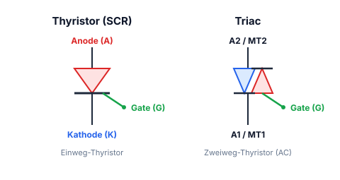

Das ist eine Mischung aus Diode & Transistor.  
Es ist eine steuerbare Diode, die erst leitet, wenn am Eingang Gate ein Signal anliegt.

### Symbol

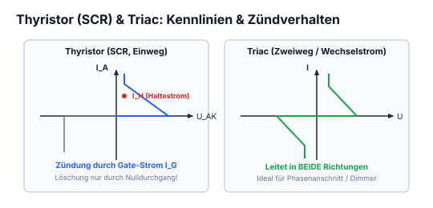

*Abbildung: Schaltzeichen eines Thyristors (SCR):*
- *Dioden-Grundsymbol mit Anode $A$ und Kathode $K$.*
- *Zusätzlicher Steueranschluss Gate $G$ an der Kathodenseite.*

Sie wird erst wieder nicht leitend, wenn $U_D = 0$ ist.

---

---

## 8.8 Der Triac: Zweiweg-Thyristortriode für Wechselstrom

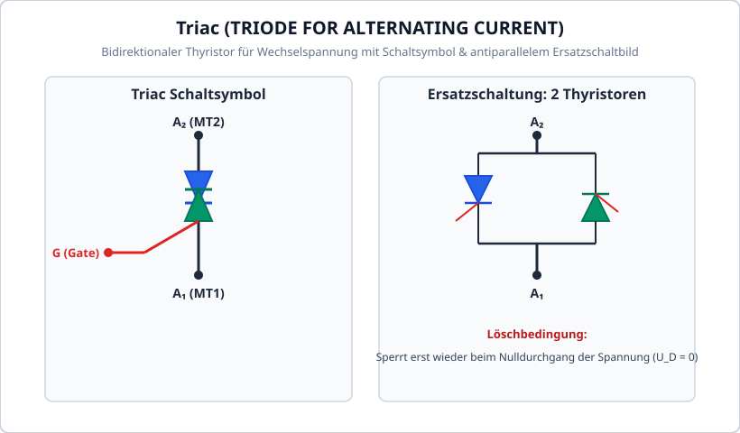

Das sind 2 Dioden, die für Wechselspannung polarisiert sind. Sie werden auch durch einen Impuls am Gate durchlässig und sperrt auch erst dann wieder, wenn $U_D = 0$ ist.

### Symbol

*Abbildung: Schaltzeichen eines Triacs (Zweiweg-Thyristortriode):*
- *Antiparallele Anordnung zweier Thyristoren mit gemeinsamen Hauptanschlüssen $A_1$ und $A_2$.*
- *Gemeinsamer Steueranschluss Gate $G$.*

---

---

## 8.9 Schottky-Dioden: Kennwerte, Schaltverhalten & HF-Einsatz

Die Schottky-Diode basiert nicht auf einem pn-Übergang, sondern auf einem **Metall-Halbleiter-Kontakt** (Schottky-Barriere, z. B. Platin, Molybdän oder Chrom auf n-Silizium).

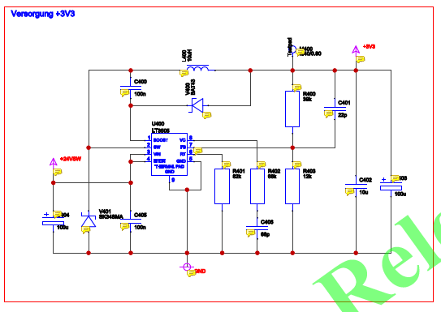

### Hauptmerkmale & Vorteile
1. **Niedrige Durchlassspannung:**
   Schleusenspannung $U_F \approx 0{,}3\dots 0{,}5\,\text{V}$ (gegenüber $0{,}7\dots 1{,}0\,\text{V}$ bei Standard-Silizium-Dioden). Dadurch sinken die Durchlassverluste $P_V = U_F \cdot I_F$ um ca. $50\,\%$.
2. **Extrem schnelles Schaltverhalten ($t_{rr} \approx 0\,\text{ns}$):**
   Da der Stromtransport ausschließlich durch Majoritätsträger (Elektronen) erfolgt, entfällt die bei pn-Dioden gefürchtete Speicherzeit der Minoritätsträger beim Umschalten von Durchlass- in Sperrrichtung.
3. **Einsatzbereiche:**
   Freilaufdioden in Schaltnetzteilen (Buck-/Boost-Konverter), Verpolungsschutz, Hochfrequenz-Mischer und Gleichrichter.

!!! warning "Nachteile von Schottky-Dioden"
    - Deutlich **höherer Sperr-Leckstrom** $I_R$ (im Mikroampere- bis Milliampere-Bereich), der mit steigender Temperatur stark zunimmt.
    - Begrenzte maximale **Sperrspannung** (typisch bis maximal $100\dots 200\,\text{V}$). Für Hochspannungen werden SiC-Schottky-Dioden (Siliziumkarbid) eingesetzt.

## 8.10 Z-Dioden (Zener-Dioden): Spannungsstabilisierung & Begrenzung

Eine Z-Diode ist eine gezielt hochdotierte Silizium-pn-Diode, die für den dauerhaften Betrieb im **Durchbruchbereich in Sperrrichtung** ausgelegt ist.

### Der Zener- und Lawinendurchbruch
- **Zener-Effekt ($U_Z < 5\,\text{V}$):** Sehr schmale Raumladungszone. Das extrem starke elektrische Feld reißt Elektronen direkt aus den kovalenten Kristallbindungen (Tunneleffekt). Negativer Temperaturkoeffizient ($\text{TK} < 0$).
- **Lawinen-Effekt / Avalanche ($U_Z > 6\,\text{V}$):** Breitere Raumladungszone. Ladungsträger werden im Feld so stark beschleunigt, dass sie durch Stoßionisation lawinenartig neue Paare erzeugen. Positiver Temperaturkoeffizient ($\text{TK} > 0$).
- **Temperaturkompensation bei $U_Z \approx 5{,}6\,\text{V}$:** Hier heben sich beide Effekte auf; die Z-Spannung ist nahezu vollkommen temperaturunabhängig ($\text{TK} \approx 0\,\%/^\circ\text{C}$).

### Dimensionierung einer Z-Dioden-Parallelstabilisierung
Gegeben sei eine schwankende Eingangsspannung $U_{in}$, eine konstante Z-Spannung $U_Z$ und ein variabler Laststrom $I_L$:

$$R_V = \frac{U_{in,min} - U_Z}{I_{Z,min} + I_{L,max}}$$

* **Mindest-Zenerstrom:** $I_{Z,min} \approx 1\dots 5\,\text{mA}$, um sicher im steilen Durchbruchbereich der Kennlinie zu arbeiten.
* **Maximale Verlustleistung der Z-Diode (im Leerlauf bei $I_L=0$):**
  $$P_{Z,max} = U_Z \cdot I_{Z,max} = U_Z \cdot \frac{U_{in,max} - U_Z}{R_V}$$

## 8.11 TVS- / Transzorb-Dioden: Hochenergetischer Transientenschutz

Eine **TVS-Diode** (Transient Voltage Suppressor, Markenname *Transzorb*) ist eine spezialisierte Diode zum Schutz empfindlicher Halbleiterschaltungen gegen extrem schnelle elektrostatische Entladungen (ESD) und energiereiche Überspannungsimpulse (Surge/Burst).

### Funktionsweise & Kenndaten
- **Schaltzeit:** Reagiert im Sub-Nanosekundenbereich ($<1\,\text{ps}$).
- **Unipolar vs. Bipolar:**
  - *Unipolar:* Schützt DC-Leitungen (wirkt in Vorwärtsrichtung wie normale Diode, in Sperrrichtung als Transientenschutz).
  - *Bipolar:* Zwei antiparallel integrierte Z-Dioden; schützt symmetrische AC- oder Datenleitungen (z. B. RS-485, CAN-Bus).
- **Kennwerte:**
  - **$V_{RWM}$ (Stand-Off Voltage):** Maximale Betriebsspannung, bei der die Diode sperrt ($I_R < 5\,\mu\text{A}$).
  - **$V_{BR}$ (Breakdown Voltage):** Durchbruchspannung, ab der die Diode leitend wird (gemessen bei $1\,\text{mA}$).
  - **$V_C$ (Clamping Voltage):** Maximale Restspannung über der Diode beim vollen Spitzenimpulsstrom $I_{PPM}$.
  - **$P_{PPM}$ (Peak Pulse Power):** Typisch $400\,\text{W}$, $600\,\text{W}$ oder $1\,500\,\text{W}$ für $10/1\,000\,\mu\text{s}$-Impulse.

## 8.12 LED-Ansteuerung: Vorwiderstand, PWM & Dimmung

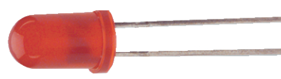

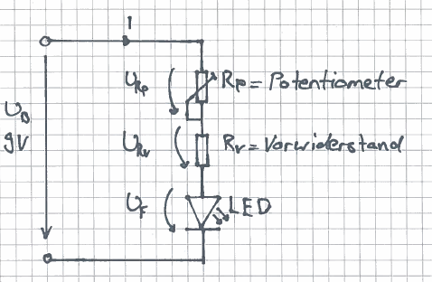

Eine Leuchtdiode (LED) besitzt eine steile Diodenkennlinie und darf **niemals direkt an einer Konstantspannungsquelle** betrieben werden.

### 1. Berechnung des Vorwiderstands
$$R_V = \frac{U_{CC} - U_F}{I_F}$$

Typische Flussspannungen bei $I_F = 20\,\text{mA}$:
- Rot: $U_F \approx 1{,}6\dots 2{,}0\,\text{V}$
- Grün / Gelb: $U_F \approx 2{,}1\dots 2{,}4\,\text{V}$
- Blau / Weiß: $U_F \approx 3{,}0\dots 3{,}6\,\text{V}$

### 2. Dimm-Verfahren
- **Analoge Stromdimmung:** Absenkung des Stroms $I_F$ über einen Längstransistor. Nachteil: Bei weißen LEDs verschiebt sich der Farbort (Farbtemperatur ändert sich), geringer Wirkungsgrad.
- **Pulsweitenmodulation (PWM):** Die LED wird periodisch mit voller Stromstärke ein- und ausgeschaltet (Taktfrequenz $f_{PWM} \ge 200\,\text{Hz}$, flimmerfrei für das menschliche Auge). Die Helligkeit ist exakt proportional zum Tastgrad:
  $$D = \frac{T_{on}}{T} \implies \text{Helligkeit} \propto D$$

## 8.13 Piezoelemente: Sensorik & Aktorik

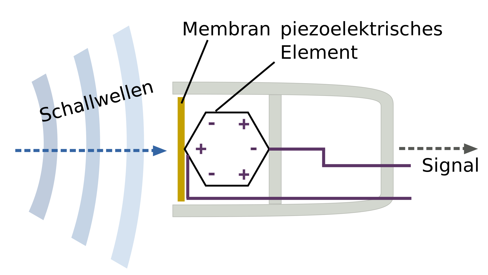

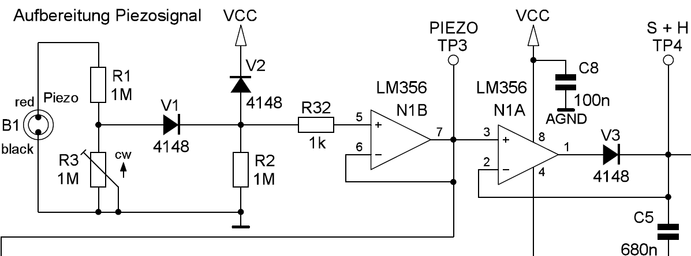

Piezoelemente bestehen aus polarisierten ferroelektrischen Piezokeramiken (Blei-Zirkonat-Titanat / PZT).

- **Direkter Piezoeffekt (Sensor):**
  Mechanische Krafteinwirkung (Druck oder Zug) verschiebt die Ladungsschwerpunkte in den Kristall-Elementarzellen $\implies$ an den Elektroden entsteht eine elektrische Spannung:
  $$Q = d \cdot F$$
  Anwendung: Piezotaster, Erschütterungssensoren, Drucksensoren, Piezo-Feuerzeuge.
- **Inverser Piezoeffekt (Aktor):**
  Wird an das Piezoelement eine elektrische Spannung angelegt, verformt sich der Festkörper elastisch (Längenänderung im Mikrometerbereich):
  $$\Delta l = d \cdot U$$
  Anwendung: Piezo-Signalgeber (Buzzer), Ultraschall-Schallköpfe in der Messtechnik, Common-Rail-Dieselinjektoren, Nanometer-Positioniertische.
