# Kapitel 9: Transistoren & Grundschaltungen

!!! abstract "Überblick"
    BJT, Emitter-, Kollektor-, Basisschaltung, Push-Pull, RS-Flip-Flop, JFET und MOSFETs.

## 9.1 Bipolartransistoren (BJT): NPN & PNP Kennlinienfeld

### Ausgangskennlinienfeld

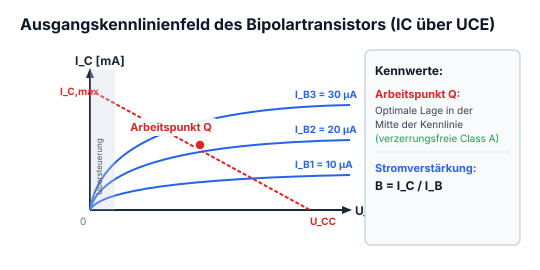

*Abbildung: Kennliniendiagramm $I_C$ über $\frac{U_{BE}}{\text{V}}$ bzw. Transistorkennlinien:*
- *Vertikale Achse: Kollektorstrom $I_C$ mit positivem Bereich ($+$ oben) und negativem Bereich ($-$ unten), Nullpunkt $0$ in der Mitte.*
- *Horizontale Achse: Spannung $\frac{U_{BE}}{\text{V}}$.*
- *Obere Kurven (NPN): Knick und starker Anstieg bei ca. $0{,}6 \dots 0{,}7\,\text{V}$, danach flacherer Verlauf.*
- *Untere Kurven (PNP): Knick und Abfall bei ca. $-0{,}6 \dots -0{,}7\,\text{V}$, danach flacherer Verlauf nach unten.*

### Flip-Flop

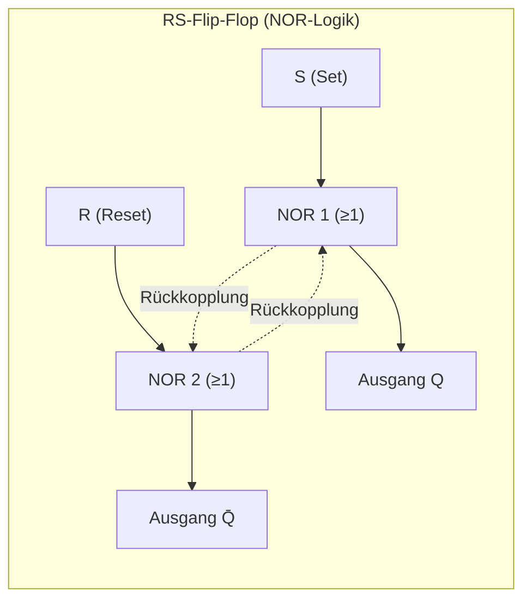

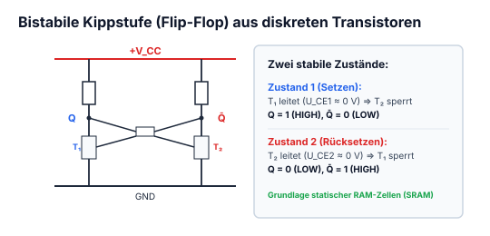

*Abbildung: Zwei Darstellungen eines bistabilen Flip-Flops:*
- *Links: Logik-Schaltbild eines RS-Flip-Flops aufgebaut aus zwei kreuzgekoppelten NOR-Gattern ($\ge 1$ mit Negationspunkt am Ausgang):*
  - *Oberes Gatter: Eingang $S$, Rückkopplung vom invertierten Ausgang $\bar{Q}$, Ausgang $Q$.*
  - *Unteres Gatter: Eingang $R$, Rückkopplung vom Ausgang $Q$, Ausgang $\bar{Q}$.*
- *Rechts: Diskrete Transistorschaltung (bistabile Kippstufe) mit zwei NPN-Transistoren:*
  - *Obere Versorgungsspannungsschiene, untere Masse-Schiene (GND).*
  - *Emitter beider Transistoren liegen an Masse.*
  - *Kollektoren sind über Lastwiderstände an die obere Versorgungsspannung angeschlossen.*
  - *Kollektor des linken Transistors ist mit der Basis des rechten Transistors kreuzgekoppelt.*
  - *Kollektor des rechten Transistors ist mit der Basis des linken Transistors kreuzgekoppelt.*
  - *Zwei Ausgangsanschlusspunkte an den Kollektoren.*

---

---

## 9.2 Der Bipolartransistor als Schalter

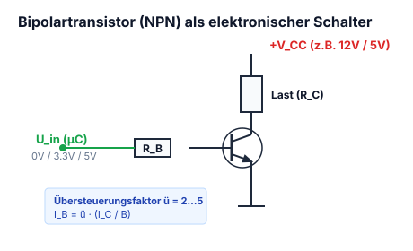

Auch ein Transistor braucht ein[en] Vorwiderstand.  
Alles was man wissen muss steht im Datenblatt.

*Abbildung: Schaltung eines Transistors als Schalter (hier PNP-Transistor):
Obere Schiene: Betriebsspannung $U_B$.
Emitter ist an die Versorgungsspannung $U_B$ angeschlossen ($I_E$ fließt hinein).
Die Basis wird über einen Vorwiderstand $R_V$ angesteuert (Spannungsabfall $U_{RV}$, Basisstrom $I_B$ fließt heraus).
Eingezeichnet ist die Basis-Emitter-Spannung $U_{BE}$.
Vom Kollektor fließt der Kollektorstrom $I_C$ über den Lastwiderstand $R_L$ (Spannungsabfall $U_{RL}$) nach Masse (GND).
Über der Kollektor-Emitter-Strecke liegt die Sättigungsspannung $U_{CE(sat)}$.*

$$R_V = \frac{U_B - U_{BE} - U_e}{\frac{I_C}{B} \cdot \ddot{u}} = \frac{U_{RV}}{I_B}$$

$$\text{mit } I_C = \frac{U_B - U_{CE(sat)}}{R_L}$$

$$\ddot{u} = \text{Übersteuerungsfaktor}$$

Dabei ist $B$ aus dem Datenblatt abzulesen und $\ddot{u}$ zwischen $2\text{--}10$ zu wählen. Mit $\ddot{u} = 10$ ist die Garantie grösser, dass wir in die Sättigung kommt, das ist wichtig, weil der Transistor sonst zu viel Leistung auf sich hat und sich erhitzt.

!!! example "Praxisbeispiel: Dimensionierung der Transistor-Schaltstufe"
    Ein Relais mit Spulenwiderstand $R_{\text{Last}} = 240\,\Omega$ soll an $U_{CC} = 12\,\text{V}$ über einen NPN-Transistor (z. B. BC547, Gleichstromverstärkung $h_{FE} \approx 150$) von einem $3{,}3\,\text{V}$-Mikrocontroller-Ausgang geschaltet werden:
    1. **Kollektorstrom im geschlossenen Zustand ($U_{CE,\text{sat}} \approx 0{,}2\,\text{V}$):**
       $$I_C \approx \frac{U_{CC} - U_{CE,\text{sat}}}{R_{\text{Last}}} = \frac{12\,\text{V} - 0{,}2\,\text{V}}{240\,\Omega} = \frac{11{,}8\,\text{V}}{240\,\Omega} \approx 49{,}2\,\text{mA}$$
    2. **Basisstrom mit Übersteuerungsfaktor ($k = 3$ für sichere Sättigung):**
       $$I_B = k \cdot \frac{I_C}{h_{FE}} = 3 \cdot \frac{49{,}2\,\text{mA}}{150} \approx 0{,}98\,\text{mA} \approx 1{,}0\,\text{mA}$$
    3. **Berechnung des Basisvorwiderstands $R_B$ ($U_{BE} \approx 0{,}7\,\text{V}$):**
       $$R_B = \frac{U_{\text{GPIO}} - U_{BE}}{I_B} = \frac{3{,}3\,\text{V} - 0{,}7\,\text{V}}{1{,}0\,\text{mA}} = \frac{2{,}6\,\text{V}}{0{,}001\,\text{A}} = 2600\,\Omega = 2{,}6\,\text{k}\Omega$$
       Gewählt wird der Standard-Normwert **$R_B = 2{,}2\,\text{k}\Omega$** oder **$2{,}7\,\text{k}\Omega$**.

---
!!! warning "Die 3 Betriebsbereiche des Bipolartransistors"
    1. **Sperrbereich (Cutoff):** $U_{BE} < 0{,}6\,\text{V} \implies I_B = 0, \, I_C \approx 0$ (Schalter geöffnet).
    2. **Aktiver Verstärkerbereich:** $U_{BE} \approx 0{,}7\,\text{V}$ und $U_{CE} > U_{CE,\text{sat}} \implies I_C = \beta \cdot I_B$.
    3. **Übersteuerter Sättigungsbereich:** $I_B > \frac{I_C}{\beta} \implies U_{CE} = U_{CE,\text{sat}} \approx 0{,}1 \dots 0{,}2\,\text{V}$ (Schalter geschlossen).

---

## 9.3 Transistoren: Funktionsprinzip & Steuerstrom

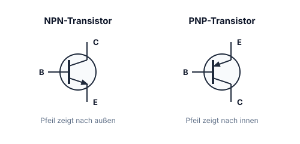

### Bipolare Transistoren

#### NPN

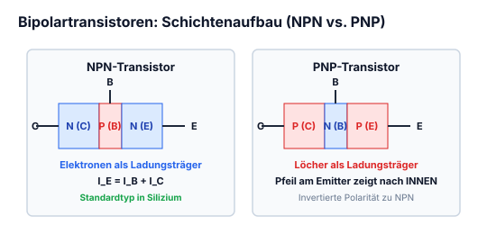

*Abbildung: NPN-Transistor-Schaltzeichen und Schichtenaufbau:*
- *Schaltzeichen: Basis $B$, Kollektor $C$, Emitter $E$. Basisstrom $I_B$ fließt in die Basis, Kollektorstrom $I_C$ in den Kollektor, Pfeil am Emitter zeigt nach außen ($I_E$). Pfeile für Spannungen: Basis-Emitter-Spannung $U_{BE}$ und Kollektor-Emitter-Spannung $U_{CE}$.*
- *Schichtenmodell: Halbleiterschichtenfolge Emitter $E$ [$N$] – Basis $B$ [$P$] – Kollektor $C$ [$N$]. Am Emitter liegen $0\,\text{V}$, am Kollektor $+$.*

#### PNP

*Abbildung: PNP-Transistor-Schaltzeichen und Schichtenaufbau:*
- *Schaltzeichen: Basis $B$, Kollektor $C$, Emitter $E$. Pfeil am Emitter zeigt nach innen ($I_E$). Basisstrom $I_B$ fließt aus der Basis heraus, Kollektorstrom $I_C$ fließt aus dem Kollektor heraus. Spannungen: $U_{BE}$ und $U_{CE}$.*
- *Schichtenmodell: Halbleiterschichtenfolge Emitter $E$ [$P$] – Basis $B$ [$N$] – Kollektor $C$ [$P$]. Basis $B$ ist an die mittlere $N$-Schicht angeschlossen.*

**Anschlüsse:**
- $B$: Basis
- $C$: Collector
- $E$: Emitter

Der bipolare Transistor ist ein stromabhängiger Stromverstärker und wird auch als Schalter genutzt.

**Unterschied zwischen NPN & PNP:**
Für NPN's muss eine positive Spannung anliegen, bei PNP's eine negative Spannung.

### Formeln

$$I_E = I_B + I_C \quad ; \quad I_C = I_B \cdot B = I_B \cdot h_{FE} \quad \text{mit } B = \frac{I_C}{I_B}$$

$$U_{CE} = U_{CB} + U_{BE}$$

$$B = h_{FE} = \text{Verstärkungsfaktor}$$

---

---

## 9.4 Emitterschaltung (Class A) & Gegentakt-Endstufe (Push-Pull)

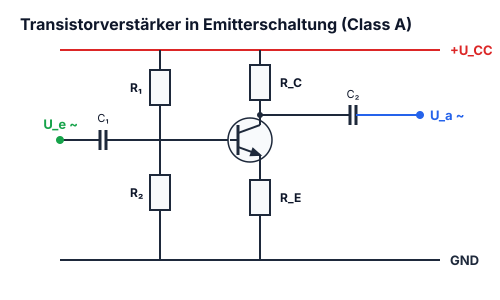

### Class A - Verstärker

*Abbildung: Kleinsignal-Verstärkerstufe in Emitterschaltung:*
- *Versorgungsschiene oben ($+U_B$), Masse unten (GND).*
- *NPN-Transistor: Emitter direkt an Masse angeschlossen ($I_E$).*
- *Kollektor über Arbeitswiderstand an obere Versorgungsschiene angeschlossen ($I_C$).*
- *Basisvorspannung über Widerstand $R_1$ von der oberen Schiene.*
- *Eingang: Eingangsspannung $U_e$, Eingangsstrom $I_e$ über Koppelkondensator $C_1$ an die Basis ($I_B$).*
- *Ausgang: Ausgangsspannung $U_a$, Ausgangsstrom $I_a$ über Koppelkondensator $C_2$ am Kollektor abgegriffen.*

### Push-Pull

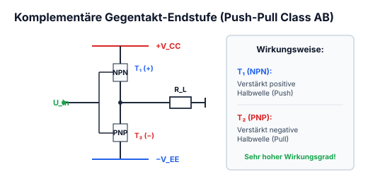

*Abbildung: Gegentakt-Endstufe (Push-Pull-Verstärker):*
- *Obere Versorgungsschiene, untere Masse-Schiene (GND).*
- *Zwei komplementäre Transistoren:*
  - *$T_1$ (PNP-Transistor): Emitter an oberer Schiene, Emitterpfeil zeigt nach innen zur Basis.*
  - *$T_2$ (NPN-Transistor): Emitter an Masse (GND), Emitterpfeil zeigt nach außen zur Masse.*
- *Basen beider Transistoren sind miteinander verbunden und werden über einen Vorwiderstand $R_V$ vom Eingangssignal angesteuert.*
- *Kollektoren beider Transistoren sind am Mittelpunkt zusammengeführt und führen zum Ausgang.*
- *Vom Ausgangsknoten führt ein Lastwiderstand $R_L$ nach Masse.*

---

---

## 9.5 Kollektorschaltung / Emitterfolger (Impedanzwandler)

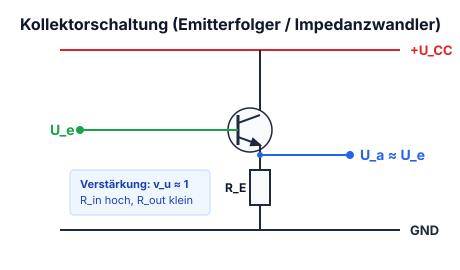

*Abbildung: Kollektorschaltung (Emitterfolger) mit Wechselstromkopplung:*
- *Versorgungsschiene $+U_B$ oben, Masse GND unten.*
- *Spannungsteiler an der Basis: $R_1$ nach $+U_B$, $R_2$ nach GND.*
- *Eingang: Signalspannung $U_e$ wird über Koppelkondensator $C_1$ auf die Basis eingekoppelt.*
- *NPN-Transistor $T_1$: Kollektor liegt direkt an $+U_B$.*
- *Emitterwiderstand $R_E$ liegt zwischen Emitter und GND.*
- *Ausgang: Signalspannung $U_a$ wird am Emitter über einen Ausgangskondensator ausgekoppelt.*

---

## 9.6 Basisschaltung (HF-Verstärker)

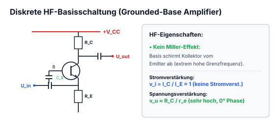

*Abbildung: Basisschaltung zur Hochfrequenzverstärkung:*
- *Versorgungsschiene $+U_B$ oben, GND unten.*
- *Basisvorspannung über resistiven Spannungsteiler zwischen $+U_B$ und Masse. Basisstrom $I_B$.*
- *NPN-Transistor:*
  - *Kollektor über Arbeitswiderstand an $+U_B$. Kollektorstrom $I_C$.*
  - *Emitter über Widerstand an Masse. Emitterstrom $I_E$.*
- *Eingang: Eingangsspannung $U_e$ wird über einen Kondensator am Emitter eingespeist.*
- *Ausgang: Ausgangsspannung $U_a$ wird über einen Kondensator am Kollektor abgegriffen.*

### Formeln

$$I_C = I_B \cdot B$$

$$I_E = I_C + I_B = I_B \cdot (B + 1)$$

---

---

## 9.7 Transistor-Grundschaltungen im tabellarischen Vergleich

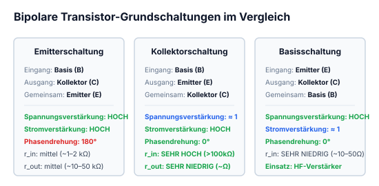

### Schaltungsäquivalenzen

*Abbildung: n: Gegenüberstellung von bipolaren Transistor-Grundschaltungen und ihren Feldeffekttransistor-Pendants:*

1. **Obere Zeile (Emitterfolger vs. Sourcefolger / Kollektorschaltung vs. Drainschaltung):**
   - *Links (Bipolar): NPN-Transistor zwischen $U_B$ und GND. Kollektor direkt an $U_B$. Basis über Vorwiderstand $R_V$ am Eingang. Emitter über Lastwiderstand $R_L$ an GND.*
   - *$=$ (entspricht*

   - *Rechts (FET): FET zwischen $U_B$ und GND. Drain direkt an $U_B$. Gate über $R_V$ am Eingang. Source über Lastwiderstand $R_L$ an GND.*

2. **Untere Zeile (Emitterschaltung vs. Sourceschaltung):**
   - *Links (Bipolar): NPN-Transistor zwischen $U_B$ und GND. Kollektor über $R_L$ an $U_B$, Ausgangsspannung wird am Kollektor gegen GND abgegriffen. Basis über $R_V$ am Eingang. Emitter an GND.*
   - *$=$ (entspricht)*
   - *Rechts (FET): FET zwischen $U_B$ und GND. Drain über $R_L$ an $U_B$, Ausgangsspannung wird am Drain gegen GND abgegriffen. Gate über $R_V$ am Eingang. Source an GND.)*

---

---

## 9.8 Unipolare Transistoren (Feldeffekttransistoren - FET)

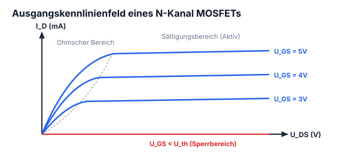

### MOSFET (Metalloxid Semiconductor)

#### P-Ch Verarmungs-Typ $\rightarrow$ NC

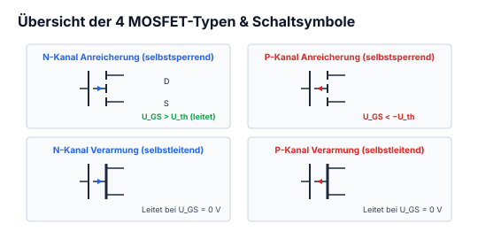

*Abbildung: Schaltsymbol und Halbleiterstruktur eines P-Kanal-Verarmungs-MOSFETs:*
- *Schaltsymbol: Anschlüsse Gate $G$, Source $S$, Drain $D$. Durchgehender Kanal, Substratanschluss mit Pfeil nach außen gerichtet (weg vom Kanal).*
- *Struktur: Drain $D$ oben, Source $S$ unten, P-leitender Kanal im Halbleiterkörper, zwei N-Gebiete an den Seiten, Metalloxid-Isolierschicht, Gate-Anschluss $G$.*

- $G$: Gate
- $D$: Drain
- $S$: Source

#### P-Ch Anreicherungs-Typ $\rightarrow$ NO

*Abbildung: Schaltsymbol eines P-Kanal-Anreicherungs-MOSFETs:*
- *Gate $G$, Source $S$, Drain $D$.*
- *Unterbrochene Kanallinie (drei Abschnitte), Substrat mit Pfeil nach außen, mit Source verbunden.*

#### Kennliniendiagramm

*Abbildung: Kennlinienfeld $I_D$ über $U_{DS}$:*
- *Vertikale Achse: Drainstrom $+I_D$ nach oben, $-I_D$ nach unten.*
- *Horizontale Achse: Drain-Source-Spannung $U_{DS}$.*
- *Kennlinienschar im 1. Quadranten für positive Gatespannungen $+2\,\text{V}, +1\,\text{V}, \dots$ sowie Kennlinienverlauf im 4. Quadranten für negative Spannungen.*

---

---

## 9.9 Sperrschicht-FET (JFET) & 2-Pol-Konstantstromquelle

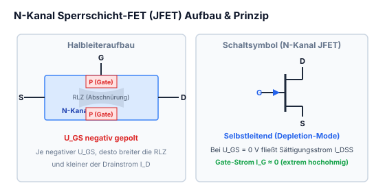

### N-Ch Verarmungstyp

*Abbildung: Schaltsymbol und Struktur eines N-Kanal-Sperrschicht-Feldeffekttransistors (JFET):*
- *Schaltsymbol: Drain $D$, Source $S$, Gate $G$ mit Pfeil nach innen zum Kanal.*
- *Struktur: Drain $D$ oben, Source $S$ unten, N-Kanal im Zentrum, seitliche P-Gebiete, die mit dem Gate $G$ verbunden sind.*

### Anwendungen von J-FETs mit N-Kanal
- Verstärkerschaltung, Analogschalter, Oszillatoren
- Vorverstärker Mikrofon

### J-FET als Strombegrenzer

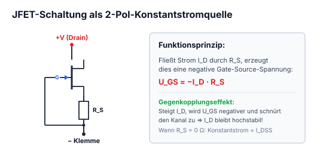

*Abbildung: J-FET-Beschaltung als Konstantstromquelle / Strombegrenzer:*
- *Schaltsymbol: Gate $G$ ist direkt mit der Source $S$ kurzgeschlossen. Anschlüsse Drain $D$ und Source $S$.*
- *Strukturmodell: Oben Anschluss $D \mid A$ (Drain / Anode), unten Anschluss $S \mid K$ (Source / Kathode), N-Kanal mit seitlich kurzgeschlossenen P-Zonen.*

---

---

## 9.10 MOSFETs: N-Kanal & P-Kanal (Verarmungs- vs. Anreicherungstyp)

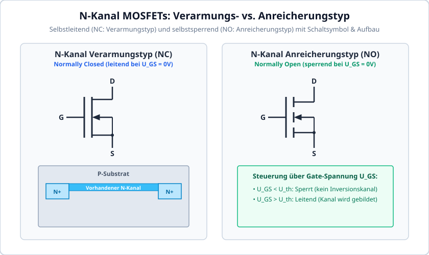

### N-Ch. Verarmungstyp $\rightarrow$ NC

*Abbildung: Schaltsymbol und Halbleiteraufbau eines N-Kanal-Verarmungs-MOSFETs:*
- *Schaltsymbol: Anschlüsse Gate $G$, Source $S$, Drain $D$. Durchgehender Kanal, Substratpfeil zeigt nach innen auf den Kanal zu.*
- *Aufbau: Drain $D$ oben, Source $S$ unten, N-leitender Kanal, seitliche P-Bereiche, Metalloxid-Isolierschicht (MO), Gate-Anschluss $G$.*

### N-Ch. Anreicherungstyp $\rightarrow$ NO

*Abbildung: Schaltsymbol eines N-Kanal-Anreicherungs-MOSFETs:*
- *Anschlüsse Gate $G$, Source $S$, Drain $D$.*
- *Unterbrochene Kanallinie (drei Striche), Substratpfeil zeigt nach innen auf den Kanal zu.*

**Spannungspolarität:**
N-Ch's müssen mit einer positiven Spannung genutzt werden und der P-Ch mit einer negativen Spannung.

### Anwendung von MOSFETs
MOSFETs werden meistens für Verstärkerschaltungen verwendet.

---

---

## 9.11 IGBT (Insulated Gate Bipolar Transistor): Aufbau, Kennlinien & Ansteuerung

Der **IGBT** vereint die Vorteile des feldeffektgesteuerten MOSFETs (nahezu leistungsloser Steueranschluss über isoliertes Gate) mit den Vorteilen des Bipolartransistors (sehr geringe Durchlassverluste und hohe Stromtragfähigkeit bei hohen Spannungen).

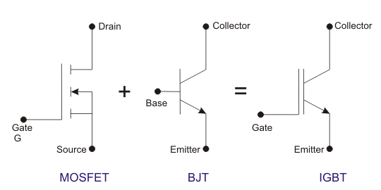

### Schaltungsaufbau & Funktionsweise
- **Ersatzschaltbild:** Ein N-Kanal-MOSFET treibt die Basis eines pnp-Hochleistungs-Bipolartransistors.
- **Leitungsmechanismus:** Durch Anlegen einer Gate-Emitter-Spannung $U_{GE} > U_{GE(th)} \approx 4\dots 6\,\text{V}$ bildet sich im MOSFET-Teil ein Inversionskanal. Elektronen fließen in die schwach dotierte n-Driftzone und veranlassen die p-Substratschicht zur massiven Injektion von Löchern (**Leitfähigkeitsmodulation**).
- Dadurch bleibt die Durchlassspannung $U_{CE(sat)}$ auch bei Strömen von mehreren Hundert Ampere sehr gering ($U_{CE(sat)} \approx 1{,}5\dots 2{,}5\,\text{V}$).

### Ansteuerung & Schalteigenschaften
- **Schaltfrequenzbereich:** Typisch bis $20\dots 50\,\text{kHz}$ (oberhalb von Thyristoren, aber unterhalb reiner Leistungs-MOSFETs).
- **Tail-Strom:** Beim Abschalten des Gates rekombinieren die im n-Gebiet gespeicherten Minoritätsladungsträger nur langsam $\implies$ ein abklingender Reststrom („Tail“) verursacht Abschaltverlustleistung.
- **Einsatzbereiche:** Frequenzumrichter für Drehstrommotoren, Schweißinverter, Induktionskochfelder, Traktionsantriebe (Elektrofahrzeuge, Züge) und Hochvolt-Prüfgeneratoren bei EMC Partner AG.
