# Kapitel 10: Operationsverstärker, Filter & Signalverarbeitung

!!! abstract "Überblick"
    Dezibel [dB], OPV-Grundregeln, Grundschaltungen, RC-Tiefpass und Hochpassfilter.

## 10.1 Vierpol-Grundlagen: Verstärkung & Dämpfung in Dezibel [dB]

### Verstärkung

Die Verstärkung wird mit $V$, $V_{dB}$ bezeichnet und in $[1]$, $[\text{dB}]$ gegeben.

**Formel:**

$$V_{dB} = 20 \cdot \log_{10}(V)$$

mit $V = \frac{U_a}{U_e}$, Rückrechnung: $V = 10^{\left(\frac{V_{dB}}{20}\right)}$

- $U_e$: Spannung am Eingang
- $U_a$: Spannung am Ausgang

---

### Dämpfung

Die Dämpfung wird mit $D_{dB}$ bezeichnet und in $[\text{dB}]$ angegeben.

**Formel:**

$$D_{dB} = 20 \cdot \log_{10}(D)$$

mit $D = \frac{U_e}{U_a}$, Rückrechnung: $D = 10^{\left(\frac{D_{dB}}{20}\right)}$

---

### Bsp.:

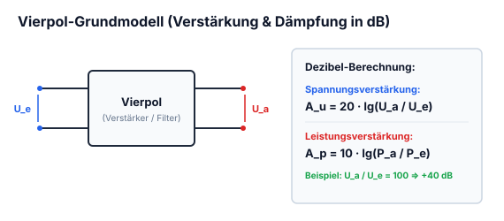

*Abbildung: Vierpol mit Eingangsklemmen für Eingangsspannung $U_e$ und Ausgangsklemmen für Ausgangsspannung $U_a$.*

$$U_e = 0{,}1\,\text{V}$$
$$U_a = 10\,\text{V}$$

$$V = \frac{U_a}{U_e} = \frac{10\,\text{V}}{0{,}1\,\text{V}} = 100$$

$$V_{dB} = 20 \cdot \log_{10}(V) = 20 \cdot \log_{10}\left(\frac{10\,\text{V}}{0{,}1\,\text{V}}\right) = 20 \cdot \log_{10}(100) = 40\,\text{dB}$$

Es wird also $40\,\text{dB}$ verstärkt.

Die Verstärkung $V$ ist ein Faktor, dies kann man aber in dB umrechnen.

$$V_{dB} = 20 \cdot \log_{10}(V) \quad \text{wobei} \quad V = \frac{U_a}{U_e} \text{ ist.}$$

Die Angabe $V_{dB}$ gilt aber nur für $U$ & $I$.

---

## 10.2 Der ideale Operationsverstärker (OPV): Kennwerte

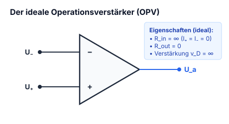

Der Operationsverstärker verstärkt die Spannung aber der OP hat verschiedene Eigenschaften je nach Einbau.

### Schaltsymbol

*Abbildung: n: Zwei gebräuchliche Schaltsymbole für den Operationsverstärker:
- Links: Dreieckssymbol mit invertierendem ($-$) und nicht-invertierendem ($+$) Eingang links und Ausgang rechts.
- Rechts: Rechteckiges Symbol nach DIN/IEC mit Kennzeichnung der Eingänge $-$ und $+$ und Ausgang rechts.*

---

### Eigenschaften idealer Operationsverstärker

$$V_0 = \infty$$
$$R_i = \infty$$
$$I_p = I_n = 0\,\text{mA}$$
$$R_a = 0$$
$$V_0 = \frac{U_a}{U_d} = \infty$$

*Abbildung: Idealer Operationsverstärker:
Zwei Eingänge: nicht-invertierender Eingang ($+$) und invertierender Eingang ($-$).
Eingangsströme $I_p$ und $I_n$ fließen in die jeweiligen Eingänge ($I_p = I_n = 0$).
Differenzspannung $U_d$ liegt zwischen den Eingängen.
Eingangsspannungen jeweils gegen Masse bezogen.
Ausgangsspannung $U_a$ liegt am Ausgang gegen Masse an.*

!!! warning "Die beiden Goldenen Regeln des idealen Operationsverstärkers (bei Gegenkopplung)"
    1. **Virtueller Kurzschluss:** Die Differenzeingangsspannung ist null:
       $$U_d = U_+ - U_- = 0 \implies U_+ = U_-$$
    2. **Kein Eingangsstrom:** Wegen des unendlich hohen Eingangswiderstandes ($r_e \to \infty$) fließen keine Ströme in die Eingänge:
       $$I_+ = I_- = 0$$

---

## 10.3 OPV-Gegenkopplung mit Widerständen

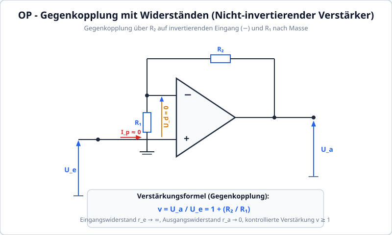

Das sorgt für eine kontrollierte Gegenkopplung und Verstärkung, deren Teilerverhältnis auf dem Prinzip des [[#4.9 Spannungsteiler (unbelastet & belastet) & Stromteiler|Spannungsteilers]] beruht.

*Abbildung: Nicht-invertierender Operationsverstärker mit Gegenkopplung:
Eingangsspannung $U_e$ liegt am nicht-invertierenden Eingang ($+$) gegen Masse.
Differenzspannung $U_d$ liegt zwischen den Eingängen ($+$) und ($-$).
Eingangsströme: $I_p$ fließt in den $(+)$ Eingang, $I_n$ fließt in den $(-)$ Eingang.
Vom Ausgang führt ein Gegenkopplungswiderstand $R_2$ (Spannung $U_{R2}$, Strom $I_2$) zurück auf den invertierenden Eingang ($-$).
Vom invertierenden Eingang führt ein Widerstand $R_1$ (Spannung $U_{R1}$, Strom $I_1$) nach Masse.
Ausgangsspannung $U_a$ liegt am Ausgang gegen Masse an.*

---

---

## 10.4 Der nicht-invertierende Verstärker

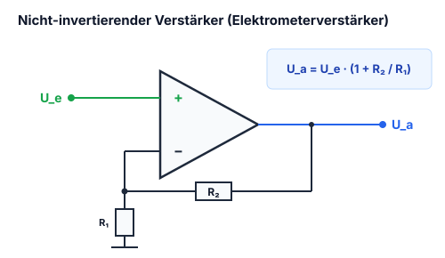

$$U_d = 0$$

*Abbildung: Nicht-invertierender Operationsverstärker:
Eingangsspannung $U_e$ liegt am nicht-invertierenden Eingang ($+$) gegen Masse.
Differenzspannung $U_d = 0$ zwischen den Eingängen ($+$) und ($-$).
Gegenkopplung vom Ausgang über Widerstand $R_1$ auf den invertierenden Eingang ($-$).
Vom invertierenden Eingang führt Widerstand $R_2$ nach Masse.
Ausgangsspannung $U_a$ am Ausgang gegen Masse.*

$$U_a = U_e \left(1 + \frac{R_1}{R_2}\right)$$

$$V = \frac{U_a}{U_e} = 1 + \frac{R_1}{R_2} \implies R_2 = \frac{R_1}{(V - 1)}$$

---

---

## 10.5 Der Impedanzwandler (Spannungsfolger / Buffer)

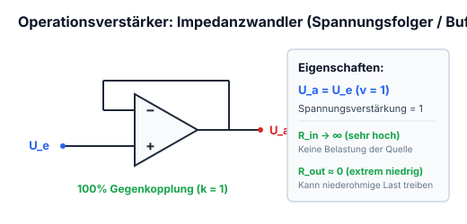

$$U_e = U_a$$
$$V = 1$$

*Abbildung: Impedanzwandler / Spannungsfolger:
Eingangsspannung $U_e$ liegt am nicht-invertierenden Eingang ($+$) an.
Der Ausgang ist direkt mit dem invertierenden Eingang ($-$) kurzgeschlossen (100% Gegenkopplung).
Ausgangsspannung $U_a$ steht am Ausgang an.*

Der Impedanzwandler ist dafür da, um die Schaltung zuvor unbelastet zu lassen, z.B. bei einer R2R Schaltung.

---

## 10.6 Der subtrahierende Verstärker (Differenzverstärker)

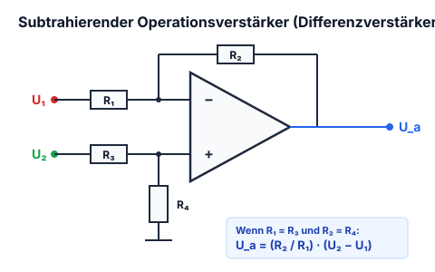

*Abbildung: Subtrahierverstärker / Differenzverstärker:
- Invertierender Zweig: Eingangsspannung $U_{e2}$ führt über Vorwiderstand $R_3$ (Spannungsabfall $U_{R3}$, Strom $I_2$) an den Eingang ($-$). Rückkopplungswiderstand $R_4$ (Spannungsabfall $U_{R4}$, Strom $I_2$) verbindet Ausgang und Eingang ($-$). Eingangsstrom $I_n = 0\,\text{A}$.
- Nicht-invertierender Zweig: Eingangsspannung $U_{e1}$ führt über Vorwiderstand $R_1$ (Strom $I_1$) an den Eingang ($+$). Von dort führt Widerstand $R_2$ (Spannungsabfall $U_{R2}$, Strom $I_1$) nach Masse. Eingangsstrom $I_p = 0\,\text{A}$.
- Differenzspannung $U_d = 0\,\text{V}$ zwischen invertierendem und nicht-invertierendem Eingang.
- Ausgangsspannung $U_a$ gegen Masse.*

$$\text{mit } \begin{cases} R_1 = R_3 \\ R_2 = R_4 \end{cases} \implies U_a = (U_{e1} - U_{e2}) \cdot \frac{R_2}{R_1}$$

---

## 10.7 Der invertierende Verstärker

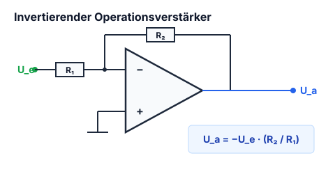

*(Im Original: „Der invertierender Verstärker“)*

*Abbildung: Invertierender Operationsverstärker:
Eingangsspannung $U_e$ führt über Widerstand $R_2$ an den invertierenden Eingang ($-$).
Gegenkopplungswiderstand $R_1$ führt vom Ausgang auf den invertierenden Eingang ($-$).
Der nicht-invertierende Eingang ($+$) liegt fest an Masse (GND).
Ausgangsspannung $U_a$ gegen Masse.*

$$V = \frac{U_a}{U_e} = -\frac{R_1}{R_2}$$

---

---

## 10.8 Der addierende Verstärker (Summierer)

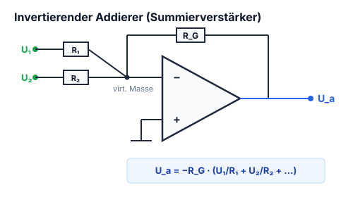

*Abbildung: Invertierender Addierer / Summierverstärker:
Zwei Eingangsspannungen $U_{e3}$ und $U_{e2}$ werden über ihre jeweiligen Eingangswiderstände $R_3$ und $R_2$ an den invertierenden Eingang ($-$) geführt.
Gegenkopplungswiderstand $R_1$ verbindet den Ausgang mit dem invertierenden Eingang ($-$).
Der nicht-invertierende Eingang ($+$) liegt an Masse (GND).
Ausgangsspannung $U_a$ liegt am Ausgang gegen Masse.*

$$U_a = - U_{e2} \cdot \frac{R_1}{R_2} - U_{e3} \cdot \frac{R_1}{R_3}$$

---

## 10.9 Frequenzabhängiger Spannungsteiler & Bode-Diagramm

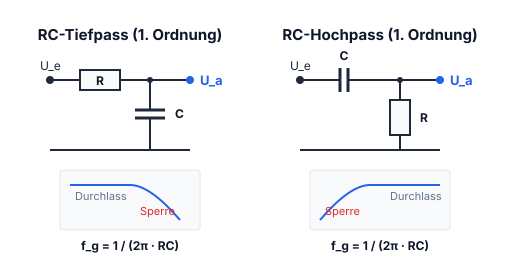

### Hochpass-Filter

Ein Hochpass-Filter lässt die hohen Frequenzen passier[en], d.h. er filter[t] tiefe Frequenzen.

*Abbildung: Passiver RC-Hochpass 1. Ordnung:
Eingangsklemmen X1-1 und X1-2.
Im Signalzweig liegt ein Längskondensator $C_1$.
Dahinter liegt ein Querwiderstand $R_1$ nach Masse (GND).
Ausgangsklemmen X2-1 und X2-2 greifen das Signal über $R_1$ ab.*

Je höher die Frequenz desto höher die Ausgangsspannung.  
Bzw. je tiefer die Frequenz desto tiefer die Spannung und desto höher $V_{dB}$ (Dämpfung).

$f_g = \text{Grenzfrequenz}$

$$f_g = \frac{1}{2\pi \cdot R_1 \cdot C_1}$$

Das ist der Punkt wo $|R_{1}| = |X_{C1}|_{fg}$ ist.  
($X_C$ ist der Kondensatorwiderstand $= \frac{1}{\omega \cdot C}$ mit $\omega = 2\pi \cdot f$)

$\varphi = \text{Phasenverschiebung}$  
Das ist die Verschiebung der Phase in $[^\circ]$, stellt die Verzögerung dar.  
Die Phasenverschiebung an der Grenzfrequenz beträgt $45^\circ$.

---

## 10.10 Passiver RC-Tiefpass 1. Ordnung

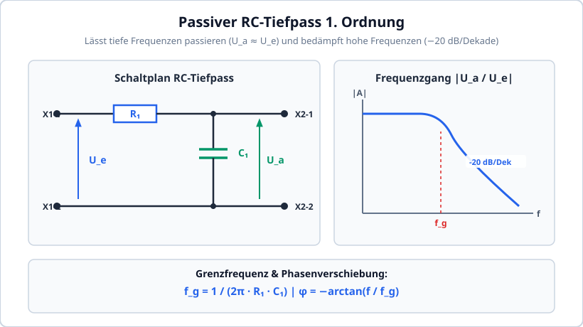

Ein passiver Tiefpass lässt tiefe Frequenzen passieren und bedämpft hohe Frequenzen. Das Zeitverhalten basiert direkt auf der [[#3.4 Auf- und Entladen des Kondensators (RC-Zeitkonstante τ)|RC-Ladezeitkonstante $\tau = R \cdot C$]].

*Abbildung: Passiver RC-Tiefpass 1. Ordnung:
Eingangsklemmen X1-1 und X1-2.
Im Längszweig liegt ein Serienwiderstand $R_1$.
Dahinter liegt ein Querkondensator $C_1$ nach Masse (GND).
Ausgangsklemmen X2-1 und X2-2 greifen das Signal über $C_1$ ab.*

Je tiefer die Frequenz desto höher die Spannung und desto tiefer die Dämpfung.

$f_g = \text{Grenzfrequenz}$

$$f_g = \frac{1}{2\pi \cdot R_1 \cdot C_1}$$

$\varphi = \text{Phasenverschiebung}$  
Das ist die Verschiebung der Phase in $[^\circ]$.

Mit der Veränderung der Werte von $R_1$ & $C_1$ kann man die „Empfindlichkeit“ einstellen.

!!! note "Definition der Grenzfrequenz $f_g$ (-3 dB-Punkt)"
    - Bei der Grenzfrequenz $f = f_g = \frac{1}{2\pi R C}$ ist die Ausgangsspannung auf $\frac{1}{\sqrt{2}} \approx 70{,}7\%$ des Maximalwertes abgefallen:
      $$20 \cdot \log_{10}\left(\frac{1}{\sqrt{2}}\right) = -3{,}01\,\text{dB}$$
    - Die Phasenverschiebung beträgt beim RC-Tiefpass genau **$\varphi = -45^\circ$** (beim CR-Hochpass **$\varphi = +45^\circ$**).
    - Weit oberhalb der Grenzfrequenz fällt das Signal mit **$-20\,\text{dB/Dekade}$** (entspricht $-6\,\text{dB/Oktave}$) ab.

    [!EXAMPLE] Praxisbeispiel: Dimensionierung eines RC-Tiefpassfilters für Audio
    Ein passives RC-Tiefpassfilter soll hochfrequente Störgeräusche oberhalb der Grenzfrequenz $f_g = 1\,\text{kHz}$ dämpfen. Es wird ein gebräuchlicher Folienkondensator mit $C_1 = 100\,\text{nF} = 100 \cdot 10^{-9}\,\text{F}$ eingesetzt:
    1. **Berechnung des Serienwiderstands $R_1$:**
       $$f_g = \frac{1}{2\pi \cdot R_1 \cdot C_1} \implies R_1 = \frac{1}{2\pi \cdot f_g \cdot C_1}$$
       $$R_1 = \frac{1}{2\pi \cdot 1000\,\text{Hz} \cdot 100 \cdot 10^{-9}\,\text{F}} = \frac{1}{6{,}283 \cdot 10^{-4}} \approx 1591{,}5\,\Omega$$
    2. **Wahl des Normwertes:**
       Gewählt wird **$R_1 = 1{,}6\,\text{k}\Omega$** (E24) oder **$1{,}5\,\text{k}\Omega$** (ergibt $f_g \approx 1061\,\text{Hz}$).
    3. **Dämpfung bei $10\,\text{kHz}$:**
       Da die Amplitude oberhalb von $f_g$ mit $-20\,\text{dB/Dekade}$ abfällt, wird eine $10\,\text{kHz}$-Störfrequenz um ca. **$-20\,\text{dB}$ (auf ein Zehntel der Eingangsspannung!)** bedämpft.

---

## 10.11 Passive Tiefpässe (LR- & RC-Tiefpass)

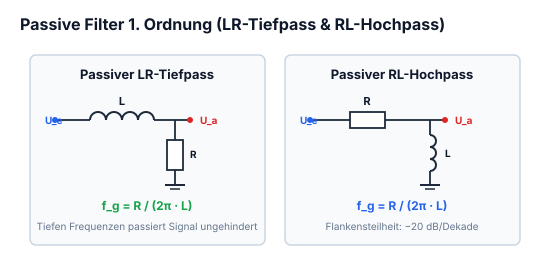

### LR-Tiefpass

*Abbildung: Passiver LR-Tiefpass:
Im Längszweig liegt eine Spule / Induktivität $L$.
Im Querzweig liegt ein Widerstand $R$.*

$$f_g = \frac{R}{2\pi \cdot L}$$

$$X_L = \omega \cdot L \quad \text{mit} \quad \omega = 2\pi \cdot f$$

---

### RC-Tiefpass

*Abbildung: Passiver RC-Tiefpass:
Im Längszweig liegt ein Widerstand $R$.
Im Querzweig liegt ein Kondensator $C$.*

$$f_g = \frac{1}{2\pi \cdot R \cdot C}$$

$$X_C = \frac{1}{\omega \cdot C}$$

---

---

## 10.12 Passive Hochpässe (RL- & CR-Hochpass)

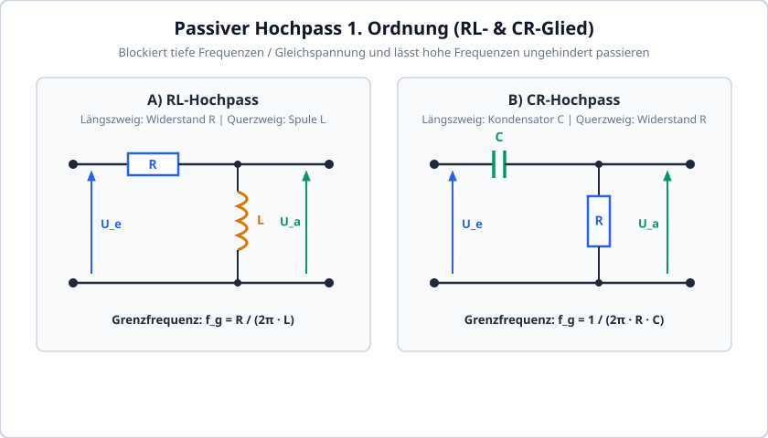

### RL-Hochpass

*Abbildung: Passiver RL-Hochpass:
Im Längszweig liegt ein Widerstand $R$.
Im Querzweig liegt eine Spule / Induktivität $L$.*

---

### CR-Hochpass

*Abbildung: Passiver CR-Hochpass:
Im Längszweig liegt ein Kondensator $C$.
Im Querzweig liegt ein Widerstand $R$.*

---

## 10.13 Lineare Spannungsregler (Festspannungsregler 78xx / LM317)

Ein Linearregler stabilisiert eine schwankende Gleichspannung auf einen hochpräzisen, festen DC-Ausgangswert.

### Funktionsweise
Intern vergleicht ein Operationsverstärker (Fehlerverstärker) eine heruntergeteilte Ausgangsspannung mit einer internen Bandgap-Referenzspannung und steuert den Durchlasswiderstand eines Leistungstransistors (Längsstellglied) kontinuierlich so, dass $U_{out}$ konstant bleibt.

### Verlustleistung & Kühlkörperberechnung
Da der gesamte Laststrom durch das Längsstellglied fließt, wird die Spannungsdifferenz vollständig in Wärme umgesetzt:

$$P_V = (U_{in} - U_{out}) \cdot I_L + U_{in} \cdot I_q \approx (U_{in} - U_{out}) \cdot I_L$$

* **Wirkungsgrad:** $\eta = \frac{U_{out}}{U_{in}}$. Bei $U_{in} = 12\,\text{V}$ und $U_{out} = 5\,\text{V}$ beträgt der Wirkungsgrad lediglich $41{,}7\,\%$; mehr als die Hälfte der Energie verpufft als Wärme!
* **Dropout-Spannung:** Ein Standardregler (z. B. LM7805) benötigt $U_{in} \ge U_{out} + 2{,}5\,\text{V}$. Bei geringeren Spannungsabständen kommen **LDO-Regler (Low Drop-Out)** mit pnp- oder P-Kanal-MOSFET-Längstransistor zum Einsatz ($U_{drop} < 0{,}2\dots 0{,}4\,\text{V}$).

## 10.14 Schaltregler: Buck-Konverter (Tiefsetzsteller / Step-Down)

Um eine hohe DC-Eingangsspannung mit hohem Wirkungsgrad ($>90\,\%$) in eine niedrigere Ausgangsspannung umzuwandeln, wird der Buck-Konverter eingesetzt:

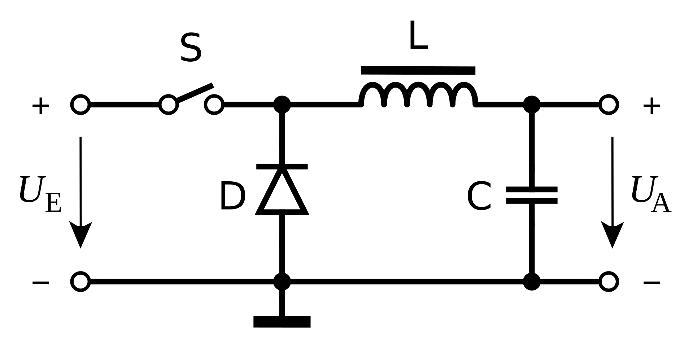

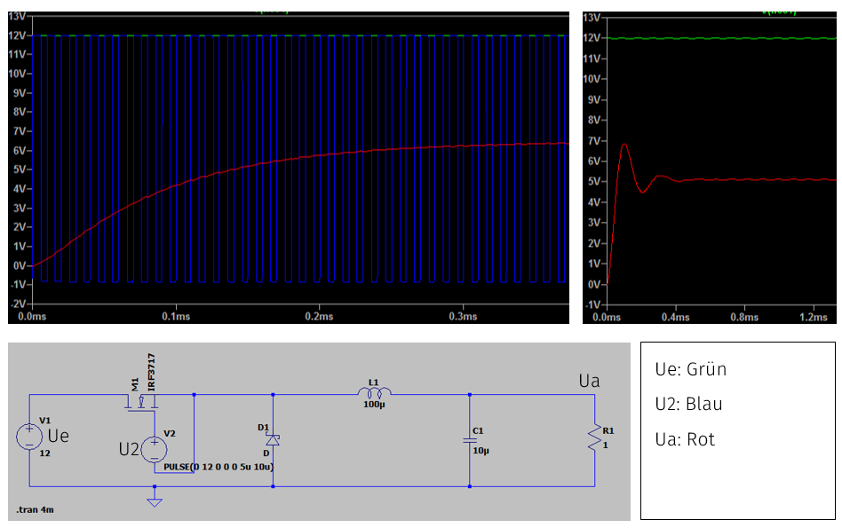

### Schaltungsaufbau & Arbeitsphasen
1. **Einschaltphase ($T_{on}$):** Der Transistor (MOSFET) schaltet durch. Strom fließt von $U_{in}$ über die Spule $L$ in den Ladekondensator $C$ und die Last $R_L$. In der Spule baut sich ein Magnetfeld auf ($u_L = U_{in} - U_{out}$).
2. **Ausschaltphase ($T_{off}$):** Der MOSFET sperrt. Die Spule wirkt der Stromunterbrechung durch Selbstinduktion entgegen und treibt den Strom über die Freilaufdiode (Schottky) weiter in Last und Ausgangskondensator ($u_L = -U_{out}$).

### Mathematische Ausgangsspannung
Im kontinuierlichen Betrieb (Continuous Conduction Mode / CCM) gilt nach der Spannungs-Zeit-Flächenbilanz der Spule:

$$U_{out} = D \cdot U_{in} \quad \text{mit Tastgrad } D = \frac{T_{on}}{T_{on} + T_{off}} = \frac{T_{on}}{T}$$

* **Kriterien für Komponenten:**
  - **Schaltfrequenz $f_{sw}$:** Typisch $100\,\text{kHz}\dots 2\,\text{MHz}$ (je höher, desto kleiner können Spule und Kondensator gewählt werden).
  - **Freilaufdiode:** Schnelle Schottky-Diode oder Synchrongleichrichter (aktiver N-Kanal-MOSFET) zur Verlustminimierung.
  - **Ausgangskondensator:** Low-ESR-Typen zur Minimierung des Ausgangs-Ripples $\Delta U_{out}$.

## 10.15 Schaltregler: Boost-Konverter (Hochsetzsteller / Step-Up)

Der Boost-Konverter erzeugt aus einer niedrigen Eingangsspannung eine höhere Ausgangsspannung ($U_{out} > U_{in}$):

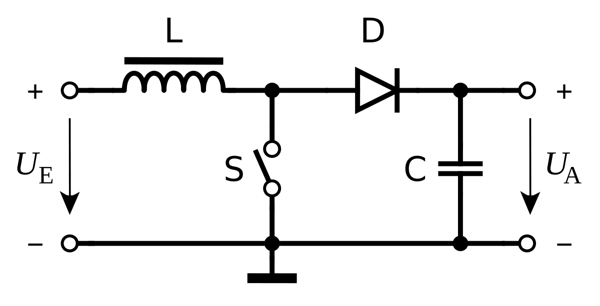

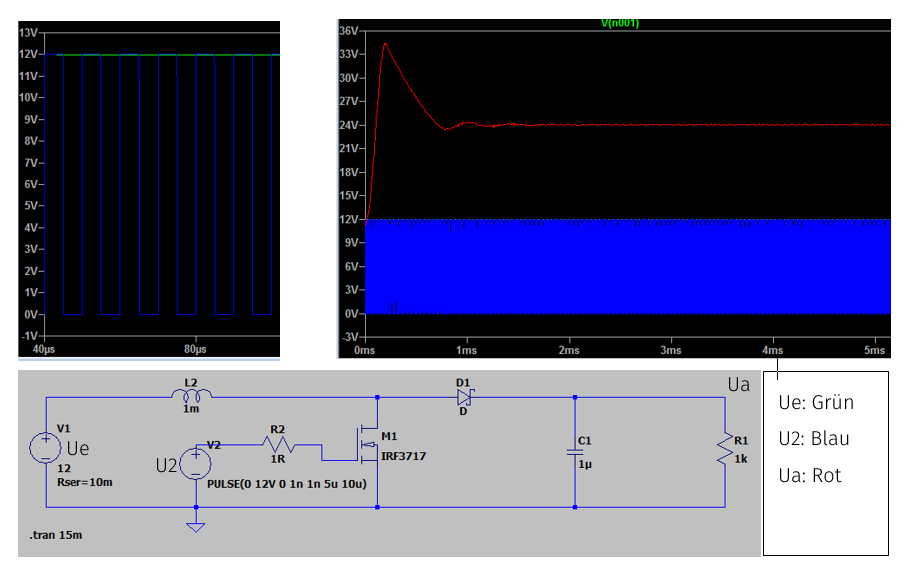

### Arbeitsphasen & Spannungsübersetzung
1. **Ladephase ($T_{on}$):** Schalter geschlossen. Die Spule liegt direkt an $U_{in}$, der Strom steigt linear an, Energie wird im Magnetfeld gespeichert. Die Diode sperrt; der Ausgang wird aus dem Kondensator gespeist.
2. **Entladephase ($T_{off}$):** Schalter offen. Die Spule addiert ihre Selbstinduktionsspannung zur Eingangsspannung: $U_{L} + U_{in}$. Die Diode leitet und lädt den Ausgangskondensator auf ein höheres Potenzial auf:

$$U_{out} = \frac{U_{in}}{1 - D}$$

* Für $D = 0{,}5$ verdoppelt sich die Spannung ($U_{out} = 2 \cdot U_{in}$).

## 10.16 Der NE555 Timer: Schaltungen & Dimensionierung

Der NE555 ist der weltweit meistgenutzte integrierte Timer-Baustein.

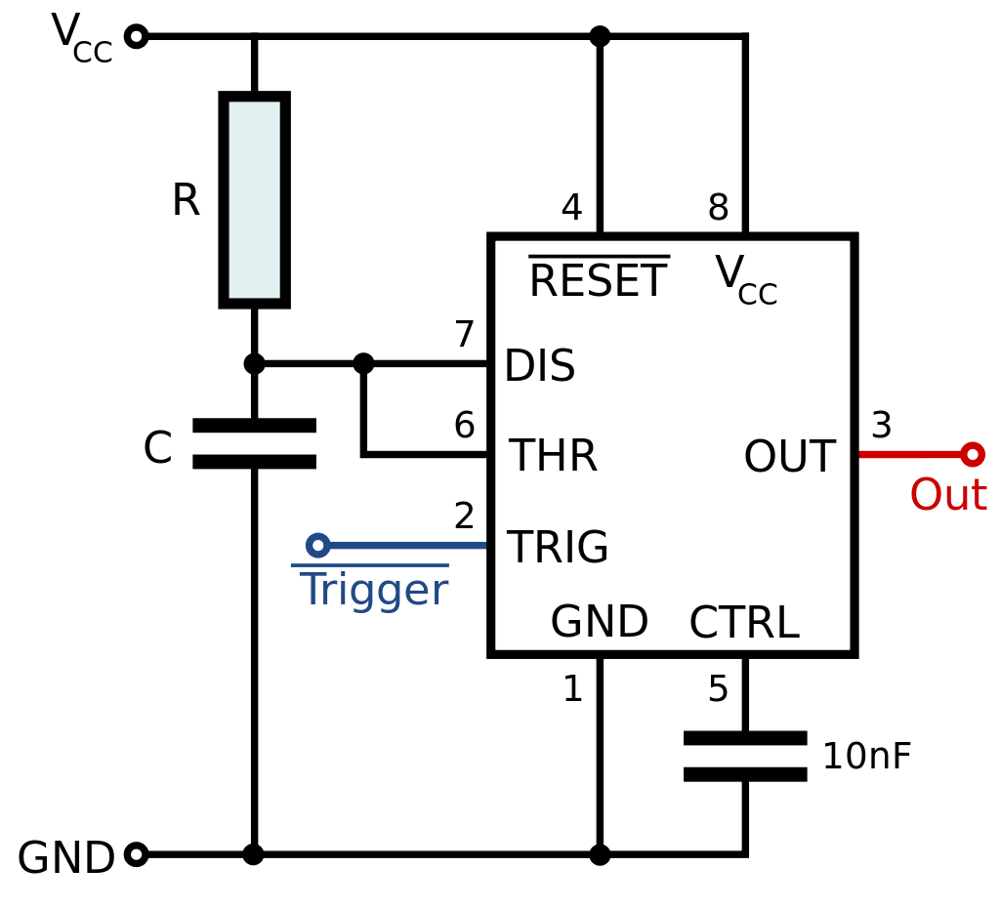

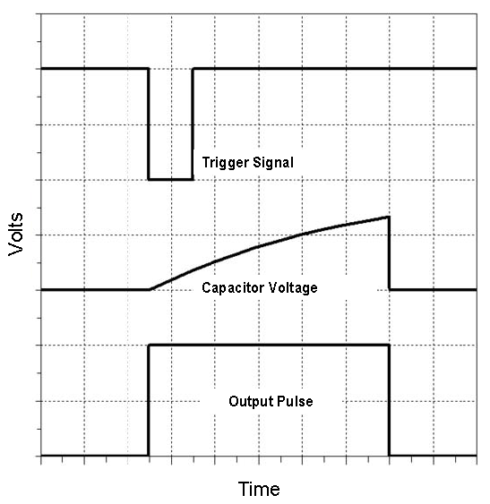

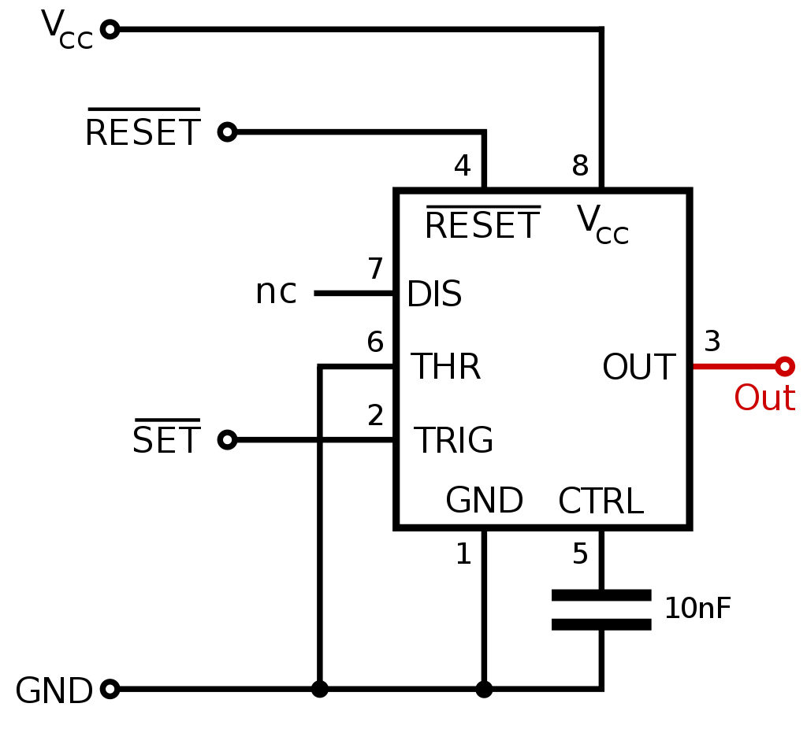

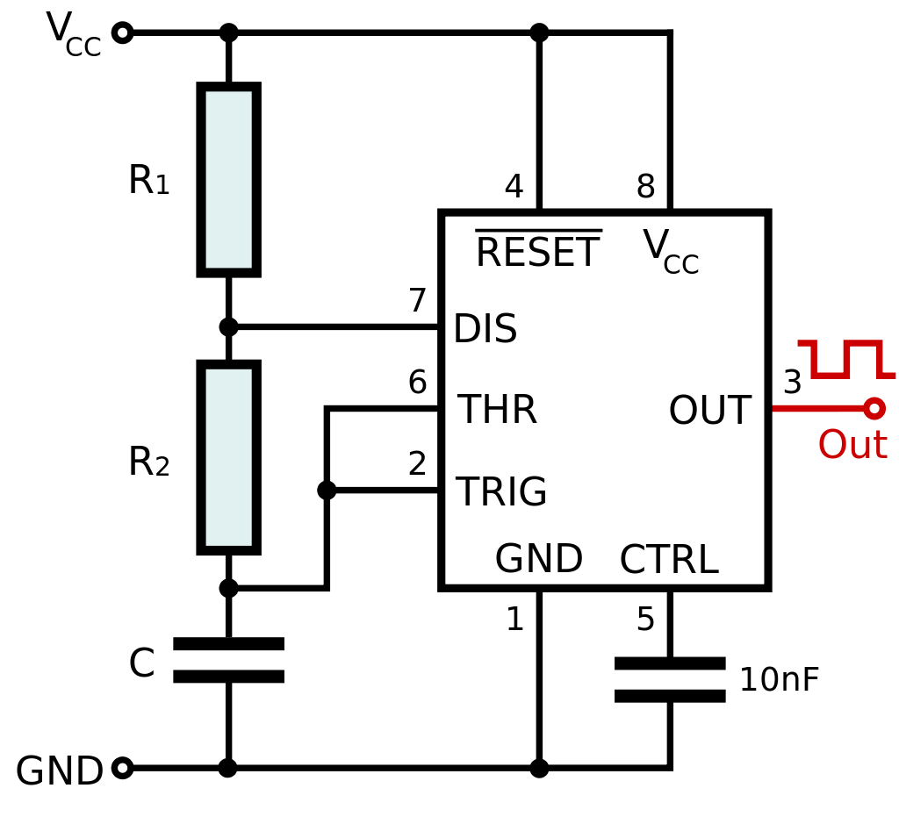

### 1. Astabile Kippstufe (Taktgenerator / Oszillator)
Widerstand $R_1$ zwischen $V_{CC}$ und Discharge (Pin 7), $R_2$ zwischen Pin 7 und Threshold/Trigger (Pin 6/2), Kondensator $C$ nach Masse:

$$T_{high} = \ln(2) \cdot (R_1 + R_2) \cdot C \approx 0{,}693 \cdot (R_1 + R_2) \cdot C$$
$$T_{low} = \ln(2) \cdot R_2 \cdot C \approx 0{,}693 \cdot R_2 \cdot C$$
$$\mathbf{f = \frac{1{,}44}{(R_1 + 2R_2) \cdot C}}$$

### 2. Monostabile Kippstufe (Monoflop / Zeitrelais)
Wird Pin 2 durch einen negativen Impuls unter $\frac{1}{3} V_{CC}$ gezogen, schaltet der Ausgang auf HIGH für die exakt definierte Zeitdauer:

$$\mathbf{T = \ln(3) \cdot R \cdot C \approx 1{,}1 \cdot R \cdot C}$$

## 10.17 Der Schmitt-Trigger: Schalthysterese & Signalformung

Ein Schmitt-Trigger ist ein Komparator mit **positiver Rückkopplung (Mitkopplung)**, der verrauschte, langsame Analogsignale in saubere, steilflankige Digitalsignale umwandelt.

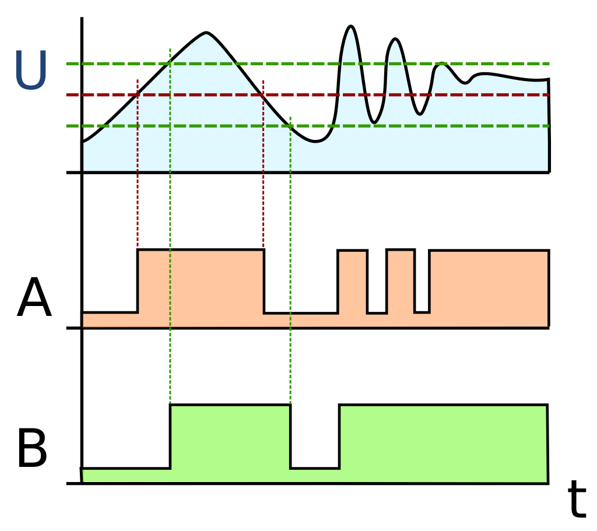

- **Schalthysterese:** Das Umschalten von LOW auf HIGH erfolgt bei einer höheren Spannung ($U_{on}$) als das Zurückschalten von HIGH auf LOW ($U_{off}$).
- Die Differenz $U_H = U_{on} - U_{off}$ verhindert Mehrfachschaltungen (Prellen) bei verrauschten Eingangssignalen.

## 10.18 D/A- und A/D-Wandler (DAC & ADC)

Signalwandler bilden die fundamentale Schnittstelle zwischen analoger Messwelt und digitaler Rechenwelt:

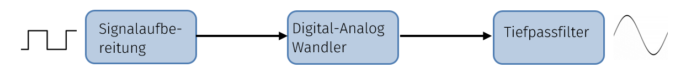

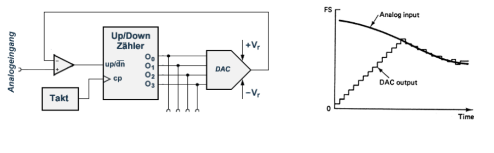

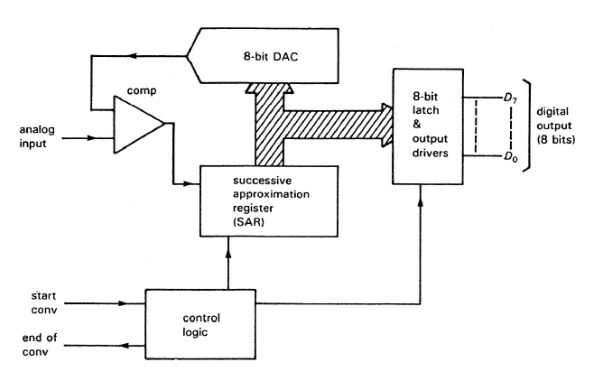

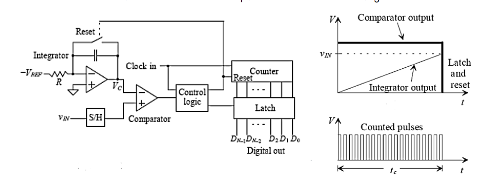

### 1. D/A-Wandler (Digital-to-Analog Converter)
- **R-2R-Widerstandsleiter:** Benötigt pro Bit nur zwei Präzisionswiderstandswerte ($R$ und $2R$). Über Umschalter speisen die Bits gewichtete Ströme in den Summierpunkt eines Operationsverstärkers.
- Ausgangsspannung bei $n$ Bits:
  $$U_{out} = U_{ref} \cdot \sum_{i=1}^n \frac{b_i}{2^i}$$

### 2. A/D-Wandler (Analog-to-Digital Converter)
- **Flash-Wandler (Parallelverfahren):** Verwendet $2^n - 1$ Komparatoren parallel. Extrem schnell ($>1\,\text{GSample/s}$), wird in Oszilloskopen eingesetzt.
- **SAR-Wandler (Sukzessive Approximation):** Ermittelt Bit für Bit vom MSB zum LSB über einen internen DAC und Komparator (Bisektionsverfahren). Standard in Mikrocontrollern ($10\dots 16\,\text{Bit}$).
- **Delta-Sigma-Wandler ($\Delta\Sigma$):** Überabtastung und Noise Shaping. Höchste Auflösung ($24\,\text{Bit}$) bei niedrigerer Abtastrate (Präzisionsmultimeter, Audio).

## 10.19 Filter höherer Ordnung & Bandpässe

Passive Filter 1. Ordnung weisen ab der Grenzfrequenz $f_g$ eine Dämpfung von $-20\,\text{dB/Dekade}$ ($-6\,\text{dB/Oktave}$) auf.

### Filter kaskadieren
Werden mehrere Filterstufen hintereinander geschaltet (unter Vermeidung gegenseitiger Belastung durch Impedanzpuffer):
- **Filter 2. Ordnung:** $-40\,\text{dB/Dekade}$ ($-12\,\text{dB/Oktave}$), Phasenverschiebung bis $180^\circ$.
- **Filter $n$-ter Ordnung:** $-n \cdot 20\,\text{dB/Dekade}$.
- **Sallen-Key-Topologie:** Ermöglicht aktive Filter 2. Ordnung mit nur einem einzigen Operationsverstärker bei einstellbarer Filtergüte $Q$ (Butterworth = maximal flach, Bessel = linearer Phasengang/konstante Gruppenlaufzeit, Tschebyscheff = steilste Flanke mit Welligkeit).
