# Kapitel 11: Digitaltechnik & Mikrocontroller-Programmierung

!!! abstract "Überblick"
    Zahlensysteme, Pull-Up/Down, Entprellung, C-Operatoren, Bitmanipulation, ISR und FSM.

## 11.1 Zahlensysteme: Von Dezimal zu Binär umrechnen

Berechnung per fortgesetzter Division durch 2 mit Rest:

$$162 : 2 = 81 \quad \text{Rest } 0$$
$$81 : 2 = 40 \quad \text{Rest } 1$$
$$40 : 2 = 20 \quad \text{Rest } 0$$
$$20 : 2 = 10 \quad \text{Rest } 0$$
$$10 : 2 = 5 \quad \text{Rest } 0$$
$$5 : 2 = 2 \quad \text{Rest } 1$$
$$2 : 2 = 1 \quad \text{Rest } 0$$
$$1 : 2 = 0 \quad \text{Rest } 1$$

Die Reste von unten nach oben gelesen ergeben:
$$= 10100010_b$$

---

---

## 11.2 Hexadezimales Zahlensystem

### Von Hexa zu Binär

$$8C_h \Rightarrow \underbrace{1000}_{8} \underbrace{1100}_{C} = 140_d$$

### Von Hexadezimal zu Dezimal

$$8C_h = C \cdot 16^0 + 8 \cdot 16^1 = 12 \cdot 1 + 8 \cdot 16 = 140$$

### Von Dezimal zu Hexadezimal

$$140 : 16^1 = 8 \quad \text{Rest } 12 \rightarrow 8$$
$$12 : 16^0 = 12 \quad \text{Rest } 0 \rightarrow C$$

$$\left. \begin{array}{l} 8 \\ C \end{array} \right\} 8C_h$$

---

---

## 11.3 Hexadezimales, Binäres und Dezimales Zahlensystem im Vergleich

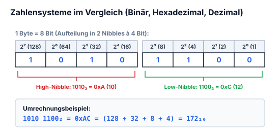

| Dezimal | Binär | Hexa | Dezimal | Binär | Hexa |
| :---: | :---: | :---: | :---: | :---: | :---: |
| 1 | 0001 | 1 | 9 | 1001 | 9 |
| 2 | 0010 | 2 | 10 | 1010 | A |
| 3 | 0011 | 3 | 11 | 1011 | B |
| 4 | 0100 | 4 | 12 | 1100 | C |
| 5 | 0101 | 5 | 13 | 1101 | D |
| 6 | 0110 | 6 | 14 | 1110 | E |
| 7 | 0111 | 7 | 15 | 1111 | F |
| 8 | 1000 | 8 | | | |

---

---

## 11.4 Pull-Up- und Pull-Down-Widerstände

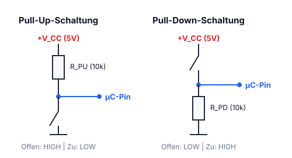

### Pull up:


*Abbildung: n: Zwei Varianten einer Pull-up-Schaltung:
1. Links mit mechanischem Schalter: Von der Versorgungsspannung führt ein Pull-up-Widerstand zu einem Knotenpunkt, der an den Mikrokontroller-Pin „PB0“ führt. Vom Knotenpunkt führt ein Taster/Schalter nach Masse.
2. Rechts mit NPN-Transistor (Open-Collector-Ausgang): Von der Versorgungsspannung führt ein Pull-up-Widerstand an den Kollektor des Transistors und an den Pin „PB0“. Der Emitter liegt an Masse, die Basis wird angesteuert.*


Der Eingang wird somit auf logisch 1 gezogen (wenn der Schalter offen bleibt).

### Pulldown:


*Abbildung: n: Zwei Varianten einer Pulldown-Schaltung:
1. Links mit mechanischem Schalter: Von der Versorgungsspannung führt ein Taster/Schalter an den Knotenpunkt zum Pin „PB0“. Vom Knotenpunkt führt ein Pulldown-Widerstand nach Masse.
2. Rechts mit NPN-Transistor (Emitterfolger / High-Side): Der Kollektor liegt an der Versorgungsspannung. Der Emitter führt an den Pin „PB0“ und über einen Pulldown-Widerstand nach Masse. Die Basis wird angesteuert.*


---

## 11.5 Taster- & Schalterentprellung (Hardware vs. Software)

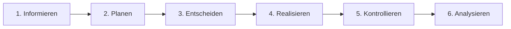

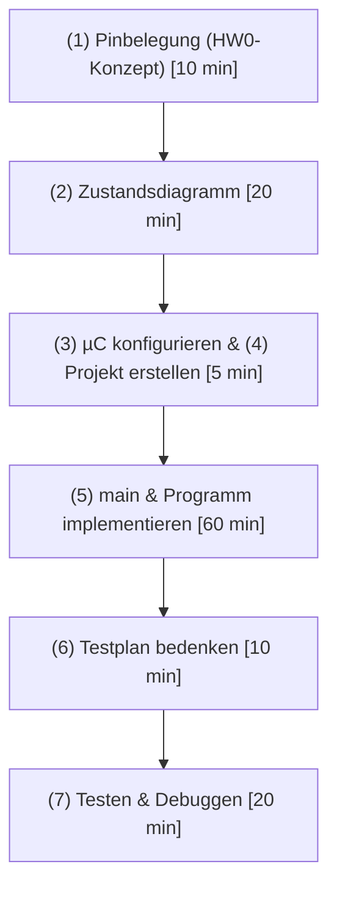

### Nach dem Grundprinzip IPERKA
**Informieren – Planen – Entscheiden – Realisieren – Kontrollieren – Analysieren**


### Informieren
- Was ist:
  - $\rightarrow$ gegeben
  - $\rightarrow$ gesucht
  - $\rightarrow$ unklar $\rightarrow$ Nachschlagen / Fragen formulieren $\rightarrow$ Fragen

### Planen
Plane dein Vorgehen und schätze, wie lange es dauern darf.

#### Plan $\mu C$

| Schritt | Tätigkeit | Zeit |
| :---: | :--- | :---: |
| (1) | Pinbelegung, Eingang und Ausgang $\rightarrow$ Vorlage HW0-Konzept | 10 min |
| (2) | Zustandsdiagramm | 20 min |
| (3) | $\mu C$ konfigurieren | 5 min *(zusammen mit 4)* |
| (4) | Projekt erstellen | *(5 min)* |
| (5) | main erstellen + Programm implementieren | 60 min |
| (6) | Testplan bedenken | 10 min |
| (7) | Testen + debuggen | 20 min |

---

---

## 11.6 C-Programmierung: Bits, Bytes, Nibbles & Datentypen

### Binäres Zahlensystem

Im binärem Zahlensystem sind nur 2 Dezimalzahlen vorhanden: die 0 & die 1.  
Es wird bei $\mu C$ gebraucht, um Ein- und Ausgänge zu bestimmen und sie auf High or Low zu stellen.

- **1 Bit:** Ein Bit kann nur zwei Zustände haben: $1$ & $0$  
  $\Rightarrow 1000_b$ : Ein Bit, insgesamt 4 Bits

- **1 Nibble:** Ein Nibble besteht aus 4 Bits  
  $1010_b = 10_d$  
  Der maximale Wert von einem Nibble ist 15.

- **1 Byte:** Ein Byte besteht aus 8 Bits  
  $10111010_b = 186_d$  
  Der maximale Wert von einem Byte ist 255.

### Von Binär zu Dezimal

| $2^7$ | $2^6$ | $2^5$ | $2^4$ | $2^3$ | $2^2$ | $2^1$ | $2^0$ |
| :---: | :---: | :---: | :---: | :---: | :---: | :---: | :---: |
| 1 | 0 | 1 | 1 | 1 | 0 | 1 | 0 |

$$128 + 32 + 16 + 8 + 2$$

$$\Downarrow$$

$$0 \cdot 2^0 + 1 \cdot 2^1 + 0 \cdot 2^2 + 1 \cdot 2^3 + 1 \cdot 2^4 + 1 \cdot 2^5 + 0 \cdot 2^6 + 1 \cdot 2^7$$

---

---

## 11.7 Operatoren in C (Arithmetik & Logik)

### Vergleichsoperatoren

| Operator | Bedeutung |
| :---: | :--- |
| `==` | Gleichheit |
| `!=` | Ungleichheit |
| `<` | Kleiner als |
| `>` | Grösser als |
| `<=` | kleiner gleich |
| `>=` | Grösser gleich |

### Zuweisung

`=` : Weist z.B. einer Variable einen Wert zu

### Arithmetische Operatoren

| Operator | Bedeutung |
| :---: | :--- |
| `+` | Addition |
| `-` | Subtraktion |
| `*` | Multiplikation |
| `/` | Ganzzahlige-Division |
| `%` | Modulo-Division (ganzzahliger Rest) |
| `++_` | Prä-Inkrement |
| `_++` | Post-Inkrement |
| `--_` | Prä-Dekrement |
| `_--` | Post-Dekrement |

---

---

## 11.8 Schiebeoperatoren in C (<< und >>)

$$\text{Variable} \ll 1 = \text{Variable} \cdot 2^1$$
$$\text{Variable} \ll 2 = \text{Variable} \cdot 2^2$$
$$\text{Variable} \gg 1 = \text{Variable} / 2^1$$
$$\text{Variable} \gg 2 = \text{Variable} / 2^2$$

---

## 11.9 Bitmanipulation in Mikrocontroller-Registern

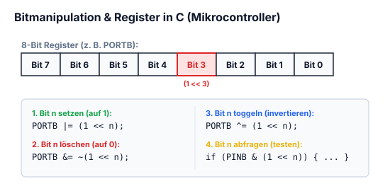

- **Bitweise AND `[&]`** : löscht alle Bits, die in der Maske 0 sind
- **Bitweise OR `[|]`** : Setzt alle Bits, die in der Maske 1 sind
- **Bitweise XOR `[^]`** : Kehrt alle Bits um, die in der Maske 1 sind
- **Bitweise Invertieren `[~]`** : Invertiert die Bits 1 zu 0 und 0 zu 1
!!! warning "Kanonische Bitmanipulation in C (Mikrocontroller-Standard)"
    ```c
    // 1. Bit n setzen (auf 1):
    PORTB |= (1 << n);
    
    // 2. Bit n löschen (auf 0):
    PORTB &= ~(1 << n);
    
    // 3. Bit n umschalten (toggeln):
    PORTB ^= (1 << n);
    
    // 4. Bit n abfragen / prüfen:
    if (PINB & (1 << n)) {
        // Bit n ist 1
    }
    ```

---

## 11.10 Kombinierte Zuweisungsoperatoren

| Operator | Beispiel | Bedeutung |
| :---: | :--- | :--- |
| `+=` | `a += 5` | `a = a + 5` |
| `<<=` | `a <<= 5` | `a = a << 5` |
| `>>=` | `a >>= 5` | `a = a >> 5` |
| `&=` | `a &= 0x5` | `a = a & 0x5` |
| `\|=` | `a \|= 0x5` | `a = a \| 0x5` |
| `^=` | `a ^= 0x5` | `a = a ^ 0x5` |

---

---

## 11.11 Interrupts & Interrupt Service Routinen (ISR)

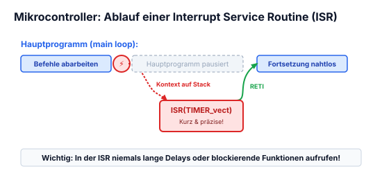

Ein Interrupt ist ein Unterbruch deines Hauptprogramms. In dem ISR wird dann ein Befehl durchgeführt, dieser sollte so kurz wie möglich sein.  
ISR heisst Interrupt Service Routine.  
Die Wiederholungsrate kann man mit dem internen Timer/Trigger steuern.

### Beispiel

```c
void ISR_timer3_overflow() interrupt 14
{
    TMR3CN &= ~(0x80);
    ticks++;
}
```

Die meisten Befehle für das Einstellen des Interrupts sind im Manual nachzuschlagen.

### Wichtig!

Die Variablen im ISR-Befehl sind so zu deklarieren:
```c
volatile unsigned char ticks;
```
Auch der Datentyp muss logisch gewählt sein.  
Um Fehler zu verhindern, sind Datentypen zu nutzen, die die gleiche Bitanzahl haben wie der ($\mu C$) Mikrocontroller.

---

---

## 11.12 Zustandsdiagramme & Finite State Machines (FSM)

*(Notiz: in C übersetzen)*

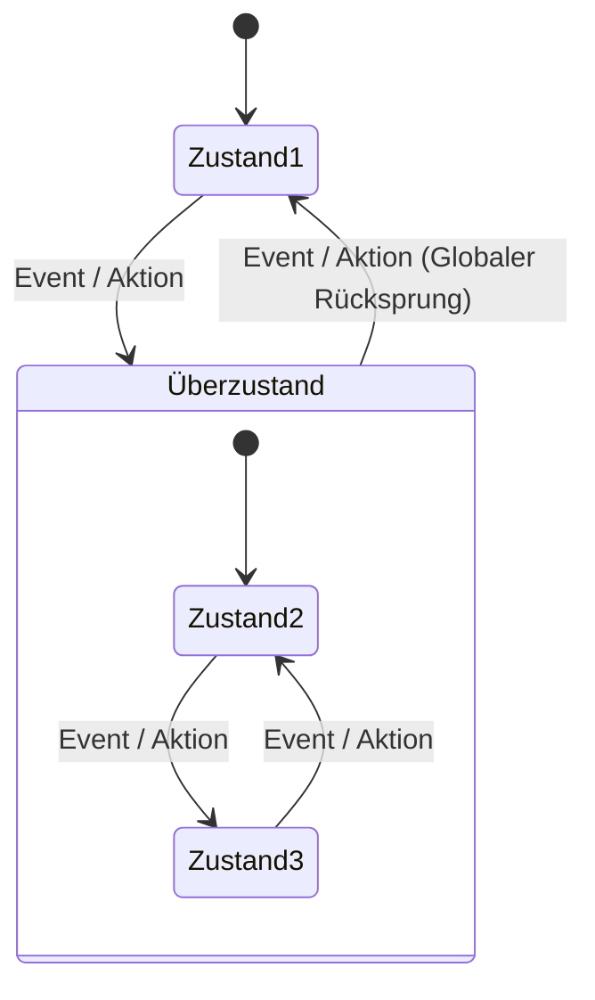


*Abbildung: Hierarchisches Zustandsdiagramm (Statechart) mit Überzustand:*
- *Startzustand (ausgefüllter Kreis) $\rightarrow$ Pfeil nach unten auf `Zustand 1`.*
- *Übergang von `Zustand 1` in den `Überzustand` beschriftet mit $\frac{\text{Event}}{\text{Aktion}}$.*
- *Innerhalb des Rahmens `Überzustand`:*
  - *Ein interner Startknoten führt zu `Zustand 2`.*
  - *Übergang von `Zustand 2` zu `Zustand 3` beschriftet mit $\frac{\text{Event}}{\text{Aktion}}$.*
  - *Übergang von `Zustand 3` zurück zu `Zustand 2` beschriftet mit $\frac{\text{Event}}{\text{Aktion}}$.*
- *Vom äußeren Rahmen des `Überzustand`s führt ein globaler Rücksprung-Pfeil zu `Zustand 1`, beschriftet mit $\frac{\text{Event}}{\text{Aktion}}$.*


Beim Überzustand ist es so, dass jeder Zustand im Überzustand zum Zustand 1 eine Verbindung hat.

---

---


## 11.13 Zahlensysteme, BCD-Code & Komplementdarstellung

In der Mikrocontrollertechnik werden Zahlen primär binär und hexadezimal verarbeitet:


- **1 Byte = 8 Bit:** Aufteilung in High-Nibble (Bits 7..4) und Low-Nibble (Bits 3..0).
  Beispiel: $1010\,1100_2 = \text{0xAC} = 172_{10}$.
- **BCD-Code (Binary Coded Decimal):** Jede Dezimalziffer ($0\dots 9$) wird einzeln durch 4 Bit codiert.
- **Zweierkomplement für negative Zahlen:**
  Um eine negative Zahl darzustellen:
  1. Alle Bits invertieren (Einerkomplement).
  2. $+1$ addieren.
  - Der Wertebereich einer vorzeichenbehafteten 8-Bit-Zahl (`int8_t`) reicht von $-128$ bis $+127$.


## 11.14 Boolesche Algebra: Rechengesetze & Logikminimierung

### Fundamentale Rechenregeln
| Rechengesetz | UND-Verknüpfung | ODER-Verknüpfung |
| :--- | :--- | :--- |
| **Neutralität** | $a \cdot 1 = a \qquad a \cdot 0 = 0$ | $a + 0 = a \qquad a + 1 = 1$ |
| **Idempotenz** | $a \cdot a = a$ | $a + a = a$ |
| **Komplementarität** | $a \cdot \overline{a} = 0$ | $a + \overline{a} = 1$ |
| **Doppelte Negation** | $\overline{\overline{a}} = a$ | $\overline{\overline{a}} = a$ |
| **Kommutativgesetz** | $a \cdot b = b \cdot a$ | $a + b = b + a$ |
| **Assoziativgesetz** | $(a \cdot b) \cdot c = a \cdot (b \cdot c)$ | $(a + b) + c = a + (b + c)$ |
| **Distributivgesetz** | $a \cdot (b + c) = a \cdot b + a \cdot c$ | $a + (b \cdot c) = (a + b) \cdot (a + c)$ |
| **De Morgansche Gesetze** | $\mathbf{\overline{a \cdot b} = \overline{a} + \overline{b}}$ | $\mathbf{\overline{a + b} = \overline{a} \cdot \overline{b}}$ |


## 11.15 Logikgatter: Grundtypen & Wahrheitstabellen

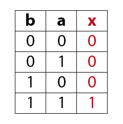

- **NAND & NOR als Universalgatter:** Jede beliebige logische Schaltung lässt sich ausschließlich aus NAND-Gattern oder ausschließlich aus NOR-Gattern aufbauen.
- **XOR (Antivalenz):** Ausgang ist 1, wenn ungleiche Eingangspegel anliegen. Dient als 1-Bit-Halbaddierer und Paritätsgenerator.


## 11.16 Bistabile Kippstufen: Flip-Flops (RS, D, JK, T)

Flip-Flops sind die fundamentalen 1-Bit-Speicherelemente der Digitaltechnik.

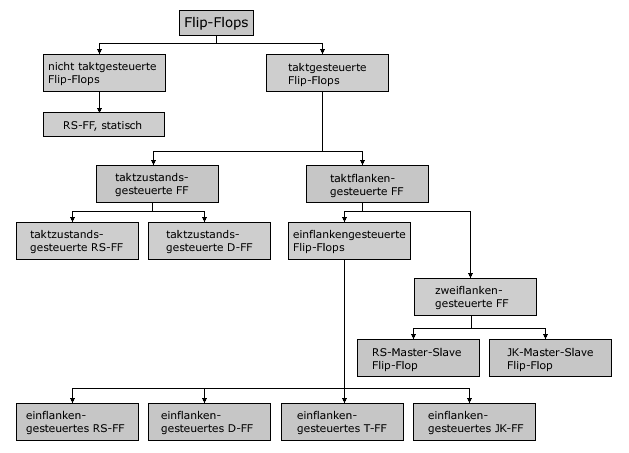

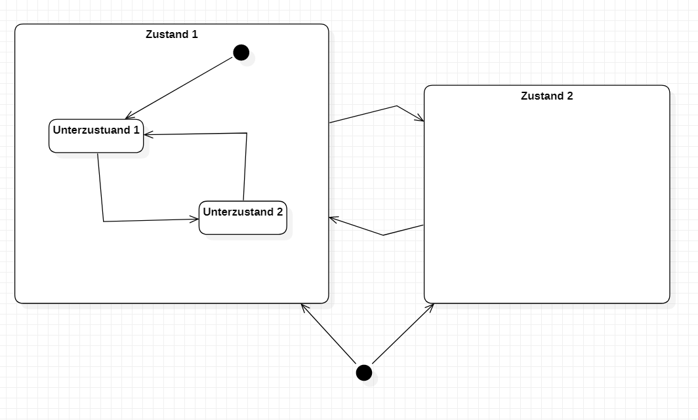

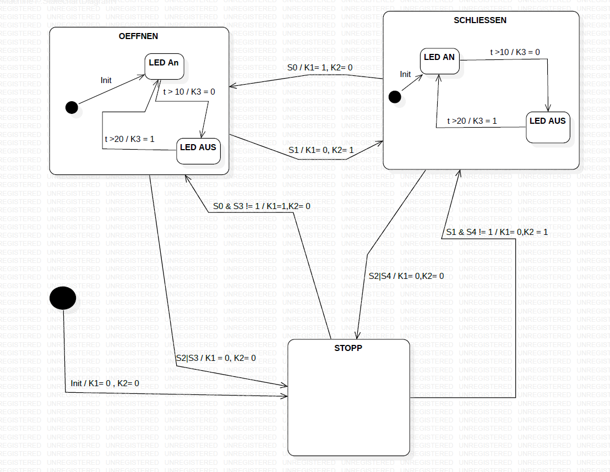

1. **RS-Flip-Flop:** Setzen ($S=1$) und Rücksetzen ($R=1$). Der Zustand $S=1, R=1$ ist verboten (undefinierter Folgezustand).
2. **D-Flip-Flop (Data / Delay):** Übernimmt bei einer Taktflanke ($\uparrow$) den Zustand am Eingang $D$ an den Ausgang $Q$.
3. **JK-Flip-Flop:** Universelles Flip-Flop ohne verbotenen Zustand. Bei $J=1, K=1$ invertiert der Ausgang bei jeder Taktflanke (**Toggle-Modus**).
4. **T-Flip-Flop (Toggle):** Schaltet bei jeder aktiven Taktflanke um $\implies$ Frequenzhalbierer / Dualzähler.


## 11.17 C-Programmierung für Mikrocontroller: Arrays, Funktionen & Schleifen

In eingebetteten Systemen bestimmt die Speicheranordnung von Datenfeldern und Programmablaufstrukturen direkt die Rechenzeit und Latenz:

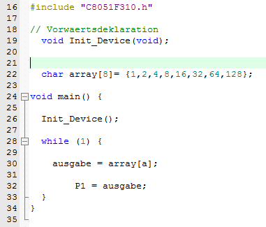

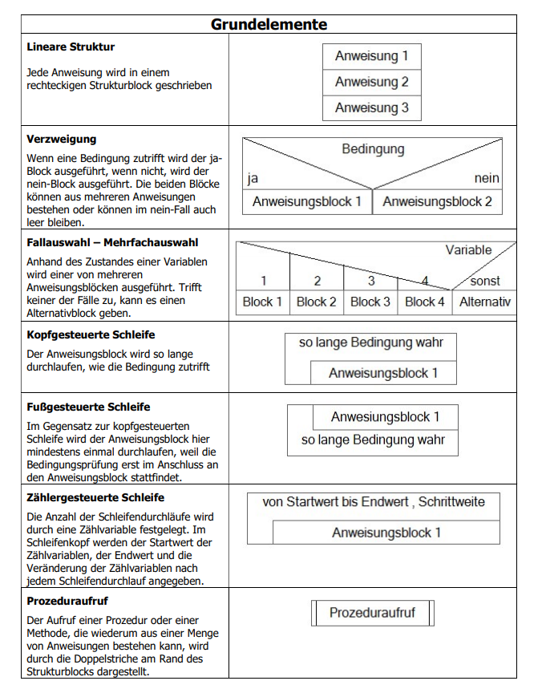

### 1. Eindimensionale & zweidimensionale Arrays
```c
uint8_t messwerte[8] = {12, 15, 18, 22, 25, 28, 30, 35};
uint8_t matrix[2][3] = { {1, 2, 3}, {4, 5, 6} };
```

### 2. Funktionen & Parameterübergabe
- **Call-by-Value:** Kopie des Wertes wird übergeben.
- **Call-by-Reference (über Zeiger):** Adresse der Variablen wird übergeben; Originalwert kann direkt modifiziert werden:
```c
void adc_kalibrieren(uint16_t *raw_val, float offset) {
    *raw_val = (uint16_t)(*raw_val * 1.02f + offset);
}
```

### 3. Header-Dateien & Include-Guards
Jede Header-Datei (`.h`) muss gegen Mehrfach-Inkludierung geschützt werden:
```c
#ifndef MY_DRIVER_H
#define MY_DRIVER_H

#include <stdint.h>
void timer0_init(void);

#endif /* MY_DRIVER_H */
```


## 11.18 Mikrocontroller-Konfiguration & Peripherie (C8051F31x)

Bei 8051-Derivaten (wie dem Silicon Labs C8051F310) müssen Systemtakt, Port-I/O und die digitale **Crossbar-Matrix** explizit initialisiert werden:

```c
// Oszillator auf internen 24.5 MHz Takt konfigurieren
OSCICN |= 0x03;

// Crossbar aktivieren und Port 0 Pins als Push-Pull konfigurieren
P0MDOUT |= 0x0F;   // P0.0 bis P0.3 als digitale Push-Pull-Ausgänge
XBR1    |= 0x40;   // Crossbar Enable
```

### Software-Flankenerkennung (Edge Detection)
```c
static bit taste_alt = 1;
bit taste_aktuell = P0_1;

// Positive Flanke (Übergang 0 -> 1)
if (taste_aktuell == 1 && taste_alt == 0) {
    led_toggle();
}
taste_alt = taste_aktuell;
```
