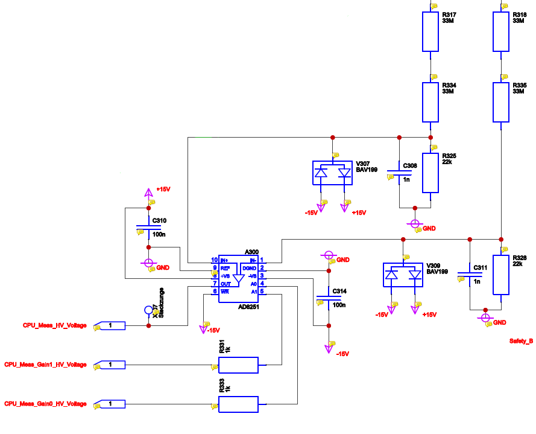
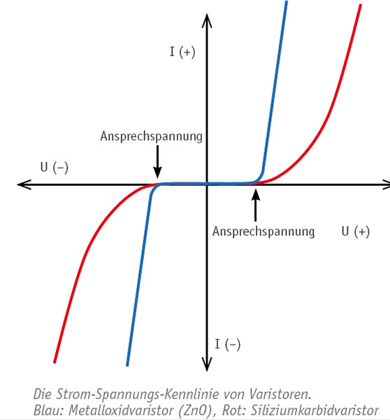

# Kapitel 12: Hochspannungstechnik & Praxisschaltungen (EMC Partner AG)

!!! abstract "Reale Industrieanwendungen & Hochvolt-Design"
    Dieses Kapitel fasst die Schaltungstechnik, Sicherheitskonzepte und Messmodule zusammen, die in den Hochspannungs- und EMV-Prüfgeneratoren der **EMC Partner AG** (z. B. im HV-Supply 8) zum Einsatz kommen.

---

## 12.1 Sicherheits-Erdschalter im HV-Supply 8

In Hochspannungs-Prüfgeneratoren werden Zwischenkreiskondensatoren auf Spannungen von mehreren Kilovolt ($U > 1\dots 8\,\text{kV}$) aufgeladen. Bei Notaus, Unterbrechung des Sicherheitskreises oder beim Abschalten muss diese gefährliche Ladung **binnen Sekundenbruchteilen sicher gegen Erde entladen** werden.

_image4.png)

### Schaltungsaufbau mit Entladewiderständen
Wird der Sicherheitskreis unterbrochen, fällt das Sicherheitsschütz ab und schließt einen federbelasteten mechanischen Hochvolt-Erdschalter.
- **Warum werden 4 Entladewiderstände verwendet?**
  1. **Spannungsfestigkeit:** Handelsübliche Leistungswiderstände haben eine maximale Grenzspannung (z. B. $750\,\text{V}$ oder $1\,000\,\text{V}$). Bei $4\,\text{kV}$ Gesamtspannung teilt sich die Spannung bei 4 gleichen Widerständen in Reihe auf unkritische $1\,\text{kV}$ pro Bauteil auf.
  2. **Leistungsaufteilung:** Die enorme Spitzenverlustleistung beim Entladen $P = \frac{U^2}{R_{ges}}$ teilt sich gleichmäßig auf alle 4 Bauelemente auf ($P_i = \frac{P_{ges}}{4}$).
- **Entladezeit-Berechnung:**
  $$\tau = R_{ges} \cdot C \implies t_{sicher} \approx 5 \cdot \tau$$
  Nach $5\tau$ ist die Kondensatorspannung auf unter $0{,}7\,\%$ des Anfangswertes abgesunken ($U < 50\,\text{V}$).

## 12.2 Hochspannungs-Gleichrichtung & Kaskadenschaltungen

Die Erzeugung von Gleichspannungen im Kilovoltbereich erfordert spezielle Gleichrichtertopologien:

_image4.png)

1. **Dioden-Reihenschaltung & Symmetrierung:**
   Weil einzelne Silizium-Dioden nur Sperrspannungen bis $1\,000\dots 1\,600\,\text{V}$ sperren, werden Hochvolt-Diodenketten eingesetzt. Zur Vermeidung ungleicher Spannungsaufteilung durch unterschiedliche Sperr-Leckströme wird jede Diode mit einem hochohmigen **Symmetrierwiderstand** ($R \approx 1\dots 10\,\text{M}\Omega$) und einer Symmetrierkapazität parallel geschaltet.
2. **Spannungsvervielfacher (Greinacher- / Villard-Kaskade):**
   Netzwerk aus Dioden und Kondensatoren, das eine Wechselspannung pro Stufe um das Zweifache des Scheitelwerts ($2 \cdot \hat{u}$) hochsetzt.

## 12.3 Hochspannungs-Polarisierungsumschaltung

In der EMV-Prüfpraxis müssen Prüflinge sowohl mit **positiven** als auch mit **negativen** Stoßimpulsen (Surge) beaufschlagt werden.

_image4.png)

- **Schaltungskonzept:** Mittels motorgetriebener Schalter oder spezieller Hochspannungs-Vakuumrelais wird die Polarität der Gleichspannungsquelle gegenüber dem gemeinsamen Bezugspotenzial (PE) umgepolt.
- **Sicherheitsverriegelung:** Vor jeder Umpolung muss der Mikrocontroller über das Messmodul verifizieren, dass die Zwischenkreisspannung durch den Erdschalter vollständig auf $0\,\text{V}$ entladen ist, um Lichtbögen an den Relaiskontakten auszuschließen.

## 12.4 HV-Supply Messmodul: Präzisionserfassung & Signalaufbereitung

Das HV-Messmodul erfasst kontinuierlich die anliegende Hochspannung und übermittelt den Messwert galvanisch getrennt an die zentrale Mikrocontroller-Steuerung.

### Komponenten der Messkette
1. **Präzisions-Hochspannungsteiler:**
   Extrem temperaturstabile Dickschicht-Hochspannungswiderstände (TK $< 25\,\text{ppm}/\text{K}$, Spannungsfestigkeit $>10\,\text{kV}$). Teilerverhältnis typisch $1\,000:1$ oder $2\,000:1$.
2. **Instrumentierungs- & Pufferverstärker (OPV):**
   Ein rauscharmer Operationsverstärker (z. B. AD8251) puffert den hochohmigen Teilerknoten ab und skaliert das Signal auf den Eingangsbereich des A/D-Wandlers ($0\dots 3{,}3\,\text{V}$ bzw. $0\dots 5\,\text{V}$).
3. **Mikrocontroller-Verarbeitung:**
   Der A/D-Wandler liest den Messwert ein, mittelt über digitale Filter (Rauschunterdrückung) und löst bei Überschreiten programmierter Sicherheitsgrenzwerte einen Hardware-Interrupt zur Notabschaltung aus.

## 12.5 Varistor-Box: Zuverlässiger Geräteschutz bei Transientenprüfungen

Die Varistor-Box dient als vorgeschaltete Schutzbaugruppe, um Messeingänge und interne Schaltkreise vor energiereichen Rückwirkungen während zerstörender EMV-Tests zu schützen.

- **Mehrstufiges Schutzkonzept:**
  - *Grob-Schutz:* Gasableiter (GDT = Gas Discharge Tube) für höchste Stoßströme ($>10\dots 20\,\text{kA}$).
  - *Mittel-Schutz:* Metalloxid-Varistoren (MOV) zur schnellen Begrenzung auf definierte Schutzpegel.
  - *Fein-Schutz:* Schnelle TVS-Dioden zur Restspannungsbegrenzung auf wenige Volt oberhalb der Signalspannung.
