# Elektrotechnik, Elektronik & Messtechnik
*Vollständig digitalisiertes, strukturiertes & ergänztes Referenz- und Formelhandbuch*

[TOC]

---

# Kapitel 1: Mathematische Grundlagen & Vektorrechnung

!!! abstract "Überblick"
    Vektoralgebra, Betrag, Skalarprodukt, Kreuzprodukt und trigonometrische Grundlagen.

## 1.1 Vektoren, Ortsvektoren & Betrag

- **Vektor** = Richtung + Betrag, z. B. Geschwindigkeit
- **Skalar** = Betrag, z. B. Masse

---

### Eigenschaften und Varianten von Vektoren

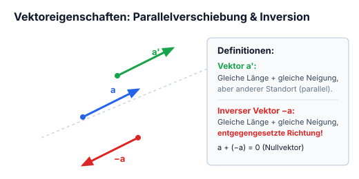


*Abbildung: 2D-Koordinatensystem mit Achsen $x$ und $y$, Vektor $\vec{a}$ startet im Ursprung $(0,0)$.*


- $\vec{a}'$ = gleich lang + gleiche Neigung, aber anderer Standort als $\vec{a}$
- $-\vec{a}$ = gleich lang + gleiche Neigung, aber die entgegengesetzte Richtung


*Abbildung: Drei Vektoren auf einer Referenzlinie: $\vec{a}$ nach rechts oben, $-\vec{a}$ parallel nach links unten, $\vec{a}'$ parallel verschoben nach rechts oben.*


---

### Vektoraddition, Subtraktion

Vektoren: $\vec{a}$ *(grün)*, $\vec{b}$ *(blau)*, $\vec{c}$ *(rot)*

$$\begin{pmatrix} 5 \\ 0 \end{pmatrix} + \begin{pmatrix} 0 \\ 3 \end{pmatrix} = \begin{pmatrix} 5 \\ 3 \end{pmatrix}$$

$$\begin{pmatrix} \vec{a}_x \\ \vec{a}_y \end{pmatrix} + \begin{pmatrix} \vec{b}_x \\ \vec{b}_y \end{pmatrix}$$

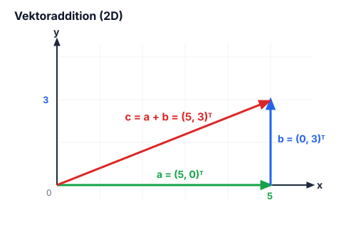


*Abbildung: 2D-Koordinatensystem mit $x$-Achse bis 5 und $y$-Achse bis 3:*
- *$\vec{a}$: grüner Vektor entlang der $x$-Achse von $(0,0)$ bis $(5,0)$*
- *$\vec{b}$: blauer Vektor vertikal von $(5,0)$ bis $(5,3)$*
- *$\vec{c} = \vec{a} + \vec{b}$: roter Summenvektor von $(0,0)$ bis $(5,3)$*


---

### Betrag eines Vektors

**Betrag** $= |\vec{a}|$ wird aus $\vec{a}_x$ und $\vec{a}_y$ berechnet:

$$\sqrt{\vec{a}_x^2 + \vec{a}_y^2} = |\vec{a}|$$

**z. B.:** 
$$\vec{a} = \begin{pmatrix} 5 \\ 3 \end{pmatrix} \implies \sqrt{5^2 + 3^2} = \sqrt{34} \approx 5{,}83$$

---

### Einheitsvektor

- $\vec{e} = \text{Einheitsvektor (hat immer Länge 1)}$
- $\vec{e}_a = \text{Vektorrichtung}$

$$\boxed{\vec{e}_a = \frac{\vec{a}}{|\vec{a}|}}$$

$\frac{\vec{a}}{|\vec{a}|} =$ Länge des Einheitsvektors mit der Richtung

**z. B.:**
$$\vec{a} = \begin{pmatrix} 3 \\ 5 \end{pmatrix}, \quad |\vec{a}| = \sqrt{3^2 + 5^2} = 5{,}83$$

$$3 : 5{,}83 = \vec{e}_x \approx 0{,}52 \quad \Bigg\} = \text{aufgeteilte Länge}$$
$$5 : 5{,}83 = \vec{e}_y \approx 0{,}86$$

---

### Trigonometrie am rechtwinkligen Dreieck


*Abbildung: eines rechtwinkligen Dreiecks mit Hypotenuse, Gegenkathete, Ankathete und Winkel $\alpha$ unten rechts:*


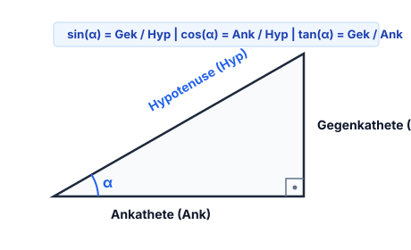

$$\frac{\text{Gek}}{\text{Hyp}} = \sin(\alpha) \quad (\text{Sinus})$$

$$\frac{\text{Ank}}{\text{Hyp}} = \cos(\alpha) \quad (\text{Cosinus})$$

$$\frac{\text{Gek}}{\text{Ank}} = \tan(\alpha) \quad (\text{tangenz})$$

---

---

## 1.2 Vektorprodukt (Kreuzprodukt)

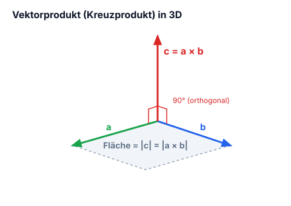


*Abbildung: 3D-Darstellung der Vektoren $\vec{a}$, $\vec{b}$ und $\vec{c}$:*
- *$\vec{a}$ und $\vec{b}$ spannen in einer Ebene ein Parallelogramm auf (Flächeninhalt $= |\vec{c}|$*

- *$\vec{c}$ steht senkrecht auf der durch $\vec{a}$ und $\vec{b}$ aufgespannten Ebene)*

> **Beschriftungen:**
> - *„3D dargestellt!“*
> - *„Ortogonal = Rechtwinklig“*

---

### Berechnungsvorschrift

$$\vec{a} \times \vec{b} = \begin{pmatrix} a_x \\ a_y \\ a_z \end{pmatrix} \times \begin{pmatrix} b_x \\ b_y \\ b_z \end{pmatrix} = \begin{pmatrix} a_y \cdot b_z \overset{1}{-} a_z \cdot b_y \\ a_z \cdot b_x \overset{2}{-} a_x \cdot b_z \\ a_x \cdot b_y \overset{3}{-} a_y \cdot b_x \end{pmatrix} = \begin{pmatrix} c_x \\ c_y \\ c_z \end{pmatrix}$$

#### Hilfsschema (Sarrus-ähnliches Schema zur Multiplikation):
*Zur Vereinfachung der Rechnung hängt man die zwei obersten Angaben der jeweiligen Vektoren unten an, z. B. $a_x, a_y$ und $b_x, b_y$:*

$$\begin{array}{ccc}
a_x & & b_x \\
a_y & \searrow_1 \nwarrow^1 & b_y \\
a_z & \searrow_2 \nwarrow^2 & b_z \\
\hline
a_x & \searrow_3 \nwarrow^3 & b_x \\
a_y & & b_y
\end{array}$$

- **Zeile 1 ($c_x$):** $1 \implies a_y \cdot b_z - a_z \cdot b_y$
- **Zeile 2 ($c_y$):** $2 \implies a_z \cdot b_x - a_x \cdot b_z$
- **Zeile 3 ($c_z$):** $3 \implies a_x \cdot b_y - a_y \cdot b_x$

---

---

## 1.3 Skalare Größen

Ein Beispiel für ein Skalar ist Masse. Das beste Beispiel für die Skalare Multiplikation oder Division wäre:

$$\vec{F} = m \cdot \vec{a}$$

$$\text{Skalar} \cdot \text{Vektor} = \text{Vektor}$$

$$\lambda \vec{a} = \text{Skalar} \times \text{Vektor}$$

---

### Optische Darstellung:

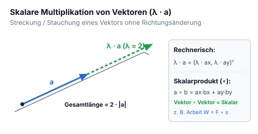


*Abbildung: Ein blauer Vektor $\vec{a}$ wird geradlinig um dieselbe Länge verlängert. Über der Verlängerung ist $\lambda$ notiert. Eine geschweifte Klammer fasst die gesamte verlängerte Strecke zusammen: $\lambda \vec{a} \text{ mit } \lambda = 2$.*


---

### Rechnerische Darstellung

$$\lambda \vec{a} = \lambda \begin{pmatrix} \vec{a}_x \\ \vec{a}_y \end{pmatrix} = \begin{pmatrix} \lambda \vec{a}_x \\ \lambda \vec{a}_y \end{pmatrix}$$

---

---

## 1.4 Skalarprodukt (Punktprodukt)

Es wird Skalarprodukt genannt weil das Endprodukt ein Skalar ist. Bei einer Rechnung wird dann eigentlich dieses Zeichen eingesetzt: $\circ$ *(Pfeil weist auf einen kleinen Kreis / Kringel als Produktzeichen)*.

$$\begin{pmatrix} \vec{a}_x \\ \vec{a}_y \end{pmatrix} \circ \begin{pmatrix} \vec{b}_x \\ \vec{b}_y \end{pmatrix} = \vec{a}_x \cdot \vec{b}_x + \vec{a}_y \cdot \vec{b}_y$$

$$\text{Vektor} \circ \text{Vektor} = \text{Skalar}$$

---

---

# Kapitel 2: Elektrostatik, Ladungen & Elektrische Felder

!!! abstract "Überblick"
    Ladungsquantelung, Coulombsches Gesetz, E-Feld, Gaußscher Satz, Potenzial und Spannung.

## 2.1 Atommodell, Ladungen & Elementarladung

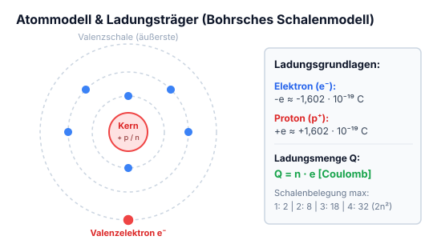


*Abbildung: Schematisches Atommodell für „Wasserstoff“:*
- *In der Mitte ein Kern mit Protonen ($p$, grün beschriftet) und Neutronen ($n$, blau beschriftet).*
- *Eine äußere Kreisbahn mit einem umlaufenden Elektron ($e$, rot beschriftet).*


- **Wasserstoff**
- **Elektron** *(rot)* = negative Ladung
- **Proton** *(grün)* = positive Ladung
- **Neutron** *(blau)* = neutrale Ladung

Die ungleichnamige Ladungen ziehen sich an und die gleichnamigen stossen sich ab. Nur durch die Zentrifugalkraft stürzt der Elektron nicht zum Proton.

Ein Atom kann aus mehreren Bahnen bestehen.

---

Ein Atom besteht aus einem **Kern** und aus einen oder mehreren **Schalen**, auf diesen können nur eine begrenzte Anzahl von Elektronen sein.

Reihenfolge:
1) 2
2) 8
3) 18
4) 32

> **Merksatz (rot umrandeter Kasten):**  
> Die Elektronen auf der äussersten Schale des jeweiligen Atoms heissen **Valenzelektronen**.

---

### Elementarladung

Bei einem Atom hat es immer gleichviele Protonen wie Elektronen, die Ladung der Elementarteilchen ist fest gequantelt, diese nennt man:

$$\text{Elementarladung} = -e \approx -1{,}602 \times 10^{-19} \, \text{C}$$

Bei den Protonen ist es fast das selbe:

$$\text{Elementarladung} = +e \approx +1{,}602 \times 10^{-19} \, \text{C}$$

---

das c steht für coulomb.

ion = Der Atom während elektronen entzogen oder Beigefügt ~~oder entzogen~~ werden.

---

### Ladungsmenge

- $Q =$ Ladung (Elektrizitätsmenge)
- $n =$ Anzahl der Elementarladung
- $e =$ Elementarladung

$$Q = n \times \pm e$$

**Bsp.:**  
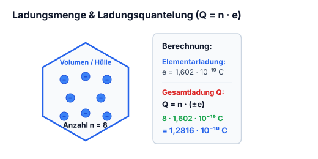


*Abbildung: Eine sechseckige Umrandung mit 8 blauen Punkten im Inneren:*
- *$\bullet \rightarrow \pm \text{Elementarladung} = \pm 1{,}602 \times 10^{-19}$*
- *$n = \text{menge}$ (Pfeil auf die Gesamtheit der Ladungen*

- *$Q = \text{Ladung}$ (Pfeil nach außen aus der Umrandung))*

$$8 \times 1{,}602 \times 10^{-19} = 1{,}2816 \times 10^{-18}$$

---

---

## 2.2 Coulombsches Gesetz

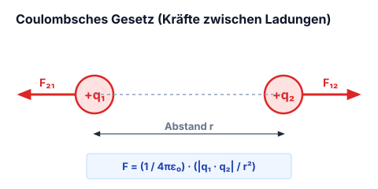 *(im Original: „Coulombsches Gesetz“)*


*Abbildung: Zwei punktförmige Ladungen:*
- *Quelladung $q$ (schwarz*

- *Testladung $e$ (blau)*
- *Gestrichelte Pfeillinie als Abstandsvektor $\vec{r}$ von $q$ nach $e$.)*

$$F \approx \frac{1}{4\pi\varepsilon_0} \cdot \frac{q \cdot e}{|r|^2} \qquad F = \text{Kraft } [\text{N}]$$

$$\vec{F} \approx \frac{1}{4\pi\varepsilon_0} \cdot \frac{q \cdot e}{|r|^2} \, \vec{e}_r \qquad \varepsilon_0 = 8{,}854 \cdot 10^{-12} \, \text{C/Vm}$$

Dieses Gesetz ist nur bei Punktladungen möglich.

$$F = e E$$

---
!!! warning "Coulombsches Gesetz & Dielektrizitätskonstante"
    - Das Coulombsche Gesetz gilt in dieser Form streng für **ruhende Punktladungen**.
    - Befinden sich die Ladungen in einem dielektrischen Medium (z. B. Isolieröl, Kunststoff), verringert sich die wirksame Kraft um die relative Permittivität $\varepsilon_r$:
      $$\vec{F} = \frac{1}{4\pi \varepsilon_0 \varepsilon_r} \cdot \frac{q_1 \cdot q_2}{|\vec{r}|^2} \, \vec{e}_r$$
    - Im Vakuum / Luft gilt $\varepsilon_r \approx 1$.

---

## 2.3 Superpositionsprinzip & Feldstärkeberechnung


*Abbildung: Zentrale Punktladung $q$, von der 8 radiale Feldlinien (blaue Pfeile) in alle Richtungen nach außen verlaufen. Im ersten Quadranten liegt ein Messpunkt $P$ mit gestricheltem Abstandsdreieck $r$ zum Zentrum $q$.*


Hier gilt:

$$\vec{E} = \frac{1}{4\pi\varepsilon_0} \cdot \frac{q}{|r|^2} \, \vec{e}_r$$

Wir wollen die Feldstärke vom Punkt $P$ wissen.

Vereinfachte Rechnung von mehreren Quelladungen:

$$\vec{E}(\vec{r}_P) = \frac{1}{4\pi\varepsilon_0} \cdot \sum_{i=1}^n \frac{q_i}{|r_i|^2} \, \vec{e}_r$$

Quellladung haben gegenseitig keinen Einfluss.  
Die Dichte der Feldlinien definieren die Stärke vom Elektrischem Feld.

---

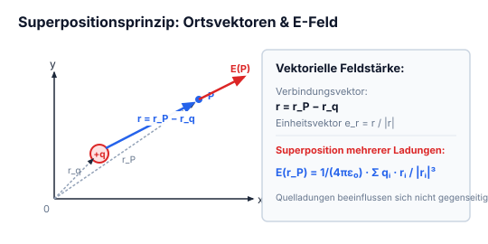


*Abbildung: oben: 2D-Koordinatensystem mit Achsen:*
- *Quelladung $q$ mit Ortsvektor $\vec{r}_q$ und nach allen Richtungen ausgehenden Feldlinien.*
- *Messpunkt $P$ mit Ortsvektor $\vec{r}_P$.*
- *Verbindungsvektor $\vec{r}$ von $q$ nach $P$ mit Einheitsvektor $\vec{e}_r$.*


$$\vec{r} = \vec{r}_P - \vec{r}_q$$

$$\vec{e}_r = \frac{\vec{r}}{|r|}$$

$$\vec{E} = \frac{1}{4\pi\varepsilon_0} \cdot \frac{q}{|r|^2} \, \vec{e}_r \implies \vec{E} = \frac{1}{4\pi\varepsilon_0} \cdot \frac{q \vec{r}}{|r|^3}$$

$$\vec{E} = \frac{1}{4\pi\varepsilon_0} \cdot \sum_{i=1}^n q_i \frac{\vec{r}_i}{|r_i|^3} \quad \text{mit } \vec{r}_i = \vec{r}_P - \vec{r}_{qi}$$

---

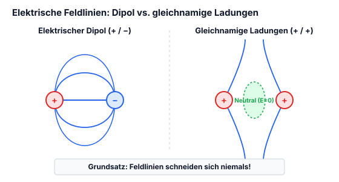

*(Zwei Feldlinien-Skizzen:*
1. *Elektrischer Dipol: Oben Pluspol $(+)$, unten Minuspol $(-)$. Feldlinien treten aus $(+)$ aus und verlaufen in symmetrischen Bögen zu $(-)$.*
2. *Zwei gleichnamige Ladungen: Oben Pluspol $(+)$, unten Pluspol $(+)$. Die Feldlinien weichen einander aus und biegen nach links und rechts ab. Der feldfreie Zwischenraum in der Mitte ist grün markiert und mit „Neutral“ beschriftet.)*

**Feldlinien schneiden sich nie.**

---

---

## 2.4 Kontinuierliche Ladungsverteilungen

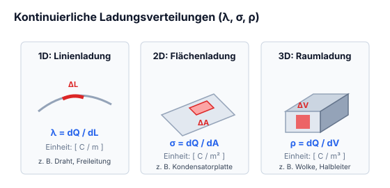

1. **Längenbezogene Ladungsdichte:**  

*Abbildung: Eine geschwungene Linie/Draht mit einem roten Linienelement $\Delta L$ und gestrichelter Verbindungslinie zu einem Punkt oben.*
  
$$\Delta L = \text{Delta } l$$  
$$\lambda = \lim_{\Delta L \to 0} \frac{\Delta Q}{\Delta L} \quad \left[\frac{\text{C}}{\text{m}}\right]$$

2. **Flächenbezogene Ladungsdichte:**  

*Abbildung: Eine rautenförmige Ebene mit Ladungspunkten und einem rot hervorgehobenen Flächenelement $\Delta A$, von dem eine gestrichelte Linie zu einem Punkt führt.*
  
$$\Delta A$$  
$$\sigma = \lim_{\Delta A \to 0} \frac{\Delta Q}{\Delta A} \quad \left[\frac{\text{C}}{\text{m}^2}\right]$$

3. **Raumbezogene Ladungsdichte (Volumenladungsdichte):**  

*Abbildung: Ein unregelmäßiger 3D-Körper mit Ladungspunkten im Inneren und einem rot umrandeten Volumenelement $\Delta V$, verbunden mit einem Punkt oben.*
  
$$\Delta V$$  
$$\rho = \lim_{\Delta V \to 0} \frac{\Delta Q}{\Delta V} \quad \left[\frac{\text{C}}{\text{m}^3}\right]$$

$$\vec{E}(\vec{r}_P) = \frac{\lambda \Delta L}{4\pi\varepsilon_0} \sum_{i=1}^n \frac{1}{|\vec{r}_i|^2}$$

*(Roter handschriftlicher Kommentar unten:)*  
> *„Kann man nicht Rechnen!“*

---

---

## 2.5 Elektrischer Fluss

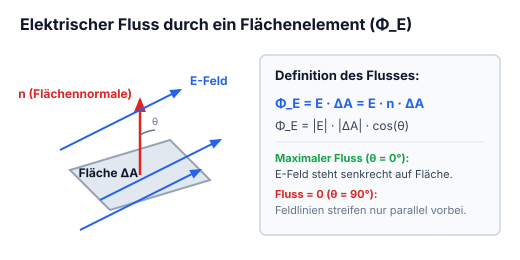


*Abbildung: Eine ebene rechteckige Fläche $\Delta A$ mit Flächennormale $\vec{n}$ senkrecht dazu. Parallele elektrische Feldlinien $\vec{E}$ (blaue Pfeile) durchstoßen die Fläche schräg.*


$$\Phi_E = \vec{E} \cdot \Delta \vec{A}$$

*(mit $\Delta \vec{A} = \vec{n} \cdot \Delta A$)*

- $\Delta A = \text{Fläche}$
- $\vec{n} = \text{Flächennormale}$
- $\vec{E} = \text{Elektrische Feldlinien}$
- $\Phi_E = \text{Elektrischer Fluss}$

$$\Phi_E = \sum_{i=1}^n \vec{E}_i \cdot \Delta \vec{A}_i = \text{Fluss in homogenen und nicht gerader Fläche.}$$

---

---

## 2.6 Gaußsches Gesetz (Symmetrien: Kugel, Zylinder, Ebene)

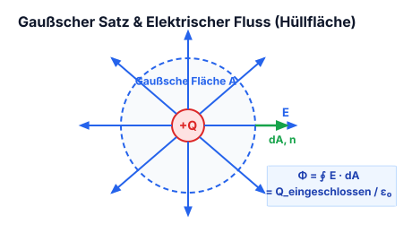

### Sphärische Symmetrie

$$\sum_{i=1}^n \vec{E}_i \cdot \Delta \vec{A}_i = \frac{Q}{\varepsilon_0}$$

Für geschlossene Flächen (Allgemein)

Für Kugeln:

$$\vec{E} \cdot 4\pi r^2 = \frac{Q}{\varepsilon_0}$$

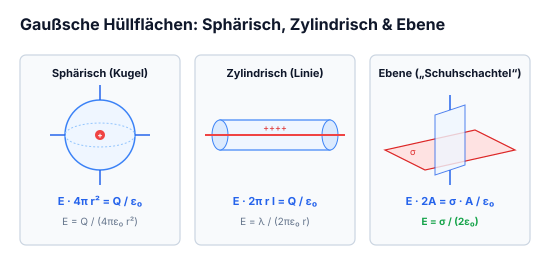


*Abbildung: Eine Kugel mit Äquator- und Längenkreisen. Im Mittelpunkt eine Ladung $e$ bzw. $q$ (blau), von der rote Pfeile radial nach außen zu den Polen und Rändern verlaufen.*


---

### Zylindersymmetrie

$$E = \frac{\rho \cdot r^2}{2 r \varepsilon_0} \implies E \cdot 2\pi r l = \frac{Q}{\varepsilon_0}$$


*Abbildung: Ein Zylinder in horizontaler Ausrichtung, auf dessen Mittelachse mehrere Ladungspunkte aufgereiht sind.*


Mit dieser Formel berechnet man die elektrische Feldstärke an einem Punkt außerhalb des Zylinders.

---

### Ebene Symmetrie

Gauss'sche Oberfläche  
„Gaußsche Schuhschachtel“ (Quaderförmige Hüllfläche)

Formel dafür ist:

$$E \cdot A = \frac{\sigma}{\varepsilon_0} \rightarrow E = \frac{\sigma}{2\varepsilon_0}$$


*Abbildung: Eine flächige geladene Ebene mit Punktladungen, durch die senkrecht ein quaderförmiges Volumen („Schuhschachtel“, blau) hindurchstößt.*


---

---

## 2.7 Elektrisches Potenzial & Arbeit im E-Feld

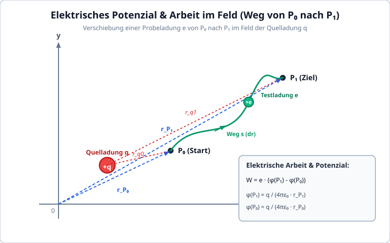


*Abbildung: 2D-Koordinatensystem mit Achsen $y$ und $x$:*
- *Quelladung $q$ (rot) im Koordinatensystem.*
- *Anfangspunkt $P_0$ mit Ortsvektor $\vec{r}_{P_0}$ vom Ursprung.*
- *Endpunkt $P_1$ mit Ortsvektor $\vec{r}_{P_1}$ vom Ursprung.*
- *Ein geschwungener Pfad zwischen $P_0$ und $P_1$ mit einer Testladung $e$ (grün).*
- *Gestrichelte Verbindungslinien von der Quelladung $q$ nach $P_0$ und $P_1$.*


- $P_1 = P_1, \quad P_0 = P_0$
- Der Punkt $q$ kann man selber wählen: $q = \text{Nullpunkt}$

Hier gilt:

$$W = e \left( \underbrace{\frac{q}{4\pi\varepsilon_0 r_{P_1}}}_{P_{P_1}} - \underbrace{\frac{q}{4\pi\varepsilon_0 r_{P_0}}}_{P_{P_0}} \right) =$$

$$W = e (P_{P_1} - P_{P_0})$$

Wie man sieht kann man die Arbeit von der Bewegung einer Ladung mit dem elektrischem Potential berechnen.

---

---

## 2.8 Elektrische Spannung & Potenzialdifferenz

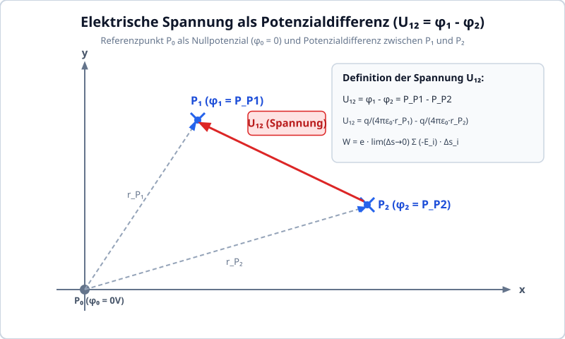


*Abbildung: 2D-Koordinatensystem mit den Achsen $y$ und $x$:*
- *Punkt $P_1$ mit Kreuz im oberen Bereich.*
- *Punkt $P_2$ mit Kreuz weiter unten rechts.*
- *Ursprung als Referenzpunkt $P_0$.*


$$P_0 = p_0 = 0$$

$$W = e \cdot \lim_{\Delta s \to 0} \sum (-\vec{E}_i) \cdot \Delta \vec{s}_i$$

$$U_{12} = \lim_{\Delta s \to 0} \sum (-\vec{E}_i) \cdot \Delta \vec{s}_i$$

---

$$\left( \frac{q}{4\pi\varepsilon_0 r_{P_1}} - \underbrace{\frac{q}{4\pi\varepsilon_0 r_{P_0}}}_{0} \right) - \left( \frac{q}{4\pi\varepsilon_0 r_{P_2}} - \underbrace{\frac{q}{4\pi\varepsilon_0 r_{P_0}}}_{0} \right)$$

$$\downarrow$$

$$P_{P_1} - P_{P_2} = \frac{q}{4\pi\varepsilon_0 r_{P_1}} - \frac{q}{4\pi\varepsilon_0 r_{P_2}} = U_{12}$$

Mit dieser Formel können wir ~~das~~ die Potentialdifferenz berechnen.  
Wird als elektrische Spannung $U$ [V] angegeben.

---

---

## 2.9 Äquipotenzialflächen

Da es auf beiden Seiten der Punkte auf der Äquipotentialfläche die gleiche Feldstärke hat, ergibt die Potentialdifferenz 0, daher gibt auch die Feldstärke dieser beiden Punkte 0.

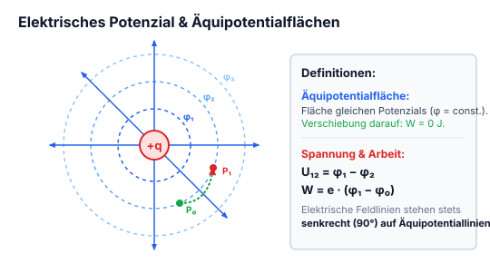


*Abbildung: Zentrales radialsymmetrisches Feld:*
- *Punktladung $q$ im Zentrum.*
- *Acht radiale Feldlinien (blaue Pfeile) nach außen.*
- *Vier konzentrische Kreislinien um das Zentrum, beschriftet per Pfeil mit „Äquipotentialflächen“.*
- *Auf einem der inneren Kreise liegen zwei Punkte $P_1$ und $P_2$.*


---

---

## 2.10 Elektrische Felder in Materie

Ein **Isolator** z. B. Keramik oder Gummi ist ein Material in dem alle Elektronen an die Atome gebunden sind.

**Elektrische Leiter** (z. B. Kupfer, Aluminium) sind Materialien mit frei beweglichen Leitungselektronen im Leitungsband.

---

---

## 2.11 Dünne leitende Platten im homogenen Feld

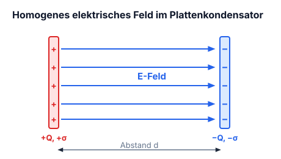

### Flächenladungsdichte

$$\pm \sigma = \pm Q : A$$


*Abbildung: Plattenkondensator mit zwei vertikalen Platten:*
- *Linke Platte positiv geladen ($+$).*
- *Rechte Platte negativ geladen ($-$).*
- *Dazwischen homogene elektrische Feldlinien (blaue Pfeile) horizontal von links nach rechts verlaufend.*
- *Hinweispfeil auf das Einbringen von Platten zwischen die Kondensatorplatten.*


Werden zwei dünne, ungeladene leitende Platten in das Feld eingebracht:

$\downarrow$

tritt Ladungstrennung durch elektrische Influenz auf. Die induzierten Oberflächenladungen kompensieren das äußere Feld im Inneren des Leiters vollständig.

---

---

## 2.12 Leitender Körper & Faraday-Käfig (Hohlraum)

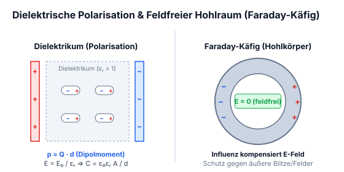

Wenn wir uns ungeladener Kupfer in Form von einer geschlossenen Kugel vorstellen, wirkt es wie auf dem beispiel auf der letzten Seite.


*Abbildung: Zwei konzentrische Kreise stellen einen leitenden Hohlkörper (z. B. eine geschlossene metallische Kugelschale) in einem äußeren elektrischen Feld dar. An der linken Außenoberfläche befinden sich influenzierte negative Ladungen ($-$), an der rechten Außenoberfläche positive Ladungen ($+$). Im inneren, vom Leiter umschlossenen Hohlraum ist das Feld kompensiert, ein Pfeil weist auf diesen zentralen Hohlraum mit der Beschriftung „Feldfrei“.*


---

---

## 2.13 Dielektrische Polarisation & Materieeinfluss

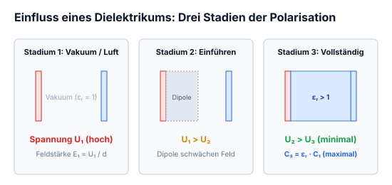


*Abbildung: Drei Stadien eines Plattenkondensators mit Plattenabstand $d$:*
*1. Vakuum/Luft zwischen den Platten: linke Platte positiv geladen ($+$), rechte Platte negativ geladen ($-$). Elektrische Feldlinien verlaufen homogen von links nach rechts. Spannung $U_1$.*
*Dazwischen: $U_1 > U_2$.*
*2. Kondensator mit einsetzender dielektrischer Polarisation: mikroskopische elektrische Dipole richten sich gegen das externe Feld aus und schwächen das innere Feld; Spannung $U_2$.*
*Dazwischen: $U_2 > U_3$.*
*3. Kondensator mit vollständig ausgefülltem Dielektrikum (blau hervorgehoben); die Feldstärke und damit die Spannung sinken weiter auf $U_3$.*


$$U = E \cdot d$$


*Abbildung: Modell eines polarisierbaren Atoms/Moleküls in einem äußeren elektrischen Feld, dargestellt als Kreis mit horizontalen Feldlinien (blaue Pfeile nach rechts). An der Hülle sammeln sich Ladungsschwerpunkte: negative Ladungsträger ($-$) links, positive Ladungsträger ($+$) rechts. Ein kleiner Kreis stellt den verschobenen Kern bzw. die Ladungsträger dar, mit einem Abstandsvektor $\vec{d}$ zwischen den Schwerpunkten.*


Hier gilt:
$$\vec{p} = Q \vec{d}$$

Dieser Vorgang nennt man Dipolmoment.

---

Mit mehreren dipole in einem Volumen wird die Formel so gerechnet:

$$\vec{P} = \frac{1}{V} \sum_{n=1}^{N} \vec{p}_n$$

---

---

# Kapitel 3: Kondensatoren & Kapazität

!!! abstract "Überblick"
    Plattenkondensator, Kapazitätsberechnung, Bauformen, Energie und Lade-/Entladevorgänge.

## 3.1 Die Kapazität & Plattenkondensator

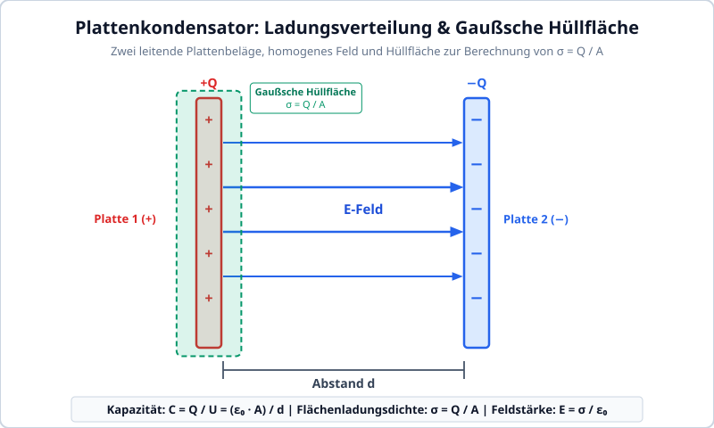

$$Q = C \cdot U \qquad C = \text{Kapazität}$$

- $C$ ist ein Mass für die Fähigkeit eines Körpers, Ladung zu speichern.
- $C$ wird in $\text{C}/\text{V}$ oder $\text{F} = \text{Farad}$ angegeben.
- Ein Bauelement mit der Eigenschaft der Kapazität wird Kondensator genannt.

### Bildliche vorstellung


*Abbildung: Zwei parallele leitende Plattenbeläge mit vertikalem Abstand; der obere Belag trägt positive Ladungen ($+$), der untere Belag gleich große negative Ladungen ($-$). Zwischen den Belägen zeigen vertikale elektrische Feldlinien nach unten. Beschriftung: „2 leitende Beläge mit gleichgrossen Ladungen“.*


*Abbildung: Zwei gegenüberstehende vertikale Kondensatorplatten:*
*- Linke Platte: positiv geladen ($+$), umgeben von einer gestrichelten Kontur, beschriftet als „Hüllfläche“. Pfeil mit Notiz: „Zur berechnung der Flächenladungsdichte: $\sigma = Q : A$“.*
*- Rechte Platte: negativ geladen ($-$), blau umrandet, beschriftet mit: „Wird Homogen dargestellt“.*


### Berechnung der Kapazität von Plattenkondensatoren

$$C = \frac{Q}{U} = \frac{\varepsilon_0 A}{d}$$

---
!!! warning "Gespeicherte Energie im elektrischen Feld des Kondensators"
    Die im Kondensator gespeicherte elektrostatische Energie berechnet sich aus dem Integral über den Ladevorgang:
    $$W_e = \frac{1}{2} C U^2 = \frac{1}{2} \frac{Q^2}{C} = \frac{1}{2} Q U \quad [\text{Joule}]$$

---

## 3.2 Kondensator-Grundlagen & Feldwirkung

### Reihenschaltung von Kondensatoren

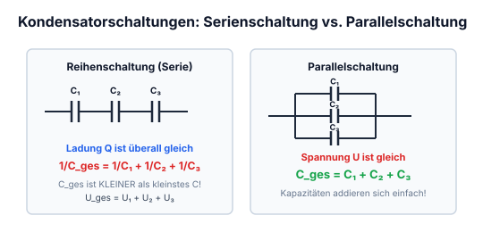


*Abbildung: Reihenschaltung dreier Kondensatoren $C_1, C_2, C_3$ an einer Spannungsquelle. Ein Gesamtstrom bzw. eine Gesamtladung $Q_{\text{ges}}$ wird eingespeist.*


$$C_{\text{ges}} = \frac{1}{\frac{1}{C_1} + \frac{1}{C_2} + \frac{1}{C_3}}$$

Bei der Reihenschaltung ist die Ladungsmenge der Kondensatoren gleich.

$Q = \text{Ladungsmenge}$
$$C = \frac{Q}{U} \quad \text{mit } Q = n \cdot e = I \cdot t$$

$$Q = n \cdot e \quad \text{mit } e = 0{,}1602 \cdot 10^{-18}\,\text{C} = \text{Elementarladung}$$
*(Hinweis: entspricht $1{,}602 \cdot 10^{-19}\,\text{C}$)*
in Coulomb $[\text{C}]$ oder $[\text{As}]$

### Parallelschaltung


*Abbildung: Parallelschaltung dreier Kondensatoren $C_1, C_2, C_3$ an einer Spannungsquelle. Die Teilladungen bzw. Teilströme $Q_1, Q_2, Q_3$ fließen in die einzelnen Zweige.*


$$C_{\text{ges}} = C_1 + C_2 + C_3$$

Bei der Parallelschaltung liegt an jedem Kondensator die Gleiche Spannung an aber die Ladungsmenge ist überall anders.

$$Q_{\text{ges}} = Q_1 + Q_2 + Q_3$$

---

---

## 3.3 Typische Anwendungen von Kondensatoren

### RC-Glied (Tiefpassfilter)


*Abbildung: Grundschaltung eines RC-Tiefpassfilters. In der oberen Zuleitung liegt ein Widerstand $R$. Dahinter ist parallel zwischen der oberen und der unteren Masseleitung ein Kondensator $C$ geschaltet. Eingang links, Ausgang rechts.*


Mit dieser Schaltung kann man nicht nur ein Frequenz-abhängigen Spannungsteiler, oder ein Tiefpass-Filter machen, sondern auch Schalter entprellen.

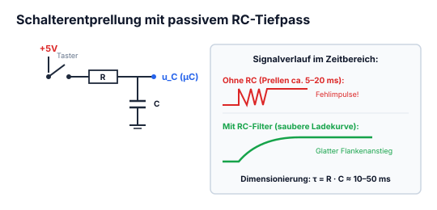


*Abbildung: Schaltung zur Schalterentprellung. In der oberen Signalleitung liegt ein erster Widerstand $R_1$. Dahinter ist ein Schalter/Taster ($E--\backslash$) gegen Masse geschaltet. In Reihe folgt ein zweiter Widerstand $R_2$, zu dem eine Diode parallelgeschaltet ist (Anode links, Kathode rechts). Dahinter ist ein Kondensator parallel gegen Masse geschaltet.*


Um Verzögerungen zu vermeiden sollten $R_1$ & $R_2$ gleich gross gewählt werden.  
Wichtig: Um die Bauteile auszuwählen ist die Zeitkonstante $\tau$. Man sagt $\tau \approx 5$ [bzw. $5\tau$], dann ist der Kondensator geladen.

---

---

## 3.4 Auf- und Entladen des Kondensators (RC-Zeitkonstante τ)

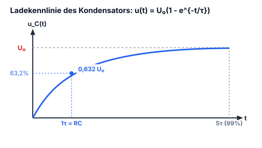


*Abbildung: Lade-/Entladediagramm mit der Kondensatorspannung $U_c$ über der Zeitachse $t$.*
*Das Diagramm ist in zwei Abschnitte der Zeitdauer $t_g$ gegliedert:*
*1. Phase „aufladen“: Kurve steigt von 0 exponentiell an.*
*2. Phase „entladen“: Kurve fällt vom Maximalwert wieder exponentiell gegen 0 ab.*


$$t_g \approx 5\,\tau \quad [\mathrm{s}]$$

$$\tau = R \cdot C \quad [\mathrm{s}]$$

### Aufladen

$U_c = \text{Spannung am Kondensator}$

$$U_c = U \cdot \left(1 - e^{-\frac{t}{\tau}}\right)$$

### Entladen

$$U_c = U \cdot e^{-\frac{t}{\tau}}$$

!!! example "Praxisbeispiel: RC-Zeitglied (Einschaltverzögerung)"
    Ein RC-Lied aus $R = 10\,\text{k}\Omega$ und $C = 100\,\mu\text{F}$ wird über einen Schalter an $U = 10\,\text{V}$ gelegt:
    1. **Zeitkonstante $\tau$:**
       $$\tau = R \cdot C = 10\,000\,\Omega \cdot 100 \cdot 10^{-6}\,\text{F} = 1{,}0\,\text{s}$$
    2. **Kondensatorspannung $U_C$ im Zeitverlauf:**
       - nach $t = 1\,\text{s}$ ($1\tau$): $U_C = 10\,\text{V} \cdot (1 - e^{-1}) \approx 6{,}32\,\text{V}$
       - nach $t = 3\,\text{s}$ ($3\tau$): $U_C = 10\,\text{V} \cdot (1 - e^{-3}) \approx 9{,}50\,\text{V}$
       - nach $t = 5\,\text{s}$ ($5\tau$): $U_C = 10\,\text{V} \cdot (1 - e^{-5}) \approx 9{,}93\,\text{V}$
       Nach $5\,\text{Sekunden}$ ist der Kondensator zu über $99\,\%$ aufgeladen.

---
!!! tip "Kenngrößen der RC-Ladekurve (Faustregeln für die Praxis)"
    - **$t = 1\tau$**: Die Spannung erreicht **$63{,}2\%$** der Endspannung ($U_C = 0{,}632 \, U$).
    - **$t = 3\tau$**: Die Spannung erreicht **$95{,}0\%$** der Endspannung.
    - **$t = 5\tau$**: Die Spannung erreicht **$99{,}3\%$** der Endspannung (in der Praxis gilt der Kondensator nach $5\tau$ als vollständig geladen / entladen).
    - **Ladestrom zum Einschaltzeitpunkt ($t = 0$):** Der ungeladene Kondensator wirkt wie ein Kurzschluss; der Spitzenstrom beträgt $I_{\max} = \frac{U}{R}$.

---

## 3.5 Kondensatoren: Bauarten & Kenndaten

### Elektrolytkondensator

- **Polarisiert?** Ja
- **Vorteil:** grosse Kapazität, relativ hohe Spannungsfestigkeit
- **Nachteil:** unter Umständen sehr hoher ESR (equivalent serial resistenc [verlustwiederstand]), nicht geeignet für hohe Frequenzen, verliert schnell seinen Kapazitätswert, sie mögen keine hohe Temperatur.
- **Info:** Sie besitzen ein Überdruckventil, welches bei falsch-polung oder zu hoher spannung platzt und daraus kommt ein sehr heisses und giftiges Gas.

---

### Folienkondensator

- **Polarisiert?** Nein
- **Vorteil:** grosse Kapazität, gut für NF (Niederfrequenz) oder für Filter im Audiobereich, im Vergleich zu Elektrolytkondensator besser für höhere Frequenzen, Sie sind sehr stabil d.h. sie verlieren ihren Kapazitätswert, gibt es mit hohen Werten (jedoch grosse Dimension)
- **Nachteil:** nicht für sehr hohe Frequenzen geeignet
- **Info:** Wird meist als Stützkondensatoren bei IC's verwendet, typischerweise 100nF (so nahe wie möglich beim IC)

---

## 3.6 Keramikkondensatoren & SMD-Bauformen

- **Polarisiert?** Nein
- **Vorteil:** sehr gut für sehr hohe Frequenzen
- **Nachteil:** brüchig, ungenaue Kapazitätswerte (hohe Toleranz), altert stark, es gibt nur kleine Werte.

---

---

## 3.7 Regeln & Zusammenfassung zu Kondensatorschaltungen

Nebst der Kapazität muss noch die Spannungsfestigkeit berücksichtigt werden.

Spannungsfestigkeit für Kondensatoren mindestens $2 \cdot \text{Spitzenspannung}$, wenns nach dem Gleichrichter kommt. Für nach dem Spannungsregler wird empfohlen mindestens $2 \cdot \text{die Gleichspannung}$, weil es vorkommen kann, das durch's umlegen eines Schalters eine höhere Spannung entstehen kann, besser wäre ein Kondensator mit $3 \cdot \text{die Gleichspannung}$.

**Wichtig!** Im ersten Moment ist ein Kondensator ein Kurzschluss.

---

# Kapitel 4: Gleichstromtechnik, Netzwerkanalyse & Grundgesetze

!!! abstract "Überblick"
    Strom, Ohmsches Gesetz, Joulesche Wärme, Zählpfeile, Kirchhoffsche Regeln und Quellen.

## 4.1 Elektrischer Strom & Stromdichte


*Abbildung: Zwei räumliche Leiterkörper mit Ladungen $Q+$ und $Q-$, zwischen denen elektrische Feldlinien bzw. ein Stromfaden verlaufen. Eine schematische Augen-Skizze betrachtet den Leitungsquerschnitt, durch den sich ein Elektron $e^-$ mit Driftgeschwindigkeit $\vec{v}_e$ bewegt.*


$$\frac{n \times e}{\Delta t} = \frac{\Delta Q}{\Delta t} = I \; [\text{A}]$$

$$\lambda = \frac{\Delta Q}{\Delta l} \rightarrow I = \frac{\lambda \times \Delta l}{\Delta t} = \lambda \times \vec{v}$$

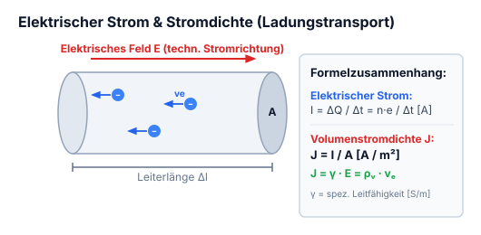


*Abbildung: Ein zylindrischer Leiter entlang einer Koordinatenachse $x$ mit Querschnittsfläche $\Delta A$ und sich bewegenden positiven Ladungen $+$, betrachtet durch ein Auge.*


$$\frac{\frac{n \times e}{\Delta t}}{\Delta A} = \frac{I}{\Delta A} = J \; \left[\frac{\text{A}}{\text{m}^2}\right]$$

### Volumenstromdichte

$J =$ Volumenstromdichte

$$J = \rho \times \vec{v} = \frac{\rho \times \Delta V}{\Delta t \times \Delta A}$$

- $\vec{v}_e =$ Driftgeschwindigkeit
- $\vec{v} =$ Geschwindigkeit
- $\vec{v}_e = -\mu \vec{E} \qquad \mu = \text{Beweglichkeit}$

$$J = n(-e) \times \vec{v}_e = n(-e) \times (-\mu e \vec{E}) = \underbrace{n e \, \mu}_{\gamma} \vec{E} \rightarrow J = \gamma \vec{E}$$

---

---

## 4.2 Ladungsbewegung im metallischen Leiter

$$J = \text{Volumenstromdichte} = [\text{A}/\text{m}^2]$$

$$\vec{J} = \frac{\Delta I}{\Delta A} :$$
heisst welcher Stromanteil durch eine bestimmte Fläche fliesst.

Je grösser die Volumenstromdichte ist desto wärmer wird der Leiter, je wärmer er wird desto grösser ist der Widerstand, bei gewissen Halbleiter ist es genau anders rum.

$$Q = \rho \cdot \Delta V$$

$$\rho = \frac{Q}{\Delta V}$$

$$\vec{J} = \rho \cdot \vec{v}$$

**Größen:**
- $\Delta V = \text{Volumen} = \Delta A \cdot \Delta l$
- $\rho = \text{Raumladungsdichte}$
- $\vec{v} = \text{Geschwindigkeit}$

---

---

## 4.3 Ohmsches Gesetz & Spezifischer Widerstand

$$R = \frac{U}{I} = \frac{l}{\gamma \cdot A} = \frac{\rho \cdot l}{A} \quad \text{mit } \rho = \frac{1}{\gamma}$$

- $\gamma =$ Spezifische Leitfähigkeit
- $\rho =$ Spezifische Widerstandfähigkeit

### Widerstand bei einer bestimmten Temperatur ($T$)

$$R(T) = R_{20^\circ} \cdot (1 + \alpha \cdot \Delta T)$$

*(Beschriftung der Formelbestandteile):*
- ① $R(T)$: Widerstand in der Gewissen Temperatur
- ② $R_{20^\circ}$: Spezifischer Widerstand bei $20^\circ\text{C}$
- ③ $\alpha$: Temperaturbeiwerte
- ④ $\Delta T$: Gewollte Temperatur (differenz zu $20^\circ\text{C}$)

**Einheiten:**
- $R = [\Omega] \text{ ohm}$
- $R_{20^\circ} = \rho = [\Omega \cdot \text{mm}^2/\text{m}]$
- $\gamma = [\text{m}/(\Omega \cdot \text{mm}^2)]$

---

---

## 4.4 Joulesches Gesetz, elektrische Leistung & Arbeit

- $P =$ Leistung
- $W =$ Arbeit
- $t =$ Zeit

$$P = \frac{W}{t} = U \cdot I \quad \text{mit } W = F \cdot s \quad [\text{Nm}]$$

Zum berechnen der Verlustleistung z.B eines Widerstandes:

$$P = U \cdot I = I^2 \cdot R = \frac{U^2}{R}$$

**Einheiten:**
- $P = [\text{W}] \text{ Watt}$
- $W = [\text{J}] \text{ Joule}$
- $t = [\text{s}] \text{ Sek (time)}$

---

---

## 4.5 Zählpfeilsysteme (Erzeuger- vs. Verbraucherpfeilsystem)

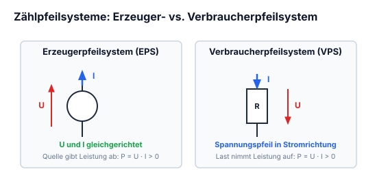


*Abbildung: Ein einfacher Stromkreis aus Quelle links und Verbraucherwiderstand rechts. Bei der Quelle zeigt der Zählpfeil $u \uparrow$ parallel zur Quellspannung („Generatorpfeilsystem“). Beim Verbraucher zeigt der Spannungsabfallpfeil $u \downarrow$ in Richtung des durchfließenden Stroms („Verbraucherpfeilsystem“).*


### Spannungsquellen-Schaltsymbole:
- Kreis mit durchgehendem Strich: **Spannungsquelle Allgemein**
- Kreis mit Querstrich/Minus: **Gleichspannung**
- Kreis mit Sinuswelle $\sim$: **Wechselspannung**
- Kreis mit Pfeil nach unten $\downarrow$: **Zeitlich veränderbare spannung**

---

---

## 4.6 1. Kirchhoffsches Gesetz (Knotenregel)

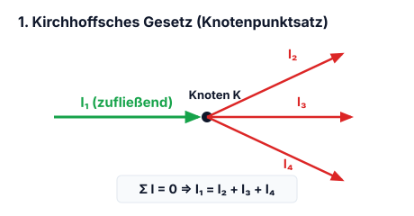

Die Summe der vom Knoten wegfliessenden Ladungsträger ergibt die Anzahl der in den Knoten reinfliessenden Ladungsträger.


*Abbildung: Ein Verzweigungsknoten. Ein Strom $I_1$ fließt horizontal in den Knoten hinein, zwei Teilströme $I_2$ (schräg nach oben) und $I_3$ (nach unten) fließen aus dem Knoten heraus.*


$$I_1 = I_2 + I_3$$

$$\sum_{k=1}^n I_k = 0 = I_1 - I_2 - I_3$$

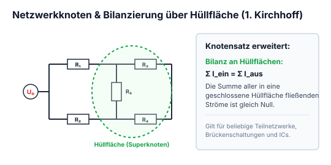


*Abbildung: Netzwerk / Brückenschaltung mit Gleichspannungsquelle links und fünf Widerständen $R_1, R_2, R_3, R_4, R_5$. Über eine gestrichelte grüne Hüllfläche um die Teilknoten rechts wird der Summenstrom bilanziert:*


$$I_{R1} + I_{R4} = I_{R3} + I_{R4} + I_{R5}$$

---

---

## 4.7 2. Kirchhoffsches Gesetz (Maschenregel)

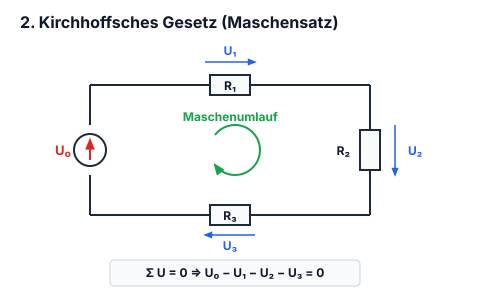

Wenn eine Ladung von $P_1$ ein Weg zu $P_1$ zurücklegt ist die Arbeit Null somit ist auch die Spannung Null.


*Abbildung: Dreieckige Leiterschleife mit den Punkten $P_1, P_2, P_3$. Zwischen $P_1$ und $P_2$ liegt Widerstand $R_1$ mit Zählpfeil $U_{R1} \rightarrow$. Zwischen $P_2$ und $P_3$ liegt Widerstand $R_3$ mit Zählpfeil $U_{R3} \downarrow$. Zwischen $P_3$ und $P_1$ liegt Widerstand $R_4$ mit Pfeil $U_{R4} \nwarrow$. Ein zentraler Kreispfeil gibt den Umlaufsinn im Uhrzeigersinn vor.*


$$P_1 - P_1 = U_{R1} + U_{R3} - U_{R4} = 0$$

$$\sum_{k=1}^n U_k = 0$$

---

---

## 4.8 Reihen- und Parallelschaltung von Widerständen

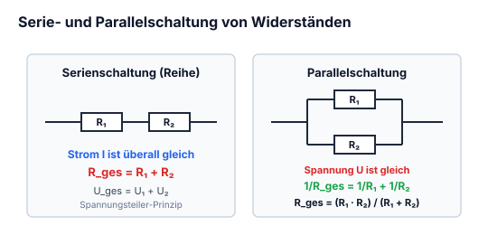

### Serie


*Abbildung: Stromkreis mit einer Quelle $I \uparrow$ in Reihe mit drei Widerständen $R_1$ (horizontal, Spannung $U_1 \rightarrow$), $R_2$ (vertikal, Spannung $U_2 \downarrow$) und $R_3$ (vertikal, Spannung $U_3 \downarrow$).*


$$R_{\text{ges}} = R_1 + R_2 + R_3$$

$$U_{\text{ges}} = R_{\text{ges}} \cdot I = U_1 + U_2 + U_3$$

$$I = \frac{U_{\text{ges}}}{R_{\text{ges}}}$$

> Der Strom bleibt überall gleich aber die Spannung ändert sich

### Parallel

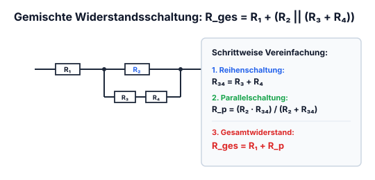


*Abbildung: Umformung einer Schaltung. Links schematische Parallelschaltung mit Quelle. Rechts Schaltung mit Speisung $I \uparrow, U_q \downarrow$, Vorwiderstand $R_1$ und zwei Parallelzweigen: Zweig 1 mit $R_2$ (Strom $I_1 \downarrow$, Spannung $U_1 \downarrow$), Zweig 2 mit Reihenschaltung aus $R_3$ und $R_4$ (Strom $I_2 \downarrow$, Gesamtspannung $U_1 \downarrow$).*


$$R_{34} \,||\, R_2$$

$$R_1 + (R_{34} \,||\, R_2) = \text{Ersatzwiederstand} : R_{\text{ges}} = \frac{1}{\sum_{k=1}^n \frac{1}{R_k}}$$

$$I = I_1 + I_2$$

$$U_q = U_1$$

$$I_1 = \frac{U_1}{R_2}$$

> Der Strom teilt sich je nach wiederstand auf, die Spannung bleibt aber überall gleich

---

---

## 4.9 Spannungsteiler (unbelastet & belastet) & Stromteiler

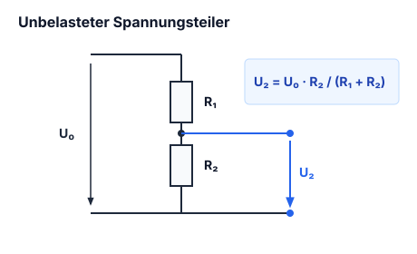

### Spannungsteiler


*Abbildung: Reihenschaltung an einer Spannungsquelle $U \downarrow$, bestehend aus zwei in Reihe geschalteten Widerständen $R_1$ mit Teilspannung $U_1 \downarrow$ und $R_2$ mit Teilspannung $U_2 \downarrow$. Pfeilbeschriftung: „$\subset$ Serieschaltung“.*


$$U_1 = R_1 \cdot I, \quad U_2 = R_2 \cdot I \quad \& \quad U = U_1 + U_2 = I(R_1 + R_2)$$

$$\downarrow$$

$$\frac{U_1}{U_2} = \frac{R_1}{R_2} \quad \& \quad \frac{U_2}{U} = \frac{R_2}{R_1 + R_2}$$

### Stromteiler

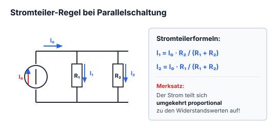


*Abbildung: Parallelschaltung an einer Stromquelle (Pfeil $\uparrow$) mit zwei parallelen Zweigen: Widerstand $R_1$ mit Strom $I_1 \downarrow$ und Widerstand $R_2$ mit Strom $I_2 \downarrow$. An beiden liegt die Gesamtspannung $U \downarrow$.*


$$I_1 = U / R_1 \quad \& \quad I_2 = U / R_2$$

$$I = I_1 + I_2 = U \left(\frac{1}{R_1} + \frac{1}{R_2}\right) = U \frac{R_1 + R_2}{R_1 \cdot R_2}$$

$$\downarrow$$

$$\frac{I_1}{I_2} = \frac{R_2}{R_1} = \frac{G_1}{G_2} \quad \& \quad \frac{I_2}{I} = \frac{R_1}{R_1 + R_2}$$

!!! example "Praxisbeispiel: Belasteter vs. unbelasteter Spannungsteiler"
    Ein Spannungsteiler aus $R_1 = 10\,\text{k}\Omega$ und $R_2 = 10\,\text{k}\Omega$ an $U_{\text{in}} = 10\,\text{V}$ liefert im Leerlauf exakt $U_{\text{out}} = 5{,}0\,\text{V}$.
    
    Schließt man nun einen Lastwiderstand $R_L = 10\,\text{k}\Omega$ an:
    1. **Ersatzwiderstand des Querzweigs:**
       $$R_{2\parallel L} = \frac{R_2 \cdot R_L}{R_2 + R_L} = \frac{10\,\text{k}\Omega \cdot 10\,\text{k}\Omega}{20\,\text{k}\Omega} = 5{,}0\,\text{k}\Omega$$
    2. **Eingebrochene Ausgangsspannung:**
       $$U_{\text{out,belastet}} = U_{\text{in}} \cdot \frac{R_{2\parallel L}}{R_1 + R_{2\parallel L}} = 10\,\text{V} \cdot \frac{5\,\text{k}\Omega}{10\,\text{k}\Omega + 5\,\text{k}\Omega} = 3{,}33\,\text{V} \quad (\ll 5\,\text{V}!)$$
    
    **Schaltungsregel:** Ein resistiver Spannungsteiler bricht unter Last ein. Er muss entweder niederohmig dimensioniert werden ($R_L \gg R_2$) oder durch einen [[#10.5 Der Impedanzwandler (Spannungsfolger / Buffer)|Operationsverstärker-Buffer]] entkoppelt werden.

---

---

## 4.10 Reale Spannungs- und Stromquellen (Innenwiderstand)

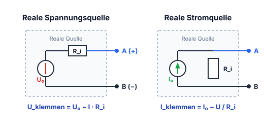

### Reale Spannungsquelle


*Abbildung: Ersatzschaltbild einer realen Spannungsquelle mit idealer Quellenspannung $U_0 \downarrow$ in Reihe zum Innenwiderstand $R_i$ mit Spannungsabfall $U_{Ri} \rightarrow$, abgeschlossen mit Ausgangsklemmen und Klemmenspannung $U \downarrow$. Beschriftung: „Spannungsquelle mit Innenwiederstand“.*


- $\text{Leerlaufspannung: } U = U_L = U_0$
- $U_L \, (=\text{Quellspannung}) = \text{Leerlaufspannung}$
- $\text{Kurzschlussstrom: } I_k = \frac{U_0}{R_i}$ *(in der Handschrift als „Kurzschlussspannung“ tituliert)*

### Reale Stromquelle


*Abbildung: Reale Stromquelle bestehend aus idealer Stromquelle $I_0 \uparrow$ parallel zu einem Innenwiderstand, mit Ausgangsspannung $U \downarrow$.*


- $\text{Kurzschlussbetrieb: } I = I_k = I_0$
- $I_k \, (=\text{Quellstrom})$
- $\text{Leerlaufspannung: } U_L = I_0 \cdot R_i$

### Berechnung von $R_i$
*(Im roten Kasten notiert):*
- $U_0 \rightarrow (\text{Leerlaufspannung})$
- $I_k \rightarrow (\text{Kurzschlussstrom})$

$$R_i = \frac{U_0}{I_k}$$

---

## 4.11 Wirkungsgrad & Leistungsanpassung

$$\eta = \frac{P_L}{P_{\text{ges}}} \cdot 100\%$$

- $P_L =$ Nutzleistung (am Lastwiederstand verbrauchte Leistung)
- $P_{\text{ges}} =$ Gesamtleistung

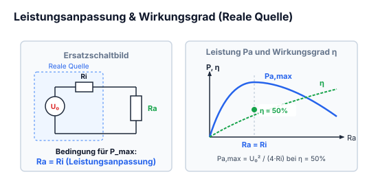


*Abbildung: Vollständiger Stromkreis. Eine reale Spannungsquelle (grün umrahmt: ideale Spannungsquelle mit Innenwiderstand $R_i$ und Spannungsabfall $U_{Ri}$) treibt den Strom $I \downarrow$ durch einen externen Lastwiderstand $R_L$, über dem die Klemmenspannung $U \downarrow$ abfällt.*


---
!!! warning "Leistungsanpassung vs. Spannungsanpassung"
    - **Leistungsanpassung ($R_L = R_i$):**
      - Am Lastwiderstand wird die maximal mögliche Leistung umgesetzt: $P_{L,\max} = \frac{U_0^2}{4 R_i}$.
      - Der Wirkungsgrad beträgt dabei genau **$\eta = 50\%$** (die andere Hälfte wird im Innenwiderstand $R_i$ in Wärme umgewandelt).
    - **Spannungsanpassung ($R_L \gg R_i$):**
      - Minimale thermische Verluste in der Quelle, Klemmenspannung $U \approx U_0$.
      - Wirkungsgrad **$\eta \to 100\%$** (Standard im Stromnetz und der Signalübertragung).
    - **Stromanpassung ($R_L \ll R_i$):**
      - Laststrom entspricht nahezu dem Kurzschlussstrom $I_L \approx I_K$.

---


## 4.12 Leistungs- & Impedanzanpassung in der Praxis

Wird ein elektrischer Verbraucher mit dem Lastwiderstand $R_L$ an eine reale Spannungsquelle mit der Quellenspannung $U_0$ und dem Innenwiderstand $R_i$ angeschlossen, unterscheidet man je nach Schaltungsziel drei fundamentale Betriebsarten:

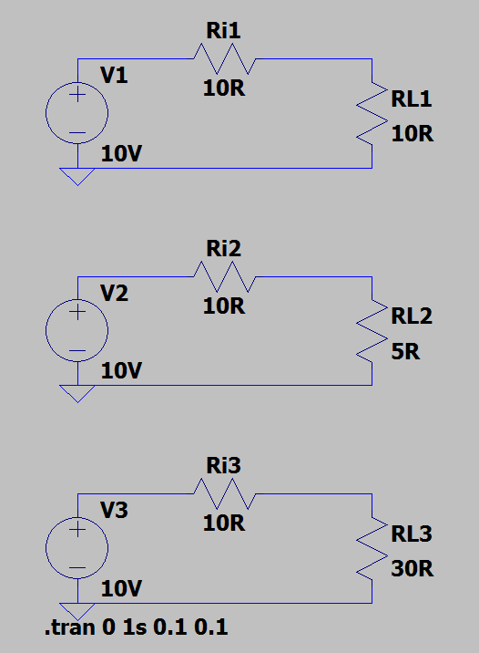

1. **Leistungsanpassung ($R_L = R_i$):**
   - Ziel: Die an den Verbraucher übertragene Wirkleistung $P_L$ soll ein Maximum erreichen.
   - Herleitung:
     $$I = \frac{U_0}{R_i + R_L} \implies P_L = I^2 \cdot R_L = \frac{U_0^2 \cdot R_L}{(R_i + R_L)^2}$$
     Durch Ableitung $\frac{dP_L}{dR_L} = 0$ ergibt sich das Maximum exakt bei:
     $$R_L = R_i \implies P_{L,max} = \frac{U_0^2}{4 \cdot R_i}$$
   - **Wirkungsgrad bei Leistungsanpassung:**
     $$\eta = \frac{P_L}{P_{ges}} = \frac{I^2 \cdot R_L}{I^2 \cdot (R_i + R_L)} = \frac{R_L}{R_i + R_L} = \frac{R_i}{2R_i} = \mathbf{50\,\%}$$
     Genau die Hälfte der erzeugten Leistung wird im Innenwiderstand $R_i$ der Quelle in Wärme umgesetzt. Anwendung: HF-Technik, Antennentechnik ($50\,\Omega / 75\,\Omega$), Audio-Endstufen.

2. **Spannungsanpassung ($R_L \gg R_i$, z. B. $R_L \ge 10 \cdot R_i$):**
   - Ziel: Die Klemmenspannung $U_L$ soll möglichst lastunabhängig und nahe an der Quellenspannung $U_0$ liegen.
   - Wirkungsgrad $\eta \to 100\,\%$.
   - Anwendung: Netzspannung ($230\,\text{V}$-Steckdosennetz), Operationsverstärker-Ausgänge, Audio-Line-Pegel.

3. **Stromanpassung ($R_L \ll R_i$):**
   - Ziel: Ein möglichst konstanter, lastunabhängiger Stromfluss.
   - Anwendung: Stromschleifen ($4\dots 20\,\text{mA}$ in der Prozessautomatisierung), LED-Treiber.


## 4.13 Einschaltstrombegrenzung (Inrush Current) & Sanftanlauf

Beim Einschalten elektronischer Geräte treten häufig extrem hohe Stromspitzen (das Vielfache des Nennbetriebsstroms) auf, die Gerätesicherungen auslösen oder Schalterkontakte verschweißen können:

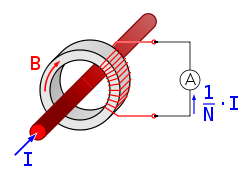

### Ursachen des Einschaltstroms
1. **Laden von Puffer- und Siebkondensatoren:**
   Im ungeladenen Zustand ($t=0$) ist die Spannung am Kondensator $u_C(0) = 0\,\text{V}$. Der Kondensator wirkt im ersten Schaltmoment wie ein Kurzschluss; der Spitzenstrom wird ausschließlich durch den Netzinnenwiderstand, die Leitungsinduktivität und den Ersatzserienwiderstand (ESR) begrenzt:
   $$i_{peak} = \frac{U_{peak}}{R_{Netz} + ESR}$$
2. **Magnetische Einschaltstromspitzen bei Transformatoren:**
   Wird ein Ringkerntrafo im Spannungsnulldurchgang eingeschaltet, treibt die Flussakkumulation den Kern tief in die magnetische Sättigung. Die Induktivität bricht zusammen, und es fließen kurzzeitig Ströme bis zum 20- bis 50-fachen des Nennstroms.

### Schaltungstechnische Schutzmaßnahmen
- **NTC-Einschaltstrombegrenzer (Heißleiter):**
  Ein NTC-Widerstand besitzt im kalten Zustand einen hohen Widerstand (z. B. $5\dots 10\,\Omega$), der den Einschaltstrom sicher deckelt. Durch den fließenden Betriebsstrom erwärmt er sich und sinkt auf einen minimalen Restwiderstand ($<0{,}5\,\Omega$) ab.
- **Relais-Überbrückungsschaltung (Sanftanlauf):**
  Ein fester Leistungswiderstand ($10\dots 47\,\Omega$, z. B. $25\,\text{W}$) liegt in der Ladeleitung. Sobald der Zwischenkreis auf ca. $80\dots 90\,\%$ aufgeladen ist, überbrückt ein Relaiskontakt den Vorwiderstand verlustfrei für den Dauerbetrieb.


## 4.14 Rückstromschutz (Reverse DC Current Protection)

Wird ein Netzteil oder DC/DC-Wandler an eine Batterie oder an eine busgespeiste Schaltung angeschlossen, kann Strom rückwärts in den Ausgang des Netzteils fließen, wenn die Ausgangsspannung unter die externe Spannung sinkt.

### Lösungsansätze im Vergleich
1. **Standard-Siliziumdiode:**
   - Hoher Vorwärtsspannungsabfall $U_F \approx 0{,}7\dots 1{,}0\,\text{V}$.
   - Hohe thermische Verlustleistung $P_V = U_F \cdot I_L$ (bei $5\,\text{A}$ bereits ca. $4\,\text{W}$ Kühlbedarf!).
2. **Schottky-Diode:**
   - Geringere Schleusenspannung $U_F \approx 0{,}3\dots 0{,}5\,\text{V}$.
   - Gut geeignet für kleinere bis mittlere Ströme, aber höherer Sperr-Leckstrom $I_R$.
3. **Ideale Diode (MOSFET-basierter Rückstromschutz):**
   - Ein P-Kanal- oder N-Kanal-Power-MOSFET wird invers in die Versorgungsleitung geschaltet.
   - Ein Controller misst die Spannungsdifferenz über Source und Drain. Bei normalem Stromfluss schaltet er das Gate voll durch.
   - Der Spannungsabfall beträgt lediglich $U_{drop} = I_L \cdot R_{DS(on)}$ (z. B. $5\,\text{A} \cdot 5\,\text{m}\Omega = 25\,\text{mV}$).
   - Die Verlustleistung sinkt drastisch auf $P_V = I_L^2 \cdot R_{DS(on)} = (5\,\text{A})^2 \cdot 5\,\text{m}\Omega = \mathbf{0{,}125\,\text{W}}$!


# Kapitel 5: Magnetismus, Induktion, Spulen & Transformatoren

!!! abstract "Überblick"
    Lorentzkraft, Ampèresches Gesetz, Solenoid, Spulenberechnung und Transformatoren.

## 5.1 Kraftwirkung des Magnetfeldes auf Ströme

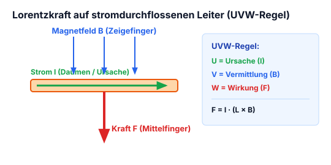


*Abbildung: Zwei Darstellungen zur Kraftwirkung zwischen Leitern und Magneten:*
*Links: Zwei parallel verlaufende Leiterdrähte an einer Gleichstromquelle $[+ \mid -]$. Die Ströme fließen gegenläufig (linker Ast nach oben, rechter Ast nach unten). Die Drähte biegen sich nach außen voneinander weg. Beschriftung: "Abstossung". Darunter zwei Stabmagnete mit gleichnamigen Polen gegenübergestellt: $[\,S \mid N\,] \rightarrow \leftarrow [\,N \mid S\,]$.*
*Rechts: Zwei parallele Drähte an einer Gleichstromquelle $[+ \mid -]$, Ströme fließen gleichgerichtet. Die Drähte ziehen sich gegenseitig an und biegen sich zueinander. Beschriftung: "Anziehung". Darunter zwei Stabmagnete mit ungleichnamigen Polen: $[\,S \mid N\,] \rightarrow \leftarrow [\,S \mid N\,]$.*


Ein von Strom durchflossenen Leiter hat auch ein Magnetisches Feld, es übt auch eine Magnetische Kraft aus.

Um die Stärke eines Magnetfeldes auszurechnen benutzt man eine von strom durchflossenen Leiter. Mit $\vec{F}$ hat man die richtung der Kraft.

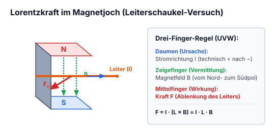


*Abbildung: C-förmiges Gestell / Magnetjoch in einem 3D-Koordinatensystem $(x, y, z)$. Am oberen Schenkel ist die Tiefe $L$ entlang der $y$-Achse markiert sowie elektrische Anschlüsse $+$ und $-$. An zwei Zuleitungsdrähten ist ein zylindrischer Leiter der Länge $L$ aufgehängt. Durch den Leiter fließt ein Strom $I$ (blauer Pfeil in $y$-Richtung). Das Magnetfeld bewirkt eine Auslenkung um den Winkel $\alpha$ gegenüber der Senkrechten; eingetragen sind die Kraftkomponenten bzw. Gegenkraft $-\vec{F}$.*


$$\vec{F} = L \cdot \vec{I} \times \vec{B}$$

$$F = B \cdot I \cdot L \cdot \sin(\alpha)$$

---

---

## 5.2 Lorentzkraft auf bewegte Ladungen (UVW-Regel)

Kraft auf bewegende Ladungsmenge:
- $\vec{v} =$ Geschwindigkeit der Ladungsmenge
- $\vec{B} =$ Die Kraft die auf die Ladungsmenge $Q$ wirkt
- $Q =$ Ladungsmenge

so gilt:
$$\vec{F} = Q \, \vec{v} \times \vec{B}$$

Wenn ausser dem Magnetfeld $\vec{B}$ noch gleichzeitig ein elektrisches Feld $\vec{E}$ wirkt, dann:
$$\vec{F} = Q(\vec{E} + \vec{v} \times \vec{B})$$

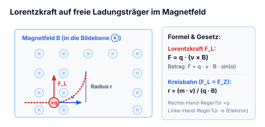

---

---

## 5.3 Magnetfeld eines geraden stromdurchflossenen Leiters

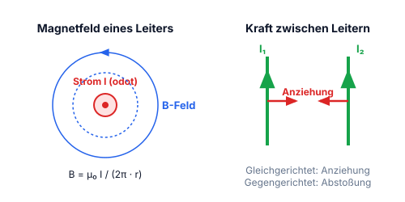

Mit:
- $\mu_0 = \text{magnetische Feldkonstante} = 0{,}4 \cdot \pi \cdot 10^{-6}\,\frac{\text{Vs}}{\text{Am}}$
- $I_1 = \text{Stromstärke}$
- $d = \text{Abstand}$

$$B_1 = \frac{\mu_0}{2\pi} \cdot \frac{I_1}{d}$$

---

## 5.4 Magnetische Kraft zwischen parallelen Leitern

$$\frac{\vec{F}}{L} = -\vec{e}_d \cdot \frac{\mu_0}{2\pi} \cdot \frac{I_1 \cdot I_2}{d}$$

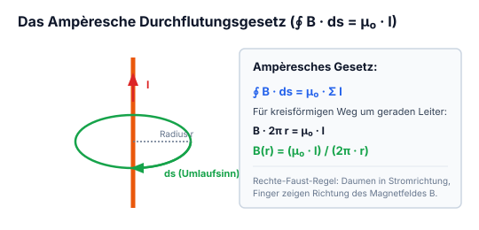


*Abbildung: Neben der Formel eine geschlossene polygonale Umlauflinie mit Richtungspfeilen. Darunter ein 2D-Koordinatensystem mit Achsen $x$ und $y$. Im Ursprung befindet sich Leiter 1 ($I_1$, Symbol $\odot$ für Strom aus der Ebene heraus). Im Abstand $d$ auf der $x$-Achse befindet sich Leiter 2 ($I_2$, Symbol $\odot$). Zwischen beiden Leitern ist der Abstand $d$ als Doppelpfeil markiert. Am Ort des Leiters 2 zeigt der Magnetfeldvektor $\vec{B}$ senkrecht nach oben in $+y$-Richtung.*


---
!!! warning "Kraftwirkung paralleler Leiter (Merkregel)"
    - **Gleichgerichtete Ströme ($I_1 \uparrow \uparrow I_2$):** Die Leiter **ziehen sich an** (Magnetfelder zwischen den Leitern schwächen sich ab).
    - **Entgegengesetzte Ströme ($I_1 \uparrow \downarrow I_2$):** Die Leiter **stoßen sich ab** (Magnetfelder zwischen den Leitern verstärken sich).

---

## 5.5 Ampèresches Durchflutungsgesetz (Umlaufintegral)

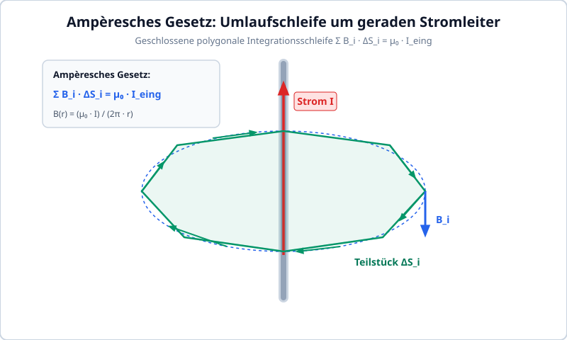

Berechnen des Magnetfeldes für einfache und symetrischen Draht, von einem geschlossenen Weg.


*Abbildung: Ein gerader, vertikal verlaufender Leiter mit nach oben gerichtetem Strompfeil $I$. Um den Leiter ist eine geschlossene polygonale Wegschleife gelegt, die in Teilstücke $\Delta S_i$ unterteilt ist, mit Pfeilen für den geschlossenen Umlauf im Gegenuhrzeigersinn.*


$$\sum_{i=1}^n \vec{B}_i \cdot \Delta S_i = \mu_0 \cdot I_{\text{eing}}$$

---

---

## 5.6 Lang gestreckte Zylinderspule (Solenoid)

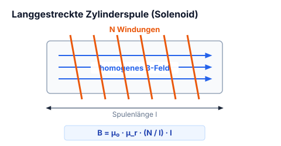


*Abbildung: Zylindrische Spule mit Windungen entlang der horizontalen $x$-Achse. Am linken Ende tritt der Strom $I$ ein. Im Inneren der Spule verläuft das homogene Magnetfeld $B_x$ entlang der Achse über die Spulenlänge $l$.*


$$B \cdot l = \mu_0 \cdot N \cdot I_{\text{eing}}$$

---

## 5.7 Toroidspule (Ringspule)

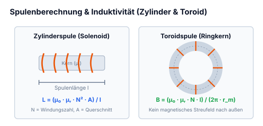


*Abbildung: Ringspule / Toroid mit kreisförmig angeordneten Drahtwindungen um einen ringförmigen Kern mit Radius $r$. Auf der linken Seite sind die beiden Anschlussdrähte für den Strom $I$ mit Vorzeichen $+$ und $-$ herausgeführt.*


$$B \cdot 2\pi r = \mu_0 \cdot N \cdot I_{\text{eing}}$$

---

---

## 5.8 Berechnung der Windungszahl & Spuleninduktivität

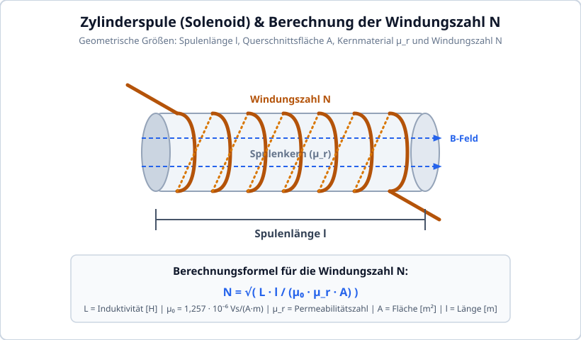


*Abbildung: Zylinderspule (Solenoid) mit Windungszahl $N$, Länge $l$ und Querschnittsfläche $A$.*


Wieviele Windungen man machen muss, um die gewünschte Induktivität zu erhalten, hängt ab von:

$$N = \sqrt{L \cdot \frac{l}{\mu_0 \cdot \mu_r \cdot A}}$$

- $N =$ Anzahl der Windungen
- $L =$ Induktivität $[\text{H}]$
- $\mu_0 =$ magnetische Feldkonstante $= 1{,}257 \cdot 10^{-6} \, \frac{\text{Vs}}{\text{Am}}$
- $\mu_r =$ Permeabilitätszahl

---
!!! note "Selbstinduktionsgesetz & Magnetische Energie der Spule"
    - **Induktionsspannung:** Eine Stromänderung $\frac{di}{dt}$ induziert eine gegengerichtete Selbstinduktionsspannung:
      $$u_L(t) = L \cdot \frac{di}{dt}$$
      *(Folge: Der Strom durch eine Induktivität kann nicht springen! Beim plötzlichen Trennen entstehen hohe Abschaltspannungsspitzen).*
    - **Gespeicherte magnetische Energie:**
      $$W_m = \frac{1}{2} L I^2 \quad [\text{Joule}]$$

---

## 5.9 Der ideale Einphasen-Transformator

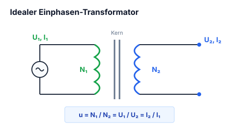

### Idealer Einphasen Transformator


*Abbildung: Ersatzschaltbild eines Einphasentransformators:*
- *Primärseite: Wechselstromgenerator $G\sim$ mit Primärspannung $U_1$, Primärstrom $I_1$ und Primärwindungszahl $N_1$.*
- *Transformatorkern (vertikale Trennlinien für galvanische Trennung).*
- *Sekundärseite: Sekundärspule mit Windungszahl $N_2$, Sekundärspannung $U_2$ und Sekundärstrom $I_2$.*


$$u = \text{Übersetzungsverhältnis}$$

$$u = \frac{N_1}{N_2} = \frac{U_1}{U_2} = \frac{I_2}{I_1}$$

Dienen als Energiezufuhr mit einer galvanischen Trennung, sind Strom- oder Spannungsverstärker (bzw. Wandler).

---
!!! tip "Impedanztransformation des Transformators"
    Ein Transformator transformiert nicht nur Spannungen und Ströme, sondern auch Lastwiderstände quadratisch mit dem Übersetzungsverhältnis $u$:
    $$Z_1 = u^2 \cdot Z_2 = \left(\frac{N_1}{N_2}\right)^2 \cdot Z_2$$

---


## 5.10 Magnetismus, Ferromagnetismus & Magnetwerkstoffe

Magnetische Erscheinungen beruhen auf der Bewegung elektrischer Ladungen (Mikroströme durch Elektronenspin und Orbitalbewegung der Elektronen um den Atomkern).


### Elementarmagnete & Weißsche Bezirke
In ferromagnetischen Werkstoffen (Eisen $\text{Fe}$, Kobalt $\text{Co}$, Nickel $\text{Ni}$) sind die magnetischen Momente benachbarter Atome durch quantenmechanische Austauschwechselwirkung parallel ausgerichtet. Diese mikroskopischen Bereiche spontaner Magnetisierung heißen **Weißsche Bezirke** (Domänen), getrennt durch **Bloch-Wände**.
- Im unmagnetisierten Zustand sind die Domänen statistisch regellos verteilt $\implies B_{aussen} = 0$.
- Unter Einwirkung eines äußeren Feldes $H$ verschieben sich zunächst die Bloch-Wände (reversibel), gefolgt von irreversiblen Barkhausen-Sprüngen und vollständiger Drehung der Domänen in Feldrichtung.

### Magnetische Hysteresekurve ($B$-$H$-Diagramm)
- **Neukurve:** Verlauf der Magnetisierung vom feldfreien Ursprung bis zur Sättigung.
- **Sättigungsflussdichte $B_{sat}$:** Maximal möglicher magnetischer Fluss im Material (alle Elementarmagnete parallel ausgerichtet).
- **Remanenz $B_R$:** Verbleibende magnetische Flussdichte nach Abschalten des äußeren Feldes ($H=0$).
- **Koerzitivfeldstärke $H_C$:** Erforderliche magnetische Gegenfeldstärke, um den Werkstoff vollständig zu entmagnetisieren ($B=0$).
- **Hystereseverlust:** Die vom Hystereseast umschlossene Fläche $\oint H \, dB$ entspricht der pro Ummagnetisierungszyklus in Wärme umgesetzten Energie.


## 5.11 Sättigungsverhalten von Spulen & Induktivitäten

Wird der Strom durch eine Spule mit Eisen- oder Ferritkern über den linearen Bereich hinaus gesteigert, gerät der Kern in die **magnetische Sättigung**:

```
          B [Tesla]
             ^          Sättigungsflussdichte B_sat
             |       .-------------------------- (mu_r -> 1)
             |     / 
             |   /   Linearer Bereich (hohe Induktivität L)
             | /
  -----------+------------------> H [A/m]
```

### Konsequenzen in der Leistungselektronik
Die Induktivität einer Spule ist proportional zur differentiellen Permeabilität $\mu_r = \frac{1}{\mu_0} \frac{dB}{dH}$:
$$L(i) = \frac{N^2 \cdot A_e \cdot \mu_0 \cdot \mu_r(i)}{l_e}$$

- Sobald $B \ge B_{sat}$ erreicht wird, bricht $\mu_r$ schlagartig von Werten wie $2\,000\dots 5\,000$ auf $\mu_r \approx 1$ ein.
- **Dramatische Stromsteilheit:** Da $u_L = L \cdot \frac{di}{dt}$, sinkt $L$ auf den winzigen Wert einer Luftspule. Der Strom schießt explosionsartig in die Höhe $\implies$ MOSFETs, Dioden oder Sicherungen werden zerstört.

!!! warning "Konstruktive Abhilfe: Der Luftspalt"
    Speicherdrosseln für Schaltnetzteile (Buck/Boost) besitzen einen definierten **Luftspalt** im Kern. Der Luftspalt verringert die wirksame Gesamtremanenz, linearisiert die Scherung der Kennlinie und verschiebt den Sättigungsstrom $I_{sat}$ zu deutlich höheren Werten. Nahezu die gesamte magnetische Feldenergie $W = \frac{1}{2} L I^2$ wird im Volumen des Luftspalts gespeichert!


## 5.12 Luftspulen: Berechnung & Hochfrequenzverhalten

Für Hochfrequenzanwendungen (Filterstufen, Schwingkreise, Dämpfungsglieder) werden Spulen ohne ferromagnetischen Kern verwendet (Luftspulen). Sie kennen keine Sättigung und keine Hystereseverluste.

### Induktivitätsberechnung einer einlagigen Zylinderspule
Eine bewährte ingenieurmäßige Näherung ist die Formel von Wheeler (für Zylinderspulen mit Spulenradius $r$, Länge $l$ und Windungszahl $N$ in mm):

$$L \approx \frac{N^2 \cdot r^2}{228 \cdot r + 254 \cdot l} \quad [\mu\text{H}]$$

### Hochfrequenzeffekte an Luftspulen
1. **Skineffekt:** Mit steigender Frequenz verdrängen Wirbelströme den Stromfluss an die Leiteroberfläche. Die effektive Eindringtiefe beträgt:
   $$\delta = \frac{1}{\sqrt{\pi \cdot f \cdot \mu \cdot \kappa}}$$
   Bei $1\,\text{MHz}$ in Kupfer beträgt $\delta \approx 66\,\mu\text{m}$. Abhilfe: Versilberte Drähte oder Hochfrequenz-Litze (HF-Litze).
2. **Eigenresonanz:** Jede Windung bildet mit der Nachbarwindung eine parasitäre Koppelkapazität $C_p$. Oberhalb der Eigenresonanzfrequenz $f_{res} = \frac{1}{2\pi\sqrt{L \cdot C_p}}$ verhält sich eine Spule kapazitiv!


## 5.13 Elektrische Schwingkreise (LC-Resonanz)

Ein Schwingkreis besteht aus der Parallelschaltung (Parallelresonanzkreis) oder Reihenschaltung (Serienresonanzkreis) einer Spule $L$ und eines Kondensators $C$.


### Thomsonsche Schwingungsgleichung
Bei der Resonanzfrequenz $f_0$ kompensieren sich der induktive Blindwiderstand $X_L$ und der kapazitive Blindwiderstand $X_C$ exakt:

$$X_L = X_C \implies \omega_0 L = \frac{1}{\omega_0 C} \implies \mathbf{f_0 = \frac{1}{2\pi \sqrt{L \cdot C}}}$$

### Wichtige Kenngrößen
- **Wellenwiderstand (Kennwiderstand):**
  $$Z_0 = \sqrt{\frac{L}{C}}$$
- **Gütefaktor $Q$ (Qualitätsfaktor):**
  Beschreibt die Dämpfungsarmut des Schwingkreises (Verhältnis von gespeicherter Energie zu Verlustenergie pro Periode):
  $$Q = \frac{\omega_0 L}{R_s} = \frac{1}{\omega_0 C R_s} \quad \text{(beim Serienschwingkreis mit Verlustwiderstand } R_s\text{)}$$
  $$Q = \frac{R_p}{\omega_0 L} = \omega_0 C R_p \quad \text{(beim Parallelschwingkreis)}$$
- **Resonanzüberhöhung:**
  Beim Serienschwingkreis tritt an $L$ und $C$ eine Spannungsüberhöhung um den Faktor $Q$ auf ($U_L = U_C = Q \cdot U_{in}$)!
- **Bandbreite $B$:**
  $$B = \frac{f_0}{Q}$$


# Kapitel 6: Messtechnik & Elektrische Sicherheit

!!! abstract "Überblick"
    Messverfahren, Shunts, Drehspulwerk, DMM, Kelvin-Messung, Wheatstone-Brücke, Oszilloskop und RCD.

## 6.1 Grundlagen der Messtechnik & Einführung

### Spannungsmessung

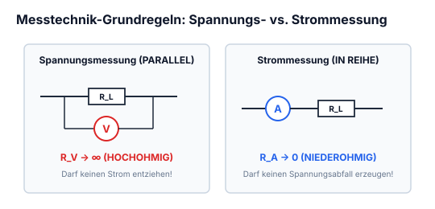


*Abbildung: Zwei Leitungen führen von links zu einem Lastwiderstand. Parallel dazu liegt ein Voltmeter $(V)$ zusammen mit seinem Innenwiderstand $R_V$.*


$R_V = \text{Hochohmig}$

### Strommessung

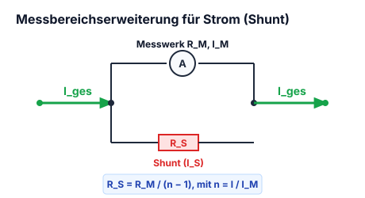


*Abbildung: In Reihe zu einem Lastwiderstand $R_L$ liegt im Leitungszweig ein Amperemeter $(A)$ mit seinem Innenwiderstand $R_A$.*


$R_A = \text{Niederohmig}$

### Messbereicherweiterung

$R_S = \text{Vorwiederstand}$ *(Shunt / Nebenwiderstand)*

$$R_{\text{ges}} = \frac{R_S \cdot R_A}{R_S + R_A} + R_L$$

$$\frac{I_A}{I_S} = \frac{R_S}{R_A}$$

$$I_{\text{max}} = I_S + I_A$$


*Abbildung: Schaltkreis mit Lastwiderstand $R_L$. Dahinter zweigt parallel ein Nebenwiderstand $R_S$ mit Teilstrom $I_S$ ab, während der Hauptmesszweig über das Amperemeter $(A)$ und dessen Innenwiderstand $R_A$ mit Teilstrom $I_A$ verläuft. Das eigentliche Messwerk ist durch eine Umrahmung hervorgehoben.*


---

---

## 6.2 Indirekte Widerstandsmessung (Strom- vs. Spannungsfehlerschaltung)

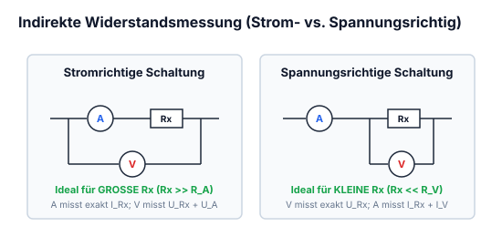

### Spannungsfehlerschaltung (genauer)


*Abbildung: Eine Gleichspannungsquelle speist die Schaltung. Das Voltmeter $(V)$ samt Innenwiderstand liegt direkt parallel zur Quelle an den Hauptleitungen. In der unteren Leitung liegt dahinter in Reihe der Innenwiderstand und das Strommessgerät $(A)$, gefolgt vom Lastwiderstand $R_L$. Das Amperemeter misst exakt den Strom durch $R_L$, während das Voltmeter zusätzlich den Spannungsabfall über dem Amperemeter erfasst.*


Es hat durch das Ampeere-messgerät eine Abweichung ist aber trotzdem relativ genau.

### Stromfehlerschatung (ungenau)


*Abbildung: Eine Gleichspannungsquelle mit nachgeschaltetem Amperemeter $(A)$ samt Innenwiderstand in der Zuleitung. Dahinter liegen der Lastwiderstand $R_L$ und das Voltmeter $(V)$ samt Innenwiderstand $R_V$ parallel. Das Voltmeter misst exakt die Spannung an $R_L$, das Amperemeter misst jedoch die Summe aus Laststrom und Voltmeterstrom.*


Ist sehr ungenau, wenn man Volt und Ampeere gleichzeitig misst.

---

---

## 6.3 Direkte Widerstandsmessung & Vierleiter-Kelvin-Messung


### 2-Drahttechnik


*Abbildung: n: Drei Stufen der direkten 2-Leiter-Widerstandsmessung:*
*1. Links: Ersatzschaltbild mit interner Stromquelle, parallel liegendem Spannungsmesser $(V)$ und Prüfling (Widerstand).*
*2. Mitte: Symbolische Darstellung eines Widerstandsmessgeräts $(\Omega)$ parallel zum Prüfwiderstand.*
*3. Rechts: Praktischer Anschluss über zwei Messleitungen an Anschlüssen $\circ$. Auf den Zuleitungsdrähten sind schräge Markierungen angebracht, die den Einfluss der Leitungswiderstände andeuten.*


Bei elektronischer Schaltung ist Vorsicht geboten

### 4-Drahttechnik


*Abbildung: Kelvin-Vierdrahtmessung. Eine Stromquelle links speist einen definierten Messstrom über zwei äußere Leitungen (mit eingezeichneten Leitungswiderständen) durch den Prüfwiderstand rechts. Die Spannung am Prüfwiderstand wird über zwei separate innere Leitungen mit Leitungswiderständen hochohmig durch ein Voltmeter $(V)$ abgegriffen.*


---

---

## 6.4 Strom- und Spannungsmessung mit Shunt-Widerstand


Messgeräte haben Kategorien:
cat I, cat II, cat III und cat IV

Je näher man der Energiequelle kommt desto grösser wird die Kategorie

Es können durch Blitzeinschläge oder anderen Ursachen in Schaltungen Transienten entstehen, Transienten sind hohe Spannungsüberschüse auf kurzer Zeit, dass kann währen dem Messen ein Lichtbogen verursach: das ist eine Explosion.
Bei guten Messgeräte ist man dagegen geschützt

---

---

## 6.5 Messgeräte-Innenwiderstände & Bürde

### 1. Fundamentalvoraussetzung
Die zu messende Grösse muss qualitativ eindeutig definiert sein und quantitativ bestimmbar sein.

### 2. Fundamentalvoraussetzung
Das Messnormal muss durch eine Konventation festgelegt sein (Si-Einheit)
*(Hinweis / Klammer darunter: kann man von t/s/m ableiten)*

### Messungen müssen:
- Objektiv sein
- reproduzierbar sein
- quantitativ (mit einer Zahl versehen)

---

---

## 6.6 Begriffsdefinitionen (Toleranz, Messfehler, Auflösung)

- **Messgrösse:** Die physikalische Grösse, die bestimmt werden soll
- **Messgerät:** Für die Messung geeignete Einrichtung
- **Messeinrichtung:** Alles um das Messgerät herum
- **Sensor:** Teil des Messgeräts der in direkter Verbindung mit der physikalischen Grösse steht.
- **Messwert:** Gemessener Wert
- **richtiger Wert:** gemessener Wert mit Fehlerberechnung
- **wahrer Wert:** unmessbar
- **Messabweichung:** differenz von wahrer Wert und gemessener Wert
- **Messergebnis:** Zahl und Einheit ist vorhanden
- **kalibrieren:** Ermittle die Messabweichung vom richtigen Wert (wird amtlich geeicht)
- **Messbereich:** Ein Spannungsbereich den man Messen kann.

---

---

## 6.7 Analoge Drehspulmesswerke vs. Digitalmultimeter (DMM)


### Analog


*Abbildung: Zeigerinstrument mit Skala von 0 bis 200: $0 \backslash | / 200$. Links unter der Skala: "Genauigkeitsklasse 0,5". Ein Pfeil verknüpft den Skalenendwert 200 mit dem Messbereich.*


Abweichung berechnet mit:
- Genauigkeit $= 0{,}5\%$
- Messbereich $= 200\,\text{V}$
- Messwert $= 12\,\text{V}$

$$0{,}5\% \text{ von } 200\,\text{V} = 1{,}0\,\text{V}$$
$$\text{Abweichung} = 12\,\text{V} \pm 1{,}0\,\text{V}$$

### Digital


*Abbildung: Digitalanzeige mit LCD-Feld "12 V". Darunter Spezifikation: $\pm 5\% + 3\,\text{digit}$.*


Abweichung berechnen mit
Anzeigeumfang:
$3\frac{1}{2}$ stellen $= \frac{1}{2}$ für 1 und 3 für 999
$\min 0000$ und $\max 1999$
Anzeigeumfang $= 2000$

$$\text{Auflösung} = \frac{\text{Messbereich}}{\text{Anzeigeumfang}}$$

Messbereich $= 10\,\text{V}$
$$\text{Auflösung} = \frac{10}{2000} = 0{,}005$$

$$\text{Abweichung} = 0{,}015 = 0{,}005 \cdot 3 \text{ für 3 digit} + \text{Absoluter Fehler } \pm 0{,}6\,\text{V}$$
*(Hinweis: $5\% \text{ von } 12\,\text{V} = 0{,}6\,\text{V}$)*

---

---

## 6.8 Oszilloskop: Funktionsprinzip & Schirmaufbau

### Betriebe:
- **yt-Betrieb** $\rightarrow$ Misst den zeitlichen Verlauf einer Spannung ($y = \text{Spannung} \,/\, x = t = \text{Zeit}$)
- **xy-Betrieb** $\rightarrow$ Misst man die Spanung von den Kanälen CH1 und CH2 gegeneinander. ($x = \text{CH}1, y = \text{CH}2$) zum Messen von Kennlinien der Bauteile

**Trigger = Auslöser:** Wenn man eine bestimmte Spannung erfassen möchte, dafür gibt's auch ein externer Eingang.

Auf dem Oszilloskop steht der Spitzenwert $V_{pk}$ was gemessen werden darf und den Innenwiederstand.
$\triangle$ immer das Handbuch lesen ($R_i$ ist meistens $1\,\text{M}\Omega$)

### Sonde:
Ist meist ein Hochohmiges Kabel mit einem Spannungsteiler. Sie ist mit einem BNC stecker mit dem Oszilloskop verbunden und gleichzeitig auch geerdet.

---

---

## 6.9 Oszilloskop: Einstellungen & Messpraxis (Trigger, Timebase)


### einstellungen:
- **AC:** Die Gleichspannungssignale werden ausgeblendet
- **DC:** Direkte verbindung ohne Änderung

### Horizontal:
- **Wert $\frac{\text{sec}}{\text{div}}$ vergrössern/verkleinern** (bei yt Betrieb)
- **Position von der horizontale Grundlinie (Achse)**
- **Wert $\frac{\text{V}}{\text{div}}$ vergrössern/verkleinern** (bei xy Betrieb)

### Vertikal:
- **Vertikale Empfindlichkeit ($\frac{\text{V}}{\text{div}}$) einstellen:** Skaliert die Amplitude der Messkurve auf dem Schirm.
- **Position der Vertikalen Achse**

---

---

## 6.10 Wheatstonesche Messbrücke & Abgleichbedingung


*Abbildung: Wheatstonesche Messbrücke in Rautenform. Vier Brückenzweige mit Widerständen: links oben $R_1$ mit Spannungsabfall $U_1$, rechts oben $R_2$ mit $U_2$, links unten Prüfling $R_L$ mit $U_L$, rechts unten Regelwiderstand $R_P$ mit $U_P$. In der Querdiagonale zwischen den seitlichen Abgriffen liegt ein Voltmeter $(V)$. Die Speisespannung wird an den oberen und unteren Knotenpunkten von links zugeführt. Rechts ist parallel zur Brücke eine Reihenschaltung aus Kondensator und Widerstand skizziert.*


Wenn $R_1$ und $R_2$ gleich ist und man $R_L$ herausfinden will, dreht man den $R_P$ bis der gesamter Spannungsabfall 0 ist

$$U_{12} = U_2 - U_1 = U_L - U_P = 0$$

$$\frac{U_1}{U_L} = \frac{U_2}{U_P}$$


*Abbildung: Darunter befindet sich eine zweite Schaltskizze derselben Brücke in H-Anordnung mit zwei parallelen Brückenzweigen $[R_1 \text{ in Reihe mit } R_L]$ und $[R_2 \text{ in Reihe mit } R_P]$, verbunden über das zentrale Voltmeter $(V)$.*


---
!!! warning "Allgemeine Abgleichbedingung der Wheatstone-Brücke"
    Die Brückenspannung zwischen den Querabgriffen wird genau dann zu null ($U_{\text{Brücke}} = 0\,\text{V}$), wenn die Diagonalprodukte der Brückenwiderstände identisch sind:
    $$R_1 \cdot R_P = R_2 \cdot R_L \iff R_L = R_P \cdot \frac{R_1}{R_2}$$
    Dies gilt universell für beliebige Widerstandswerte.

---

## 6.11 Elektrische Sicherheit: Schmelzsicherungen & RCD (FI-Schutzschalter)

### Schaltsymbol:


*Abbildung: Schaltsymbol einer Sicherung: Schmales Rechteck mit mittig hindurchgeführter Leitung, darüber bezeichnet mit „F“*


### Aufbau & Funktion:
Ein Schmelzsicherung ist nichts weiter als ein sehr dünner Draht (hochohmig weil $R = \frac{\rho \cdot l}{A}$), der, wenn zu viel Strom fliesst verglüht.

### Nennstrom:
Der Nennstrom ist die maximal zulässige Stromzufuhr welche die Sicherung (auch auf ewig) aushält.  
Je grösser die Differenz zwischen $I_{\text{real}} - I_{\text{Nennstrom}}$ ist desto schneller löst die Sicherung aus.

### Nennspannung:
Die Nennspannung ist die maximal zulässige Spannung, bei der die Sicherung den Strom sicher unterbrechen kann.

### Schnelligkeit der Sicherung:
Es gibt...

| Flink | Träge |
|:---|:---|
| Superflink (FF) | Träge (T) |
| flink (F) | Superträge (TT) |
| mittelträge (M) | |

---

Es gibt grössere Sicherungen für grösseren Strom z.B Leitungsschutz, findet man in einer Wohnung.  
oder es gibt Feinsicherungen die in Geräten verbaut sind. (Geräteschutz)

### Fehlerstromschutzschalter:
Wird auch RCD (Residual Current protective Device) genannt.

**Schaltungssymbol:**  

*Abbildung: 4-poliges Schaltsymbol eines RCD/FI-Schutzschalters:*
*Obere Anschlüsse: L1 (Klemme 1), L2 (Klemme 3), L3 (Klemme 5), N (Klemme 7N).*
*Untere Anschlüsse: Klemme 2, Klemme 4, Klemme 6, Klemme 8N.*
*Vier gekoppelte Schaltglieder mit Auslösekennzeichnung.*


Sie unterbrechen den Stromkreis an allen Polen, sobald ein definierter Fehlerstrom z.B durch das berühren eines Strom führenden Teils.

**Wichtig:**  
Sie unterbrechen nicht bei Überlast oder Kurzschluss.  
Sie ersetzen kein Leitungsschutzschalter.

---

---

## 6.12 Temperaturmessung mit Thermoelementen (Seebeck-Effekt)


*Abbildung: Prinzipskizze eines Thermoelements (Seebeck-Effekt):*
- *Zwei Drähte aus unterschiedlichen Metallen:*
  - *Oberer Leiter: Eisen*
  - *Unterer Leiter: Konstantan*
- *Rechte Verbindungsstelle (Messstelle) auf Temperatur $T_1$, Thermospannung $U_1$.*
- *Linke Verbindungsstelle (Vergleichsstelle) auf Temperatur $T_2$, Thermospannung $U_2$.*
- *Vom aufgetrennten Konstantan-Leiter führen zwei Leitungen zu einem Messgerät / Messverstärker (Kasten).*


### Funktionsweise & Bedingungen
- Einer der beiden Temperaturen ($T_1 / T_2$) sollte konstant auf $0^\circ\text{C}$ gekühlt werden, um eine Vergleichstemperatur festzulegen.
- Um mit dem was anfangen zu können, braucht man einen Messverstärker.

### Beispiel

Wenn:
$$T_2 = 0^\circ\text{C}$$
und:
$$T_1 = 1200^\circ\text{C}$$

Thermospannung:
$$U_t = 70\,\text{mV}$$

---

---


## 6.13 Messkategorien CAT I bis CAT IV nach IEC/EN 61010

Bei Arbeiten an elektrischen Anlagen droht die größte Lebensgefahr nicht durch die reguläre Betriebsspannung ($230\,\text{V}/400\,\text{V}$), sondern durch energiereiche **Überspannungs-Transienten** (Blitzeinschläge, Schaltvorgänge im Mittelspannungsnetz). Schlägt ein Transient in einem Messgerät über, zündet ein Lichtbogen, der durch die nachfließende Kurzschlussleistung zur Explosion führen kann.

Die Sicherheitsnorm **DIN EN 61010-1** unterteilt Messumgebungen in vier Kategorien:

```
[Mittelspannungsnetz / Trafostation]
                 |
            [ CAT IV ]   Netzursprung, Zählerplatz, Freileitung, Hausanschlusskasten
                 |
            [ CAT III ]  Gebäudeinstallation, Unterverteiler, Sicherungskästen, CEE-Dosen
                 |
            [ CAT II ]   Steckdosenbetriebene Verbraucher (Haushaltsgeräte, Netzteile)
                 |
            [ CAT I ]    Galvanisch getrennte Elektronik, Labornetzteile, Batteriegeräte
```

### Stoßspannungsfestigkeit im Vergleich

| Nennspannung gegen Erde | CAT I Prüfstoß | CAT II Prüfstoß | CAT III Prüfstoß | CAT IV Prüfstoß |
| :---: | :---: | :---: | :---: | :---: |
| **$300\,\text{V}$** | $800\,\text{V}$ | $1\,500\,\text{V}$ | $2\,500\,\text{V}$ | $4\,000\,\text{V}$ |
| **$600\,\text{V}$** | $1\,500\,\text{V}$ | $2\,500\,\text{V}$ | $4\,000\,\text{V}$ | **$6\,000\,\text{V}$** |
| **$1\,000\,\text{V}$** | $2\,500\,\text{V}$ | $4\,000\,\text{V}$ | **$6\,000\,\text{V}$** | **$8\,000\,\text{V}$** |

!!! warning "Sicherheitsmerkmale von Qualitäts-Multimetern"
    Echte CAT-III/IV-Multimeter besitzen sandgefüllte Hochenergie-Schmelzsicherungen ($10\times 38\,\text{mm}$) mit einem Abschaltvermögen von mindestens $10\dots 50\,\text{kA}$ bei $1\,000\,\text{V}$, um interne Lichtbögen sicher zu löschen, sowie Messleitungen mit Fingerschutzkragen und reduzierten Spitzenlängen ($<4\,\text{mm}$).


## 6.14 Gefahren des elektrischen Stroms (AC vs. DC) & 5 Sicherheitsregeln

### Schutzkleinspannungsgrenzen
- **Wechselspannung (AC):** $U_{max} \le \mathbf{50\,\text{V AC}}$ (Effektivwert)
- **Gleichspannung (DC):** $U_{max} \le \mathbf{120\,\text{V DC}}$ (Restwelligkeit $<10\%$)
- Bei feuchter Umgebung oder Tieren: $\le 25\,\text{V AC}$ / $\le 60\,\text{V DC}$.

### Physiologische Wirkung auf den menschlichen Organismus
Der menschliche Körperinnenwiderstand beträgt von Hand zu Hand im Mittel ca. $R_K \approx 1\,000\,\Omega$:
- **$0{,}5\,\text{mA}$:** Wahrnehmungsschwelle (Kribbeln).
- **$10\,\text{mA}$:** Loslass-Schwelle (Verkrampfung der Beugemuskulatur, „Festkleben“ an der Leitung).
- **$30\,\text{mA}$:** Atembeklemmung, Gefahr des Erstickens bei längerer Einwirkzeit (Auslösegrenze von Personenschutz-FI/RCD!).
- **$>50\,\text{mA}$:** Akute Lebensgefahr durch **Herzkammerflimmern** bei $50/60\,\text{Hz}$ Wechselstrom.
- **$>1\,\text{A}$:** Schwerste innere Organverbrennungen und Herzstillstand.

### Gleichstrom vs. Wechselstrom
- **Wechselstrom ($50\,\text{Hz}$)** ist bei gleicher Spannung für das menschliche Herz gefährlicher, da $50\,\text{Hz}$ genau in die vulnerable Erregungsphase des Herzmuskels fällt.
- **Gleichstrom** führt primär zu thermischen Verbrennungen und gefährlicher Blut-Elektrolyse (Vergiftung). Ein Gleichstrom-Lichtbogen hat keinen natürlichen Nulldurchgang und erlischt extrem schwer!

### Die 5 Sicherheitsregeln (DIN VDE 0105-100)
1. **Freischalten** (allpolig abschalten).
2. **Gegen Wiedereinschalten sichern** (Schaltsperre, Vorhängeschloss, Warnschild).
3. **Spannungsfreiheit allpolig feststellen** (zweipoliger Prüfer, z. B. Duspol, vor und nach Messung testen!).
4. **Erden und kurzschließen** (zuerst Erde, dann Leiter kontaktieren).
5. **Benachbarte, unter Spannung stehende Teile abdecken oder abschranken**.


## 6.15 Transienten, Surge & Burst in der EMV-Prüfpraxis

Transiente Überspannungen sind impulsartige Spannungsstöße mit extrem schneller Anstiegszeit und hoher Amplitude.


### Genormte Störimpulse (EMV-Prüfung)
1. **Surge (Blitz-Stoßspannung nach IEC 61000-4-5):**
   - Hochenergetischer Impuls mit Wellenform $1{,}2/50\,\mu\text{s}$ (Spannung) bzw. $8/20\,\mu\text{s}$ (Strom).
   - Prüfpegel: typisch $0{,}5\,\text{kV}$ bis $>4\,\text{kV}$.
2. **Burst (Schnelle transiente elektrische Störgrößen nach IEC 61000-4-4):**
   - Schauer von Tausenden extrem schnellen Nadelimpulsen ($5/50\,\text{ns}$) mit Wiederholfrequenzen von $5\,\text{kHz}\dots 100\,\text{kHz}$, hervorgerufen durch prellende Relais- und Schützkontakte.


## 6.16 Hochspannungs-Tastköpfe (HV-Probes): Frequenzabgleich

Um Hochspannungssignale bis zu mehreren Kilovolt unverfälscht auf dem Oszilloskop darzustellen, werden kompensierte $100:1$- oder $1\,000:1$-Tastköpfe verwendet.

### Abgleichbedingung des frequenzkompensierten Spannungsteilers
Damit das Teilerverhältnis über den gesamten Frequenzbereich von Gleichstrom bis in den Megahertz-Bereich konstant bleibt, muss die RC-Zeitkonstante des Tastkopfes exakt derjenigen des Oszilloskopeingangs entsprechen:

$$R_1 \cdot C_1 = R_2 \cdot C_2 \iff \frac{R_1}{R_2} = \frac{C_2}{C_1}$$

- **Abgleichpraxis:** Anlegen des internen $1\,\text{kHz}$-Rechteck-Kalibriersignals des Oszilloskops. Mit einem isolierten Abgleichschraubendreher wird die Trimmerkapazität $C_1$ justiert:
  - **Unterkompensation ($R_1 C_1 > R_2 C_2$):** Abgerundete Vorderflanke, Tiefpassverhalten.
  - **Überkompensation ($R_1 C_1 < R_2 C_2$):** Scharfe Überschwinger an den Ecken.
  - **Idealer Abgleich:** Perfekt horizontales Rechteckdach ohne Dachschräge.


## 6.17 Aufbau & Dokumentation professioneller Messprotokolle

Ein normgerechtes Prüf- und Messprotokoll (im Prüffeld sowie bei Qualifikationsprüfungen) muss folgende Pflichtelemente aufweisen:
1. **Kopfdaten:** Prüfdatum, Prüfer/Autor, Prüflingsbezeichnung, Seriennummer, Artikelnummer, Auftragsnummer.
2. **Umgebungsbedingungen:** Raumtemperatur (z. B. $22\,^\circ\text{C}$), relative Luftfeuchte (z. B. $45\,\%$) und Luftdruck.
3. **Eingesetzte Messmittel:** Exakte Modellbezeichnung, Seriennummer, Kalibrierdatum und gültige Prüfplakette.
4. **Messaufbau & Schaltskizze:** Blockschaltbild mit Kennzeichnung aller Messpunkte (TP = Test Points).
5. **Messwerttabelle:** Systematischer tabellarischer Soll-Ist-Vergleich mit Toleranzangaben ($\pm\,\%$) und klarer Statusbewertung (PASS / FAIL).
6. **Fehlerdiskussion & Fazit:** Zusammenfassung und rechtsverbindliche Freigabe-Unterschrift.


# Kapitel 7: Passive Bauelemente & Fertigungstechnik

!!! abstract "Überblick"
    Widerstandsbauformen, Farbcode, E-Reihen, Potentiometer, R2R, Kabel, Mechanik und Lötverfahren.

## 7.1 Mechanische Fertigungstechnik

### Normen:
Die Normen sind von Organisationen festgelegte Anforderungen, sie sind eine Vereinheitlichung von Massen, rechnerische Regeln und vielen anderen Angaben.
Es gibt den Landesnorm z.B SNR, die europäische Normen EN und die weltweit geltenen Normen ISO. Die Normen gibt es für verschiedene Fachrichtungen.

### Toleranzen:
So genau wie nötig, nicht so genau wie möglich.
Eine Toleranz schreibt man so $\pm 0{,}1\,\text{mm}$.

---

---

## 7.2 Maß-, Form- und Lagetoleranzen


### Ebenheitstoleranz:
`[ ⏥ | 0,2 ]`


*Abbildung: Werkstückkörper mit planer Oberseite. Ein Toleranzhinweispfeil mit gefülltem Dreieck zeigt auf die Oberfläche und trägt das Toleranzfeld `[ ⏥ | 0,2 ]`.*


### Rechtwinkligkeitstoleranz:
`[ ⊥ | 0,2 | A ]`


*Abbildung: L-förmiger Werkstückquerschnitt. An der linken vertikalen Außenfläche befindet sich das Bezugselement `[A]` mit gefülltem Dreieck. Auf die Oberseite des unteren horizontalen Schenkels weist der Toleranzpfeil mit dem Rahmen `[ ⊥ | 0,2 | A ]`.*


### Paralellitätstoleranz:
`[ // | 0,2 | A ]`


*Abbildung: Ein Hohlblockprofil mit innenliegender Aussparung. An der unteren Grundfläche ist das Bezugsdreieck `[A]` platziert. Auf die gegenüberliegende obere Außenfläche zeigt die Toleranzangabe `[ // | 0,2 | A ]`.*


---

---

## 7.3 Technische Zeichnung & Projektionen

Bei einer technischen Zeichnung gibt es 2 Teile: einmal die Zeichnung und den Zeichnungskopf mit wichtigen Angaben. Bei einer technischer Zeichnung ist fast alles genormt.

### Perspektiven:
Es werden nur soviele Ansichten gezeichnet wie man braucht. Die Frontperspektive ist die Ansicht welche dir am meisten Informationen [gibt].

### Darstellungen:


- **Isometrisch** $\longrightarrow$
  
*Abbildung: Quader/Würfel in isometrischer Axonometrie, aufsteigende Kanten jeweils im $30^\circ$-Winkel zur Horizontalen.*

  $$a : b : c = 1 : 1 : 1$$
  $$\alpha = 30^\circ \quad \beta = 30^\circ$$

- **Kabinett**
  
*Abbildung: Quader in Kavalier-/Kabinettperspektive; Frontfläche unverzerrt parallel zur Bildebene, $\alpha = 0^\circ$, Fluchtachse unter $\beta = 45^\circ$ verkürzt.*

  $$a : b : c = 0{,}5 : 1 : 1$$
  $$\alpha = 0^\circ \quad \beta = 45^\circ$$

- **Dimetrisch**
  
*Abbildung: Quader in dimetrischer Projektion; Winkel $\alpha = 7^\circ$ und $\beta = 42^\circ$ zur Horizontalen, Breitenachse verkürzt.*

  $$a : b : c = 0{,}5 : 1 : 1$$
  $$\alpha = 7^\circ \quad \beta = 42^\circ$$

---

---

## 7.4 Fertigungsverfahren der Mechanik

Die Form der Werkstücke wird nach dem Verfahren...

| geschaffen | geändert | beibehalten |
| :--- | :--- | :--- |
| Urformen (HG 1) | Umformen (HG 2) \| Trennen (HG 3) | Fügen (HG 4) \| Beschichten (HG 5) \| Änderung der Stoffeigenschaften (HG 6) |

Der Zusammenhalt des Werkstoffes wird durch das Verfahren...
- geschaffen (HG 1)
- beibehalten (HG 2)
- verkleinert (HG 3)
- vergrössert (HG 4)
- beibehalten / verkleinert / vergrössert (HG 5, HG 6)

### Hauptgruppen:
- **HG 1:** Giessen
- **HG 2:** Biegeumformen, Zugdruckumformen (Druckformen, Zugformen)
- **HG 3:** Fräsen
- **HG 4:** Form-, Kraft-, Stoff-schlüssiges Fügen, Vorgespannetes Formschlüssiges Fügen
- **HG 5:** Galvanisieren, Anodisieren
- **HG 6:** Glühen, Härten, Vergüten, Randschichthärten, Einsatzhärten.

---

---

## 7.5 Bohren & Zerspanung

$$v_c = \frac{d \cdot \pi \cdot n}{1000}$$

$$n = \frac{v_c \cdot 1000}{d \cdot \pi}$$

- $v_c =$ Schnittgeschwindigkeit
- $n =$ Drehzahl
- $d =$ Durchmesser

---

## 7.6 Prüfen & Messzeuge

### Formlehren
- Fasenlehre
- Radiuslehre
- Kreislehre

### Masslehren
- Fühlerlehre
- Lochlehre

### Messen
- Massstab
- Messschieber

*(Strukturdiagramm: Prüfen unterteilt sich in:*
*- **subjektives Prüfen** $\rightarrow$ Sinneswahrnehmung*
*- **Objektives Prüfen** $\rightarrow$ Lehren, Messen)*

---

---

## 7.7 Kabelaufbau, Adern, Litzen & Isolation

### Kabelarten:

- **Litze:** 
*Abbildung: Zylindrische Isolierhülse, aus der mehrere schräg verdrillte Leiterdrähte hervortreten*
  
  mit mehreren Drähten (unter $1\,\mathrm{mm}$) verdreht  
  *Seil:* mit mehreren Drähten ($1\text{--}4\,\mathrm{mm}$) verdreht

- **Draht:** 
*Abbildung: Isolierhülse mit einem einzelnen, massiven Innenleiter*
  
  mit 1 dickeren Draht

- **Flexible Litze:** 
*Abbildung: Isolierhülse, aus der viele sehr feine Drähte fächerförmig austreten*
  
  mit vielen sehr feinen Drähte

Der Draht kann sehr schnell brechen, die Litze ist schon eher beweglich aber am besten ist die Flexible Litze, wenn man eine bewegliche Verbindung braucht. Die Drähte werden nur noch als Verbindung zwischen 2 Platinen gebraucht, aber auch nur, wenn die Verbindung nicht bewegt wird.

---

### Netzkabel:
Wird auch Apparatekabel genannt.


*Abbildung: Aufbau eines mehradrigen Netzkabels. Links die äußere Schicht „Mantel“, daraus hervortretend drei einzeln isolierte Adern („Isolation“), nummeriert mit ①, ②, ③, an deren Enden die metallische „Litze“ sichtbar ist.*


- ① Neutralleiter [N] (Blau)
- ② Polleiter (Braun oder Schwarz) [P]
- ③ Schutzerde [PE] (gelb-grün)

Erhältlich mit 2–5 Adern  
**Anwendung:** Netz-, Geräte- und Verlängerungskabel

### Steuerkabel:

*Abbildung: Kabelaufbau mit äußerem „Mantel“, mehreren Adern mit „Isolation“ und freigelegter „Litze“*
  
**Anwendung:** Verbindung von Bedienungs- zu Steuerungseinheit  
Erhältlich mit 2–50 Adern und mit oder ohne Abschirmung

### Flachkabel:

*Abbildung: Flachbandkabel mit mehreren parallel nebeneinander geführten Adern, beschriftet mit „Isolation“*
  
Farbig nach genormten Farbcode  
Erhältlich mit 10–96 Adern, mit und ohne Abschirmung  
**Anwendung:** Verbindung zwischen Leiterplatten

### AWG (American Wire Gauge):
Einheit für den Leiterquerschnitt.

**Beispiel:**

| AWG | Querschnitt [$\mathrm{mm}^2$] |
|:---:|:---:|
| 17 | $1{,}039\,\mathrm{mm}^2$ |
| 20 | $0{,}518\,\mathrm{mm}^2$ |

---

### Koaxialkabel:


*Abbildung: Konzentrischer Aufbau eines Koaxialkabels von außen nach innen:*
*- Mantel*
*- Kupfergeflecht $\rightarrow$ Schirm*
*- Isolierung*
*- Kupferdraht*


**Vorteil:**  
Stördämpfend

**Nachteil:**  
Brüchig (es wird ein biegeradius angegeben, den man nicht überschreiten darf)

**Anwendung:**  
Hochfrequenzübertragung  
Datenübertragung

### Lichtwellenleiter:

**Vorteil:**  
Grosse Datenübertragung  
Störabsicherung

**Nachteil:**  
Brüchig, teuer

**Anwendung:**


*Abbildung: Schichtweiser Aufbau eines Lichtwellenleiters:*
*- Umhüllung aus Kunststoff*
*- Mantel aus Kunststoff*
*- Kern aus Glas, Kunststoff*


---

### Buskabel:

| ASI (Flachkabel) | Profibus | Ethernet | KNX (EIB) |
|:---:|:---:|:---:|:---:|
| 
*Abbildung: Flaches Profil mit Mantel und 2 Adern*
 <br> Mantel | 
*Abbildung: Runder Mantel, Abschirmung / Kupfergeflecht, 2 Adern*
 <br> Mantel, Abschirrm | 
*Abbildung: Runder Mantel / Kunststoff, Kupfergeflecht-Schirm, 4 Adern*
 <br> Mantel / Kunststoff | *(leer)* |

**ASI:**  
Flaches Kabel, nicht paarweise verdrillt und hat keine Schirmung

**Profibus:**  
Rundes Kabel, nicht paarweise verdrillt geschirmt gegen äussere Einflüsse

**Ethernet:**  
Rundes Kabel, paarweise verdrillt geschirmt gegen äussere Einflüsse

*(Post-it Notiz:)*
> Ethernet ist twisted-pair

---

---

## 7.8 Kabelquerschnitte & AWG-Norm

| ab | Querschnitt | Bis maximal | Einsatz |
|:---:|:---:|:---:|:---|
| $< 16\,\text{A}$ | $2{,}5\,\mathrm{mm}^2$ | | Hauptstromkreis 230/400 V |
| $< 10\,\text{A}$ | $1{,}5\,\mathrm{mm}^2$ | $\le 16\,\text{A}$ | Hauptstromkreis 230/400 Vac |
| $< 6\,\text{A}$ | $1\,\mathrm{mm}^2$ | $\le 10\,\text{A}$ | Hauptstromkreis 230/400 Vac |
| | $0{,}75\,\mathrm{mm}^2$ | $\le 6\,\text{A}$ | |
| | $0{,}5\,\mathrm{mm}^2$ | $\le 1{,}5\,\text{A}$ | Steuerspannung 24 V |

---

## 7.9 Kabelfarben nach DIN/VDE

### Generell
- Schutzerde [PE] = grün-gelb

### Steuerkreis (Steuerspannung)
**Wechselstrom:**
- 24 Vac (Phase) = dunkelblau
- Rückleiter AC = weiss-dunkelblau

**Gleichstrom:**
- +24 Vdc = rot
- Rückleiter DC = weiss-rot

### Hauptstromkreis
- Polleiter / Phase [P] 230/400 Vac = schwarz
- Nullleiter [N] = hellblau

---

---

## 7.10 Festwiderstände: Schicht- vs. Drahtwiderstände

### Funktion & Aufbau
Widerstände beeinflussen in einer Schaltung die Ströme & Spannungen. Der Wert der abgebaut wird, verlässt den Widerstand in Form von Wärme.  
Es gibt verschiede Widerstände:

### Drahtwiederstand


*Abbildung: Zylindrischer Keramikkörper mit gewickeltem Widerstandsdraht und zwei axialen Anschlussdrähten*
  
Der Keramikzylinder wird mit einem dünnem Draht umwickelt. Die Drahtwiederstände sind gut für hohe Leistungen geeignet, sie werden auch mit dem Aluminiumgehäuse gekühlt.

### Kohlenschicht-, Metallschichtwiederstände

*Abbildung: Schichtwiderstand mit wendelförmigen/mäanderförmigen Einschnitten:*
*- Pfeil oben: „Kohle-, Metallschicht“*
*- Pfeil rechts: „Einschleiffungen“*
*- Pfeil unten: „Keramikzylinder (ausgerollt)“*
  
Auf dem Keramikzylinder ist eine Dünne Metall- oder Kohlenschicht aufgetragen, um den Widerstand zu definieren wird die Schicht eingeschliffen.

---

---

## 7.11 Farbcode-Kennzeichnung von Widerständen


Die Widerstände werden mit einem Farbcode bedruckt, damit man den Widerstandswert anhand der Farben feststellen kann.

| Farbe | Wert | Multiplikator | Toleranz |
|:---|:---:|:---:|:---:|
| Schwarz | $0\,\Omega$ | $\times 1$ | — |
| Braun | $1\,\Omega$ | $\times 10$ | $1\%$ |
| Rot | $2\,\Omega$ | $\times 100$ | $2\%$ |
| Orange | $3\,\Omega$ | $\times 1\,\text{k}$ | — |
| Gelb | $4\,\Omega$ | $\times 10\,\text{k}$ | — |
| Grün | $5\,\Omega$ | $\times 100\,\text{k}$ | $0{,}5\%$ |
| Blau | $6\,\Omega$ | $\times 1\,\text{M}$ | $0{,}25\%$ |
| Violet | $7\,\Omega$ | $\times 10\,\text{M}$ | $0{,}1\%$ |
| Grau | $8\,\Omega$ | — | — |
| Weiss | $9\,\Omega$ | — | — |
| Silber | — | $\times 0{,}01$ | $10\%$ |
| Gold | — | $\times 0{,}1$ | $5\%$ |

### Schaltungssymbol:

*Abbildung: Genormtes Schaltsymbol eines Festwiderstands als Rechteck mit Anschlussleitungen, darüber bezeichnet mit „R“*


**Wichtig:**  
Nicht jeder Widerstand verträgt die selbe Leistung.

---

---

## 7.12 E-Normreihen (E6 bis E96) & Toleranzen

Das ist eine klar definierte Reihe an Widerstandswerte die man festgelegt hat. Je höher die Reihe (z.B E12 oder E96) desto genauer werden sie und desto mehr Werte sind von ihnen vorhanden.

**Beispiel an E6 und E12**

| E6 (hat 20% Toleranz) | E12 (hat 10% Toleranz) |
|:---:|:---:|
| 1,0 | 1,0 |
| 1,5 | 1,2 |
| 2,2 | 1,5 |
| 3,3 | 1,8 |
| 4,7 | 2,2 |
| 6,8 | 2,7 |
| | 3,3 |
| | 3,9 |
| | 4,7 |
| | 5,6 |
| | 6,8 |
| | 8,2 |

Diese Werte können multipliziert werden  
z.B $\times 1\,\Omega$, $10\,\Omega$, $100\,\Omega$, $1\,\text{k}\Omega$, $10\,\text{k}\Omega$, $100\,\text{k}\Omega$, $1\,\text{M}\Omega$ usw...

---

---

## 7.13 Veränderbare Widerstände (Potentiometer & Trimmer)


Das sind Widerstände bei dem man den Wert in Begrenzung beliebig einstellen kann.

### Schaltsymbole:


*Abbildung: n dreier Schaltsymbole für einstellbare Widerstände:*
*1. „Verstellbarer Widerstand“: Rechteckiger Widerstandskörper mit diagonal durchgehendem Pfeil nach rechts oben, links bezeichnet mit „R“.*
*2. „Einstellpotentiometer“: Rechteckiger Widerstandskörper mit diagonaler Linie, die oben links mit einem Querbalken abschließt (Trimmer-Symbol), links bezeichnet mit „R“.*
*3. „Widerstand mit beweglichem Abgriff“: Rechteckiger Widerstandskörper mit oberem und unterem Festanschluss sowie einem seitlich rechtwinklig herangeführten Pfeilabgriff, links bezeichnet mit „R“.*


Bei den veränderbaren Widerstände gibt es auch wieder verschiedene Aufbauten z.B

### Kohlenschichtpotentiometer:
Durch bewegung des Schleiffers wird der Wert verändert (Aufbau 1 Seite vorher)

### Cermetpotentiometer:
Ist eine Keramikzylinder wie beim Kohlenschichtwied. einfach mit einem Gemisch aus Keramik & Metall (genannt Cermet) aufgetragen.

### Drahtpotentiometer:
Die Position des Schleiffers gibt dann eine höheren oder tieferen Widerstandswert

---

---

## 7.14 Widerstandsnetzwerke (SIL/SIP & DIP/DIL)


SIP (single inline package), DIP (dual inline package)

Das sind normale Widerstände in einem gefertigten Baustein, es gibt sie mit verschiedenen Werten, Anzahl und Pins (die sind im Datenblatt zum nachschlagen)

### Beispiel vom Aufbau von SIL (SIP)


*Abbildung: n zu SIL/SIP-Widerstandsnetzwerken:*
*- Links (Sternschaltung / Sammelschiene): Eine horizontale gemeinsame Busleitung oben mit einem gemeinsamen Pin ganz links. Daran hängen 5 parallele Widerstände, die jeweils nach unten zu separaten Anschluss-Pins führen.*
*- oder -*
*- Rechts (Einzelelemente): Drei voneinander isolierte Widerstände nebeneinander, jeweils mit separatem Pin oben und unten.*


### Beispiel vom Aufbau von DIP (DIL)


*Abbildung: n zu DIP/DIL-Widerstandsnetzwerken:*
*- Links (Zentraler Bus): Eine horizontale Mittelleitung mit Pin links, an die abwechselnd Widerstände nach oben (3 Stück) und nach unten (2 Stück) zu externen Pins führen.*
*- oder -*
*- Rechts (Isolierte Einzelwiderstände): Vier parallele, voneinander getrennte Widerstände mit je einem Anschluss oben und unten.*


---

---

## 7.15 Anwendungsbereiche von Widerständen

### Vorwiderstand

Zum begrenzen des Strom wird ein Vorwiderstand benötigt z.B bei einer LED. Ein LED darf maximal mit $20\,\mathrm{mA}$ & $2\,\mathrm{V}$ betrieben werden.


*Abbildung: *
*- Links: LED direkt zwischen zwei Klemmen an eine Spannungsquelle geschaltet.*
*- Pfeil $\rightarrow$ nach rechts:*
*- Rechts: Schaltung an $5\,\mathrm{V}$: Vorwiderstand $R_v$ in Reihe vor der LED zur Strombegrenzung geschaltet zwischen $+5\,\mathrm{V}$ und Masse.*


### Kleinere aber feinere Potentiometer Einstellmöglichkeit

Je nach Anordnung von Widerstand & Potentiometer kann man verschiedene Einstellmöglichkeiten erlangen.


*Abbildung: & Rechnung 1: Spannungsteiler an $10\,\mathrm{V}$ bestehend aus einem oberen Vorwiderstand $R_v$ und einem unteren Potentiometer $R_{\mathrm{pot}}$.*


$$U_{Rv} = 0{,}9 \cdot 10\,\mathrm{V} = 9\,\mathrm{V}$$
$$U_{Rpot} = 0{,}1 \cdot 10\,\mathrm{V} = 1\,\mathrm{V}$$

*(Notiz daneben: $\rightarrow R = \frac{U_{Rpot}}{I_{\text{ges}}} = \frac{1\,\mathrm{V}}{\dots}$)*

Somit ist der Einstellbereich zwischen 90% & 100% also 10%


*Abbildung: & Rechnung 2: Dreiteiliger Spannungsteiler an $10\,\mathrm{V}$ bestehend aus einem oberen Vorwiderstand $R_v$, einem mittleren Potentiometer $R_{\mathrm{pot}}$ und einem unteren Widerstand $R_n$.*


$$U_{Rv} = 0{,}45 \cdot 10\,\mathrm{V} = 4{,}5\,\mathrm{V}$$
$$U_{Rpot} = 0{,}1 \cdot 10\,\mathrm{V} = 1\,\mathrm{V}$$
$$U_{Rn} = 0{,}45 \cdot 10\,\mathrm{V} = 4{,}5\,\mathrm{V}$$

Der Einstellbereich ist zwischen 45% & 55% also 10%

---

---

## 7.16 R-2R-Widerstandsleiter-Netzwerk (D/A-Wandlung)


Das ist eine spezielle Schaltung von Widerständen, sie wandelt Digital-Werte zu Analoge-Spannung um. (Digital-Analog-Umsetzung).


*Abbildung: 3-Bit R-2R-Widerstandsleiter-Netzwerk:
Drei digitale Eingänge, jeweils über Widerstände mit dem Wert $2R$:
- „Höchster Bit“ (MSB) führt über $2R$ an den oberen Knotenpunkt (Ausgang)
- „Mittlerer Bit“ führt über $2R$ an den mittleren Knotenpunkt
- „kleinster Bit“ (LSB) führt über $2R$ an den unteren Knotenpunkt
Zwischen den Knotenpunkten liegt jeweils ein Längswiderstand $R$.
Vom untersten Knotenpunkt führt ein Widerstand $2R$ nach Masse (GND).
Rechts ist vermerkt: $2R = 2 \cdot R$.*


---

## 7.17 Widerstandstrimmung durch Parallelschaltung


Der Widerstand kann man mit einem anderem Widerstand kontrollieren, durch Parallelschaltung.


*Abbildung: Schaltung zur Widerstandstrimmung / Spannungsteiler:
Eingangsklemmen links führen auf eine Reihenschaltung aus Längswiderstand $R_1$ und Parallelwiderstand $R_2$.
Parallel zu $R_2$ kann über zwei Klemmen ein dritter Widerstand $R_3$ zugeschaltet werden.
Über der Parallelschaltung von $R_2$ und $R_3$ wird die Ausgangsspannung $U$ abgegriffen.*


Der Ersatzwiderstand aus $R_2$ & $R_3$ wird verändert.

Je grösser $R_3$ ist umso „genauer“ wird der Ersatzwiderstand ($R_{23}$).

$$R_{23} = \frac{1}{\frac{1}{R_2} + \frac{1}{R_3}} \quad \text{ans} \rightarrow \frac{1}{\dots} = \frac{1}{\frac{1}{R_2} + \frac{1}{R_3}}$$

Der Ersatzwiderstand kann nicht grösser werden als der kleinste Widerstand in der Parallelschaltung.

---

## 7.18 Lötverfahren: Tauch- und Wellenlöten

### Lötzinn

Es gibt verschiedene Lötzinnlegierungen  
z.B. $\text{Sn}99\text{Cu}1$, $\text{Sn}95{,}5\text{Ag}3{,}8\,\text{Cu}0{,}7$, $\text{Sn}60\text{Pb}40$  
Das Silberhaltige Lötzinn ist sehr teuer aber es leitet am besten.

| Material | Leitfähigkeit bei $20\,^\circ\text{C}$ $[\text{m}/(\Omega \cdot \text{mm}^2)]$ |
| :--- | :--- |
| Silber | 62 |
| Kupfer | 56 |
| Gold | 43,5 |
| Aluminium | 36 |

In einem Lötzinn hat es ein Flussmittel enthalten, Das Flussmittel löst die Oxydschicht an der Lötstelle.

---

### Tauchlöten

Die Leiterplatte mit den THT bestückten Bauelementen wird exakt in das flüssige Lötzinn eingetaucht, sodass nur die Beinchen belötet werden.


*Abbildung: Tauchlöten – Leiterplatte mit bedrahteten Bauelementen wird nach unten in ein Zinnbad abgesenkt, sodass lediglich die Anschlussbeinchen das flüssige Zinn berühren.*


---

### Wellenlöten

Es wird eine Welle im Lötbecken erzeugt die exakt an die untere Seite an der Platine reicht, so werden THT Bauteile nicht all zu heiss gelötet.


*Abbildung: Wellenlöten – Bestückte Platine bewegt sich horizontal über ein Lötbecken, in dem eine Zinnwelle an die Unterseite der Leiterplatte geführt wird.*


---

## 7.19 Reflowlöten mit Heißluft / Ofen


Zuerst wird eine Lötpaste auf die gewollte Stelle aufgetragen, danach wird es im Ofen oder mit einem Föhn verflüssigt. Bei diesem Verfahren wird das Bauteil enorm erhitzt.  
SMD's und THT können so angebracht werden, jedoch besteht die Gefahr auf den Grabsteineffekt.


*Abbildung: Reflow-Lötprozess – Ein SMD-Bauteil auf einer Leiterplatte wird mittels einer Heißluftdüse/Föhn erwärmt.*


---

---

## 7.20 Dampfphasenlöten (Vapor Phase Soldering)


Die Leiterplatte wird in Dampf eingebracht, welcher nur eine konstante Temperatur aufweisen kann. Das überhitzen ist damit unmöglich. Dieser Vorgang ist gut zum Löten von THT, SMD und BGA (Kugelgitteranordnung) geeignet.


*Abbildung: Dampfphasenlöten – Leiterplatte mit Bauteilen in einer geschlossenen Kammer mit definierter Dampfatmosphäre.*


---

---

## 7.21 BGA (Ball Grid Array) Kugelgitteranordnung


Das ist eine spezielle Anordnung von Lötverbindungen auf einer Platine, die ist z.B. bei einer CPU zu sehen.


*Abbildung: Ball Grid Array (BGA) – Bausteinbeschriftung „CPU“ mit einem darunterliegenden Feld aus Lötkugeln/Lötbällen auf einer Trägerplatine.*


---

## 7.22 Der Grabsteineffekt (Tombstoning)


Das ist, wenn sich ein SMD Bauteil Vertikal aufrichtet, das passiert wenn die Hitzeverteilung durch grössere oder kleinere Leiterflächen auf der Platine ungleich ist.


*Abbildung: Grabsteineffekt (Tombstoning):  
Links: SMD-Bauteil flach auf zwei Lötpads montiert – linkes Lötpad ist schmal („klein“), rechtes Lötpad ist großflächig („Gross“, z.B. GND).  
Pfeil $\rightarrow$  
Rechts: Durch ungleichmäßige Wärmeabfuhr und unterschiedliche Schmelzzeiten der Lötpaste richtet sich das SMD-Bauteil einseitig senkrecht auf wie ein Grabstein.*


---


## 7.23 Metalloxid-Varistoren (MOV / VDR)

Ein Varistor (**Var**iable Res**istor** oder VDR = Voltage Dependent Resistor) ist ein spannungsabhängiger Halbleiterwiderstand mit stark nichtlinearer Strom-Spannungs-Kennlinie.


### Aufbau & Wirkungsweise
- **Zusammensetzung:** Gesinterte Keramikscheibe aus Zinkoxid-Körnern ($\text{ZnO}$) mit Beimischungen von Wismut-, Antimon- und Manganoxiden.
- **Mikrostruktur:** An den Berührungspunkten der leitfähigen ZnO-Kristallkörner entstehen mikroskopische Halbleiter-Sperrschichten (Reihen- und Parallelschaltung Tausender winziger Diodenbarrieren).
- **Kennlinie:**
  $$I = k \cdot U^\alpha \quad \text{mit Nichtlinearitätskoeffizient } \alpha \approx 30\dots 50$$
  - Bei Nennbetriebsspannung fließt nur ein winziger Sperr-Leckstrom ($<10\,\mu\text{A}$).
  - Steigt die anliegende Spannung über die Ansprechspannung (Schwellspannung $U_V$), bricht der Widerstand lawinenartig um viele Zehnerpotenzen zusammen und leitet hochenergetische Ströme (bis mehrere Kiloampere) gegen Erde ab.
- **Polung:** Varistoren sind symmetrisch bidirektional und eignen sich gleichermaßen für Wechsel- und Gleichspannung.

!!! warning "Alterung & Brandgefahr bei Varistoren"
    Jeder abgeleitete Surge-Impuls erzeugt punktuelle Mikro-Schmelzkanäle im Zinkoxid-Gefüge. Mit zunehmender Impulsanzahl sinkt die Schwellspannung $U_V$, und der dauerhafte Leckstrom steigt an. Dies führt zu thermischem Durchgehen (Thermal Runaway). Professionelle Überspannungsschutzmodule verfügen deshalb über integrierte thermische Trennschalter (Thermo-Fuse).


## 7.24 Selbstrückstellende Sicherungen (PolyFuse / PPTC)

Eine PolyFuse (auch PolySwitch oder PPTC = Polymeric Positive Temperature Coefficient) ist ein nichtlineares Schutzelement, das bei Überstrom hochohmig wird und sich nach Behebung des Fehlers **selbsttätig wieder zurückstellt**:


### Funktionsprinzip
- **Materialaufbau:** Matrix aus unpolarem Polymer (z. B. Polyethylen), gefüllt mit mikroskopischen Partikeln aus leitfähigem Ruß/Kohlenstoff (Carbon Black).
- **Ruhezustand:** Bei Nennstrom berühren sich die Rußpartikel $\implies$ geringer Kaltwiderstand ($R_{cold} \approx 20\,\text{m}\Omega \dots 1\,\Omega$).
- **Auslösevorgang:** Bei Überstrom erwärmt sich das Bauteil durch $P = I^2 \cdot R$. Beim Erreichen der Phasenumwandlungstemperatur dehnt sich das Polymer kristallin schlagartig aus. Die Rußketten reißen ab; der Widerstand springt sprunghaft um das $10\,000$-fache in die Höhe.
- **Rückstellung:** Nach Abschalten der Last und Abkühlung sintert das Polymer in den Ausgangszustand zurück.

### Wichtige Kennwerte
- **$I_{hold}$ (Haltestrom):** Maximaler Dauerstrom, bei dem die Sicherung garantiert nicht auslöst.
- **$I_{trip}$ (Auslösestrom):** Mindeststrom, bei dem die Sicherung sicher auslöst (typisch $I_{trip} \approx 2 \cdot I_{hold}$).
- **$V_{max}$:** Maximale Betriebsspannung im hochohmigen Zustand.


## 7.25 Bauteil-Codierung: Farbringe, SMD-Codes & EIA-96

### 1. Farbcode-Kennzeichnung bedrahteter Widerstände
- **4-Ring-Widerstand (Standard):** Ring 1 & 2 = Ziffern, Ring 3 = Multiplikator ($10^x$), Ring 4 = Toleranz.
- **5-Ring-Widerstand (Metallschicht 1%):** Ring 1, 2 & 3 = Ziffern, Ring 4 = Multiplikator, Ring 5 = Toleranz (Braun = 1%, Rot = 2%).
- **6-Ring-Widerstand (Präzision):** Ring 6 gibt den Temperaturkoeffizienten an (z. B. Blau = $10\,\text{ppm}/\text{K}$, Gelb = $25\,\text{ppm}/\text{K}$, Rot = $50\,\text{ppm}/\text{K}$).

### 2. SMD-Widerstandscodes
- **3-stelliger Standardcode (5% Toleranz):**
  - `472` $= 47 \cdot 10^2\,\Omega = 4{,}7\,\text{k}\Omega$
  - `104` $= 10 \cdot 10^4\,\Omega = 100\,\text{k}\Omega$
  - `4R7` $= 4{,}7\,\Omega$ ($R$ dient als Dezimalpunkt)
  - `0R0` $= 0\,\Omega$ (Null-Ohm-Jumper)
- **4-stelliger Code (1% Toleranz):**
  - `1001` $= 100 \cdot 10^1\,\Omega = 1{,}00\,\text{k}\Omega$
  - `4702` $= 470 \cdot 10^2\,\Omega = 47{,}0\,\text{k}\Omega$
- **EIA-96 System (für Bauform 0603 mit 1% Toleranz):**
  Besteht aus zwei Ziffern (Wert aus E96-Tabelle) und einem Buchstaben (Multiplikator):
  - Multiplikatoren: $A=10^0$, $B=10^1$, $C=10^2$, $D=10^3$, $E=10^4$, $X=10^{-1}$, $Y=10^{-2}$.
  - Beispiel: `01C` $\to$ Code `01` entspricht $100 \implies 100 \cdot 10^2\,\Omega = \mathbf{10\,\text{k}\Omega}$.


# Kapitel 8: Halbleiterphysik, Dioden & Leistungshalbleiter

!!! abstract "Überblick"
    Bändermodell, Dotierung, PN-Übergang, Diodentypen, Gleichrichter, LED, Thyristor und Triac.

## 8.1 Halbleiterphysik & Bändermodell

- Elementhalbleiter (ein chemisches Element aus der 4ten Hauptgruppe)
- Verbindungshalbleiter (Verbindung aus chemischen Elementen aus der 3ten, 5ten, 2ten oder 6ten Hauptgruppe)

### Bändermodell


*Abbildung: Ein nach oben gerichteter Pfeil symbolisiert die Energieachse. Von oben nach unten sind drei Zustände in Kästchen dargestellt:*
*- Nichtleiter (leitet nicht*

*- Halbleiter (leitet nach bestimmter Energie)*
*- Leiter (leitet immer))*

- Entstehung Elektronen-Loch-Paar $\rightarrow$ Generation
- Hineinfallen eines Elektron in ein Loch $\rightarrow$ Rekombination

---

---

## 8.2 Dotierung (N- und P-Dotierung)


- p-dotierung
- n-dotierung
- Dotieren (verschmutzen mit anderen Elementen)

### n-dotierung


*Abbildung: Kristallgitter bei n-Dotierung.*
*In der Mitte befindet sich ein Phosphor-Atom (P) als Donator, umgeben von Silizium-Atomen (Si) oben, unten, links und rechts mit kovalenten Elektronenpaaren. Ein fünftes Elektron ist frei.*
*Beschriftungen:*
*- Pfeil auf P: „Donator (5 wertige Atom mit Majoritätsträger)“*
*- Pfeil auf das freie Elektron: „Elektronen sind Majoritätsträger“*


### p-dotierung


*Abbildung: Kristallgitter bei p-Dotierung.*
*In der Mitte befindet sich ein Bor-Atom (B) als Akzeptor, umgeben von Silizium-Atomen (Si) mit Elektronenpaaren. Eine Bindung bleibt unvollständig (Fehlstelle/Loch).*
*Beschriftungen:*
*- Pfeil auf B: „Akzeptor“*
*- Pfeil auf das Loch: „Fehlstellungen sind Majoritätsträger“*


*Abbildung: pn-Übergang und Diffusionsspannung:*
*1. Block mit zwei Zonen: $[ \,n \mid p\, ]$. Pfeilbeschriftung: „Majoritätsträger finden zusammen“.*
*2. Darunter Darstellung der Raumladungszone der Breite $d$. Nach links gerichteter Pfeil für das elektrische Feld $\vec{E}$ von der n- zur p-Zone.*
*Formel darunter: $U = E \cdot d$*


---

---

## 8.3 Der PN-Übergang & Dioden-Schaltsymbol


*Abbildung: Schematischer Aufbau einer Diode: Links Kathode mit Vorzeichen $+$, pn-Übergang $[n \mid p]$, rechts Anode mit Vorzeichen $-$.*
*Darunter links: "Durchlassrichtung" mit Diodensymbol nach links gerichtet, Pfeil nach links und Schichtenfolge $- [\,n \mid p\,] +$.*
*Darunter rechts: "Sperrrichtung" mit Diodensymbol, Pfeil nach rechts und Schichtenfolge $+ [\,n \mid p\,] -$.*


---

## 8.4 Dioden-Typen (Silizium, Schottky, Zener)

### Normale Dioden
Bsp Silicium Diode.
Sie hat eine Schleusenspannung in Durchlassrichtung die beträgt $0{,}7\,\text{V}$.

*(Schaltsymbol: Standard-Diodensymbol mit Leitungsanschlüssen, Anodendreieck und Kathodenquerstrich.)*
**Symbol:** Diode

### Schottky-Dioden (Shottky-Dioden)
Schottky-Dioden zeichnen sich durch eine sehr geringe Schwellenspannung ($U_F \approx 0{,}2 \dots 0{,}4\,\text{V}$) sowie extrem kurze Schalt- und Sperrverzögerungszeiten aus.

*(Schaltsymbol: Schottky-Diodensymbol mit S-förmig abgewinkeltem Kathodenbalken.)*
**Symbol:** Schottky-Diode

### Z-Dioden
Werden Zener-Dioden gennant, weil sie eine Sperrspannung hab, wenn diese erreicht wird fängt die Dioden in Sperrichtung an zu leiten. In durchlassrichtung ist sie wie eine normale Diode.
Die Werte der Sperrspannung kommen aus der Normreihe E12 & E24.

*(Schaltsymbol: Zener-Diodensymbol mit rechtwinklig umgebogenen Kathodenbalkenenden.)*
**Symbol:** Zener-Diode

---
!!! tip "Typische Schwellenspannungen (Schleusenspannungen) von Dioden"
    - **Germanium-Dioden:** $U_F \approx 0{,}2 \dots 0{,}3\,\text{V}$
    - **Schottky-Dioden:** $U_F \approx 0{,}2 \dots 0{,}4\,\text{V}$ (sehr schnelle Erholzeit)
    - **Silizium-Dioden:** $U_F \approx 0{,}6 \dots 0{,}7\,\text{V}$ (Standard)
    - **Zener-Dioden (Z-Dioden):** Werden in Sperrrichtung bei definierter Durchbruchspannung $U_Z$ betrieben.
    - **Leuchtdioden (LED):**
      - Infrarot: $\approx 1{,}2\,\text{V}$
      - Rot: $\approx 1{,}6 \dots 2{,}0\,\text{V}$
      - Gelb / Grün: $\approx 2{,}0 \dots 2{,}4\,\text{V}$
      - Blau / Weiß: $\approx 3{,}0 \dots 3{,}4\,\text{V}$

---

## 8.5 Brückengleichrichter (Graetz-Schaltung) & Glättung


*Abbildung: Graetz-Gleichrichterbrücke aus vier Dioden in Rautenanordnung. An den Klemmen links wird die Wechselspannung eingespeist (oberer Ast an oberen Knoten, unterer Ast an unteren Knoten). An den horizontalen Querabgriffen ist der Lastwiderstand $R$ angeschlossen.*


*(Signaldiagramme:*
*Oben: Wechselspannung "Von" als vollständige Sinusschwingung über und unter der Zeitachse.*
*Pfeil nach unten mit Text: "$f$ wird 2. so schnell"*
*Mitte: Gleichgerichtete Spannung "Zu" als Folge aufeinanderfolgender positiver Sinushalbwellen.)*

Mit einem Kondensator parallel zum Widerstand wird die Welle geglätet

*(Signaldiagramm unten: Geglättete Gleichspannung mit kleiner Restwelligkeit.)*

---

---

## 8.6 Leuchtdioden (LED): Farben, Schwellenspannung & Vorwiderstand


Das sind nichts weiter als Dioden die leuchten können.

Durch den P-N-Übergang wird aus Energie Licht ausgestrahlt die mit Linsen verdeutlicht werden, d.h. je mehr Energie in die Diode reinfliesst desto mehr Licht entsteht.

Die meisten LED's werden mit ca. $2\,\text{V}$ Gleichspannung und $20\,\text{mA}$ betrieben das kommt aber auch auf die Bauform an.

Die polarisierung ist bei manchen LED's mit einer Abgeflachten seite bezeichnet oder einem längeren Beinchen.


*Abbildung: n und Symbole zur LED:
1. Bedrahtetes LED-Gehäuse: Anode $A$ mit längerem Beinchen, Kathode $K$ mit kürzerem Beinchen und abgeflachtem Gehäuserand.
2. Gehäuseansicht von unten / Sockel: Runder Grundriss mit gerader Abflachung auf der Seite der Kathode $K$.
3. Innere Struktur: Kleinerer Anschlusssteg für Anode $A$, größerer Kelch/Amboss für Kathode $K$.
4. Schaltsymbol: Schaltzeichen einer Diode mit zwei Pfeilen nach schräg oben rechts zur Darstellung der Lichtemission.*


!!! example "Praxisbeispiel: Dimensionierung des LED-Vorwiderstands"
    Eine Standard-Leuchtdiode ($U_F = 1{,}8\,\text{V}$, Nennstrom $I_F = 20\,\text{mA} = 0{,}02\,\text{A}$) soll an einer Versorgungsspannung $U_B = 5\,\text{V}$ (z. B. Mikrocontroller-Board) betrieben werden:
    1. **Erforderlicher Vorwiderstand:**
       $$R_V = \frac{U_B - U_F}{I_F} = \frac{5\,\text{V} - 1{,}8\,\text{V}}{0{,}02\,\text{A}} = \frac{3{,}2\,\text{V}}{0{,}02\,\text{A}} = 160\,\Omega$$
    2. **Wahl des Normwertes (E12-Reihe):**
       Gewählt wird der nächsthöhere Normwert **$R = 180\,\Omega$** (oder $220\,\Omega$ zur Stromersparnis: $I_F \approx 14{,}5\,\text{mA}$).
    3. **Verlustleistung am Vorwiderstand:**
       $$P_R = (U_B - U_F) \cdot I_F = 3{,}2\,\text{V} \cdot 0{,}02\,\text{A} = 0{,}064\,\text{W} = 64\,\text{mW} \ll 0{,}25\,\text{W}$$
       Ein Standard-SMD- oder Kohleschichtwiderstand mit $\frac{1}{4}\,\text{W}$ Belastbarkeit ist völlig ausreichend.

---

## 8.7 Der Thyristor (SCR): Aufbau, Zündung & Löschung


Das ist eine Mischung aus Diode & Transistor.  
Es ist eine steuerbare Diode, die erst leitet, wenn am Eingang Gate ein Signal anliegt.

### Symbol


*Abbildung: Schaltzeichen eines Thyristors (SCR):*
- *Dioden-Grundsymbol mit Anode $A$ und Kathode $K$.*
- *Zusätzlicher Steueranschluss Gate $G$ an der Kathodenseite.*


Sie wird erst wieder nicht leitend, wenn $U_D = 0$ ist.

---

---

## 8.8 Der Triac: Zweiweg-Thyristortriode für Wechselstrom


Das sind 2 Dioden, die für Wechselspannung polarisiert sind. Sie werden auch durch einen Impuls am Gate durchlässig und sperrt auch erst dann wieder, wenn $U_D = 0$ ist.

### Symbol


*Abbildung: Schaltzeichen eines Triacs (Zweiweg-Thyristortriode):*
- *Antiparallele Anordnung zweier Thyristoren mit gemeinsamen Hauptanschlüssen $A_1$ und $A_2$.*
- *Gemeinsamer Steueranschluss Gate $G$.*


---

---


## 8.9 Schottky-Dioden: Kennwerte, Schaltverhalten & HF-Einsatz

Die Schottky-Diode basiert nicht auf einem pn-Übergang, sondern auf einem **Metall-Halbleiter-Kontakt** (Schottky-Barriere, z. B. Platin, Molybdän oder Chrom auf n-Silizium).


### Hauptmerkmale & Vorteile
1. **Niedrige Durchlassspannung:**
   Schleusenspannung $U_F \approx 0{,}3\dots 0{,}5\,\text{V}$ (gegenüber $0{,}7\dots 1{,}0\,\text{V}$ bei Standard-Silizium-Dioden). Dadurch sinken die Durchlassverluste $P_V = U_F \cdot I_F$ um ca. $50\,\%$.
2. **Extrem schnelles Schaltverhalten ($t_{rr} \approx 0\,\text{ns}$):**
   Da der Stromtransport ausschließlich durch Majoritätsträger (Elektronen) erfolgt, entfällt die bei pn-Dioden gefürchtete Speicherzeit der Minoritätsträger beim Umschalten von Durchlass- in Sperrrichtung.
3. **Einsatzbereiche:**
   Freilaufdioden in Schaltnetzteilen (Buck-/Boost-Konverter), Verpolungsschutz, Hochfrequenz-Mischer und Gleichrichter.

!!! warning "Nachteile von Schottky-Dioden"
    - Deutlich **höherer Sperr-Leckstrom** $I_R$ (im Mikroampere- bis Milliampere-Bereich), der mit steigender Temperatur stark zunimmt.
    - Begrenzte maximale **Sperrspannung** (typisch bis maximal $100\dots 200\,\text{V}$). Für Hochspannungen werden SiC-Schottky-Dioden (Siliziumkarbid) eingesetzt.


## 8.10 Z-Dioden (Zener-Dioden): Spannungsstabilisierung & Begrenzung

Eine Z-Diode ist eine gezielt hochdotierte Silizium-pn-Diode, die für den dauerhaften Betrieb im **Durchbruchbereich in Sperrrichtung** ausgelegt ist.

### Der Zener- und Lawinendurchbruch
- **Zener-Effekt ($U_Z < 5\,\text{V}$):** Sehr schmale Raumladungszone. Das extrem starke elektrische Feld reißt Elektronen direkt aus den kovalenten Kristallbindungen (Tunneleffekt). Negativer Temperaturkoeffizient ($\text{TK} < 0$).
- **Lawinen-Effekt / Avalanche ($U_Z > 6\,\text{V}$):** Breitere Raumladungszone. Ladungsträger werden im Feld so stark beschleunigt, dass sie durch Stoßionisation lawinenartig neue Paare erzeugen. Positiver Temperaturkoeffizient ($\text{TK} > 0$).
- **Temperaturkompensation bei $U_Z \approx 5{,}6\,\text{V}$:** Hier heben sich beide Effekte auf; die Z-Spannung ist nahezu vollkommen temperaturunabhängig ($\text{TK} \approx 0\,\%/^\circ\text{C}$).

### Dimensionierung einer Z-Dioden-Parallelstabilisierung
Gegeben sei eine schwankende Eingangsspannung $U_{in}$, eine konstante Z-Spannung $U_Z$ und ein variabler Laststrom $I_L$:

$$R_V = \frac{U_{in,min} - U_Z}{I_{Z,min} + I_{L,max}}$$

* **Mindest-Zenerstrom:** $I_{Z,min} \approx 1\dots 5\,\text{mA}$, um sicher im steilen Durchbruchbereich der Kennlinie zu arbeiten.
* **Maximale Verlustleistung der Z-Diode (im Leerlauf bei $I_L=0$):**
  $$P_{Z,max} = U_Z \cdot I_{Z,max} = U_Z \cdot \frac{U_{in,max} - U_Z}{R_V}$$


## 8.11 TVS- / Transzorb-Dioden: Hochenergetischer Transientenschutz

Eine **TVS-Diode** (Transient Voltage Suppressor, Markenname *Transzorb*) ist eine spezialisierte Diode zum Schutz empfindlicher Halbleiterschaltungen gegen extrem schnelle elektrostatische Entladungen (ESD) und energiereiche Überspannungsimpulse (Surge/Burst).

### Funktionsweise & Kenndaten
- **Schaltzeit:** Reagiert im Sub-Nanosekundenbereich ($<1\,\text{ps}$).
- **Unipolar vs. Bipolar:**
  - *Unipolar:* Schützt DC-Leitungen (wirkt in Vorwärtsrichtung wie normale Diode, in Sperrrichtung als Transientenschutz).
  - *Bipolar:* Zwei antiparallel integrierte Z-Dioden; schützt symmetrische AC- oder Datenleitungen (z. B. RS-485, CAN-Bus).
- **Kennwerte:**
  - **$V_{RWM}$ (Stand-Off Voltage):** Maximale Betriebsspannung, bei der die Diode sperrt ($I_R < 5\,\mu\text{A}$).
  - **$V_{BR}$ (Breakdown Voltage):** Durchbruchspannung, ab der die Diode leitend wird (gemessen bei $1\,\text{mA}$).
  - **$V_C$ (Clamping Voltage):** Maximale Restspannung über der Diode beim vollen Spitzenimpulsstrom $I_{PPM}$.
  - **$P_{PPM}$ (Peak Pulse Power):** Typisch $400\,\text{W}$, $600\,\text{W}$ oder $1\,500\,\text{W}$ für $10/1\,000\,\mu\text{s}$-Impulse.


## 8.12 LED-Ansteuerung: Vorwiderstand, PWM & Dimmung

Eine Leuchtdiode (LED) besitzt eine steile Diodenkennlinie und darf **niemals direkt an einer Konstantspannungsquelle** betrieben werden.

### 1. Berechnung des Vorwiderstands
$$R_V = \frac{U_{CC} - U_F}{I_F}$$

Typische Flussspannungen bei $I_F = 20\,\text{mA}$:
- Rot: $U_F \approx 1{,}6\dots 2{,}0\,\text{V}$
- Grün / Gelb: $U_F \approx 2{,}1\dots 2{,}4\,\text{V}$
- Blau / Weiß: $U_F \approx 3{,}0\dots 3{,}6\,\text{V}$

### 2. Dimm-Verfahren
- **Analoge Stromdimmung:** Absenkung des Stroms $I_F$ über einen Längstransistor. Nachteil: Bei weißen LEDs verschiebt sich der Farbort (Farbtemperatur ändert sich), geringer Wirkungsgrad.
- **Pulsweitenmodulation (PWM):** Die LED wird periodisch mit voller Stromstärke ein- und ausgeschaltet (Taktfrequenz $f_{PWM} \ge 200\,\text{Hz}$, flimmerfrei für das menschliche Auge). Die Helligkeit ist exakt proportional zum Tastgrad:
  $$D = \frac{T_{on}}{T} \implies \text{Helligkeit} \propto D$$


## 8.13 Piezoelemente: Sensorik & Aktorik

Piezoelemente bestehen aus polarisierten ferroelektrischen Piezokeramiken (Blei-Zirkonat-Titanat / PZT).

- **Direkter Piezoeffekt (Sensor):**
  Mechanische Krafteinwirkung (Druck oder Zug) verschiebt die Ladungsschwerpunkte in den Kristall-Elementarzellen $\implies$ an den Elektroden entsteht eine elektrische Spannung:
  $$Q = d \cdot F$$
  Anwendung: Piezotaster, Erschütterungssensoren, Drucksensoren, Piezo-Feuerzeuge.
- **Inverser Piezoeffekt (Aktor):**
  Wird an das Piezoelement eine elektrische Spannung angelegt, verformt sich der Festkörper elastisch (Längenänderung im Mikrometerbereich):
  $$\Delta l = d \cdot U$$
  Anwendung: Piezo-Signalgeber (Buzzer), Ultraschall-Schallköpfe in der Messtechnik, Common-Rail-Dieselinjektoren, Nanometer-Positioniertische.


# Kapitel 9: Transistoren & Grundschaltungen

!!! abstract "Überblick"
    BJT, Emitter-, Kollektor-, Basisschaltung, Push-Pull, RS-Flip-Flop, JFET und MOSFETs.

## 9.1 Bipolartransistoren (BJT): NPN & PNP Kennlinienfeld

### Ausgangskennlinienfeld


*Abbildung: Kennliniendiagramm $I_C$ über $\frac{U_{BE}}{\text{V}}$ bzw. Transistorkennlinien:*
- *Vertikale Achse: Kollektorstrom $I_C$ mit positivem Bereich ($+$ oben) und negativem Bereich ($-$ unten), Nullpunkt $0$ in der Mitte.*
- *Horizontale Achse: Spannung $\frac{U_{BE}}{\text{V}}$.*
- *Obere Kurven (NPN): Knick und starker Anstieg bei ca. $0{,}6 \dots 0{,}7\,\text{V}$, danach flacherer Verlauf.*
- *Untere Kurven (PNP): Knick und Abfall bei ca. $-0{,}6 \dots -0{,}7\,\text{V}$, danach flacherer Verlauf nach unten.*


### Flip-Flop


*Abbildung: Zwei Darstellungen eines bistabilen Flip-Flops:*
- *Links: Logik-Schaltbild eines RS-Flip-Flops aufgebaut aus zwei kreuzgekoppelten NOR-Gattern ($\ge 1$ mit Negationspunkt am Ausgang):*
  - *Oberes Gatter: Eingang $S$, Rückkopplung vom invertierten Ausgang $\bar{Q}$, Ausgang $Q$.*
  - *Unteres Gatter: Eingang $R$, Rückkopplung vom Ausgang $Q$, Ausgang $\bar{Q}$.*
- *Rechts: Diskrete Transistorschaltung (bistabile Kippstufe) mit zwei NPN-Transistoren:*
  - *Obere Versorgungsspannungsschiene, untere Masse-Schiene (GND).*
  - *Emitter beider Transistoren liegen an Masse.*
  - *Kollektoren sind über Lastwiderstände an die obere Versorgungsspannung angeschlossen.*
  - *Kollektor des linken Transistors ist mit der Basis des rechten Transistors kreuzgekoppelt.*
  - *Kollektor des rechten Transistors ist mit der Basis des linken Transistors kreuzgekoppelt.*
  - *Zwei Ausgangsanschlusspunkte an den Kollektoren.*


---

---

## 9.2 Der Bipolartransistor als Schalter


Auch ein Transistor braucht ein[en] Vorwiderstand.  
Alles was man wissen muss steht im Datenblatt.


*Abbildung: Schaltung eines Transistors als Schalter (hier PNP-Transistor):
Obere Schiene: Betriebsspannung $U_B$.
Emitter ist an die Versorgungsspannung $U_B$ angeschlossen ($I_E$ fließt hinein).
Die Basis wird über einen Vorwiderstand $R_V$ angesteuert (Spannungsabfall $U_{RV}$, Basisstrom $I_B$ fließt heraus).
Eingezeichnet ist die Basis-Emitter-Spannung $U_{BE}$.
Vom Kollektor fließt der Kollektorstrom $I_C$ über den Lastwiderstand $R_L$ (Spannungsabfall $U_{RL}$) nach Masse (GND).
Über der Kollektor-Emitter-Strecke liegt die Sättigungsspannung $U_{CE(sat)}$.*


$$R_V = \frac{U_B - U_{BE} - U_e}{\frac{I_C}{B} \cdot \ddot{u}} = \frac{U_{RV}}{I_B}$$

$$\text{mit } I_C = \frac{U_B - U_{CE(sat)}}{R_L}$$

$$\ddot{u} = \text{Übersteuerungsfaktor}$$

Dabei ist $B$ aus dem Datenblatt abzulesen und $\ddot{u}$ zwischen $2\text{--}10$ zu wählen. Mit $\ddot{u} = 10$ ist die Garantie grösser, dass wir in die Sättigung kommt, das ist wichtig, weil der Transistor sonst zu viel Leistung auf sich hat und sich erhitzt.

!!! example "Praxisbeispiel: Dimensionierung der Transistor-Schaltstufe"
    Ein Relais mit Spulenwiderstand $R_{\text{Last}} = 240\,\Omega$ soll an $U_{CC} = 12\,\text{V}$ über einen NPN-Transistor (z. B. BC547, Gleichstromverstärkung $h_{FE} \approx 150$) von einem $3{,}3\,\text{V}$-Mikrocontroller-Ausgang geschaltet werden:
    1. **Kollektorstrom im geschlossenen Zustand ($U_{CE,\text{sat}} \approx 0{,}2\,\text{V}$):**
       $$I_C \approx \frac{U_{CC} - U_{CE,\text{sat}}}{R_{\text{Last}}} = \frac{12\,\text{V} - 0{,}2\,\text{V}}{240\,\Omega} = \frac{11{,}8\,\text{V}}{240\,\Omega} \approx 49{,}2\,\text{mA}$$
    2. **Basisstrom mit Übersteuerungsfaktor ($k = 3$ für sichere Sättigung):**
       $$I_B = k \cdot \frac{I_C}{h_{FE}} = 3 \cdot \frac{49{,}2\,\text{mA}}{150} \approx 0{,}98\,\text{mA} \approx 1{,}0\,\text{mA}$$
    3. **Berechnung des Basisvorwiderstands $R_B$ ($U_{BE} \approx 0{,}7\,\text{V}$):**
       $$R_B = \frac{U_{\text{GPIO}} - U_{BE}}{I_B} = \frac{3{,}3\,\text{V} - 0{,}7\,\text{V}}{1{,}0\,\text{mA}} = \frac{2{,}6\,\text{V}}{0{,}001\,\text{A}} = 2600\,\Omega = 2{,}6\,\text{k}\Omega$$
       Gewählt wird der Standard-Normwert **$R_B = 2{,}2\,\text{k}\Omega$** oder **$2{,}7\,\text{k}\Omega$**.

---
!!! warning "Die 3 Betriebsbereiche des Bipolartransistors"
    1. **Sperrbereich (Cutoff):** $U_{BE} < 0{,}6\,\text{V} \implies I_B = 0, \, I_C \approx 0$ (Schalter geöffnet).
    2. **Aktiver Verstärkerbereich:** $U_{BE} \approx 0{,}7\,\text{V}$ und $U_{CE} > U_{CE,\text{sat}} \implies I_C = \beta \cdot I_B$.
    3. **Übersteuerter Sättigungsbereich:** $I_B > \frac{I_C}{\beta} \implies U_{CE} = U_{CE,\text{sat}} \approx 0{,}1 \dots 0{,}2\,\text{V}$ (Schalter geschlossen).

---

## 9.3 Transistoren: Funktionsprinzip & Steuerstrom


### Bipolare Transistoren

#### NPN


*Abbildung: NPN-Transistor-Schaltzeichen und Schichtenaufbau:*
- *Schaltzeichen: Basis $B$, Kollektor $C$, Emitter $E$. Basisstrom $I_B$ fließt in die Basis, Kollektorstrom $I_C$ in den Kollektor, Pfeil am Emitter zeigt nach außen ($I_E$). Pfeile für Spannungen: Basis-Emitter-Spannung $U_{BE}$ und Kollektor-Emitter-Spannung $U_{CE}$.*
- *Schichtenmodell: Halbleiterschichtenfolge Emitter $E$ [$N$] – Basis $B$ [$P$] – Kollektor $C$ [$N$]. Am Emitter liegen $0\,\text{V}$, am Kollektor $+$.*


#### PNP


*Abbildung: PNP-Transistor-Schaltzeichen und Schichtenaufbau:*
- *Schaltzeichen: Basis $B$, Kollektor $C$, Emitter $E$. Pfeil am Emitter zeigt nach innen ($I_E$). Basisstrom $I_B$ fließt aus der Basis heraus, Kollektorstrom $I_C$ fließt aus dem Kollektor heraus. Spannungen: $U_{BE}$ und $U_{CE}$.*
- *Schichtenmodell: Halbleiterschichtenfolge Emitter $E$ [$P$] – Basis $B$ [$N$] – Kollektor $C$ [$P$]. Basis $B$ ist an die mittlere $N$-Schicht angeschlossen.*


**Anschlüsse:**
- $B$: Basis
- $C$: Collector
- $E$: Emitter

Der bipolare Transistor ist ein stromabhängiger Stromverstärker und wird auch als Schalter genutzt.

**Unterschied zwischen NPN & PNP:**
Für NPN's muss eine positive Spannung anliegen, bei PNP's eine negative Spannung.

### Formeln

$$I_E = I_B + I_C \quad ; \quad I_C = I_B \cdot B = I_B \cdot h_{FE} \quad \text{mit } B = \frac{I_C}{I_B}$$

$$U_{CE} = U_{CB} + U_{BE}$$

$$B = h_{FE} = \text{Verstärkungsfaktor}$$

---

---

## 9.4 Emitterschaltung (Class A) & Gegentakt-Endstufe (Push-Pull)


### Class A - Verstärker


*Abbildung: Kleinsignal-Verstärkerstufe in Emitterschaltung:*
- *Versorgungsschiene oben ($+U_B$), Masse unten (GND).*
- *NPN-Transistor: Emitter direkt an Masse angeschlossen ($I_E$).*
- *Kollektor über Arbeitswiderstand an obere Versorgungsschiene angeschlossen ($I_C$).*
- *Basisvorspannung über Widerstand $R_1$ von der oberen Schiene.*
- *Eingang: Eingangsspannung $U_e$, Eingangsstrom $I_e$ über Koppelkondensator $C_1$ an die Basis ($I_B$).*
- *Ausgang: Ausgangsspannung $U_a$, Ausgangsstrom $I_a$ über Koppelkondensator $C_2$ am Kollektor abgegriffen.*


### Push-Pull


*Abbildung: Gegentakt-Endstufe (Push-Pull-Verstärker):*
- *Obere Versorgungsschiene, untere Masse-Schiene (GND).*
- *Zwei komplementäre Transistoren:*
  - *$T_1$ (PNP-Transistor): Emitter an oberer Schiene, Emitterpfeil zeigt nach innen zur Basis.*
  - *$T_2$ (NPN-Transistor): Emitter an Masse (GND), Emitterpfeil zeigt nach außen zur Masse.*
- *Basen beider Transistoren sind miteinander verbunden und werden über einen Vorwiderstand $R_V$ vom Eingangssignal angesteuert.*
- *Kollektoren beider Transistoren sind am Mittelpunkt zusammengeführt und führen zum Ausgang.*
- *Vom Ausgangsknoten führt ein Lastwiderstand $R_L$ nach Masse.*


---

---

## 9.5 Kollektorschaltung / Emitterfolger (Impedanzwandler)


*Abbildung: Kollektorschaltung (Emitterfolger) mit Wechselstromkopplung:*
- *Versorgungsschiene $+U_B$ oben, Masse GND unten.*
- *Spannungsteiler an der Basis: $R_1$ nach $+U_B$, $R_2$ nach GND.*
- *Eingang: Signalspannung $U_e$ wird über Koppelkondensator $C_1$ auf die Basis eingekoppelt.*
- *NPN-Transistor $T_1$: Kollektor liegt direkt an $+U_B$.*
- *Emitterwiderstand $R_E$ liegt zwischen Emitter und GND.*
- *Ausgang: Signalspannung $U_a$ wird am Emitter über einen Ausgangskondensator ausgekoppelt.*


---

## 9.6 Basisschaltung (HF-Verstärker)


*Abbildung: Basisschaltung zur Hochfrequenzverstärkung:*
- *Versorgungsschiene $+U_B$ oben, GND unten.*
- *Basisvorspannung über resistiven Spannungsteiler zwischen $+U_B$ und Masse. Basisstrom $I_B$.*
- *NPN-Transistor:*
  - *Kollektor über Arbeitswiderstand an $+U_B$. Kollektorstrom $I_C$.*
  - *Emitter über Widerstand an Masse. Emitterstrom $I_E$.*
- *Eingang: Eingangsspannung $U_e$ wird über einen Kondensator am Emitter eingespeist.*
- *Ausgang: Ausgangsspannung $U_a$ wird über einen Kondensator am Kollektor abgegriffen.*


### Formeln

$$I_C = I_B \cdot B$$

$$I_E = I_C + I_B = I_B \cdot (B + 1)$$

---

---

## 9.7 Transistor-Grundschaltungen im tabellarischen Vergleich


### Schaltungsäquivalenzen


*Abbildung: n: Gegenüberstellung von bipolaren Transistor-Grundschaltungen und ihren Feldeffekttransistor-Pendants:*

1. **Obere Zeile (Emitterfolger vs. Sourcefolger / Kollektorschaltung vs. Drainschaltung):**
   - *Links (Bipolar): NPN-Transistor zwischen $U_B$ und GND. Kollektor direkt an $U_B$. Basis über Vorwiderstand $R_V$ am Eingang. Emitter über Lastwiderstand $R_L$ an GND.*
   - *$=$ (entspricht*

   - *Rechts (FET): FET zwischen $U_B$ und GND. Drain direkt an $U_B$. Gate über $R_V$ am Eingang. Source über Lastwiderstand $R_L$ an GND.*

2. **Untere Zeile (Emitterschaltung vs. Sourceschaltung):**
   - *Links (Bipolar): NPN-Transistor zwischen $U_B$ und GND. Kollektor über $R_L$ an $U_B$, Ausgangsspannung wird am Kollektor gegen GND abgegriffen. Basis über $R_V$ am Eingang. Emitter an GND.*
   - *$=$ (entspricht)*
   - *Rechts (FET): FET zwischen $U_B$ und GND. Drain über $R_L$ an $U_B$, Ausgangsspannung wird am Drain gegen GND abgegriffen. Gate über $R_V$ am Eingang. Source an GND.)*

---

---

## 9.8 Unipolare Transistoren (Feldeffekttransistoren - FET)


### MOSFET (Metalloxid Semiconductor)

#### P-Ch Verarmungs-Typ $\rightarrow$ NC


*Abbildung: Schaltsymbol und Halbleiterstruktur eines P-Kanal-Verarmungs-MOSFETs:*
- *Schaltsymbol: Anschlüsse Gate $G$, Source $S$, Drain $D$. Durchgehender Kanal, Substratanschluss mit Pfeil nach außen gerichtet (weg vom Kanal).*
- *Struktur: Drain $D$ oben, Source $S$ unten, P-leitender Kanal im Halbleiterkörper, zwei N-Gebiete an den Seiten, Metalloxid-Isolierschicht, Gate-Anschluss $G$.*


- $G$: Gate
- $D$: Drain
- $S$: Source

#### P-Ch Anreicherungs-Typ $\rightarrow$ NO


*Abbildung: Schaltsymbol eines P-Kanal-Anreicherungs-MOSFETs:*
- *Gate $G$, Source $S$, Drain $D$.*
- *Unterbrochene Kanallinie (drei Abschnitte), Substrat mit Pfeil nach außen, mit Source verbunden.*


#### Kennliniendiagramm


*Abbildung: Kennlinienfeld $I_D$ über $U_{DS}$:*
- *Vertikale Achse: Drainstrom $+I_D$ nach oben, $-I_D$ nach unten.*
- *Horizontale Achse: Drain-Source-Spannung $U_{DS}$.*
- *Kennlinienschar im 1. Quadranten für positive Gatespannungen $+2\,\text{V}, +1\,\text{V}, \dots$ sowie Kennlinienverlauf im 4. Quadranten für negative Spannungen.*


---

---

## 9.9 Sperrschicht-FET (JFET) & 2-Pol-Konstantstromquelle


### N-Ch Verarmungstyp


*Abbildung: Schaltsymbol und Struktur eines N-Kanal-Sperrschicht-Feldeffekttransistors (JFET):*
- *Schaltsymbol: Drain $D$, Source $S$, Gate $G$ mit Pfeil nach innen zum Kanal.*
- *Struktur: Drain $D$ oben, Source $S$ unten, N-Kanal im Zentrum, seitliche P-Gebiete, die mit dem Gate $G$ verbunden sind.*


### Anwendungen von J-FETs mit N-Kanal
- Verstärkerschaltung, Analogschalter, Oszillatoren
- Vorverstärker Mikrofon

### J-FET als Strombegrenzer


*Abbildung: J-FET-Beschaltung als Konstantstromquelle / Strombegrenzer:*
- *Schaltsymbol: Gate $G$ ist direkt mit der Source $S$ kurzgeschlossen. Anschlüsse Drain $D$ und Source $S$.*
- *Strukturmodell: Oben Anschluss $D \mid A$ (Drain / Anode), unten Anschluss $S \mid K$ (Source / Kathode), N-Kanal mit seitlich kurzgeschlossenen P-Zonen.*


---

---

## 9.10 MOSFETs: N-Kanal & P-Kanal (Verarmungs- vs. Anreicherungstyp)


### N-Ch. Verarmungstyp $\rightarrow$ NC


*Abbildung: Schaltsymbol und Halbleiteraufbau eines N-Kanal-Verarmungs-MOSFETs:*
- *Schaltsymbol: Anschlüsse Gate $G$, Source $S$, Drain $D$. Durchgehender Kanal, Substratpfeil zeigt nach innen auf den Kanal zu.*
- *Aufbau: Drain $D$ oben, Source $S$ unten, N-leitender Kanal, seitliche P-Bereiche, Metalloxid-Isolierschicht (MO), Gate-Anschluss $G$.*


### N-Ch. Anreicherungstyp $\rightarrow$ NO


*Abbildung: Schaltsymbol eines N-Kanal-Anreicherungs-MOSFETs:*
- *Anschlüsse Gate $G$, Source $S$, Drain $D$.*
- *Unterbrochene Kanallinie (drei Striche), Substratpfeil zeigt nach innen auf den Kanal zu.*


**Spannungspolarität:**
N-Ch's müssen mit einer positiven Spannung genutzt werden und der P-Ch mit einer negativen Spannung.

### Anwendung von MOSFETs
MOSFETs werden meistens für Verstärkerschaltungen verwendet.

---

---


## 9.11 IGBT (Insulated Gate Bipolar Transistor): Aufbau, Kennlinien & Ansteuerung

Der **IGBT** vereint die Vorteile des feldeffektgesteuerten MOSFETs (nahezu leistungsloser Steueranschluss über isoliertes Gate) mit den Vorteilen des Bipolartransistors (sehr geringe Durchlassverluste und hohe Stromtragfähigkeit bei hohen Spannungen).


### Schaltungsaufbau & Funktionsweise
- **Ersatzschaltbild:** Ein N-Kanal-MOSFET treibt die Basis eines pnp-Hochleistungs-Bipolartransistors.
- **Leitungsmechanismus:** Durch Anlegen einer Gate-Emitter-Spannung $U_{GE} > U_{GE(th)} \approx 4\dots 6\,\text{V}$ bildet sich im MOSFET-Teil ein Inversionskanal. Elektronen fließen in die schwach dotierte n-Driftzone und veranlassen die p-Substratschicht zur massiven Injektion von Löchern (**Leitfähigkeitsmodulation**).
- Dadurch bleibt die Durchlassspannung $U_{CE(sat)}$ auch bei Strömen von mehreren Hundert Ampere sehr gering ($U_{CE(sat)} \approx 1{,}5\dots 2{,}5\,\text{V}$).

### Ansteuerung & Schalteigenschaften
- **Schaltfrequenzbereich:** Typisch bis $20\dots 50\,\text{kHz}$ (oberhalb von Thyristoren, aber unterhalb reiner Leistungs-MOSFETs).
- **Tail-Strom:** Beim Abschalten des Gates rekombinieren die im n-Gebiet gespeicherten Minoritätsladungsträger nur langsam $\implies$ ein abklingender Reststrom („Tail“) verursacht Abschaltverlustleistung.
- **Einsatzbereiche:** Frequenzumrichter für Drehstrommotoren, Schweißinverter, Induktionskochfelder, Traktionsantriebe (Elektrofahrzeuge, Züge) und Hochvolt-Prüfgeneratoren bei EMC Partner AG.


# Kapitel 10: Operationsverstärker, Filter & Signalverarbeitung

!!! abstract "Überblick"
    Dezibel [dB], OPV-Grundregeln, Grundschaltungen, RC-Tiefpass und Hochpassfilter.

## 10.1 Vierpol-Grundlagen: Verstärkung & Dämpfung in Dezibel [dB]

### Verstärkung

Die Verstärkung wird mit $V$, $V_{dB}$ bezeichnet und in $[1]$, $[\text{dB}]$ gegeben.

**Formel:**

$$V_{dB} = 20 \cdot \log_{10}(V)$$

mit $V = \frac{U_a}{U_e}$, Rückrechnung: $V = 10^{\left(\frac{V_{dB}}{20}\right)}$

- $U_e$: Spannung am Eingang
- $U_a$: Spannung am Ausgang

---

### Dämpfung

Die Dämpfung wird mit $D_{dB}$ bezeichnet und in $[\text{dB}]$ angegeben.

**Formel:**

$$D_{dB} = 20 \cdot \log_{10}(D)$$

mit $D = \frac{U_e}{U_a}$, Rückrechnung: $D = 10^{\left(\frac{D_{dB}}{20}\right)}$

---

### Bsp.:


*Abbildung: Vierpol mit Eingangsklemmen für Eingangsspannung $U_e$ und Ausgangsklemmen für Ausgangsspannung $U_a$.*


$$U_e = 0{,}1\,\text{V}$$
$$U_a = 10\,\text{V}$$

$$V = \frac{U_a}{U_e} = \frac{10\,\text{V}}{0{,}1\,\text{V}} = 100$$

$$V_{dB} = 20 \cdot \log_{10}(V) = 20 \cdot \log_{10}\left(\frac{10\,\text{V}}{0{,}1\,\text{V}}\right) = 20 \cdot \log_{10}(100) = 40\,\text{dB}$$

Es wird also $40\,\text{dB}$ verstärkt.

Die Verstärkung $V$ ist ein Faktor, dies kann man aber in dB umrechnen.

$$V_{dB} = 20 \cdot \log_{10}(V) \quad \text{wobei} \quad V = \frac{U_a}{U_e} \text{ ist.}$$

Die Angabe $V_{dB}$ gilt aber nur für $U$ & $I$.

---

## 10.2 Der ideale Operationsverstärker (OPV): Kennwerte


Der Operationsverstärker verstärkt die Spannung aber der OP hat verschiedene Eigenschaften je nach Einbau.

### Schaltsymbol


*Abbildung: n: Zwei gebräuchliche Schaltsymbole für den Operationsverstärker:
- Links: Dreieckssymbol mit invertierendem ($-$) und nicht-invertierendem ($+$) Eingang links und Ausgang rechts.
- Rechts: Rechteckiges Symbol nach DIN/IEC mit Kennzeichnung der Eingänge $-$ und $+$ und Ausgang rechts.*


---

### Eigenschaften idealer Operationsverstärker

$$V_0 = \infty$$
$$R_i = \infty$$
$$I_p = I_n = 0\,\text{mA}$$
$$R_a = 0$$
$$V_0 = \frac{U_a}{U_d} = \infty$$


*Abbildung: Idealer Operationsverstärker:
Zwei Eingänge: nicht-invertierender Eingang ($+$) und invertierender Eingang ($-$).
Eingangsströme $I_p$ und $I_n$ fließen in die jeweiligen Eingänge ($I_p = I_n = 0$).
Differenzspannung $U_d$ liegt zwischen den Eingängen.
Eingangsspannungen jeweils gegen Masse bezogen.
Ausgangsspannung $U_a$ liegt am Ausgang gegen Masse an.*


!!! warning "Die beiden Goldenen Regeln des idealen Operationsverstärkers (bei Gegenkopplung)"
    1. **Virtueller Kurzschluss:** Die Differenzeingangsspannung ist null:
       $$U_d = U_+ - U_- = 0 \implies U_+ = U_-$$
    2. **Kein Eingangsstrom:** Wegen des unendlich hohen Eingangswiderstandes ($r_e \to \infty$) fließen keine Ströme in die Eingänge:
       $$I_+ = I_- = 0$$

---

## 10.3 OPV-Gegenkopplung mit Widerständen


Das sorgt für eine kontrollierte Gegenkopplung und Verstärkung, deren Teilerverhältnis auf dem Prinzip des [[#4.9 Spannungsteiler (unbelastet & belastet) & Stromteiler|Spannungsteilers]] beruht.


*Abbildung: Nicht-invertierender Operationsverstärker mit Gegenkopplung:
Eingangsspannung $U_e$ liegt am nicht-invertierenden Eingang ($+$) gegen Masse.
Differenzspannung $U_d$ liegt zwischen den Eingängen ($+$) und ($-$).
Eingangsströme: $I_p$ fließt in den $(+)$ Eingang, $I_n$ fließt in den $(-)$ Eingang.
Vom Ausgang führt ein Gegenkopplungswiderstand $R_2$ (Spannung $U_{R2}$, Strom $I_2$) zurück auf den invertierenden Eingang ($-$).
Vom invertierenden Eingang führt ein Widerstand $R_1$ (Spannung $U_{R1}$, Strom $I_1$) nach Masse.
Ausgangsspannung $U_a$ liegt am Ausgang gegen Masse an.*


---

---

## 10.4 Der nicht-invertierende Verstärker


$$U_d = 0$$


*Abbildung: Nicht-invertierender Operationsverstärker:
Eingangsspannung $U_e$ liegt am nicht-invertierenden Eingang ($+$) gegen Masse.
Differenzspannung $U_d = 0$ zwischen den Eingängen ($+$) und ($-$).
Gegenkopplung vom Ausgang über Widerstand $R_1$ auf den invertierenden Eingang ($-$).
Vom invertierenden Eingang führt Widerstand $R_2$ nach Masse.
Ausgangsspannung $U_a$ am Ausgang gegen Masse.*


$$U_a = U_e \left(1 + \frac{R_1}{R_2}\right)$$

$$V = \frac{U_a}{U_e} = 1 + \frac{R_1}{R_2} \implies R_2 = \frac{R_1}{(V - 1)}$$

---

---

## 10.5 Der Impedanzwandler (Spannungsfolger / Buffer)


$$U_e = U_a$$
$$V = 1$$


*Abbildung: Impedanzwandler / Spannungsfolger:
Eingangsspannung $U_e$ liegt am nicht-invertierenden Eingang ($+$) an.
Der Ausgang ist direkt mit dem invertierenden Eingang ($-$) kurzgeschlossen (100% Gegenkopplung).
Ausgangsspannung $U_a$ steht am Ausgang an.*


Der Impedanzwandler ist dafür da, um die Schaltung zuvor unbelastet zu lassen, z.B. bei einer R2R Schaltung.

---

## 10.6 Der subtrahierende Verstärker (Differenzverstärker)


*Abbildung: Subtrahierverstärker / Differenzverstärker:
- Invertierender Zweig: Eingangsspannung $U_{e2}$ führt über Vorwiderstand $R_3$ (Spannungsabfall $U_{R3}$, Strom $I_2$) an den Eingang ($-$). Rückkopplungswiderstand $R_4$ (Spannungsabfall $U_{R4}$, Strom $I_2$) verbindet Ausgang und Eingang ($-$). Eingangsstrom $I_n = 0\,\text{A}$.
- Nicht-invertierender Zweig: Eingangsspannung $U_{e1}$ führt über Vorwiderstand $R_1$ (Strom $I_1$) an den Eingang ($+$). Von dort führt Widerstand $R_2$ (Spannungsabfall $U_{R2}$, Strom $I_1$) nach Masse. Eingangsstrom $I_p = 0\,\text{A}$.
- Differenzspannung $U_d = 0\,\text{V}$ zwischen invertierendem und nicht-invertierendem Eingang.
- Ausgangsspannung $U_a$ gegen Masse.*


$$\text{mit } \begin{cases} R_1 = R_3 \\ R_2 = R_4 \end{cases} \implies U_a = (U_{e1} - U_{e2}) \cdot \frac{R_2}{R_1}$$

---

## 10.7 Der invertierende Verstärker


*(Im Original: „Der invertierender Verstärker“)*


*Abbildung: Invertierender Operationsverstärker:
Eingangsspannung $U_e$ führt über Widerstand $R_2$ an den invertierenden Eingang ($-$).
Gegenkopplungswiderstand $R_1$ führt vom Ausgang auf den invertierenden Eingang ($-$).
Der nicht-invertierende Eingang ($+$) liegt fest an Masse (GND).
Ausgangsspannung $U_a$ gegen Masse.*


$$V = \frac{U_a}{U_e} = -\frac{R_1}{R_2}$$

---

---

## 10.8 Der addierende Verstärker (Summierer)


*Abbildung: Invertierender Addierer / Summierverstärker:
Zwei Eingangsspannungen $U_{e3}$ und $U_{e2}$ werden über ihre jeweiligen Eingangswiderstände $R_3$ und $R_2$ an den invertierenden Eingang ($-$) geführt.
Gegenkopplungswiderstand $R_1$ verbindet den Ausgang mit dem invertierenden Eingang ($-$).
Der nicht-invertierende Eingang ($+$) liegt an Masse (GND).
Ausgangsspannung $U_a$ liegt am Ausgang gegen Masse.*


$$U_a = - U_{e2} \cdot \frac{R_1}{R_2} - U_{e3} \cdot \frac{R_1}{R_3}$$

---

## 10.9 Frequenzabhängiger Spannungsteiler & Bode-Diagramm


### Hochpass-Filter

Ein Hochpass-Filter lässt die hohen Frequenzen passier[en], d.h. er filter[t] tiefe Frequenzen.


*Abbildung: Passiver RC-Hochpass 1. Ordnung:
Eingangsklemmen X1-1 und X1-2.
Im Signalzweig liegt ein Längskondensator $C_1$.
Dahinter liegt ein Querwiderstand $R_1$ nach Masse (GND).
Ausgangsklemmen X2-1 und X2-2 greifen das Signal über $R_1$ ab.*


Je höher die Frequenz desto höher die Ausgangsspannung.  
Bzw. je tiefer die Frequenz desto tiefer die Spannung und desto höher $V_{dB}$ (Dämpfung).

$f_g = \text{Grenzfrequenz}$

$$f_g = \frac{1}{2\pi \cdot R_1 \cdot C_1}$$

Das ist der Punkt wo $|R_{1}| = |X_{C1}|_{fg}$ ist.  
($X_C$ ist der Kondensatorwiderstand $= \frac{1}{\omega \cdot C}$ mit $\omega = 2\pi \cdot f$)

$\varphi = \text{Phasenverschiebung}$  
Das ist die Verschiebung der Phase in $[^\circ]$, stellt die Verzögerung dar.  
Die Phasenverschiebung an der Grenzfrequenz beträgt $45^\circ$.

---

## 10.10 Passiver RC-Tiefpass 1. Ordnung


Ein passiver Tiefpass lässt tiefe Frequenzen passieren und bedämpft hohe Frequenzen. Das Zeitverhalten basiert direkt auf der [[#3.4 Auf- und Entladen des Kondensators (RC-Zeitkonstante τ)|RC-Ladezeitkonstante $\tau = R \cdot C$]].


*Abbildung: Passiver RC-Tiefpass 1. Ordnung:
Eingangsklemmen X1-1 und X1-2.
Im Längszweig liegt ein Serienwiderstand $R_1$.
Dahinter liegt ein Querkondensator $C_1$ nach Masse (GND).
Ausgangsklemmen X2-1 und X2-2 greifen das Signal über $C_1$ ab.*


Je tiefer die Frequenz desto höher die Spannung und desto tiefer die Dämpfung.

$f_g = \text{Grenzfrequenz}$

$$f_g = \frac{1}{2\pi \cdot R_1 \cdot C_1}$$

$\varphi = \text{Phasenverschiebung}$  
Das ist die Verschiebung der Phase in $[^\circ]$.

Mit der Veränderung der Werte von $R_1$ & $C_1$ kann man die „Empfindlichkeit“ einstellen.

!!! note "Definition der Grenzfrequenz $f_g$ (-3 dB-Punkt)"
    - Bei der Grenzfrequenz $f = f_g = \frac{1}{2\pi R C}$ ist die Ausgangsspannung auf $\frac{1}{\sqrt{2}} \approx 70{,}7\%$ des Maximalwertes abgefallen:
      $$20 \cdot \log_{10}\left(\frac{1}{\sqrt{2}}\right) = -3{,}01\,\text{dB}$$
    - Die Phasenverschiebung beträgt beim RC-Tiefpass genau **$\varphi = -45^\circ$** (beim CR-Hochpass **$\varphi = +45^\circ$**).
    - Weit oberhalb der Grenzfrequenz fällt das Signal mit **$-20\,\text{dB/Dekade}$** (entspricht $-6\,\text{dB/Oktave}$) ab.

    [!EXAMPLE] Praxisbeispiel: Dimensionierung eines RC-Tiefpassfilters für Audio
    Ein passives RC-Tiefpassfilter soll hochfrequente Störgeräusche oberhalb der Grenzfrequenz $f_g = 1\,\text{kHz}$ dämpfen. Es wird ein gebräuchlicher Folienkondensator mit $C_1 = 100\,\text{nF} = 100 \cdot 10^{-9}\,\text{F}$ eingesetzt:
    1. **Berechnung des Serienwiderstands $R_1$:**
       $$f_g = \frac{1}{2\pi \cdot R_1 \cdot C_1} \implies R_1 = \frac{1}{2\pi \cdot f_g \cdot C_1}$$
       $$R_1 = \frac{1}{2\pi \cdot 1000\,\text{Hz} \cdot 100 \cdot 10^{-9}\,\text{F}} = \frac{1}{6{,}283 \cdot 10^{-4}} \approx 1591{,}5\,\Omega$$
    2. **Wahl des Normwertes:**
       Gewählt wird **$R_1 = 1{,}6\,\text{k}\Omega$** (E24) oder **$1{,}5\,\text{k}\Omega$** (ergibt $f_g \approx 1061\,\text{Hz}$).
    3. **Dämpfung bei $10\,\text{kHz}$:**
       Da die Amplitude oberhalb von $f_g$ mit $-20\,\text{dB/Dekade}$ abfällt, wird eine $10\,\text{kHz}$-Störfrequenz um ca. **$-20\,\text{dB}$ (auf ein Zehntel der Eingangsspannung!)** bedämpft.

---

## 10.11 Passive Tiefpässe (LR- & RC-Tiefpass)


### LR-Tiefpass


*Abbildung: Passiver LR-Tiefpass:
Im Längszweig liegt eine Spule / Induktivität $L$.
Im Querzweig liegt ein Widerstand $R$.*


$$f_g = \frac{R}{2\pi \cdot L}$$

$$X_L = \omega \cdot L \quad \text{mit} \quad \omega = 2\pi \cdot f$$

---

### RC-Tiefpass


*Abbildung: Passiver RC-Tiefpass:
Im Längszweig liegt ein Widerstand $R$.
Im Querzweig liegt ein Kondensator $C$.*


$$f_g = \frac{1}{2\pi \cdot R \cdot C}$$

$$X_C = \frac{1}{\omega \cdot C}$$

---

---

## 10.12 Passive Hochpässe (RL- & CR-Hochpass)


### RL-Hochpass


*Abbildung: Passiver RL-Hochpass:
Im Längszweig liegt ein Widerstand $R$.
Im Querzweig liegt eine Spule / Induktivität $L$.*


---

### CR-Hochpass


*Abbildung: Passiver CR-Hochpass:
Im Längszweig liegt ein Kondensator $C$.
Im Querzweig liegt ein Widerstand $R$.*


---


## 10.13 Lineare Spannungsregler (Festspannungsregler 78xx / LM317)

Ein Linearregler stabilisiert eine schwankende Gleichspannung auf einen hochpräzisen, festen DC-Ausgangswert.

### Funktionsweise
Intern vergleicht ein Operationsverstärker (Fehlerverstärker) eine heruntergeteilte Ausgangsspannung mit einer internen Bandgap-Referenzspannung und steuert den Durchlasswiderstand eines Leistungstransistors (Längsstellglied) kontinuierlich so, dass $U_{out}$ konstant bleibt.

### Verlustleistung & Kühlkörperberechnung
Da der gesamte Laststrom durch das Längsstellglied fließt, wird die Spannungsdifferenz vollständig in Wärme umgesetzt:

$$P_V = (U_{in} - U_{out}) \cdot I_L + U_{in} \cdot I_q \approx (U_{in} - U_{out}) \cdot I_L$$

* **Wirkungsgrad:** $\eta = \frac{U_{out}}{U_{in}}$. Bei $U_{in} = 12\,\text{V}$ und $U_{out} = 5\,\text{V}$ beträgt der Wirkungsgrad lediglich $41{,}7\,\%$; mehr als die Hälfte der Energie verpufft als Wärme!
* **Dropout-Spannung:** Ein Standardregler (z. B. LM7805) benötigt $U_{in} \ge U_{out} + 2{,}5\,\text{V}$. Bei geringeren Spannungsabständen kommen **LDO-Regler (Low Drop-Out)** mit pnp- oder P-Kanal-MOSFET-Längstransistor zum Einsatz ($U_{drop} < 0{,}2\dots 0{,}4\,\text{V}$).


## 10.14 Schaltregler: Buck-Konverter (Tiefsetzsteller / Step-Down)

Um eine hohe DC-Eingangsspannung mit hohem Wirkungsgrad ($>90\,\%$) in eine niedrigere Ausgangsspannung umzuwandeln, wird der Buck-Konverter eingesetzt:


### Schaltungsaufbau & Arbeitsphasen
1. **Einschaltphase ($T_{on}$):** Der Transistor (MOSFET) schaltet durch. Strom fließt von $U_{in}$ über die Spule $L$ in den Ladekondensator $C$ und die Last $R_L$. In der Spule baut sich ein Magnetfeld auf ($u_L = U_{in} - U_{out}$).
2. **Ausschaltphase ($T_{off}$):** Der MOSFET sperrt. Die Spule wirkt der Stromunterbrechung durch Selbstinduktion entgegen und treibt den Strom über die Freilaufdiode (Schottky) weiter in Last und Ausgangskondensator ($u_L = -U_{out}$).

### Mathematische Ausgangsspannung
Im kontinuierlichen Betrieb (Continuous Conduction Mode / CCM) gilt nach der Spannungs-Zeit-Flächenbilanz der Spule:

$$U_{out} = D \cdot U_{in} \quad \text{mit Tastgrad } D = \frac{T_{on}}{T_{on} + T_{off}} = \frac{T_{on}}{T}$$

* **Kriterien für Komponenten:**
  - **Schaltfrequenz $f_{sw}$:** Typisch $100\,\text{kHz}\dots 2\,\text{MHz}$ (je höher, desto kleiner können Spule und Kondensator gewählt werden).
  - **Freilaufdiode:** Schnelle Schottky-Diode oder Synchrongleichrichter (aktiver N-Kanal-MOSFET) zur Verlustminimierung.
  - **Ausgangskondensator:** Low-ESR-Typen zur Minimierung des Ausgangs-Ripples $\Delta U_{out}$.


## 10.15 Schaltregler: Boost-Konverter (Hochsetzsteller / Step-Up)

Der Boost-Konverter erzeugt aus einer niedrigen Eingangsspannung eine höhere Ausgangsspannung ($U_{out} > U_{in}$):


### Arbeitsphasen & Spannungsübersetzung
1. **Ladephase ($T_{on}$):** Schalter geschlossen. Die Spule liegt direkt an $U_{in}$, der Strom steigt linear an, Energie wird im Magnetfeld gespeichert. Die Diode sperrt; der Ausgang wird aus dem Kondensator gespeist.
2. **Entladephase ($T_{off}$):** Schalter offen. Die Spule addiert ihre Selbstinduktionsspannung zur Eingangsspannung: $U_{L} + U_{in}$. Die Diode leitet und lädt den Ausgangskondensator auf ein höheres Potenzial auf:

$$U_{out} = \frac{U_{in}}{1 - D}$$

* Für $D = 0{,}5$ verdoppelt sich die Spannung ($U_{out} = 2 \cdot U_{in}$).


## 10.16 Der NE555 Timer: Schaltungen & Dimensionierung

Der NE555 ist der weltweit meistgenutzte integrierte Timer-Baustein.


### 1. Astabile Kippstufe (Taktgenerator / Oszillator)
Widerstand $R_1$ zwischen $V_{CC}$ und Discharge (Pin 7), $R_2$ zwischen Pin 7 und Threshold/Trigger (Pin 6/2), Kondensator $C$ nach Masse:

$$T_{high} = \ln(2) \cdot (R_1 + R_2) \cdot C \approx 0{,}693 \cdot (R_1 + R_2) \cdot C$$
$$T_{low} = \ln(2) \cdot R_2 \cdot C \approx 0{,}693 \cdot R_2 \cdot C$$
$$\mathbf{f = \frac{1{,}44}{(R_1 + 2R_2) \cdot C}}$$

### 2. Monostabile Kippstufe (Monoflop / Zeitrelais)
Wird Pin 2 durch einen negativen Impuls unter $\frac{1}{3} V_{CC}$ gezogen, schaltet der Ausgang auf HIGH für die exakt definierte Zeitdauer:

$$\mathbf{T = \ln(3) \cdot R \cdot C \approx 1{,}1 \cdot R \cdot C}$$


## 10.17 Der Schmitt-Trigger: Schalthysterese & Signalformung

Ein Schmitt-Trigger ist ein Komparator mit **positiver Rückkopplung (Mitkopplung)**, der verrauschte, langsame Analogsignale in saubere, steilflankige Digitalsignale umwandelt.


- **Schalthysterese:** Das Umschalten von LOW auf HIGH erfolgt bei einer höheren Spannung ($U_{on}$) als das Zurückschalten von HIGH auf LOW ($U_{off}$).
- Die Differenz $U_H = U_{on} - U_{off}$ verhindert Mehrfachschaltungen (Prellen) bei verrauschten Eingangssignalen.


## 10.18 D/A- und A/D-Wandler (DAC & ADC)

Signalwandler bilden die fundamentale Schnittstelle zwischen analoger Messwelt und digitaler Rechenwelt:


### 1. D/A-Wandler (Digital-to-Analog Converter)
- **R-2R-Widerstandsleiter:** Benötigt pro Bit nur zwei Präzisionswiderstandswerte ($R$ und $2R$). Über Umschalter speisen die Bits gewichtete Ströme in den Summierpunkt eines Operationsverstärkers.
- Ausgangsspannung bei $n$ Bits:
  $$U_{out} = U_{ref} \cdot \sum_{i=1}^n \frac{b_i}{2^i}$$

### 2. A/D-Wandler (Analog-to-Digital Converter)
- **Flash-Wandler (Parallelverfahren):** Verwendet $2^n - 1$ Komparatoren parallel. Extrem schnell ($>1\,\text{GSample/s}$), wird in Oszilloskopen eingesetzt.
- **SAR-Wandler (Sukzessive Approximation):** Ermittelt Bit für Bit vom MSB zum LSB über einen internen DAC und Komparator (Bisektionsverfahren). Standard in Mikrocontrollern ($10\dots 16\,\text{Bit}$).
- **Delta-Sigma-Wandler ($\Delta\Sigma$):** Überabtastung und Noise Shaping. Höchste Auflösung ($24\,\text{Bit}$) bei niedrigerer Abtastrate (Präzisionsmultimeter, Audio).


## 10.19 Filter höherer Ordnung & Bandpässe

Passive Filter 1. Ordnung weisen ab der Grenzfrequenz $f_g$ eine Dämpfung von $-20\,\text{dB/Dekade}$ ($-6\,\text{dB/Oktave}$) auf.

### Filter kaskadieren
Werden mehrere Filterstufen hintereinander geschaltet (unter Vermeidung gegenseitiger Belastung durch Impedanzpuffer):
- **Filter 2. Ordnung:** $-40\,\text{dB/Dekade}$ ($-12\,\text{dB/Oktave}$), Phasenverschiebung bis $180^\circ$.
- **Filter $n$-ter Ordnung:** $-n \cdot 20\,\text{dB/Dekade}$.
- **Sallen-Key-Topologie:** Ermöglicht aktive Filter 2. Ordnung mit nur einem einzigen Operationsverstärker bei einstellbarer Filtergüte $Q$ (Butterworth = maximal flach, Bessel = linearer Phasengang/konstante Gruppenlaufzeit, Tschebyscheff = steilste Flanke mit Welligkeit).


# Kapitel 11: Digitaltechnik & Mikrocontroller-Programmierung

!!! abstract "Überblick"
    Zahlensysteme, Pull-Up/Down, Entprellung, C-Operatoren, Bitmanipulation, ISR und FSM.

## 11.1 Zahlensysteme: Von Dezimal zu Binär umrechnen

Berechnung per fortgesetzter Division durch 2 mit Rest:

$$162 : 2 = 81 \quad \text{Rest } 0$$
$$81 : 2 = 40 \quad \text{Rest } 1$$
$$40 : 2 = 20 \quad \text{Rest } 0$$
$$20 : 2 = 10 \quad \text{Rest } 0$$
$$10 : 2 = 5 \quad \text{Rest } 0$$
$$5 : 2 = 2 \quad \text{Rest } 1$$
$$2 : 2 = 1 \quad \text{Rest } 0$$
$$1 : 2 = 0 \quad \text{Rest } 1$$

Die Reste von unten nach oben gelesen ergeben:
$$= 10100010_b$$

---

---

## 11.2 Hexadezimales Zahlensystem

### Von Hexa zu Binär

$$8C_h \Rightarrow \underbrace{1000}_{8} \underbrace{1100}_{C} = 140_d$$

### Von Hexadezimal zu Dezimal

$$8C_h = C \cdot 16^0 + 8 \cdot 16^1 = 12 \cdot 1 + 8 \cdot 16 = 140$$

### Von Dezimal zu Hexadezimal

$$140 : 16^1 = 8 \quad \text{Rest } 12 \rightarrow 8$$
$$12 : 16^0 = 12 \quad \text{Rest } 0 \rightarrow C$$

$$\left. \begin{array}{l} 8 \\ C \end{array} \right\} 8C_h$$

---

---

## 11.3 Hexadezimales, Binäres und Dezimales Zahlensystem im Vergleich


| Dezimal | Binär | Hexa | Dezimal | Binär | Hexa |
| :---: | :---: | :---: | :---: | :---: | :---: |
| 1 | 0001 | 1 | 9 | 1001 | 9 |
| 2 | 0010 | 2 | 10 | 1010 | A |
| 3 | 0011 | 3 | 11 | 1011 | B |
| 4 | 0100 | 4 | 12 | 1100 | C |
| 5 | 0101 | 5 | 13 | 1101 | D |
| 6 | 0110 | 6 | 14 | 1110 | E |
| 7 | 0111 | 7 | 15 | 1111 | F |
| 8 | 1000 | 8 | | | |

---

---

## 11.4 Pull-Up- und Pull-Down-Widerstände


### Pull up:


*Abbildung: n: Zwei Varianten einer Pull-up-Schaltung:
1. Links mit mechanischem Schalter: Von der Versorgungsspannung führt ein Pull-up-Widerstand zu einem Knotenpunkt, der an den Mikrokontroller-Pin „PB0“ führt. Vom Knotenpunkt führt ein Taster/Schalter nach Masse.
2. Rechts mit NPN-Transistor (Open-Collector-Ausgang): Von der Versorgungsspannung führt ein Pull-up-Widerstand an den Kollektor des Transistors und an den Pin „PB0“. Der Emitter liegt an Masse, die Basis wird angesteuert.*


Der Eingang wird somit auf logisch 1 gezogen (wenn der Schalter offen bleibt).

### Pulldown:


*Abbildung: n: Zwei Varianten einer Pulldown-Schaltung:
1. Links mit mechanischem Schalter: Von der Versorgungsspannung führt ein Taster/Schalter an den Knotenpunkt zum Pin „PB0“. Vom Knotenpunkt führt ein Pulldown-Widerstand nach Masse.
2. Rechts mit NPN-Transistor (Emitterfolger / High-Side): Der Kollektor liegt an der Versorgungsspannung. Der Emitter führt an den Pin „PB0“ und über einen Pulldown-Widerstand nach Masse. Die Basis wird angesteuert.*


---

## 11.5 Taster- & Schalterentprellung (Hardware vs. Software)


### Nach dem Grundprinzip IPERKA
**Informieren – Planen – Entscheiden – Realisieren – Kontrollieren – Analysieren**


### Informieren
- Was ist:
  - $\rightarrow$ gegeben
  - $\rightarrow$ gesucht
  - $\rightarrow$ unklar $\rightarrow$ Nachschlagen / Fragen formulieren $\rightarrow$ Fragen

### Planen
Plane dein Vorgehen und schätze, wie lange es dauern darf.

#### Plan $\mu C$

| Schritt | Tätigkeit | Zeit |
| :---: | :--- | :---: |
| (1) | Pinbelegung, Eingang und Ausgang $\rightarrow$ Vorlage HW0-Konzept | 10 min |
| (2) | Zustandsdiagramm | 20 min |
| (3) | $\mu C$ konfigurieren | 5 min *(zusammen mit 4)* |
| (4) | Projekt erstellen | *(5 min)* |
| (5) | main erstellen + Programm implementieren | 60 min |
| (6) | Testplan bedenken | 10 min |
| (7) | Testen + debuggen | 20 min |

---

---

## 11.6 C-Programmierung: Bits, Bytes, Nibbles & Datentypen

### Binäres Zahlensystem

Im binärem Zahlensystem sind nur 2 Dezimalzahlen vorhanden: die 0 & die 1.  
Es wird bei $\mu C$ gebraucht, um Ein- und Ausgänge zu bestimmen und sie auf High or Low zu stellen.

- **1 Bit:** Ein Bit kann nur zwei Zustände haben: $1$ & $0$  
  $\Rightarrow 1000_b$ : Ein Bit, insgesamt 4 Bits

- **1 Nibble:** Ein Nibble besteht aus 4 Bits  
  $1010_b = 10_d$  
  Der maximale Wert von einem Nibble ist 15.

- **1 Byte:** Ein Byte besteht aus 8 Bits  
  $10111010_b = 186_d$  
  Der maximale Wert von einem Byte ist 255.

### Von Binär zu Dezimal

| $2^7$ | $2^6$ | $2^5$ | $2^4$ | $2^3$ | $2^2$ | $2^1$ | $2^0$ |
| :---: | :---: | :---: | :---: | :---: | :---: | :---: | :---: |
| 1 | 0 | 1 | 1 | 1 | 0 | 1 | 0 |

$$128 + 32 + 16 + 8 + 2$$

$$\Downarrow$$

$$0 \cdot 2^0 + 1 \cdot 2^1 + 0 \cdot 2^2 + 1 \cdot 2^3 + 1 \cdot 2^4 + 1 \cdot 2^5 + 0 \cdot 2^6 + 1 \cdot 2^7$$

---

---

## 11.7 Operatoren in C (Arithmetik & Logik)

### Vergleichsoperatoren

| Operator | Bedeutung |
| :---: | :--- |
| `==` | Gleichheit |
| `!=` | Ungleichheit |
| `<` | Kleiner als |
| `>` | Grösser als |
| `<=` | kleiner gleich |
| `>=` | Grösser gleich |

### Zuweisung

`=` : Weist z.B. einer Variable einen Wert zu

### Arithmetische Operatoren

| Operator | Bedeutung |
| :---: | :--- |
| `+` | Addition |
| `-` | Subtraktion |
| `*` | Multiplikation |
| `/` | Ganzzahlige-Division |
| `%` | Modulo-Division (ganzzahliger Rest) |
| `++_` | Prä-Inkrement |
| `_++` | Post-Inkrement |
| `--_` | Prä-Dekrement |
| `_--` | Post-Dekrement |

---

---

## 11.8 Schiebeoperatoren in C (<< und >>)

$$\text{Variable} \ll 1 = \text{Variable} \cdot 2^1$$
$$\text{Variable} \ll 2 = \text{Variable} \cdot 2^2$$
$$\text{Variable} \gg 1 = \text{Variable} / 2^1$$
$$\text{Variable} \gg 2 = \text{Variable} / 2^2$$

---

## 11.9 Bitmanipulation in Mikrocontroller-Registern


- **Bitweise AND `[&]`** : löscht alle Bits, die in der Maske 0 sind
- **Bitweise OR `[|]`** : Setzt alle Bits, die in der Maske 1 sind
- **Bitweise XOR `[^]`** : Kehrt alle Bits um, die in der Maske 1 sind
- **Bitweise Invertieren `[~]`** : Invertiert die Bits 1 zu 0 und 0 zu 1
!!! warning "Kanonische Bitmanipulation in C (Mikrocontroller-Standard)"
    ```c
    // 1. Bit n setzen (auf 1):
    PORTB |= (1 << n);
    
    // 2. Bit n löschen (auf 0):
    PORTB &= ~(1 << n);
    
    // 3. Bit n umschalten (toggeln):
    PORTB ^= (1 << n);
    
    // 4. Bit n abfragen / prüfen:
    if (PINB & (1 << n)) {
        // Bit n ist 1
    }
    ```

---

## 11.10 Kombinierte Zuweisungsoperatoren

| Operator | Beispiel | Bedeutung |
| :---: | :--- | :--- |
| `+=` | `a += 5` | `a = a + 5` |
| `<<=` | `a <<= 5` | `a = a << 5` |
| `>>=` | `a >>= 5` | `a = a >> 5` |
| `&=` | `a &= 0x5` | `a = a & 0x5` |
| `\|=` | `a \|= 0x5` | `a = a \| 0x5` |
| `^=` | `a ^= 0x5` | `a = a ^ 0x5` |

---

---

## 11.11 Interrupts & Interrupt Service Routinen (ISR)


Ein Interrupt ist ein Unterbruch deines Hauptprogramms. In dem ISR wird dann ein Befehl durchgeführt, dieser sollte so kurz wie möglich sein.  
ISR heisst Interrupt Service Routine.  
Die Wiederholungsrate kann man mit dem internen Timer/Trigger steuern.

### Beispiel

```c
void ISR_timer3_overflow() interrupt 14
{
    TMR3CN &= ~(0x80);
    ticks++;
}
```

Die meisten Befehle für das Einstellen des Interrupts sind im Manual nachzuschlagen.

### Wichtig!

Die Variablen im ISR-Befehl sind so zu deklarieren:
```c
volatile unsigned char ticks;
```
Auch der Datentyp muss logisch gewählt sein.  
Um Fehler zu verhindern, sind Datentypen zu nutzen, die die gleiche Bitanzahl haben wie der ($\mu C$) Mikrocontroller.

---

---

## 11.12 Zustandsdiagramme & Finite State Machines (FSM)

*(Notiz: in C übersetzen)*


*Abbildung: Hierarchisches Zustandsdiagramm (Statechart) mit Überzustand:*
- *Startzustand (ausgefüllter Kreis) $\rightarrow$ Pfeil nach unten auf `Zustand 1`.*
- *Übergang von `Zustand 1` in den `Überzustand` beschriftet mit $\frac{\text{Event}}{\text{Aktion}}$.*
- *Innerhalb des Rahmens `Überzustand`:*
  - *Ein interner Startknoten führt zu `Zustand 2`.*
  - *Übergang von `Zustand 2` zu `Zustand 3` beschriftet mit $\frac{\text{Event}}{\text{Aktion}}$.*
  - *Übergang von `Zustand 3` zurück zu `Zustand 2` beschriftet mit $\frac{\text{Event}}{\text{Aktion}}$.*
- *Vom äußeren Rahmen des `Überzustand`s führt ein globaler Rücksprung-Pfeil zu `Zustand 1`, beschriftet mit $\frac{\text{Event}}{\text{Aktion}}$.*


Beim Überzustand ist es so, dass jeder Zustand im Überzustand zum Zustand 1 eine Verbindung hat.

---

---


## 11.13 Zahlensysteme, BCD-Code & Komplementdarstellung

In der Mikrocontrollertechnik werden Zahlen primär binär und hexadezimal verarbeitet:


- **1 Byte = 8 Bit:** Aufteilung in High-Nibble (Bits 7..4) und Low-Nibble (Bits 3..0).
  Beispiel: $1010\,1100_2 = \text{0xAC} = 172_{10}$.
- **BCD-Code (Binary Coded Decimal):** Jede Dezimalziffer ($0\dots 9$) wird einzeln durch 4 Bit codiert.
- **Zweierkomplement für negative Zahlen:**
  Um eine negative Zahl darzustellen:
  1. Alle Bits invertieren (Einerkomplement).
  2. $+1$ addieren.
  - Der Wertebereich einer vorzeichenbehafteten 8-Bit-Zahl (`int8_t`) reicht von $-128$ bis $+127$.


## 11.14 Boolesche Algebra: Rechengesetze & Logikminimierung

### Fundamentale Rechenregeln
| Rechengesetz | UND-Verknüpfung | ODER-Verknüpfung |
| :--- | :--- | :--- |
| **Neutralität** | $a \cdot 1 = a \qquad a \cdot 0 = 0$ | $a + 0 = a \qquad a + 1 = 1$ |
| **Idempotenz** | $a \cdot a = a$ | $a + a = a$ |
| **Komplementarität** | $a \cdot \overline{a} = 0$ | $a + \overline{a} = 1$ |
| **Doppelte Negation** | $\overline{\overline{a}} = a$ | $\overline{\overline{a}} = a$ |
| **Kommutativgesetz** | $a \cdot b = b \cdot a$ | $a + b = b + a$ |
| **Assoziativgesetz** | $(a \cdot b) \cdot c = a \cdot (b \cdot c)$ | $(a + b) + c = a + (b + c)$ |
| **Distributivgesetz** | $a \cdot (b + c) = a \cdot b + a \cdot c$ | $a + (b \cdot c) = (a + b) \cdot (a + c)$ |
| **De Morgansche Gesetze** | $\mathbf{\overline{a \cdot b} = \overline{a} + \overline{b}}$ | $\mathbf{\overline{a + b} = \overline{a} \cdot \overline{b}}$ |


## 11.15 Logikgatter: Grundtypen & Wahrheitstabellen


- **NAND & NOR als Universalgatter:** Jede beliebige logische Schaltung lässt sich ausschließlich aus NAND-Gattern oder ausschließlich aus NOR-Gattern aufbauen.
- **XOR (Antivalenz):** Ausgang ist 1, wenn ungleiche Eingangspegel anliegen. Dient als 1-Bit-Halbaddierer und Paritätsgenerator.


## 11.16 Bistabile Kippstufen: Flip-Flops (RS, D, JK, T)

Flip-Flops sind die fundamentalen 1-Bit-Speicherelemente der Digitaltechnik.


1. **RS-Flip-Flop:** Setzen ($S=1$) und Rücksetzen ($R=1$). Der Zustand $S=1, R=1$ ist verboten (undefinierter Folgezustand).
2. **D-Flip-Flop (Data / Delay):** Übernimmt bei einer Taktflanke ($\uparrow$) den Zustand am Eingang $D$ an den Ausgang $Q$.
3. **JK-Flip-Flop:** Universelles Flip-Flop ohne verbotenen Zustand. Bei $J=1, K=1$ invertiert der Ausgang bei jeder Taktflanke (**Toggle-Modus**).
4. **T-Flip-Flop (Toggle):** Schaltet bei jeder aktiven Taktflanke um $\implies$ Frequenzhalbierer / Dualzähler.


## 11.17 C-Programmierung für Mikrocontroller: Arrays, Funktionen & Schleifen

### 1. Eindimensionale & zweidimensionale Arrays
```c
uint8_t messwerte[8] = {12, 15, 18, 22, 25, 28, 30, 35};
uint8_t matrix[2][3] = { {1, 2, 3}, {4, 5, 6} };
```

### 2. Funktionen & Parameterübergabe
- **Call-by-Value:** Kopie des Wertes wird übergeben.
- **Call-by-Reference (über Zeiger):** Adresse der Variablen wird übergeben; Originalwert kann direkt modifiziert werden:
```c
void adc_kalibrieren(uint16_t *raw_val, float offset) {
    *raw_val = (uint16_t)(*raw_val * 1.02f + offset);
}
```

### 3. Header-Dateien & Include-Guards
Jede Header-Datei (`.h`) muss gegen Mehrfach-Inkludierung geschützt werden:
```c
#ifndef MY_DRIVER_H
#define MY_DRIVER_H

#include <stdint.h>
void timer0_init(void);

#endif /* MY_DRIVER_H */
```


## 11.18 Mikrocontroller-Konfiguration & Peripherie (C8051F31x)

Bei 8051-Derivaten (wie dem Silicon Labs C8051F310) müssen Systemtakt, Port-I/O und die digitale **Crossbar-Matrix** explizit initialisiert werden:

```c
// Oszillator auf internen 24.5 MHz Takt konfigurieren
OSCICN |= 0x03;

// Crossbar aktivieren und Port 0 Pins als Push-Pull konfigurieren
P0MDOUT |= 0x0F;   // P0.0 bis P0.3 als digitale Push-Pull-Ausgänge
XBR1    |= 0x40;   // Crossbar Enable
```

### Software-Flankenerkennung (Edge Detection)
```c
static bit taste_alt = 1;
bit taste_aktuell = P0_1;

// Positive Flanke (Übergang 0 -> 1)
if (taste_aktuell == 1 && taste_alt == 0) {
    led_toggle();
}
taste_alt = taste_aktuell;
```


# Kapitel 12: Hochspannungstechnik & Praxisschaltungen (EMC Partner AG)

!!! abstract "Reale Industrieanwendungen & Hochvolt-Design"
    Dieses Kapitel fasst die Schaltungstechnik, Sicherheitskonzepte und Messmodule zusammen, die in den Hochspannungs- und EMV-Prüfgeneratoren der **EMC Partner AG** (z. B. im HV-Supply 8) zum Einsatz kommen.

---

## 12.1 Sicherheits-Erdschalter im HV-Supply 8

In Hochspannungs-Prüfgeneratoren werden Zwischenkreiskondensatoren auf Spannungen von mehreren Kilovolt ($U > 1\dots 8\,\text{kV}$) aufgeladen. Bei Notaus, Unterbrechung des Sicherheitskreises oder beim Abschalten muss diese gefährliche Ladung **binnen Sekundenbruchteilen sicher gegen Erde entladen** werden.

_image4.png)

### Schaltungsaufbau mit Entladewiderständen
Wird der Sicherheitskreis unterbrochen, fällt das Sicherheitsschütz ab und schließt einen federbelasteten mechanischen Hochvolt-Erdschalter.
- **Warum werden 4 Entladewiderstände verwendet?**
  1. **Spannungsfestigkeit:** Handelsübliche Leistungswiderstände haben eine maximale Grenzspannung (z. B. $750\,\text{V}$ oder $1\,000\,\text{V}$). Bei $4\,\text{kV}$ Gesamtspannung teilt sich die Spannung bei 4 gleichen Widerständen in Reihe auf unkritische $1\,\text{kV}$ pro Bauteil auf.
  2. **Leistungsaufteilung:** Die enorme Spitzenverlustleistung beim Entladen $P = \frac{U^2}{R_{ges}}$ teilt sich gleichmäßig auf alle 4 Bauelemente auf ($P_i = \frac{P_{ges}}{4}$).
- **Entladezeit-Berechnung:**
  $$\tau = R_{ges} \cdot C \implies t_{sicher} \approx 5 \cdot \tau$$
  Nach $5\tau$ ist die Kondensatorspannung auf unter $0{,}7\,\%$ des Anfangswertes abgesunken ($U < 50\,\text{V}$).


## 12.2 Hochspannungs-Gleichrichtung & Kaskadenschaltungen

Die Erzeugung von Gleichspannungen im Kilovoltbereich erfordert spezielle Gleichrichtertopologien:

_image4.png)

1. **Dioden-Reihenschaltung & Symmetrierung:**
   Weil einzelne Silizium-Dioden nur Sperrspannungen bis $1\,000\dots 1\,600\,\text{V}$ sperren, werden Hochvolt-Diodenketten eingesetzt. Zur Vermeidung ungleicher Spannungsaufteilung durch unterschiedliche Sperr-Leckströme wird jede Diode mit einem hochohmigen **Symmetrierwiderstand** ($R \approx 1\dots 10\,\text{M}\Omega$) und einer Symmetrierkapazität parallel geschaltet.
2. **Spannungsvervielfacher (Greinacher- / Villard-Kaskade):**
   Netzwerk aus Dioden und Kondensatoren, das eine Wechselspannung pro Stufe um das Zweifache des Scheitelwerts ($2 \cdot \hat{u}$) hochsetzt.


## 12.3 Hochspannungs-Polarisierungsumschaltung

In der EMV-Prüfpraxis müssen Prüflinge sowohl mit **positiven** als auch mit **negativen** Stoßimpulsen (Surge) beaufschlagt werden.

_image4.png)

- **Schaltungskonzept:** Mittels motorgetriebener Schalter oder spezieller Hochspannungs-Vakuumrelais wird die Polarität der Gleichspannungsquelle gegenüber dem gemeinsamen Bezugspotenzial (PE) umgepolt.
- **Sicherheitsverriegelung:** Vor jeder Umpolung muss der Mikrocontroller über das Messmodul verifizieren, dass die Zwischenkreisspannung durch den Erdschalter vollständig auf $0\,\text{V}$ entladen ist, um Lichtbögen an den Relaiskontakten auszuschließen.


## 12.4 HV-Supply Messmodul: Präzisionserfassung & Signalaufbereitung

Das HV-Messmodul erfasst kontinuierlich die anliegende Hochspannung und übermittelt den Messwert galvanisch getrennt an die zentrale Mikrocontroller-Steuerung.


### Komponenten der Messkette
1. **Präzisions-Hochspannungsteiler:**
   Extrem temperaturstabile Dickschicht-Hochspannungswiderstände (TK $< 25\,\text{ppm}/\text{K}$, Spannungsfestigkeit $>10\,\text{kV}$). Teilerverhältnis typisch $1\,000:1$ oder $2\,000:1$.
2. **Instrumentierungs- & Pufferverstärker (OPV):**
   Ein rauscharmer Operationsverstärker (z. B. AD8251) puffert den hochohmigen Teilerknoten ab und skaliert das Signal auf den Eingangsbereich des A/D-Wandlers ($0\dots 3{,}3\,\text{V}$ bzw. $0\dots 5\,\text{V}$).
3. **Mikrocontroller-Verarbeitung:**
   Der A/D-Wandler liest den Messwert ein, mittelt über digitale Filter (Rauschunterdrückung) und löst bei Überschreiten programmierter Sicherheitsgrenzwerte einen Hardware-Interrupt zur Notabschaltung aus.


## 12.5 Varistor-Box: Zuverlässiger Geräteschutz bei Transientenprüfungen

Die Varistor-Box dient als vorgeschaltete Schutzbaugruppe, um Messeingänge und interne Schaltkreise vor energiereichen Rückwirkungen während zerstörender EMV-Tests zu schützen.


- **Mehrstufiges Schutzkonzept:**
  - *Grob-Schutz:* Gasableiter (GDT = Gas Discharge Tube) für höchste Stoßströme ($>10\dots 20\,\text{kA}$).
  - *Mittel-Schutz:* Metalloxid-Varistoren (MOV) zur schnellen Begrenzung auf definierte Schutzpegel.
  - *Fein-Schutz:* Schnelle TVS-Dioden zur Restspannungsbegrenzung auf wenige Volt oberhalb der Signalspannung.


# Anhang: Formelsammlung & Quick-Reference

!!! abstract "Schnelle Übersicht"
    Kompakte Zusammenstellung der wichtigsten physikalischen Konstanten, Formeln und Standardregeln für Klausuren und Laborpraxis.

### 1. Physikalische Fundamentalkonstanten

| Konstante | Symbol | Wert & Einheit |
| :--- | :---: | :--- |
| **Elektrische Feldkonstante (Vakuum-Permittivität)** | $\varepsilon_0$ | $8{,}854 \cdot 10^{-12}\,\frac{\text{As}}{\text{Vm}} = 8{,}854\,\frac{\text{pF}}{\text{m}}$ |
| **Magnetische Feldkonstante (Vakuum-Permeabilität)** | $\mu_0$ | $4\pi \cdot 10^{-7}\,\frac{\text{Vs}}{\text{Am}} \approx 1{,}257 \cdot 10^{-6}\,\frac{\text{Vs}}{\text{Am}}$ |
| **Elementarladung** | $e$ | $1{,}602 \cdot 10^{-19}\,\text{C} \quad [\text{As}]$ |
| **Lichtgeschwindigkeit im Vakuum** | $c_0$ | $2{,}998 \cdot 10^8\,\frac{\text{m}}{\text{s}}$ |

---

### 2. Fundamentale Grundformeln

| Themengebiet | Formel | Beschreibung / Anmerkung |
| :--- | :--- | :--- |
| **Ohmsches Gesetz** | $U = R \cdot I$ | Zusammenhang Spannung, Widerstand, Strom |
| **Elektrische Leistung** | $P = U \cdot I = I^2 \cdot R = \frac{U^2}{R}$ | Wärmeverlustleistung am ohmschen Widerstand |
| **Knotenregel (KCL)** | $\sum I_{\text{zu}} = \sum I_{\text{ab}} \iff \sum_{k=1}^n I_k = 0$ | Ladungserhaltung an jedem Knotenpunkt |
| **Maschenregel (KVL)** | $\sum_{k=1}^m U_k = 0$ | Energieerhaltung in jedem geschlossenen Umlauf |
| **Coulombsches Gesetz** | $F = \frac{1}{4\pi\varepsilon_0 \varepsilon_r} \cdot \frac{q_1 \cdot q_2}{r^2}$ | Kraft zwischen ruhenden Punktladungen |
| **Ampèresches Gesetz** | $\oint \vec{B} \cdot d\vec{s} = \mu_0 \cdot I_{\text{eing}}$ | Durchflutungsintegral um Stromleiter |
| **Induktionsgesetz** | $u_L(t) = L \cdot \frac{di}{dt}$ | Selbstinduktionsspannung der Spule |

---

### 3. Bauelemente-Formeln im Vergleich

| Bauelement | Kenngröße / Formel | Zeitkonstante & Energie |
| :--- | :--- | :--- |
| **Kondensator (C)** | $Q = C \cdot U \qquad C = \varepsilon_0 \varepsilon_r \frac{A}{d}$ | $\tau = R \cdot C \qquad W_e = \frac{1}{2} C U^2$ |
| **Spule / Induktivität (L)** | $L = \mu_0 \mu_r \frac{N^2 A}{l} \qquad N = \sqrt{\frac{L \cdot l}{\mu A}}$ | $\tau = \frac{L}{R} \qquad W_m = \frac{1}{2} L I^2$ |
| **RC- / RL-Grenzfrequenz** | $f_g = \frac{1}{2\pi R C} \qquad f_g = \frac{R}{2\pi L}$ | Amplitude $-3\,\text{dB}$ ($70{,}7\%$), Phase $|\varphi| = 45^\circ$ |
| **Transformator** | $\frac{U_1}{U_2} = \frac{N_1}{N_2} = \frac{I_2}{I_1} = u \implies Z_1 = u^2 Z_2$ | Galvanische Trennung, Impedanztransformation |
| **Bipolartransistor (BJT)** | $I_C = \beta \cdot I_B \qquad I_E = I_C + I_B$ | $U_{BE} \approx 0{,}7\,\text{V}, \, U_{CE,\text{sat}} \approx 0{,}2\,\text{V}$ |
| **OPV: Invertierend** | $U_a = -\frac{R_2}{R_1} \cdot U_e$ | Phasenumkehr $180^\circ$, virtueller Massepunkt |
| **OPV: Nicht-invertierend** | $U_a = \left(1 + \frac{R_2}{R_1}\right) \cdot U_e$ | Keine Phasendrehung, $v \ge 1$ |
| **OPV: Spannungsfolger** | $U_a = U_e \quad (v = 1)$ | $r_e \to \infty, \, r_a \to 0$ (Impedanzwandler) |

---
