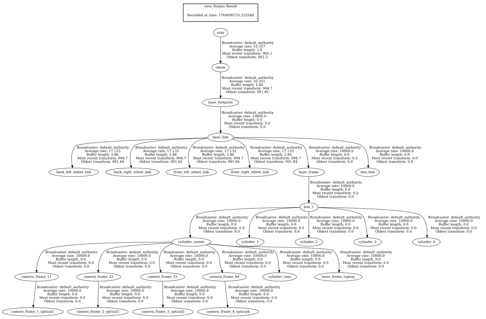
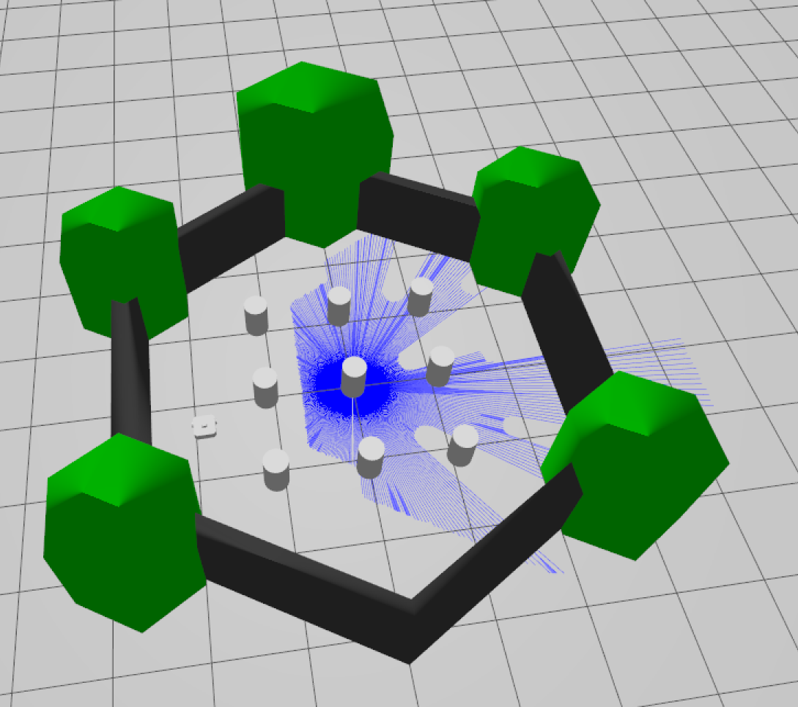
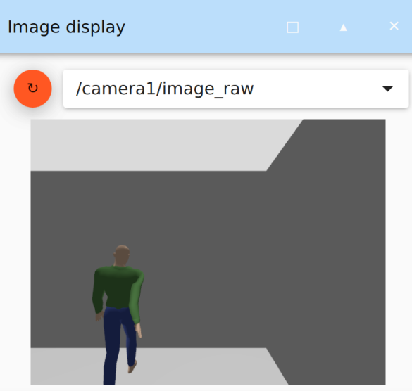

# Ergebnisse Meilenstein 01

## Frames



## Lidar-Daten



mit dem folgendem wird 1 eintrag des topics /scan angezeigt.
in unserem fall ist das eine 360Grad ansicht der Distanzen weil unsere lidars zusammengemerged sind. Das sieht man an angle_min und angle_max 

```bash
ros2 topic echo /scan --once
```

```
header:
  stamp:
    sec: 1637
    nanosec: 0
  frame_id: laser_frame
angle_min: -3.141590118408203
angle_max: 3.141590118408203
angle_increment: 0.008738775737583637
time_increment: 0.0
scan_time: 0.0
range_min: 0.20000000298023224
range_max: 30.0
ranges:
- 5.24074125289917
- 5.1849751472473145
- 5.130702972412109
- '...'
intensities:
- 0.0
- 0.0
- 0.0
- '...'
```

---

## Kamera-Daten



```bash
ros2 topic echo /camera1/color/image_raw --once`
```

```
header:
  stamp:
    sec: 318
    nanosec: 800000000
  frame_id: dingo/base_footprint/camera1
height: 480
width: 640
encoding: rgb8
is_bigendian: 0
step: 1920
data:
- 218
- 218
- 218
- '...'
```
