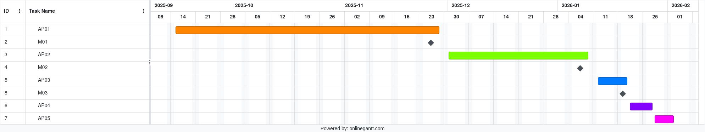

# Gebäudeplan

**Auftraggeber:** IMVS

**Projektleiter:** Janik Henz

**Betreuer:** Christoph Stamm, Anri Wild

---

## Ausgangslage

Das Institut für Mobile und Verteilte Systeme (IMVS) entwickelt im Rahmen eines Forschungsprojekts mobile Roboter, um das Pflegepersonal in Alters- und Pflegeheimen zu unterstützen. Als Plattform dient der mobile Roboter Dingo-O, der künftig Bewohner zu ihren Therapieterminen begleiten soll.

Bevor diese autonome Begleitfunktion realisiert werden kann, muss der Roboter zunächst in der Lage sein, Gebäudepläne zu erstellen. Dazu wird der Dingo manuell mittels Joysticks durch das Gebäude gesteuert, während seine Sensoren die Umgebung erfassen und Raumpläne automatisch generieren.

Am Dingo-O sind bereits folgende Sensoren und Geräte verbaut:

- Lidar (4× 180 Grad, 2 unten, 2 oben)
- Ultraschall
- Kamera
- Mikrofon
- Lautsprecher
- Bildschirm

Die Ansteuerung des Dingo-O erfolgt bereits über einen PS4-Controller. Die Kommunikation geschieht über den am Dingo verbauten Raspberry Pi.
Es wurde bereits gezeigt, dass der Dingo-O mithilfe des Lidars und der SLAM-Library eine Kartierung durchführen kann.

Beim Aufstarten des Dingo-O muss seine Position manuell bestimmt werden.

---

## Problemstellung

Die bisher erstellte Kartierung weist jedoch (durch Fenster und Spiegelungen) einige Unregelmässigkeiten auf, welche die Karte unvollständig bzw. unzuverlässig machen.
Um aus einer Karte einen Gebäudeplan zu erstellen, muss diese ausserdem mit relevanten Informationen ergänzt werden – beispielsweise mit Zimmernummern und Zimmeransichten.

---

## Ziel

Ziel dieser Arbeit ist die Entwicklung eines Verfahrens zur Erstellung von Gebäudeplänen, die die Geometrie, **alle Raumnummern** und **ein digitales Abbild** der einzelnen Räume enthalten.
Das Verfahren muss so gestaltet sein, dass **ungeschultes Personal** einen Gebäudeplan mithilfe von Anweisungen des Dingo-O fehlerfrei erstellen kann.

Das Ziel ist erreicht, wenn das Verfahren nachweislich von ungeschulten Personen erfolgreich angewendet wurde und die erstellten Pläne alle definierten Bestandteile enthalten – bis zum Ende der Projektschiene IP5 (06.02.2026).

---

## Technologien

| Komponente             | Beschreibung                      |
| ---------------------- | --------------------------------- |
| **Programmiersprache** | C++                               |
| **Framework**          | ROS (Robot Operating System)      |
| **Plattform**          | Dingo-O (mobile Roboterplattform) |

---

## 6. Liefergegenstände (Deliverables)

| Kategorie          | Liefergegenstand                                                                                            |
| :----------------- | :---------------------------------------------------------------------------------------------------------- |
| **Software**       | Lauffähiger **ROS 2 Workspace** (C++) mit allen entwickelten Nodes (Filter, Feedback, Annotierung).         |
|                    | **Finale Launch-Dateien** zur automatischen Systeminitialisierung auf dem Dingo-O.                          |
| **Funktionalität** | Strukturierte **YAML-Datei** mit allen gesammelten **semantischen Metadaten** (Pose, Raumnummer, Bildpfad). |
|                    | **Erfasste digitale Raumbilder** (Snapshots).                                                               |
| **Dokumentation**  | **Technischer Projektbericht** (Konzeption, Architektur, Implementierung).                                  |
|                    | **Testbericht** mit Nachweis der erfolgreichen Anwendung durch **ungeschultes Personal**.                   |

## Meilensteine

| Meilenstein | Termin     | Beschreibung                                                                                                                                                                                                                                                                       |
| ----------- | ---------- | ---------------------------------------------------------------------------------------------------------------------------------------------------------------------------------------------------------------------------------------------------------------------------------- |
| **M01**     | 26.11.2025 | System-Basis und Baseline-Karte erstellt. Das ROS 2-System ist eingerichtet, die Kommunikation zum Dingo-O ist vollständig validiert, und ein erster SLAM-Kartierungslauf (Baseline-Karte) unter Verwendung der rohen Lidar-Daten wurde erfolgreich durchgeführt und dokumentiert. |
| **M02**     | 07.01.2026 | Erste Lidar-Datenfusion implementiert. Die C++-Logik zur Fusion der 4 Lidar-Scans zu einer einzigen, dichten PointCloud2 unter Nutzung der Point Cloud Library (PCL) ist erfolgreich implementiert und liefert eine zusammengeführte Punktwolke.                                   |
| **M03**     | 19.01.2026 | Visuelle Rückmeldefunktion implementiert. Das Feedbacksystem zur Überwachung der Fahrparameter ist funktionsfähig, und die visuelle Display-Ausgabe für kritische Rückmeldungen wurde erfolgreich implementiert und getestet.                                                      |

---

## Arbeitspakete

### AP01: System-Basis und Baseline (Einarbeitung)

**Geschätzter Aufwand:** 32h

| Nr.     | Aufgabe                        | Beschreibung                                                                                                                                                                                                                             |
| :------ | :----------------------------- | :--------------------------------------------------------------------------------------------------------------------------------------------------------------------------------------------------------------------------------------- |
| **1.1** | **Setup & Konfiguration**      | Installation von **ROS 2 Jazzy** (Robot Operating System 2) in einem **Docker Dev Container**. Konfiguration von **VS Code**. Initialisierung des **Git-Repositories** und erfolgreiche Erstkompilierung.                                |
| **1.2** | **Kommunikation aufbauen**     | Aufsetzen des ROS-Workspaces und Erstellung des **C++-Pakets**. Implementierung der Schnittstelle zum Dingo-O. **Validierung des Datenflusses** aller Sensoren (4x Lidar, Ultraschall, Kamera, Mikrofon) über die jeweiligen ROS-Topics. |
| **1.3** | **Erster Testlauf (Baseline)** | Durchführung eines **SLAM-Kartierungslaufs** unter Verwendung der **rohen** Lidar-Daten. **Logging** aller relevanten Topics.                                                                                                            |
| **1.4** | **Auswertung & Dokumentation** | Dokumentation der erstellten **Baseline-Kartierungsdaten** und Visualisierung der **bekannten Probleme** (Reflexionen/Lücken) zur Festlegung der Korrekturziele.                                                                         |

### AP02: SLAM-Frontend-Entwicklung (Robuste Geometrie)

**Geschätzter Aufwand:** 50h

| Nr.     | Aufgabe                       | Beschreibung                                                                                                                                                                                        |
| :------ | :---------------------------- | :-------------------------------------------------------------------------------------------------------------------------------------------------------------------------------------------------- |
| **2.1** | **Sensortest & Evaluation**   | Empirische Bestimmung der optimalen Lidar-Nutzung und strategische Festlegung der Rolle jedes Sensors (Oben/Unten/Ultraschall).                                                                     |
| **2.2** | **Fusion der Daten**          | Implementierung der C++-Logik zur **Fusion der 4 Lidar-Scans** zu einer einzigen, dichten **PointCloud2** unter Nutzung der **Point Cloud Library (PCL)**.                                          |
| **2.3** | **Fehlervermeidung**          | Implementierung des **Ultraschall-Korrelations-Filters** (C++-Logik): **1.** Löschen von Lidar-Punkten, die Reflexionen sind. **2.** Einfügen virtueller Punkte, um Lücken (Fenster) zu schliessen. |
| **2.4** | **Konvertierung & Vergleich** | Konvertierung der **gefilterten** Point-Cloud-Daten zurück in ein Topic. Durchführung eines erneuten SLAM-Laufs und **Validierung der neuen Karte** im Vergleich zur Baseline-Karte.                |

### AP03: Benutzerführung und Feedbacksystem (Rückmeldungssystem)

**Geschätzter Aufwand:** 40h

| Nr.     | Aufgabe                     | Beschreibung                                                                                                                                                          |
| :------ | :-------------------------- | :-------------------------------------------------------------------------------------------------------------------------------------------------------------------- |
| **3.1** | **Dokumentation**           | Empirische Definition und Dokumentation des **Best-Practice-Kartierungsvorgangs** (Geschwindigkeit, Stopp-Punkte, Abstand zur Wand, Vorgang).                         |
| **3.2** | **Feedbacksystem**          | Implementierung der C++-Logik: Überwachung der aktuellen Fahrparameter (Geschwindigkeit, Stopp-Punkte, Abstand zur Wand, Vorgang) und Auslösung des Rückmeldesystems. |
| **3.3** | **Audio-/Displayausgabe**   | Implementierung der **visuellen Display-Ausgabe** für kritische Rückmeldungen.                                                                                        |
| **3.4** | **Testläufe & Validierung** | Systematische Testläufe mit der fusionierten Karte und dem **aktiven Feedbacksystem**. Objektive Prüfung der Kartierungsqualität unter Nutzung des Systems.           |

### AP04: Semantische Annotierung und Persistenz

**Geschätzter Aufwand:** 40h

| Nr.     | Aufgabe                       | Beschreibung                                                                                                                                              |
| :------ | :---------------------------- | :-------------------------------------------------------------------------------------------------------------------------------------------------------- |
| **4.1** | **Bildaufnahme**              | Implementierung des C++-Nodes: **Speichern der aktuellen Roboter-Position** und Auslösen der **Kamera** für einen Snapshot beim **manuellen Knopfdruck**. |
| **4.2** | **Annotationserwartung**      | Implementierung des **Annotations-Trigger** (C++) , der auf den **manuellen Knopfdruck** reagiert und den Annotationsmodus startet.                       |
| **4.3** | **Raumnummern**               | Implementierung des geführten Dialogs zur **Erfassung der Raumnummer** und Verknüpfung dieser Information mit der gespeicherten Pose und dem Bildpfad.    |
| **4.4** | **Sprachschnittstelle (ASR)** | Implementierung der **ASR (Automatic Speech Recognition)** oder eines vereinfachten Eingabeverfahrens zur Verarbeitung der Raumnummer-Eingabe.            |
| **4.5** | **ROS-Integration**           | Entwicklung des **Persistenz-Nodes (C++)** zur Speicherung aller Metadaten (Pose, Raumnummer, Bild-URL) in einer **strukturierten YAML-Datei**.           |
| **4.6** | **Tests**                     | End-to-End-Test des gesamten **Annotations-Workflows** (Knopfdruck bis Speicherung der Daten in der YAML-Datei).                                          |

### AP05: Systemvalidierung und Abschluss (Benutzertest & Doku)

**Geschätzter Aufwand:** 32h

| Nr.     | Aufgabe                          | Beschreibung                                                                                                                                                |
| :------ | :------------------------------- | :---------------------------------------------------------------------------------------------------------------------------------------------------------- |
| **5.1** | **Integration**                  | Zusammenführung aller ROS-Nodes (Filter, SLAM, Feedback, Annotierung). Erstellung der **finalen Launch-Dateien** zur automatischen Systeminitialisierung.   |
| **5.2** | **Testdurchführung**             | Erstellung eines **Testplans**. Durchführung der **Benutzertests** mit ungeschulten Personen und strukturierte Erfassung des Feedbacks und der Fehler.      |
| **5.3** | **Dokumentation & Codequalität** | Erstellung der technischen Dokumentation (Konzept, Architektur, Implementierungsdetails). Sicherstellung der **Codequalität** (Kommentierung, Refactoring). |

---

---

## Risiken

**Siehe Risikoliste (Risikoliste.pdf)**

